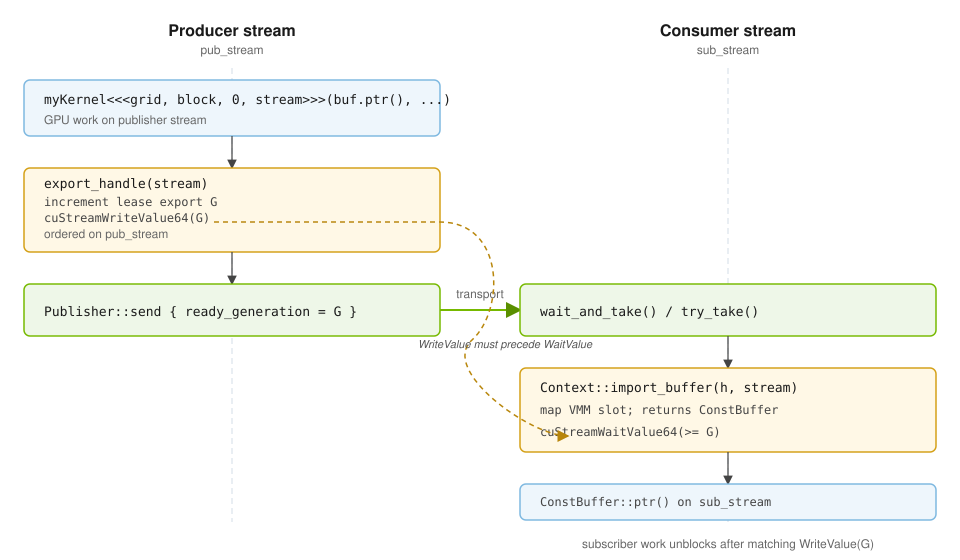

<!-- markdownlint-disable MD025 -->

<!-- _class: lead -->

# holomq Buffer Synchronization Deep Dive

**Companion to [`holomq-high-level-design.md`](holomq-high-level-design.md)** — API, layouts, pub/sub, and E2E flows live there.

This deck covers **why** cross-process GPU buffer pub/sub needs more than ref-counts, and **how** generation fences and stream-associated deferral work.

CUDA VMM device pools · stream memops · `examples/holomq_main`

---

## The problem

A publisher fills a **BufferPool** slot and sends a **`BufferHandle`** in the message payload. Subscribers import and run GPU work on the same physical memory.

Subscribers must not read until the publisher's kernels finish — but:

- SHM **ref-counts** track **leases**, not in-flight GPU work
- Each process uses its own **CUDA streams**
- **Slot reuse** can recycle memory while GPU work is still running

holomq groups cross-process fixes by race (see HLD Part 2 — **Cross-process races**). This deck focuses on fence and deferral details.

---

## Generation sync (core idea)

Each **`Buffer::export_handle(stream)`** increments a per-lease export counter, enqueues **`WriteValue(G)`** at the slot generation word on the publisher stream, and pins **G** in **`BufferHandle::ready_generation`**.



**Pinned G in the handle** — subscribers wait for the generation in the **message**, not the latest word in pool memory. Safe when the slot is reused while a slow subscriber still holds an old import.

The GPU generation word lives in **pool slot memory** (interleaved before payload for device pools; separate sync region for split host pools), not in the ref-count SHM segment.

---

## Signal-before-wait (required ordering)

CUDA stream memory ops are **not** scheduler-visible like CUDA events. You cannot enqueue **`WaitValue`** early and expect a future producer to satisfy it.

**Safe pattern (what holomq does):**

```text
1. Producer submits WriteValue(G)     (Buffer::export_handle on stream)
2. Producer sends Payload + handle    (Publisher::send; ready_generation = G)
3. Subscriber receives handle         (`Subscriber::try_take()` / `wait_and_take()`)
4. Subscriber submits WaitValue(≥ G)  (`Context::import_buffer` → `ConstBuffer`)
```

**Advanced:** `import_buffer_unsynchronized` then `ConstBuffer::enqueue_ready_wait(stream)` — same signal-before-wait rule applies.

**Unsafe:** enqueue `WaitValue` before the producer has submitted the matching `WriteValue`.

Import is lazy-cached per pool identity. The wait is enqueued **only after** the handle is received — never speculatively before the producer signals.

---

## Ref-count vs GPU idle (deferral)

SHM ref-count **0** means "no live leases" — **not** "GPU is idle".

```text
  Without stream-associated defer (unsafe):
    ~Buffer  →  ref_count 0  →  acquire() may return same slot
    while myKernel still runs on stream  →  use-after-free on GPU

  With export_handle / import_buffer defer (current, when ready_generation > 0):
    ~Buffer / ~ConstBuffer enqueues cuLaunchHostFunc(release_ref) on bound stream
    until stream completes  →  pool reuse deferred
```

Combine with **`Publisher::send(..., on_released)`** so the owner **`Buffer`** survives until the transport releases the sample (transport deferral — separate from the GPU gate).

When ref-count reaches **0** and all deferred drops completed, **`acquire()`** may safely reuse the slot.

---

## What is in the handle?

**`BufferHandle`** (embedded in `Payload`) is **opaque** to applications — library paths only (`export_handle`, payload copy, `import_buffer`, relay).

Device-pool descriptor fields (wire layout; do not read in app code):

| Field | Role |
|-------|------|
| `pool_cookie`, `pool_total_bytes`, `slot_stride_bytes`, `buffer_bytes` | VMM pool geometry + fd-pass import |
| `owner_pid`, `shm_ref_count_id` | POSIX SHM ref-count segment identity |
| `fd_pass_socket_path` | CUDA VMM fd-pass endpoint |
| `slot_index` | Which pool slot (on `BufferHandle`) |
| **`ready_generation`** | **Pinned fence G** (`0` = no cross-process GPU wait at import) |

Host pools use a separate wire layout (`BufferMemoryType::HostPageable` or `BufferMemoryType::HostPinned`). See HLD **`BufferHandle`** and memory-layout slides.

---

## Scope and constraints

**In scope (current design):**

- Same GPU: publisher and all subscribers on **one GPU** (e.g. GPU0)
- One writer (publisher), many readers (subscribers)
- NVIDIA driver **555+** for VMM + stream memops (`cuStreamWriteValue64_v2` / `cuStreamWaitValue64_v2`)
- Wait address is **local** to the waiting GPU (cross-process import on same GPU is local, not NVLink peer)

**Out of scope:**

- Cross-GPU / NVLink peer wait on imported memory
- Multi-subscriber **concurrent writes** to the same buffer (needs extra protocol)
- Producer crash after publish but before GPU reaches `WriteValue` (control-plane liveness)

See [`design-notes/vmm-stream-memops-safety.md`](../design-notes/vmm-stream-memops-safety.md).

---

<!-- _class: lead -->

## Further reading

- [`PUBLIC_API.md`](../PUBLIC_API.md) — GPU readiness and buffer pool sections
- [`holomq-high-level-design.md`](holomq-high-level-design.md) — full public API tour
- [`design-notes/README.md`](../design-notes/README.md) — contributor design notes index
- [`design-notes/buffer-pool-slot-generation-sync.md`](../design-notes/buffer-pool-slot-generation-sync.md)
- [`design-notes/buffer-gpu-completion-before-pool-reuse.md`](../design-notes/buffer-gpu-completion-before-pool-reuse.md)
- [`design-notes/ref-count-model.md`](../design-notes/ref-count-model.md)

**Render these slides:** see `README.md` in this directory (Marp CLI / VS Code).
