<!--
paginate: true
header: 'holomq — public API design'
footer: 'NVIDIA holomq'
style: |
  section { font-size: 26px; line-height: 1.28; padding: 32px 44px 24px; align-content: start; }
  section:not(.lead) { padding-top: 60px; }
  section.lead { align-content: center; }
  section.lead h1 { font-size: 2.2em; }
  section.lead p { font-size: 1.1em; }
  section h2 { margin: 0 0 0.3em; font-size: 1.35em; }
  section h3 { margin: 0.25em 0 0.12em; font-size: 1.02em; }
  section p { margin: 0.15em 0; }
  section ul, section ol { margin: 0.12em 0; padding-left: 1.05em; }
  section li { margin: 0.06em 0; }
  pre { font-size: 0.56em; line-height: 1.2; margin: 0.2em 0; }
  code { font-size: 0.85em; }
  table { font-size: 0.7em; margin: 0.15em 0; line-height: 1.2; }
  table th, table td { padding: 0.12em 0.35em; }
  img { display: block; margin: 0.15em auto 0; max-width: 94%; height: auto; max-height: 38vh; }
  section.compact { font-size: 22px; }
  section.compact h2 { font-size: 1.22em; margin-bottom: 0.2em; }
  section.compact h3 { font-size: 0.95em; }
  section.compact pre { font-size: 0.48em; }
  section.compact table { font-size: 0.64em; }
  section.compact img { max-height: 28vh; }
  section.figure img { max-height: 48vh; }
  section.figure h2 { margin-bottom: 0.12em; }
  section.figure p, section.figure li { font-size: 0.92em; margin: 0.08em 0; }
  section.figure-code img { max-height: 38vh; max-width: 98%; }
  section.figure-code pre { font-size: 0.42em; margin-top: 0.08em; }
  section.figure-code-cols .cols { display: flex; gap: 1em; align-items: center; margin-top: 0.15em; }
  section.figure-code-cols .col-diagram { flex: 1.05; display: flex; align-items: center; justify-content: center; min-width: 0; }
  section.figure-code-cols .col-code { flex: 0.95; display: flex; align-items: center; justify-content: center; min-width: 0; }
  section.figure-code-cols .col-diagram img { max-height: 64vh; width: 100%; max-width: 100%; margin: 0; object-fit: contain; }
  section.figure-code-cols .col-code pre { font-size: 0.44em; margin: 0; width: 100%; }
-->

<!-- markdownlint-disable MD025 -->

<!-- _class: lead -->

# holomq — public API design

End-to-end preview, then bottom-up tour of the application-facing C++ API

---

<!-- _class: lead -->

## Introduction

**Sharing CUDA memory across processes** — one publisher writes GPU frames, subscribers read them in another process. The next two slides preview the full per-frame loop; **Parts 1–8** then build up each piece bottom-up.

---

<!-- _class: compact -->

## End-to-end — payload & publisher setup

```cpp
struct FramePayload {
    std::uint64_t sequence{};
    std::uint32_t width{};
    std::uint32_t height{};
    BufferHandle buffer_handle{};  // shareable reference to the frame's GPU memory
};
static_assert(std::is_standard_layout_v<FramePayload>);
static_assert(std::is_trivially_copyable_v<FramePayload>);

// === Publisher process ===

#include <holomq/limits.hpp>

// Per-process runtime (one Context per process; default with_vmm_fd_export(true) for publishers)
// Quick start uses .value() after create/loan/acquire; production code should check has_value().
auto context = ContextBuilder().create().value();

// One subscriber with current defaults: 8 producer loans + 8 unread + 8 borrowed.
constexpr std::uint32_t kExternalBufferSlots =
    holomq::k_max_in_flight + 2U * holomq::k_subscriber_queue_depth;
auto pool = context.create_device_buffer_pool(slot_size, kExternalBufferSlots).value();

// Publisher port on service "camera"
auto publisher = context.publisher_builder("camera")
    .payload_type<FramePayload>()
    .create()
    .value();

// CUDA stream for GPU work and synchronization
CUstream stream{};
cuStreamCreate(&stream, CU_STREAM_DEFAULT);

// Per frame:
auto msg = publisher.loan().value();       // borrow a transport slot for this frame
auto buf = pool.acquire().value();         // grab a GPU buffer from the pool

fill_frame_kernel<<<dim3(1), dim3(256), 0, stream>>>(
    static_cast<std::uint8_t*>(buf.ptr()), slot_size);  // your __global__ kernel

// Attach the GPU buffer to the message and publish
auto exported_or = buf.export_handle(stream);
if (exported_or.has_value()) {
    msg.payload().buffer_handle = exported_or.value();
    publisher.send(std::move(msg), [buf = std::move(buf)]() {});
}

// buf stays alive until the message clears the transport *and* stream work finishes
```

---

<!-- _class: compact -->

## End-to-end — subscriber setup

```cpp
// FramePayload — same as publisher

// === Subscriber process ===

// Per-process runtime — no local FD-pass server when only importing handles
auto context = ContextBuilder().with_vmm_fd_export(false).create().value();

// Subscriber port on service "camera" (same service name as publisher)
auto camera_sub = context.subscriber_builder("camera")
    .payload_type<FramePayload>()
    .create()
    .value();

// CUDA stream for GPU work and synchronization
CUstream stream{};
cuStreamCreate(&stream, CU_STREAM_DEFAULT);

// Default WaitStrategy is TimedWait (~1 ms); KernelWait blocks until a sample arrives
#include <holomq/wait_strategy.hpp>
camera_sub.set_wait_strategy(WaitStrategy{.mode = WaitMode::KernelWait});

// Per frame:
auto msg_or = camera_sub.wait_and_take();
if (!msg_or.has_value()) { /* kTimeout, transport error, etc. */ continue; }
const auto& msg = msg_or.value();

// Import shared GPU memory; enqueues a wait so kernels below run after the publisher's work is visible
if (auto buf_or = context.import_buffer(msg.payload().buffer_handle, stream); buf_or.has_value()) {
    holomq::ConstBuffer buf = std::move(buf_or).value();
    process_frame_kernel<<<dim3(1), dim3(256), 0, stream>>>(
        static_cast<std::uint8_t*>(const_cast<void*>(buf.ptr())), slot_size);  // your __global__ kernel
}

// buf stays alive until stream work finishes and the import lease is released
```

---

<!-- _class: lead -->

## Outline

1. **Part 1 — Pools** — `BufferPool`, three pool kinds
2. **Part 2 — Cross-process sync & memory segments** — races, ref-count, generation, segment layout
3. **Part 3 — `Buffer` & cross-process mechanics** — `Buffer`, `export_handle`, GPU deferral, `BufferHandle`
4. **Part 4 — Publisher and OutboundMessage** — `Publisher`, `on_released`, `OutboundMessage`, publisher flow
5. **Part 5 — Subscriber and InboundMessage** — `Subscriber`, `InboundMessage`, `import_buffer`, VMM mapping, `ConstBuffer`, relay, GPU generation ordering
6. **Part 6 — WaitSet and WaitStrategy** — blocking, multi-service dispatch, `enable_event_wake`
7. **Part 7 — `Context`** — per-process runtime, `ContextBuilder`, pools, import, ports, publisher/subscriber builders
8. **Part 8 — Extensions, observability & build configuration** — custom allocators, logging, CMake options

---

<!-- _class: lead -->

## Part 1 — Pools

---

<!-- _class: compact -->

## `BufferPool`

Pools are **external** to the transport — sized and owned by the application process.

```cpp
#include <holomq/buffer_pool.hpp>
```

| Method | Returns | Description |
|--------|---------|-------------|
| `memory_type()` | `BufferMemoryType` | `Device`, `HostPageable`, or `HostPinned` |
| `cuda_device_ordinal()` | `std::optional<int32_t>` | CUDA device ordinal when `memory_type()` is `Device` |
| `buffer_bytes()` | `std::size_t` | User payload bytes per slot |
| `buffer_count()` | `std::uint32_t` | Number of fixed slots |
| `explicit operator bool()` | `bool` | Valid pool handle |
| `acquire()` | `expected<Buffer, Error>` | Next available slot; `kBackpressured` if pool exhausted |

<br>

**Create via `Context`** (`#include <holomq/context.hpp>`) — **`Context`** in **Part 7**:

| Factory | Returns | Pool kind |
|---------|---------|-----------|
| `create_device_buffer_pool(bytes, count[, allocator])` | `expected<BufferPool, Error>` | Device |
| `create_host_buffer_pool(bytes, count[, allocator])` | `expected<BufferPool, Error>` | Pageable host |
| `create_host_pinned_buffer_pool(bytes, count, cuda_host_register_flags[, allocator])` | `expected<BufferPool, Error>` | Pinned host |

<br>

**`Buffer` lease type — Part 3.** Size **`buffer_count`** for producer loans plus distinct
history, unread, and borrowed retention; **`holomq::k_max_in_flight`** covers only the default
producer-loan term. **Move-only.**

---

<!-- _class: figure -->

## Three pool kinds

**`BufferPool` and `Buffer` are envelope types** — one public API each; three factory-backed pool kinds share `BufferPool`, and `memory_type()` reports **Device**, **HostPageable**, or **HostPinned**. **`Buffer`** — **Part 3**.

<br>

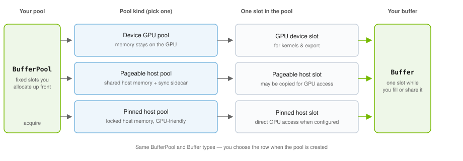

---

<!-- _class: lead -->

## Part 2 — Cross-process sync & memory segments

---

<!-- _class: compact -->

## Cross-process races

Passing a **buffer reference** between processes is not enough
**GPU work finishes later**, **pool slots get reused**, and **messages arrive faster than GPU work**.

<br>

| ID | What can go wrong |
|----|-------------------|
| **R1** | Publisher **hands out the same pool slot again** while **its own GPU** is still working on that slot |
| **R2** | A pool slot is **given out** while the **publisher or a subscriber still needs it** |
| **R3** | Publisher **gives up the buffer** while the **message is still in the pub/sub pipeline** |
| **R4** | Subscriber **runs GPU on the buffer** before the **publisher's GPU work on that buffer** has finished |
| **R5** | Publisher **reuses a pool slot** while the **subscriber's GPU** is still working on it |

---

<!-- _class: figure -->

## Ref-count SHM segment

**All pool kinds** — one POSIX SHM segment per `BufferPool`, separate from payload and generation memory. Shared by the publisher and all importing subscribers.

<br>

- **Header** — `owner_pid`, `shm_ref_count_id`, `buffer_count` (segment identity)
- **Per slot** — one `atomic<uint32_t> ref_count` only; **no payload bytes, no generation word**

<br>

**Purpose:** cross-process **slot lease** counter — addresses **R1**, **R2**, **R3**, **R5** (see next slide).

<br>

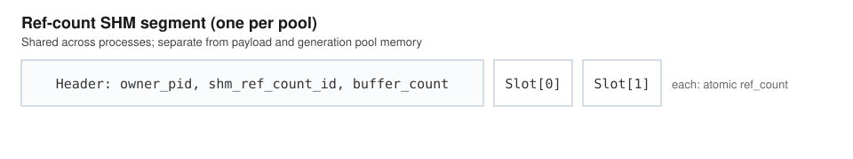

---

<!-- _class: compact -->

## Ref-count sync

<br>

The pool must not hand out a slot while the **publisher**, a **subscriber**, the **transport**, or a **GPU stream** still depends on it.

<br>

1. **Publisher hold** (**R1**, **R2**) — increment while the publisher buffer is active; release when hold ends (may wait until a bound **CUDA stream** finishes — GPU can outlive the app object).
2. **Subscriber hold** (**R2**, **R5**) — increment on import; release when hold ends (may defer on stream).
3. **Transport hold** (**R3**) — keep the lease while the **message is still in the pub/sub pipeline**.

<br>

- When ref-count reaches **0** and deferred releases complete, the publisher may reuse the slot.

---

<!-- _class: compact -->

## CUDA generation (GPU-ready fence)

**Problem:** **R4** — the subscriber must not run **GPU work** on shared memory until the **publisher's GPU work** on that export is visible cross-process. Ref-count alone does not track GPU completion.

<br>

**Mechanism:** a **generation word** per pool slot in **CUDA-accessible memory** — publisher and subscriber **streams** must be able to read/write it (stream memory ops).

- **Publisher** — after GPU work on a stream, record readiness at that slot's generation word; the **buffer reference in the message** records **which** export to wait for.
- **Subscriber** — before GPU use, wait on that stream until the publisher's export is visible.

<br>

**Analogy:** like a **timeline semaphore** per slot — monotonic **G** per export; subscriber waits **≥ G** on a stream (CUDA stream memory ops, not `cudaEvent`).

<br>

<hr style="margin: 0.5em 0; opacity: 0.35;" />

Ref-count and generation solve **different** problems: **who may reuse the slot** vs **when GPU bytes are safe to use**.

---

<!-- _class: compact -->

## Payload and generation segment(s)

<!-- verified: slot_region.hpp, shm_ref_count.hpp -->

The **generation word must live in CUDA-accessible memory**.
Sync is **enqueued on CUDA streams** — not CPU-side — via [stream memory ops](https://docs.nvidia.com/cuda/cuda-driver-api/group__CUDA__MEMOP.html):

<br>

- **Publisher** — **`cuStreamWriteValue64`** enqueued on its **CUDA stream**
- **Subscriber** — **`cuStreamWaitValue64`** (≥ G) enqueued on its **CUDA stream**

---

<!-- _class: figure -->

## CUDA stream memory ops

Publisher **`WriteValue(G)`** and subscriber **`WaitValue(≥ G)`** are enqueued on their respective **CUDA streams** — stream commands, not CPU-side polling. Pub/sub ordering of these ops is covered in **Part 5**.

<br>

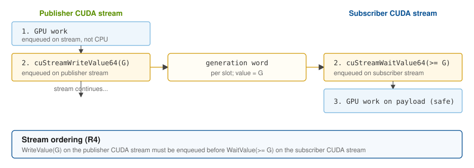

---

<!-- _class: compact -->

## Interleaved vs split segments

<br>

| Segment | When | Pool kinds |
|--------|------|------------|
| **Interleaved slot** | **Payload is also in CUDA memory** — generation and payload share one GPU-visible mapping | Device; pinned host with `CU_MEMHOSTREGISTER_DEVICEMAP` |
| **Split slot** | **Payload is not in CUDA memory** — separate **payload buffer** and **generation buffer** (same slot index) | Pageable host; pinned host without `DEVICEMAP` |

<br>

**Why two layouts:** the generation word must be **CUDA-accessible** for stream memory ops — but **user payload** is not always in GPU-visible memory (pageable host SHM, or pinned host without `DEVICEMAP`).

- **Interleaved** — when payload *can* share a GPU-visible mapping: colocate **generation word and payload** per slot so **`WaitValue` → payload access** on one stream stays **local** (fewer mappings, better ordering on the hot path).
- **Split** — when payload cannot be device-mapped: keep **POSIX SHM payload** where it belongs and add a **separate GPU-visible generation region** keyed by the same slot index — same sync semantics, extra mapping cost.

---

<!-- _class: figure -->

## Interleaved slot segment

**When:** payload and the generation word can share one **GPU-visible** mapping.

- **Device pools** — payload lives in GPU memory
- **Pinned host** with `CU_MEMHOSTREGISTER_DEVICEMAP` — host payload registered for GPU access in the same mapping

**Per slot:** `[generation][payload][pad]` — **CUDA generation** word lives here, immediately before payload.

One slot structure (detail) and how it repeats across the full pool mapping. On import, subscriber **waits on gen, then uses payload** on the same stream — adjacent layout improves locality vs split.

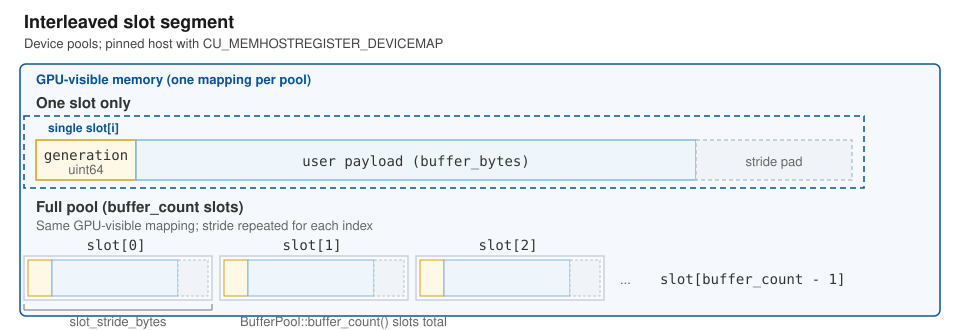

---

<!-- _class: figure -->

## Host split slot segment

**When:** user payload cannot be device-mapped alongside generation — pageable host SHM, or pinned host **without** `CU_MEMHOSTREGISTER_DEVICEMAP`.

- **Payload region** — POSIX SHM slots (`payload[i]`, `payload[i+1]`, …)
- **Generation region** — separate GPU-accessible pool (`gen[i]`, `gen[i+1]`, …) — same generation words, different mapping

**Same slot index** ties the two regions to one logical buffer; they are **not** adjacent in memory. Split is required here; interleaved layout is not available without `DEVICEMAP`.

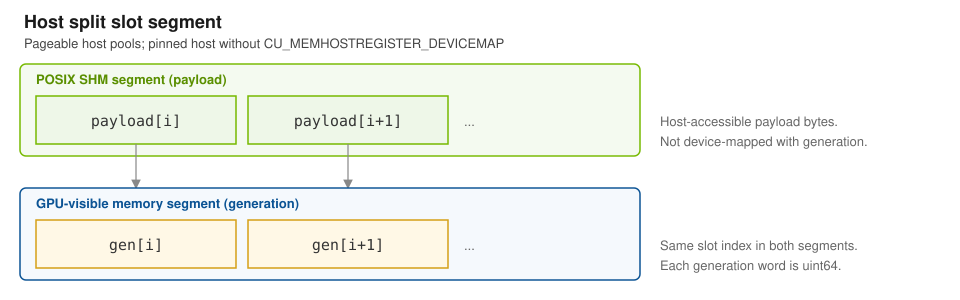

---

<!-- _class: lead -->

## Part 3 — `Buffer` & cross-process mechanics

---

<!-- _class: compact -->

## `Buffer`

Mutable **publisher-side lease** of one pool slot from `BufferPool::acquire()`.

**Envelope type:** same `Buffer` type for device and host slots; `acquire()` returns the matching lease for the pool's `memory_type()`.

- **`ConstBuffer`** — subscriber-side lease; **Part 5**

<br>

```cpp
#include <holomq/buffer.hpp>
```

| Method | Returns | Description |
|--------|---------|-------------|
| `memory_type()` | `MemoryType` | `None`, `Device`, `HostPageable`, or `HostPinned` |
| `cuda_device_ordinal()` | `std::optional<int32_t>` | CUDA device ordinal when `memory_type()` is `Device` |
| `size_bytes()` | `std::size_t` | User payload byte length |
| `explicit operator bool()` | `bool` | Valid lease |
| `ptr()` / `ptr() const` | `void*` / `const void*` | Device-accessible address (cast to `CUdeviceptr` as needed) |
| `export_handle(stream)` | `expected<BufferHandle, Error>` | Enqueue ready-generation set + defer ref release; return wire descriptor (embed in payload) |
| `export_handle_unsynchronized()` | `expected<BufferHandle, Error>` | Return wire descriptor only — no new ready-generation set or stream deferral (requires prior `enqueue_ready_set` for GPU-safe export) |
| `enqueue_ready_set(stream)` | `bool` | Enqueue ready-generation set on `stream` and defer SHM ref-count release until prior ops complete; does not block the caller; idempotent after first success |
| `~Buffer()` | | Drop owner lease; SHM ref-count release (immediate, or deferred on export stream) |

<br>

**`export_handle(stream)`** = `enqueue_ready_set(stream)` then `export_handle_unsynchronized()`.

<br>

**Move-only.**

---

## `Buffer::export_handle(stream)`

```cpp
[[nodiscard]] expected<BufferHandle, Error> export_handle(CUstream_st* stream) noexcept;
```

<br>

After all prior GPU work is enqueued on `stream` — addresses **R1** and **R4**:

1. Bump per-lease export generation and enqueue **stream write** at the slot generation word.
2. Return `BufferHandle` for cross-process handoff.
3. Arm **deferred ref-count release** when the `Buffer` is dropped — runs after `stream` completes.

Returns empty on null/invalid `stream` or enqueue failure.

---

<!-- _class: figure -->

## GPU deferral flow

Publisher **`export_handle(stream)`** (**R1**) — only the **SHM ref-count drop** waits for the bound stream; the `Buffer` lease may be destroyed earlier.

<br>

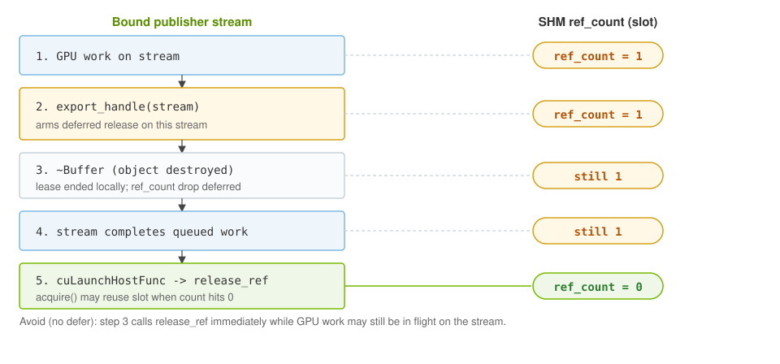

---

<!-- _class: compact -->

## `BufferHandle`

**`Buffer` stays in-process** (move-only lease).
**`BufferHandle` is the wire-safe stand-in** — `standard_layout` + `trivially_copyable`; embed in your `Payload`.

Pool/buffer code is **transport-agnostic**; pub/sub only moves your bytes.

<br>

```cpp
#include <holomq/buffer_handle.hpp>
```

<br>

### `BufferMemoryType` enum

| Value | Meaning |
|-------|---------|
| `None` | Empty handle |
| `Device` | CUDA device pool slot |
| `HostPageable` | Pageable host pool (POSIX SHM) |
| `HostPinned` | CUDA-registered host pool (POSIX SHM) |

<br>

### Methods

| Method | Returns | Description |
|--------|---------|-------------|
| `explicit operator bool()` | `bool` | Non-empty handle |
| `memory_type()` | `BufferMemoryType` | Active memory type |

<br>

**Application rule:** treat **`BufferHandle` as a copyable opaque type** — copy into payloads as needed; interact only through holomq API calls, not by constructing from wire fields or reading internal layout.

---

<!-- _class: lead -->

## Part 4 — Publisher and OutboundMessage

---

<!-- _class: compact -->

## `Publisher<Payload>`

```cpp
#include <holomq/publisher.hpp>
```

<br>

| Method | Returns | Description |
|--------|---------|-------------|
| `update_connections()` | `expected<void, Error>` | Refresh connection state and preserve failures |
| `has_subscribers()` | `bool` | Subscribers in the last successfully refreshed state |
| `number_of_subscribers()` | `uint64_t` | Exact count in the last successfully refreshed state |
| `loan()` | `expected<OutboundMessage<Payload>, Error>` | Borrow outbound slot; `kBackpressured` on exhaustion |
| `send(OutboundMessage&&)` | `expected<int, Error>` | Subscriber count on success; `kIncompleteFanout` before submission when required recipients are absent |
| `send(OutboundMessage&&, Fn&& on_released)` | `expected<int, Error>` | Same count/error result; retains `on_released` until sample release, including after send errors with uncertain visibility; `kNotImplemented` when release callbacks are disabled and `kInvalidArgument` if a callback is already pending for the payload |

<br>

**`OutboundMessage` loan type — `OutboundMessage` slide below.**

GPU memory is **not** transport-managed — embed `BufferHandle` in `Payload` as needed.

---

<!-- _class: compact -->

## Publisher pressure policy

`PublisherPubSubOptions::pressure_policy` is endpoint-local; it does not change the service queue
contract.

| Policy | Full blocking-recipient behavior |
|--------|----------------------------------|
| `kFollowService` | Wait until delivered |
| `kRejectWhenFull` | Preserve the queued sample and return `kBackpressured` |
| `kBoundedRetry` | Retry for non-zero `bounded_retry_budget_ns`, then preserve and reject |

An error from either finite policy can follow delivery to another fanout recipient. It does not
prove aggregate zero delivery or authorize automatic retry.

---

<!-- _class: compact -->

## `on_released` — buffer lease through transport

**`OutboundMessage`** and **`Buffer`** have separate lifetimes. Your payload may embed a **`BufferHandle`**, but if the **`Buffer`** is destroyed too early, the pool slot is released while the **transport sample is still queued or in flight** (**R3**).

<br>

**`Publisher::send(std::move(msg), on_released)`** — capture the **`Buffer`** in the callback

- The owner lease is held until the transport **releases the sample**
- Not a GPU fence — that is **`export_handle(stream)`** deferral.

<br>

```cpp
publisher.send(std::move(msg), [buf = std::move(buf)]() {});
```

---

<!-- _class: figure -->

## Publisher ref-count lease

<!-- verified: shm_ref_count.cpp, buffer_pool.hpp -->

1. **`BufferPool::acquire()`** — owner CAS (Compare-And-Swap) ref-count **0→1** on the chosen slot (slot unavailable while leased).
2. **Publisher `Buffer` lease** — holds the owner ref-count until the `Buffer` is destroyed (or deferred release runs).
3. **Ref-count SHM** — shared POSIX segment keyed by `owner_pid` + `shm_ref_count_id` embedded in the handle (opaque).

Slot unavailable for **`acquire()`** while **ref_count** is non-zero — each lease increments it; release decrements.

<br>

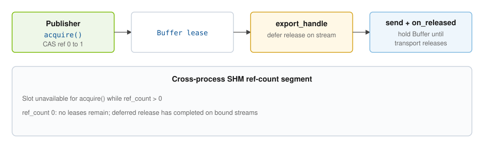

---

<!-- _class: compact -->

## `OutboundMessage<Payload>`

Move-only **loan** to one slot in the transport's pre-allocated SHM sample pool — not an app-allocated message.

**Transport abstraction** — public wrapper over the transport's internal outbound loan; apps never touch the backend sample type directly.

<br>

```cpp
#include <holomq/outbound_message.hpp>
```

<br>

| Method | Returns | Description |
|--------|---------|-------------|
| `payload()` | `Payload&` | Fill in place before `Publisher::send` |
| `payload() const` | `const Payload&` | Read-only view |

<br>

- Obtain only from **`Publisher::loan()`** — no public constructor.
- Pass to **`Publisher::send(std::move(msg))`**.
- Failed **`loan()`** → **`ErrorCode::kBackpressured`** (not logged).
- Destroy without **`send`** → loan returned to transport (sample not published).

<br>

**Move-only.**

---

<!-- _class: figure -->

## OutboundMessage flow

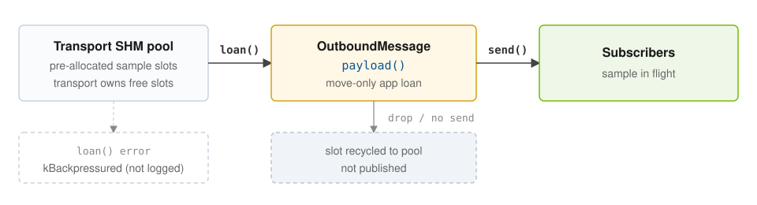

<br>

**No public constructor** — only `Publisher::loan()` hands out a slot; fill **`payload()`**, then **`Publisher::send(std::move(msg))`**.

---

<!-- _class: figure-code-cols -->

## End-to-end — publisher per frame

<div class="cols">
<div class="col-diagram">

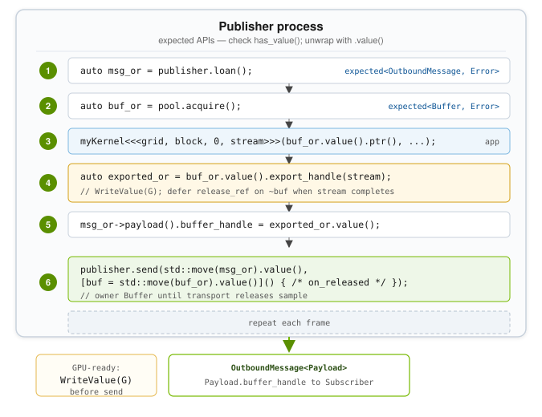

</div>
<div class="col-code">

```cpp
auto msg_or = publisher->loan();
auto buf_or = pool->acquire();
if (!msg_or.has_value() || !buf_or.has_value()) { /* kBackpressured */ return; }
auto msg = std::move(msg_or).value();
auto buf = std::move(buf_or).value();
// GPU work on buf.ptr() on stream ...
auto exported_or = buf.export_handle(stream);
if (!exported_or.has_value()) { return; }
msg.payload().buffer_handle = exported_or.value();
publisher->send(std::move(msg), [buf = std::move(buf)]() {});
// Slot returns to pool only after stream work (export_handle deferral)
// and after transport releases the sample (on_released).
```

</div>
</div>

---

<!-- _class: lead -->

## Part 5 — Subscriber and InboundMessage

---

<!-- _class: compact -->

## `Subscriber<Payload>`

<br>

```cpp
#include <holomq/subscriber.hpp>
```

<br>

| Method | Returns | Description |
|--------|---------|-------------|
| `has_samples()` | `expected<bool, Error>` | Poll helper that preserves connection failures |
| `set_wait_strategy(WaitStrategy)` | `void` | Default for `wait_and_take()` |
| `try_take()` | `expected<InboundMessage<Payload>, Error>` | Non-blocking; preserves empty-queue, backpressure, connection, and stale-endpoint errors |
| `wait_and_take()` | `expected<InboundMessage<Payload>, Error>` | Wait with port default `WaitStrategy`; `kTimeout` on timeout (**not logged**) or error (**logged**); retries on spurious kernel wake |
| `wait_and_take(WaitStrategy)` | `expected<InboundMessage<Payload>, Error>` | Same with explicit strategy; default `TimedWait` times out quickly — use `KernelWait` to block for samples |

- **`WaitStrategy`** / **`WaitMode`** — covered in **Part 6** (`WaitSet` and `WaitStrategy`).

- GPU memory is **not** transport-managed — read **`BufferHandle`** from `payload()` and import via **`Context`** (Part 7).

---

<!-- _class: compact -->

## `InboundMessage<Payload>`

Move-only **hold** on one sample from the transport's subscriber queue — not an app-allocated message.

**Transport abstraction** — public wrapper over the transport's internal inbound sample; apps never touch the backend type directly.

<br>

```cpp
#include <holomq/inbound_message.hpp>
```

<br>

| Method | Returns | Description |
|--------|---------|-------------|
| `payload() const` | `const Payload&` | Read-only view |

<br>

- Obtain only from **`Subscriber::try_take()`** or **`wait_and_take()`** — no public constructor.
- Does **not** increment **SHM ref-count** — only holds the transport sample; a **`BufferHandle`** in `payload()` is inert until **`import_buffer`**.
- **`try_take()`** → **`kNotReady`** when no sample is queued or a connection is not ready; **`kBackpressured`** at the borrow limit; **`kStaleEndpoint`** when publisher memory cannot be mapped.
- Destroy (or drop) → **transport sample hold released** — slot returned to the transport.

<br>

**Move-only.**

---

<!-- _class: figure -->

## InboundMessage flow

<br>

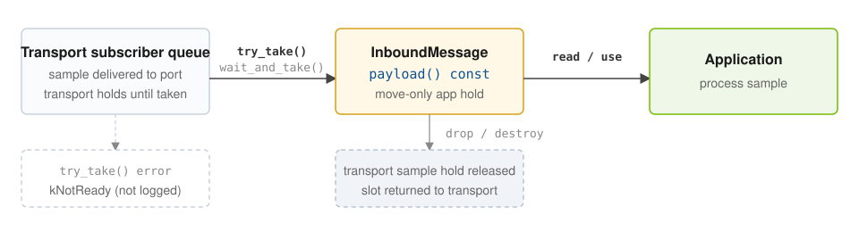

<br>

**No public constructor** — only `Subscriber::try_take()` or `wait_and_take()` hands out a sample; read **`payload() const`**, then import any embedded **`BufferHandle`**.

---

<!-- _class: compact -->

## `Context::import_buffer` — returns `ConstBuffer`

**`InboundMessage`** and **`ConstBuffer`** have separate lifetimes. The payload may carry a **`BufferHandle`**; **`import_buffer`** maps it and returns a **`ConstBuffer`** lease (**R4**, **R5**). Full **`ConstBuffer`** API follows.

**`Context`** — Part 7.

<br>

```cpp
#include <holomq/context.hpp>
```

| Method | Returns | Description |
|--------|---------|-------------|
| `Context::import_buffer(handle, stream)` | `expected<ConstBuffer, Error>` | Map handle; enqueue **`WaitValue(≥ G)`** on `stream` when export fence present; error if `stream` is null while wait required |
| `Context::import_buffer_unsynchronized(handle)` | `expected<ConstBuffer, Error>` | Map only; call **`ConstBuffer::enqueue_ready_wait`** before GPU use when fenced (see **`ConstBuffer`** slide) |

<br>

- Holds the **import ref-count lease** — not the transport sample (**`InboundMessage`**).
- GPU deferral on drop — same pattern as **`Buffer::export_handle(stream)`** (**R5**).

<br>

```cpp
auto buf_or = context.import_buffer(payload.buffer_handle, sub_stream);
if (!buf_or.has_value()) { /* handle error */ }
holomq::ConstBuffer buf = std::move(buf_or).value();
// Split path: context.import_buffer_unsynchronized(handle)
//             then buf.enqueue_ready_wait(sub_stream)
```

**Warning:** GPU use of **`ConstBuffer::ptr()`** before **`ConstBuffer::enqueue_ready_wait`** is undefined when the handle requires a cross-process GPU wait.

---

<!-- _class: compact -->

## Cross-process VMM mapping

**Device pools** use CUDA VMM allocations that are not directly shareable as pointers — a subscriber must **map** publisher memory into its own address space before use.

1. **Server address in the handle** — the pub/sub **`BufferHandle`** carries the publisher's **FD-pass server address** and a **pool id**. The underlying allocation **FD** is not sent in the message.
2. **FD request on first import** — if that pool is not yet mapped locally, the subscriber connects to the publisher's **Unix domain socket** server, requests the pool, and receives a **POSIX FD** back. HoloMQ **maps** the allocation into the subscriber process before **`ConstBuffer::ptr()`** is valid.
3. **Mapping cache** — **`Context`** reuses an existing mapping when the same pool is imported again — one server round-trip and map per pool, not per frame.

---

<!-- _class: figure -->

## VMM sharing & FD-pass

<br>

| Concept | Behavior |
|---------|----------|
| **Descriptor, not pointer** | Payload carries `BufferHandle`; never raw GPU pointers |
| **Publisher FD-pass server** | `ContextBuilder::with_vmm_fd_export` (default `true`) starts AF_UNIX server; path in `fd_pass_socket_path()` |
| **Device pools** | CUDA VMM allocation exported as POSIX FD → subscriber maps into local address space |
| **Host pools** | POSIX SHM payload attach; optional CUDA registration when pinned |
| **Subscriber `Context`** | Typically **no** FD-pass server; import uses endpoint from received handle |
| **Import caching** | `Context` caches mapped pools by pool identity across repeated imports |

<br>

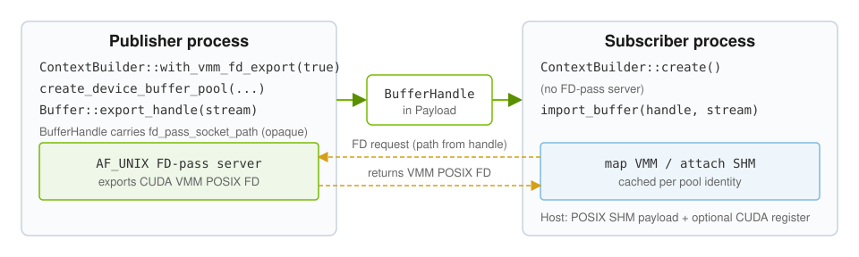

---

<!-- _class: compact -->

## `ConstBuffer`

<!-- verified: const_buffer, import paths -->

1. **Subscriber `ConstBuffer` lease** — holds the import ref-count until destroyed (or deferred release runs on the bound stream).
2. **Ref-count SHM** — same shared segment as Part 2; subscriber increments on import, decrements on release.

<br>

```cpp
#include <holomq/const_buffer.hpp>
```

| Method | Returns | Description |
|--------|---------|-------------|
| `memory_type()` | `MemoryType` | `None`, `Device`, `HostPageable`, or `HostPinned` |
| `cuda_device_ordinal()` | `std::optional<int32_t>` | CUDA device ordinal when `memory_type()` is `Device` |
| `size_bytes()` | `std::size_t` | User payload byte length |
| `explicit operator bool()` | `bool` | Valid lease |
| `ptr() const` | `const void*` | Device-accessible payload address |
| `enqueue_ready_wait(stream)` | `bool` | Enqueue ready-generation wait for publisher export fence; arm deferred ref release; does not block the caller |
| `export_handle()` | `expected<BufferHandle, Error>` | Identity relay for re-publish |

<br>

**Move-only.**

---

## Relay path

Subscriber processes data, then re-publishes the **same** imported memory:

```cpp
auto relayed = buf->export_handle();   // no new WriteValue
msg.payload().buffer_handle = *relayed;
publisher.send(std::move(msg), /* on_released as needed */);
```

Deferred ref release remains on the stream from the original `import_buffer` or `enqueue_ready_wait`.

---

<!-- _class: figure -->

## Subscriber import lease

<!-- verified: const_buffer, shm_ref_count.cpp -->

**`add_ref`** runs when **`Context::import_buffer`** constructs **`ConstBuffer`** (not when **`InboundMessage`** is taken). **`enqueue_ready_wait(stream)`** enqueues **`WaitValue(G)`** and arms deferred **`release_ref`**; **`~ConstBuffer`** drops the lease object while ref-count may stay elevated until the stream completes.

<br>

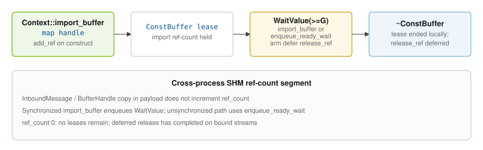

---

<!-- _class: figure-code-cols -->

## End-to-end — subscriber per frame

<div class="cols">
<div class="col-diagram">

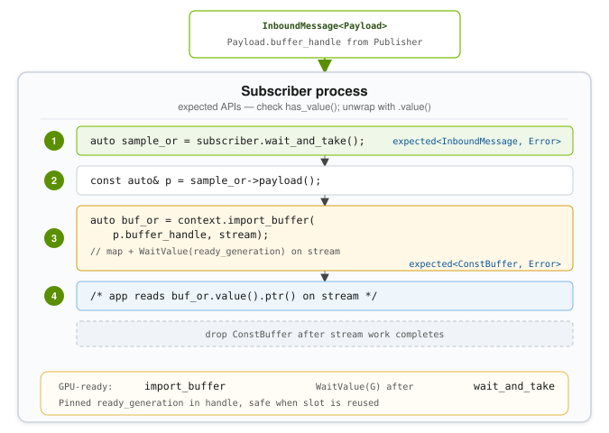

</div>
<div class="col-code">

```cpp
auto sample_or = subscriber->wait_and_take();
if (!sample_or.has_value()) { /* handle error */ }
const auto& p = sample_or->payload();
auto buf_or = context->import_buffer(p.buffer_handle, stream);
if (!buf_or.has_value()) { /* handle error */ }
holomq::ConstBuffer buf = std::move(buf_or).value();
// GPU work on buf.ptr() on stream ...
// drop sample → transport releases InboundMessage hold
// drop buf → import ref-count release (deferred on stream after GPU work)
```

</div>
</div>

---

<!-- _class: figure -->

## End-to-end — GPU generation ordering

**Race R4** — **`WriteValue(G)`** on the publisher stream before **`WaitValue(≥ G)`** on the subscriber stream (stream memory ops — Part 2):

```text
1. GPU work on publisher stream
2. export_handle(stream)  → record G at slot generation word
3. send buffer reference in payload
4. subscriber import_buffer  → wait ≥ G, then GPU work
```

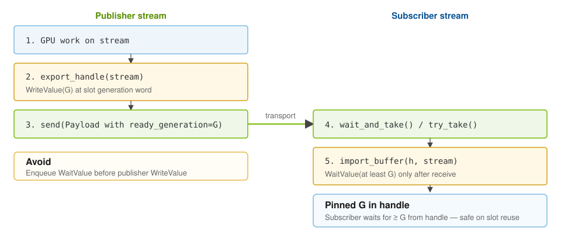

---

<!-- _class: lead -->

## Part 6 — WaitSet and WaitStrategy

---

<!-- _class: compact -->

## `WaitStrategy`

Shared blocking parameters for **`Subscriber::wait_and_take()`** and **`WaitSet::wait()`**.

<br>

```cpp
#include <holomq/wait_strategy.hpp>
```

<br>

| Field | Type | Default | Description |
|-------|------|---------|-------------|
| `spin_duration` | `std::chrono::nanoseconds` | `50'000` (50 µs) | Userspace poll before post-spin behavior (all modes) |
| `mode` | `WaitMode` | `TimedWait` | Behavior after the spin phase |
| `timeout` | `std::optional<std::chrono::nanoseconds>` | empty | Sleep bound (`TimedWait`, default 1 ms) or kernel-wait bound (`KernelWait`; unset = indefinite). Ignored for `Return`. |

<br>

| `WaitMode` | Behavior |
|------------|----------|
| `Return` | Poll for `spin_duration`, then return (`timeout` ignored) |
| `TimedWait` | Poll, then `sleep(timeout)` in userspace regardless of event wake (**default**) |
| `KernelWait` | Poll, then kernel event wait (`timeout` when set; indefinite when unset) |

<br>

**`enable_event_wake`** — **`KernelWait`** requires a **parallel event channel** per service (extra transport resources beside the sample queue). Set on **`PublisherServiceBuilder`** / **`SubscriberServiceBuilder`** (before `payload_type`) or the typed builder (before `create()`); default **`true`**. Disable with **`enable_event_wake(false)`** when wiring ports if you only use **`Return`** or **`TimedWait`** and want to avoid that overhead.

---

<!-- _class: compact -->

## `WaitResult`

Returned as the success value of **`WaitSet::wait()`** / **`wait_for_ready()`**.

**`Subscriber::wait_and_take()`** returns **`expected<InboundMessage<Payload>, Error>`** instead.

<br>

| Value | Meaning |
|-------|---------|
| `ready` | Check **`ready_handles()`**, then **`try_take()`** on matching subscribers |
| `timeout` | No attachment ready after wait (`Return` after spin, `TimedWait` sleep, or timed `KernelWait`) |
| `error` | Reserved compatibility value; current failures use `expected` errors |

<br>

**After `ready`:** handles may be **empty** on spurious kernel wake — loop and wait again. **`wait_and_take`** retries internally on spurious kernel wake when no sample is queued yet.

---

<!-- _class: compact -->

## `WaitSet`

Multiplexed blocking wait over multiple **`Subscriber`** ports — one thread, many services.

<br>

```cpp
#include <holomq/wait_set.hpp>
#include <holomq/wait_set_handle.hpp>
```

<br>

| Method | Returns | Description |
|--------|---------|-------------|
| `attach(Subscriber&)` | `expected<WaitSetAttachment, Error>` | Register port; one wait set per subscriber |
| `set_wait_strategy(WaitStrategy)` | `void` | Default for `wait()` |
| `wait()` / `wait(WaitStrategy)` | `expected<WaitResult, Error>` | Block until work may be available |
| `wait_for_ready()` / `wait_for_ready(WaitStrategy)` | `expected<WaitResult, Error>` | Aliases of `wait()` |
| `ready_handles()` | `span<const WaitSetHandle>` | Ready attachments after successful `wait()` |
| `capacity()` | `std::size_t` | Max kernel-notification slots for the transport backend |
| `attachment_count()` | `std::size_t` | Current attachments |

<br>

- **`WaitSetAttachment`** — RAII detach token; **`handle()`** → stable **`WaitSetHandle`** for dispatch.
- **`WaitSetHandle`** — opaque, comparable token from **`WaitSetAttachment::handle()`**; compare against **`ready_handles()`** after **`wait()`** (see dispatch slide).
- **`attach`** shares the subscriber transport port — an attached **`Subscriber`** may be moved.

**Move-only.**

---

<!-- _class: figure-code -->

## `WaitSet` dispatch

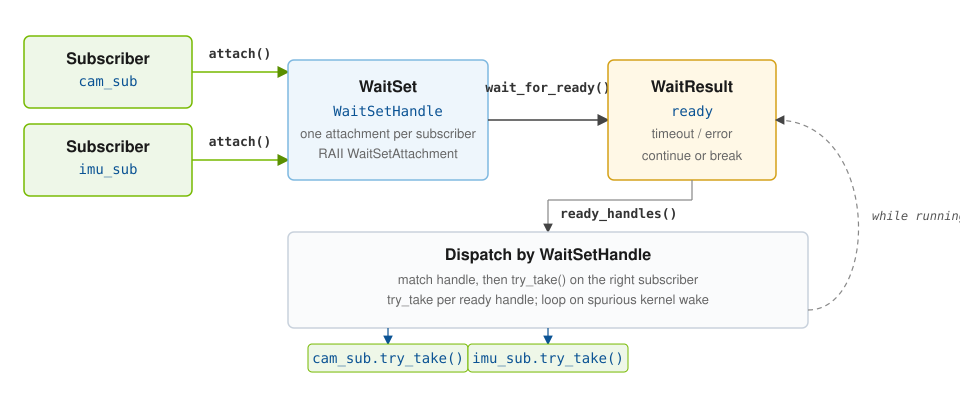

```cpp
auto ws = context.create_waitset().value();
const auto cam_h = ws.attach(camera_sub).value().handle();
const auto imu_h = ws.attach(imu_sub).value().handle();
while (running) {
    auto waited = ws.wait_for_ready();
    if (!waited.has_value()) { /* handle error */ }
    if (waited.value() != WaitResult::ready) continue;
    for (WaitSetHandle h : ws.ready_handles()) {
        if (h == cam_h && (auto m = camera_sub.try_take())) { /* camera */ }
        else if (h == imu_h && (auto m = imu_sub.try_take())) { /* imu */ }
    }
}
```

---

<!-- _class: lead -->

## Part 7 — `Context`

---

<!-- _class: compact -->

## `Context`

**One per process** — the application-facing handle for all HoloMQ runtime services in that process.

<br>

```cpp
#include <holomq/context.hpp>
```

<br>

| Responsibility | What the process gets |
|----------------|------------------------|
| **Transport session** | Pub/sub node; publisher, subscriber, and `WaitSet` ports |
| **Buffer pools** | Factory for device, host, and pinned host pools (Part 1) |
| **Cross-process memory** | Optional FD-pass server; import cache for received `BufferHandle`s |
| **Synchronized import** | Map remote buffers and wait on a CUDA stream before GPU use |

<br>

- **Move-only** (copy deleted) — thin shell over shared internal state (`ContextImpl`): transport runtime, FD-pass server, import caches.
- **`BufferPool`** references that state → FD-pass and import machinery **outlive** a dropped **`Context`** until all pools are destroyed. Safe to destroy or move-assign **`Context`** while pools remain.
- **`Context` methods** (`import_buffer`, pool factories, port factories) still require a live **`Context`** handle.

<br>

Created with **`ContextBuilder`** (next slide).

---

<!-- _class: compact -->

## `ContextBuilder`

```cpp
#include <holomq/context_builder.hpp>
```

<br>

| Method | Returns | Description |
|--------|---------|-------------|
| `with_vmm_fd_export(bool)` | `ContextBuilder&` | Start AF_UNIX FD-pass server (default `true`; subscribers pass `false`) |
| `with_fd_pass_socket(std::string)` | `ContextBuilder&` | Listen path; empty → default under `/tmp` at `create()`; error if path set but export disabled |
| `with_transport_logging(bool)` | `ContextBuilder&` | Route transport diagnostics through HoloMQ logger at `create()` |
| `create()` | `expected<Context, Error>` | Open transport node and optional FD-pass server; error on failure (logged) |

<br>

```cpp
auto context = ContextBuilder()
                   .with_fd_pass_socket("/tmp/my-app-fd-pass.sock")
                   .create();
```

<br>

| Role | `with_vmm_fd_export` | Pool factories | Import |
|------|---------------------|----------------|--------|
| **Publisher** (cross-process export) | `true` (default; optional socket path) | Creates pools | Rarely needed |
| **Subscriber** | `false` (explicit opt-out) | Optional local pools | `import_buffer` on received handles |

**Exception:** pinned host with `CU_MEMHOSTREGISTER_DEVICEMAP` (devicemap interleaved) — publisher FD-pass not required.

---

<!-- _class: compact -->

## `Context` — pools & import

<br>

```cpp
#include <holomq/context.hpp>
```

<br>

**Pool factories** — return an error on failure (logged). Empty allocator `{}` → built-in default.

| Method | Returns | Description | FD-pass on publisher |
|--------|---------|-------------|----------------------|
| `create_device_buffer_pool(bytes, count[, allocator])` | `expected<BufferPool, Error>` | CUDA VMM device pool; optional `DeviceBufferAllocator` | **Required** |
| `create_host_buffer_pool(bytes, count[, allocator])` | `expected<BufferPool, Error>` | Pageable host pool (payload SHM + sync VMM); optional `HostBufferAllocator` | **Required** |
| `create_host_pinned_buffer_pool(bytes, count, cuda_host_register_flags[, allocator])` | `expected<BufferPool, Error>` | Pinned host pool; `CU_MEMHOSTREGISTER_*` flags; optional `HostBufferAllocator` | **Required** unless `DEVICEMAP` set |

<br>

**Import** — subscriber-side adoption of handles received in message payloads (VMM, relay, lease diagrams — **Part 5**).

| Method | Returns | Description |
|--------|---------|-------------|
| `import_buffer(handle, stream)` | `expected<ConstBuffer, Error>` | Map handle; enqueue wait on `stream` when export fence present; error if `stream` is null while wait required |
| `import_buffer_unsynchronized(handle)` | `expected<ConstBuffer, Error>` | Map only; caller must `enqueue_ready_wait` before GPU use when fenced |

---

## `Context` — port factories

| Method | Returns | Description |
|--------|---------|-------------|
| `publisher_builder(service_name)` | `PublisherServiceBuilder` | Start publisher builder chain for `service_name` |
| `subscriber_builder(service_name)` | `SubscriberServiceBuilder` | Start subscriber builder chain for `service_name` |
| `create_waitset()` | `expected<WaitSet, Error>` | Multiplexed blocking wait over attached subscribers |

<br>

Use while parent **`Context`** handle is alive. Publisher and subscriber builder chains follow.

---

## Publisher builder

```cpp
#include <holomq/publisher_builder.hpp>
```

<br>

**`PublisherServiceBuilder`** (from `publisher_builder(name)`) and **`PublisherBuilder<P>`** (after `payload_type<P>()`) both expose **`enable_event_wake`**. **`create()`** requires `Payload` to be **`standard_layout`** and **`trivially_copyable`**.

<br>

| Method | Returns | Description |
|--------|---------|-------------|
| `enable_event_wake(bool)` | `PublisherBuilder` / `PublisherServiceBuilder` | Parallel event channel for `KernelWait` (default `true`; match subscriber) |
| `payload_type<P>()` | `PublisherBuilder<P>` | Fix message type `P` (**`PublisherServiceBuilder`**) |
| `create()` | `expected<Publisher<Payload>, Error>` | Create publisher port; error on failure (logged) |

<br>

```cpp
auto pub = context.publisher_builder("camera")
               .payload_type<Frame>()
               .create();
```

---

## Subscriber builder

```cpp
#include <holomq/subscriber_builder.hpp>
```

<br>

**`SubscriberServiceBuilder`** and **`SubscriberBuilder<P>`** both expose **`enable_event_wake`**. **`create()`** requires `Payload` to be **`standard_layout`** and **`trivially_copyable`**.

<br>

| Method | Returns | Description |
|--------|---------|-------------|
| `enable_event_wake(bool)` | `SubscriberBuilder` / `SubscriberServiceBuilder` | Parallel event channel for `KernelWait` (default `true`; match publisher) |
| `payload_type<P>()` | `SubscriberBuilder<P>` | Fix message type `P` (**`SubscriberServiceBuilder`**) |
| `create()` | `expected<Subscriber<Payload>, Error>` | Create subscriber port; error on failure (logged) |

<br>

```cpp
auto sub = context.subscriber_builder("camera")
               .payload_type<Frame>()
               .create();
```

---

## `Context` — queries

| Method | Returns | Description |
|--------|---------|-------------|
| `vmm_fd_export_enabled()` | `bool` | FD-pass server running |
| `fd_pass_socket_path()` | `const std::string&` | Resolved listen path (embedded in buffer descriptors) |

Server listens only when `vmm_fd_export_enabled()` is `true`.

---

<!-- _class: lead -->

## Part 8 — Extensions, observability & build configuration

---

<!-- _class: compact -->

## Custom allocators

### Device

```cpp
#include <holomq/device_buffer_allocator.hpp>
#include <holomq/device_buffer_pool_memory.hpp>

using DeviceBufferAllocator = std::function<
    std::unique_ptr<DeviceBufferPoolMemory>(std::size_t number_of_bytes)>;
```

| API | Returns | Description |
|-----|---------|-------------|
| `default_device_buffer_allocator()` | `DeviceBufferAllocator` | Built-in CUDA VMM path |
| `recommended_device_vmm_granularity()` | `std::size_t` | Recommended VMM granularity for FD export |
| `device_supports_vmm_posix_fd_export()` | `bool` | Device capability probe |
| `device_vmm_allocation_is_exportable(handle)` | `bool` | Per-allocation exportability |

`DeviceBufferPoolMemory`: virtual `ptr()`, `size()`.

<br>

### Host

```cpp
#include <holomq/host_buffer_allocator.hpp>
#include <holomq/host_buffer_pool_memory.hpp>
```

| API | Returns | Description |
|-----|---------|-------------|
| `default_host_buffer_allocator()` | `HostBufferAllocator` | Built-in SHM + optional CUDA register |
| `HostBufferAllocator` | (callable type) | Custom host pool memory; `(payload_region_bytes, payload_pinned, cuda_host_register_flags) → unique_ptr<HostBufferPoolMemory>` |

`HostBufferPoolMemory`: virtual `ptr()`, `size()`, `shm_pool_id()`, `payload_pinned()`, `host_register_flags()`.

---

<!-- _class: compact -->

## Logging

```cpp
#include <holomq/logger.hpp>
```

### Macros

`HOLOMQ_LOG_TRACE` … `HOLOMQ_LOG_CRITICAL` — compile-time filter via `HOLOMQ_LOG_ACTIVE_LEVEL`.

### Runtime API

| Function | Returns | Description |
|----------|---------|-------------|
| `set_log_level` | `void` | Runtime filter; `HOLOMQ_LOG_LEVEL` env overrides |
| `log_level` | `LogLevel` | Current runtime level |
| `set_log_handler` / `reset_log_handler` | `void` | Custom sink (`LogHandler`); must not re-enter HoloMQ logging |
| `log_literal` | `void` | Pre-formatted message (noexcept-safe) |
| `enable_transport_logging()` | `void` | Transport backend log bridge |
| `enable_transport_logging(LogLevel)` | `void` | Bridge + minimum level |
| `disable_transport_logging()` | `void` | Best-effort disable |

Default output: `[holomq][LEVEL] message` on stderr.

<br>

### Holoscan SDK adapter

```cpp
#include <holomq/adapters/holoscan_logger.hpp>

redirect_holomq_logs_to_holoscan();  // before Context::create / first HOLOMQ_LOG_*
```

Optional bridge to `holoscan::Logger`. Requires Holoscan Core headers at compile/link time.

Align `set_log_level` with `holoscan::Logger::set_level` for consistent filtering.

---

<!-- _class: compact -->

## Build-time configuration

Not runtime-selectable — publisher and subscriber **must match** where noted.

| CMake option | Effect |
|--------------|--------|
| `HOLOMQ_TRANSPORT` (`iox2`) | iceoryx2 messaging backend; `HOLOMQ_TRANSPORT_IOX2=1` |
| `HOLOMQ_FD_PASS_SOCKET` (`PATH`, `ABSTRACT`) | FD-pass endpoint encoding in buffer descriptors; **must match** across processes; compile-time `HOLOMQ_FD_PASS_USE_ABSTRACT` |

SDK default: `HOLOSCAN_MQ_BACKEND` / `HOLOMQ_DEFAULT_BACKEND` maps `iceoryx2` → `iox2` when `HOLOMQ_TRANSPORT` unset. Only `iceoryx2` is supported.

Transport QoS is configured through the typed pub/sub options. Size external pools for
`max_loaned_samples + publisher_history_depth + sum(effective queue + borrowed allowance)`;
`limits.hpp` supplies defaults, and `k_max_in_flight` covers only the publisher-loan term.
