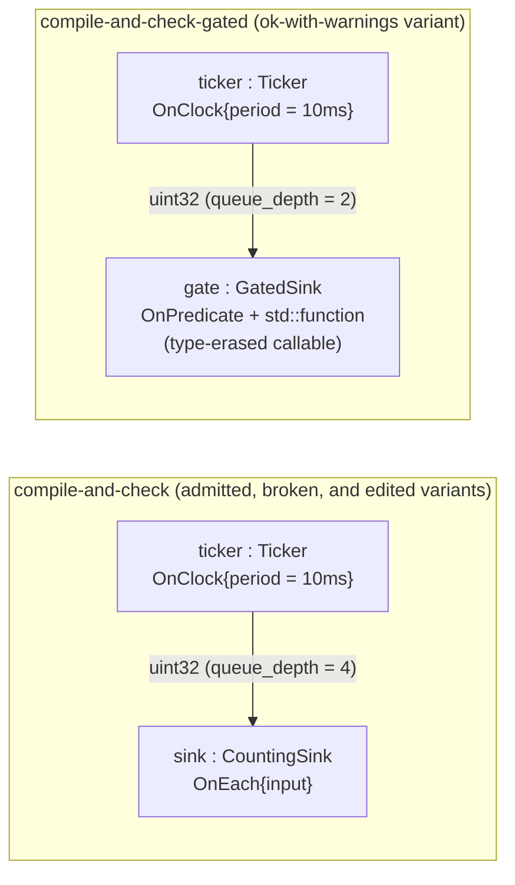

# Compile and check: admission, diagnostics, and the plan digest (`compile_and_check`)

> **User guide:** [Compile and Check](https://docs.nvidia.com/holoscan/sdk-user-guide/getting-started/compile-and-check) —
> this example is the cited
> program for `compile()` plan admission, the stable diagnostics table,
> `require_no_errors()`, and `PlanDigest`-based CI gating. Also cited by
> debugging-and-testing/understanding-failures and debugging-and-testing/testing.

One two-operator pipeline (a clock-driven ticker feeding a counting sink) is
compiled four ways — admitted, broken (a clock is declared but never made the
default), admitted-with-warnings (a type-erased predicate), and twice-identical
for the digest gate — and the program prints the plan verdict, the stable
diagnostic tokens, and the `digest stable` / `digest changed after edit` lines
before one short clean run confirms the admitted plan actually executes.



The broken variant is the *same* topology as the admitted one; the only
difference is that `set_default_clock()` is never called, so the ticker's
`OnClock` trigger (which omitted its clock key) has no default to resolve.

## What you will learn

- Why `holoscan::compile(graph)` returns a **rejected-but-queryable**
  `ExecutionPlan` instead of throwing: `plan.ok()` is the admission gate, and
  `plan.diagnostics()` / `plan.json()` remain readable evidence either way.
- How to iterate `plan.diagnostics()` as a table of stable registry
  **tokens** (`Diagnostic::token`, e.g. `TEMPORAL_CLOCK_UNDECLARED`) and
  severities (`DiagnosticSeverity::kError` / `kWarning`) that scripts can
  match — never log prose.
- That `plan.ok()` means *no error*, not *no diagnostics*: a
  `std::function`-wrapped predicate compiles under `Profile::kStandard` as
  ok-with-warnings, retaining `PREDICATE_CALLABLE_TYPE_ERASED`.
- When to use the throwing bridge `plan.require_no_errors()` (a cold setup
  path that cannot continue) and that it throws `holoscan::CompileError`.
- How to persist `plan.json()` to a file and compare `plan.digest()`
  (`PlanDigest`, 256-bit, structure-only) across compiles — equal for two
  independently authored identical graphs, different after any semantic edit —
  the compile-only CI gate the guide page teaches.

## Prerequisites

- [`time_and_clocks`](../time_and_clocks/README.md) (E15) — why every clock-driven
  graph names a default clock; this example shows what happens when you forget.
- A Holoscan SDK 5.x install. No GPU is required; everything except the final
  three-tick run is cold compilation.

## Build

From this `cpp/` folder:

```bash
cmake -B build -S .
cmake --build build
```

If the SDK is not in a default location, point CMake at it:

```bash
cmake -B build -S . -Dholoscan_DIR=/opt/nvidia/holoscan/lib/cmake/holoscan
```

## Run

```bash
./build/compile_and_check
```

The program is bounded (< 10 s; the only run waits for three 10 ms ticks) and
exits nonzero if any admission verdict, token match, or digest comparison fails.

## Expected output

```text
[admitted] plan ok: yes (diagnostics: 0)
[admitted] plan.json written: compile_and_check_plan.json (18342 bytes)   # byte count varies by SDK build
[broken] plan ok: no
[broken]   TEMPORAL_CLOCK_UNDECLARED | error
[broken] clock diagnostic found: yes
[broken] require_no_errors threw CompileError: yes
[warned] plan ok: yes
[warned]   PREDICATE_CALLABLE_TYPE_ERASED | warning
[warned] admitted with warnings: yes
[digest] first  compile: 9f2c41d7a3b8e015                                 # hex prefix varies by SDK build
[digest] second compile: 9f2c41d7a3b8e015                                 # ... but always equals the first line
[digest] plan.json byte-equal: yes
digest stable: yes
[digest] edited compile: 5b07c9e2f1a64d38                                 # differs from the first two
digest changed after edit: yes
[run] termination=stopped diagnostics=0 ticks>=3: yes
compile_and_check example complete: admission, diagnostics, and digest verified
```

## Code walkthrough

### Compilation is admission, not code generation

`compile()` snapshots the graph and either admits it or returns a **rejected
plan that is still a value**: `ok()` is false, but `diagnostics()` and `json()`
carry the complete rejection evidence. Nothing throws on the rejection path,
because a build/CI tool wants to *collect and report* every failure, not
unwind. That is why `main()` gates on `if (!plan.ok())` and prints
`plan.json()` — the same JSON document a CI job would archive as the failure
artifact.

### Stable tokens, not log prose

Each `holoscan::Diagnostic` carries a registry `token` (append-only spelling,
e.g. `TEMPORAL_CLOCK_UNDECLARED`), a two-level `severity`, and bounded
locators (`json_pointer`, `provided`/`required` summaries). The example greps
its own diagnostics table exactly the way a test harness would:
`token == "TEMPORAL_CLOCK_UNDECLARED" && severity == kError`. Tokens are the
contract; the prose around them may change between releases, the token may
not. Note the *shape* of the bug the broken variant plants: `add_clock()` was
called, so a clock exists — but no clock was ever designated the default, and
the ticker's `OnClock` omitted its clock key, which means "use the graph
default". Declaring a clock and designating the default are two separate acts.

### Two failure disciplines: values first, `require_no_errors()` at cold gates

Everywhere else this example branches on returned values (`ok()`, `expected`
results) — the SDK's errors-as-values discipline (the `HOLOSCAN_TRY` family;
see `errors_as_values`). `require_no_errors()` is the one deliberate throwing
bridge: a cold setup path that *cannot proceed* on a rejected plan converts the
error diagnostics into a thrown `holoscan::CompileError` (a `RuntimeError`
carrying `ErrorCode`). The example calls it inside `try`/`catch` on the
rejected plan to prove the guard fires — and that is the only place an
exception appears.

### `ok()` tolerates warnings — evidence is retained, not erased

The gated variant wraps its predicate in `std::function`, erasing the callable
type. Under `Profile::kStandard` the compiler admits it (`ok() == true`) but
records `PREDICATE_CALLABLE_TYPE_ERASED | warning` in the same diagnostics
table (stricter profiles reject it outright). This is the pattern to
internalize: admission and evidence are orthogonal, so CI can enforce a
zero-warning policy by scanning `diagnostics()` even when `ok()` passes.

### `PlanDigest` as the CI baseline

`plan.digest()` is a deterministic 256-bit digest of *normalized plan
semantics* — structure-only identity. Two independently authored, identical
graphs compile to byte-equal `plan.json()` and equal digests ("digest stable:
yes"), so the digest is reproducible across processes and machines, without
running anything. A small tuning edit (tick period 10 ms → 5 ms, sink queue
4 → 8) moves the digest ("digest changed after edit: yes"). A CI job therefore
compiles the app, compares `digest()` against a checked-in baseline, and flags
any unreviewed behavioral drift — no GPU, no run, no log scraping. For the
full deployment-artifact workflow built on the same identity, see the
plan-tooling guide page.

## HSDK 4.x comparison

| Task | HSDK 4.x | HSDK 5.x |
|---|---|---|
| Validate an application | `app->run()` — composition and GXF validation happen at launch; failures surface mid-startup | `compile(graph)` — cold admission before any runtime exists; `plan.ok()` gates |
| Failure detail | Free-text GXF log messages and exceptions | `Diagnostic{token, severity, json_pointer, ...}` — stable, machine-matchable, plan-owned |
| CI gate | Launch the app and scrape logs | Compile-only binary: `plan.json()` artifact + `plan.digest()` baseline comparison |

4.x had no cold compile step, so the only way to learn a graph was broken was
to run it and read logs. 5.x moves admission before execution and makes the
result a value — failure becomes testable data, and plan identity becomes a
deterministic artifact CI can diff.

## What's next

- [`running_and_stopping`](../running_and_stopping/README.md) (E17) — what happens
  *after* admission: `run_async`, the two runtime failure channels, and the
  stop idiom.
- Guide deep dives: debugging-and-testing/testing (compile checks in unit
  tests), debugging-and-testing/understanding-failures (the three failure
  styles), and advanced/plan-tooling (`emit_artifacts` on top of the digest).

## Concepts at a glance

| API | Role |
|---|---|
| `holoscan::compile(graph)` | Cold admission: snapshot the graph into an immutable `ExecutionPlan` |
| `ExecutionPlan::ok()` | True only for an admitted plan with no *error* diagnostic (warnings allowed) |
| `ExecutionPlan::diagnostics()` | Canonical-order span of stable `Diagnostic` records — the machine-readable verdict |
| `Diagnostic::token` / `::severity` | Append-only registry spelling + `kError`/`kWarning` — what CI matches on |
| `ExecutionPlan::require_no_errors()` | Cold-gate throwing bridge; throws `holoscan::CompileError` on a rejected plan |
| `ExecutionPlan::json()` | Canonical schema-versioned JSON — the archivable plan/failure artifact |
| `ExecutionPlan::digest()` | `PlanDigest` — 256-bit structure-only identity for baseline comparison |
| `Graph::set_default_clock()` | Designates *the* default clock that key-omitting `OnClock` triggers resolve |
