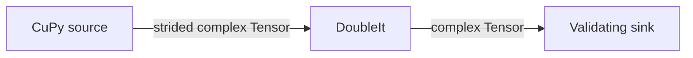

# CuPy pipeline

This Python graph passes strided complex CuPy arrays through a source, GPU
transform, and validating sink. Operators declare pass-through Tensor outputs
and bind their actual outputs to a CUDA device. They allocate no SDK Tensor
pools. CuPy owns the source and result allocations.



## Run

Install the Holoscan Python bindings and a CuPy package compatible with your
CUDA installation. A visible CUDA GPU is required. From this example directory:

```bash
python3 python/cupy_pipeline.py --device 0
python3 python/cupy_pipeline.py --device 0 --per-partition-streams
```

When using SDK build-tree bindings, prefix the command with
`PYTHONPATH=<build>/python/lib`. Expected output:

```text
cupy_pipeline: received 10 doubled arrays (last=20)
```

The two CTest variants exercise shared and per-partition compute streams. They
report a skip when CuPy or a GPU is unavailable; ordinary invocation reports a
prerequisite error. The example's `python/` directory can also be configured
against an installed SDK using CMake.

## GPU placement and storage

Use `produces_tensor(OutputSpec(storage="pass_through", memory_kind=CUDA_DEVICE,
...))` for CuPy-owned output storage. In this graph, bind each connected CUDA
output in compile options with
`deployment.bind_tensor_output_device(operator_path=..., output_port=...,
device=DeviceId(...))`. The sink gets its CUDA activity from its Tensor input.
The compiler requires explicit placement and rejects conflicting device
obligations within one operator.

Placement provisions compute streams without provisioning allocation pools.
Port bounds still constrain emitted shapes and byte spans. A connected CUDA
pass-through output can inherit its operator's unique explicit device from
another bound output or its named Green Context partition. Input placement does
not propagate to outputs. An output with neither its own binding nor unambiguous
operator placement produces `IMPLICIT_DEVICE_ZERO_REJECTED`, naming the output,
the required binding, and any conflicting placement sources. Conflicting
placements reject compilation, and the diagnostic names each conflicting port
and where its device came from.

The graph's process-local Tensor edges retain the same GPU storage, including
strides. `array * 2` allocates a new result through CuPy. The sink intentionally
copies to the CPU and synchronizes to validate values. Export across a process
boundary has separate staging-pool and transfer requirements.

## Lossless flow control

The sink validates every frame in order, so no frame may be dropped. A
graph-bound `emit()` that finds a full blocking queue waits only a bounded time
and then fails the run; the Runtime does not replay the callback. The transform
runs once per input and cannot retry later, so the source admits a new frame
only while fewer than three frames await the sink's validation, and the
transform's output edge has room for all of them plus one still active in the
sink. The transform's `emit()` then always finds space, however long the sink
is delayed. See
[Size capacity and choose the pressure policy explicitly](https://docs.nvidia.com/holoscan/sdk-user-guide/debugging-and-testing/understanding-failures#size-capacity-and-choose-the-pressure-policy-explicitly).

The source's own edge stays at depth two. When the transform falls behind, for
example during CuPy's initial kernel compilation, the source's `emit()` raises
`BackpressuredError`; the source retains its pending CuPy array and retries it
on the next clock tick, preserving frame order without reallocating the
array.

## Stream pattern

The recommended callback uses the SDK stream for allocation, Tensor conversion,
and computation:

```python
def compute(self, ctx):
    with ctx.stream():
        array = self.inp.receive_data()  # Input(..., as_=cp)
        self.out.emit(array * 2)
```

For an ordinary Tensor input, replace the receive line with
`array = cp.from_dlpack(self.inp.receive_data())`. Keep conversion inside the
stream context so DLPack can negotiate the consumer stream.

If a callback creates its own stream, keep it on the operator until the callback
returns. Synchronize it before releasing a view used on it, including a view
retained across callbacks:

```python
def compute(self, ctx):
    with ctx.stream():
        tensor = self.inp.receive_data()
        if not hasattr(self, "_cupy_stream"):
            self._cupy_stream = cp.cuda.Stream(non_blocking=True)
        with self._cupy_stream:
            view = cp.from_dlpack(tensor)
            result = view * 2
        self._cupy_stream.synchronize()
        del view
        self.out.emit(result)
```

A stream kept only in a local variable can be destroyed before SDK callback-exit
completion recording. Retained views used on an SDK stream should be released
in the operator that last used them, or after explicitly synchronizing that
stream. Drops in another partition, on unrelated threads, or by cyclic garbage
collection need explicit completion until coordinated stream liveness is
implemented.
