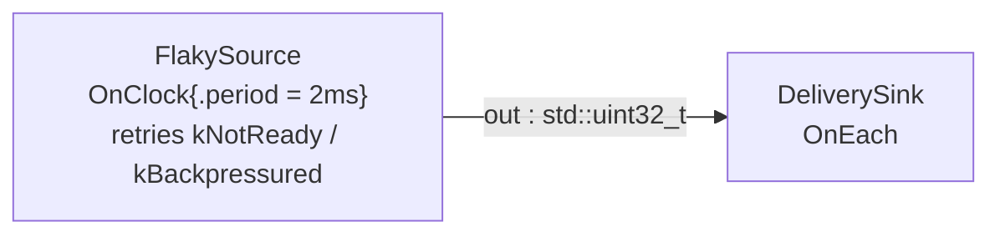

# errors_as_values — the `expected`/`Error` discipline end to end

> **User guide:** [Errors as Values](https://docs.nvidia.com/holoscan/sdk-user-guide/getting-started/errors-as-values) —
> this example is the
> cited program for the errors-as-values discipline (also serves
> debugging-and-testing/understanding-failures).

Fallible free functions exercise every propagation macro, a two-operator
graph retries transient `kNotReady`/`kBackpressured` poll failures until
three samples arrive, and a finale shows the three places a failure can
surface — then the program stops cooperatively and prints one summary line.



The retry decision (transient code → succeed the activation without
emitting, so the next clock tick tries again; any other code → return the
error and fail the run) lives entirely inside `FlakySource::compute()`.

## What you will learn

- `expected<T, Error>` / `expected<void, Error>` as the hot-path failure
  channel, and why `holoscan::Error` (code + optional message) is cheap:
  code-only errors like `Error{ErrorCode::kNotReady}` never allocate.
- All three propagation macros: `HOLOSCAN_TRY` (both arities),
  `HOLOSCAN_ASSIGN_OR_RETURN`, and `HOLOSCAN_RETURN_IF_ERROR` — plus the
  reserved expression-form extension and its `HOLOSCAN_HAS_TRY_EXPR` gate
  (hard-wired `0` on every supported frontend today).
- `forward_error` to move one `Error` between `expected`s with *different*
  value types (`expected<std::uint32_t, Error>` → `expected<std::string,
  Error>`), by hand where the macros do not fit.
- Branching on `ErrorCode` to retry transient failures (`kNotReady`,
  `kBackpressured`) instead of failing the run.
- The `RuntimeError` ↔ `Error` bridge at an exception boundary: `make_error`
  (catch → value, prefix-stripping round-trip) and `runtime_error_message`
  (value → log string).
- The three failure styles side by side: authoring throws
  (`add_flow` → `RuntimeError`), compile rejection tokens
  (`plan.diagnostics()`), and runtime evidence (`session.diagnostics()`).

## Prerequisites

- [`examples/typed_parameters`](../typed_parameters/README.md) — parameter schemas and
  the `validate_params` recovery idiom; this example generalizes that
  "failures are values" thread to the whole API surface.
- No GPU is required: payloads are bare `std::uint32_t` on host memory.

## Build

From this `cpp/` folder (standalone consumer build, using
`CMakeLists.min.txt` as the project file):

```bash
cmake -B build -S .
cmake --build build
```

If your SDK lives elsewhere, point `-Dholoscan_DIR=` at the directory
containing `holoscan-config.cmake`. Inside the SDK source tree the example
builds as part of the normal examples build via `CMakeLists.txt`.

## Run

```bash
./build/errors_as_values
```

Or through CTest:

```bash
ctest --test-dir build -R EXAMPLE_CPP_ERRORS_AS_VALUES_TEST
```

## Expected output

```text
[macros] scaled_offset("4") -> 40 (HOLOSCAN_ASSIGN_OR_RETURN + HOLOSCAN_RETURN_IF_ERROR)
[macros] describe_scale("4") -> scale=4 (HOLOSCAN_TRY, both arities)
[macros] scaled_offset("banana") -> kInvalidArgument: scale is not an unsigned integer
[forward_error] label_for("banana") -> kInvalidArgument (same Error, new value type)
[bridge] open_device(7) caught RuntimeError -> Error: kNotFound: device 7 is not attached
[bridge] Error -> RuntimeError -> Error round-trip preserved: yes
[retry] transient codes retried: kNotReady=2 kBackpressured=1
[failure-styles] authoring throw: kIncompatible: GRAPH_INPUT_FANIN_UNSUPPORTED
[failure-styles] compile rejection tokens: TEMPORAL_CLOCK_UNDECLARED
[failure-styles] run diagnostics after clean stop: 0
errors_as_values: transient_retries=3 delivered=3 (last=30) run_diagnostics=0 termination=stopped
```

Every line is printed by `main()` after `session.wait()` returns, so the
output is deterministic; the smoke test anchors on the final line alone.
The `[failure-styles]` lines are produced by *deliberate* mistakes on
scratch graphs (a second edge into a connected input; a graph whose
`OnClock` trigger has no default clock) — the real run stays clean, which is
why the run-diagnostics count is `0`.

## Code walkthrough

### Why errors travel as values, and why `Error` is deliberately cheap

A frame that fails to parse is not an exceptional event in a streaming
runtime — it is Tuesday. `expected<T, Error>` puts "can fail" into the
signature the compiler checks ([[nodiscard]] makes a dropped result a
compile-time complaint), and `Error` is sized for the hot path: an
`ErrorCode` plus a message that only allocates when non-empty. That is why
`poll_device` returns `Error{ErrorCode::kNotReady}` with no message — a
polling loop that allocates on every miss would turn a health signal into
allocator traffic. Contrast `RuntimeError`, which as a `std::runtime_error`
always heap-copies its message and carries exception RTTI: right for cold
authoring paths, wrong for per-activation failure.

### Why one macro has three spellings — and why the expression form is reserved

`HOLOSCAN_RETURN_IF_ERROR` (void results) and `HOLOSCAN_ASSIGN_OR_RETURN`
(value results) name their intent exactly and validate their operand with a
stable SDK diagnostic (`expected_macros.hpp` static-asserts the operand is
the right kind of `expected`). `HOLOSCAN_TRY` is the one-name spelling that
selects between them by arity — one argument checks, two arguments assign —
so code that prefers a single vocabulary word can use it everywhere, as
`describe_scale` does. All three are *statement* forms: each evaluates its
operand exactly once and, on failure, moves the original error into the
enclosing function's return. The expression-form extension (the
`HOLOSCAN_TRYX` macro) is intentionally reserved: `HOLOSCAN_HAS_TRY_EXPR`
is hard-wired `0` on every supported frontend (`expected_macros.hpp:365`)
until every frontend has a validated implementation, and any use is
rejected with a stable diagnostic pointing back to portable `HOLOSCAN_TRY`.

### Why `forward_error` changes the value type but never the error

`label_for` returns `expected<std::string, Error>` but calls `parse_scale`,
which returns `expected<std::uint32_t, Error>`. The two `expected`s are
unrelated C++ types, yet the failure is the same failure.
`holoscan::forward_error(std::move(parsed))` moves the `Error` out of one
and into an `unexpected` that converts into the other — no error-type
translation layer, no re-wrapping hierarchy. Because every fallible API in
the SDK shares the single `Error` type, propagation across layers is a move,
and the macros above are just this function with the `if` written for you.
`FlakySource::compute()` uses the same call to convert a fatal
`expected<std::uint32_t, Error>` failure into its own
`expected<void, Error>` return.

### Why the `RuntimeError` bridge exists and what round-trips

Cold paths still throw: graph composition APIs raise `RuntimeError`, and
4.x-era shims (like `legacy_open_device` here) live behind exception ABIs.
`open_device` is the boundary idiom — catch once, `make_error(exception)`,
and return a value the caller can branch on. The bridge is engineered to be
lossless in both directions: `RuntimeError{Error{...}}` renders
`"<code name>: <message>"`, and `make_error` strips exactly that generated
prefix on the way back, so `Error → RuntimeError → Error` preserves both
code and message without duplicating the prefix (the `round-trip preserved:
yes` line proves it). `runtime_error_message` gives you the same rendering
for logs without constructing an exception at all.

### Why transient codes are retried — and where each failure style lands

`kNotReady` and `kBackpressured` are categories, not verdicts: the device
will be ready on a later tick, the queue will drain. `FlakySource` branches
on `error.code`, counts the transient miss, and returns success *without
emitting* — under `OnClock` the next activation is the retry, so no sleep
or backoff loop appears in operator code. Anything else propagates and
fails the run. The finale then maps the territory: mistakes made while
*composing* throw immediately (the second `add_flow` into a connected input
violates the single-writer rule — `GRAPH_INPUT_FANIN_UNSUPPORTED`);
mistakes in *structure* reject the compile with stable tokens
(`TEMPORAL_CLOCK_UNDECLARED` from the clockless scratch graph, read off
`plan.diagnostics()`); failures *while running* accumulate as bounded
evidence in `session.diagnostics()` — empty here precisely because the
transient errors were handled as values. A fourth style never reaches
runtime at all: contract violations such as reselecting an `OnEach` driver
port are C++ compile errors.

## HSDK 4.x comparison

| Concern | HSDK 4.x | HSDK 5.x `errors_as_values` |
|---|---|---|
| Failure channel in operators | throw from `compute()`; scheduler logs a GXF error code and tears down | `compute()` returns `expected<void, Error>`; codes are branchable data |
| Transient conditions | scheduler-internal (retry semantics buried in conditions/schedulers) | explicit `kNotReady`/`kBackpressured` branch in operator code |
| Error identity | mixed `std::exception` texts and GXF result codes | one `ErrorCode` enum shared by values (`Error`) and exceptions (`RuntimeError`) |
| Exception interop | pervasive — exceptions were the mechanism | quarantined to boundaries via `make_error` / `RuntimeError{Error}` |
| Failure evidence | interleaved log text | three separated surfaces: throw site, `plan.diagnostics()`, `session.diagnostics()` |

4.x made every failure an exception, which erased the line between "the
graph is misauthored" and "this sample was late" — both unwound the stack.
5.x gives each failure class its own mechanism with one shared code enum,
so hot-path failures stay allocation-free values, and the only stack
unwinding left is for cold authoring mistakes you want to be loud.

## What's next

- [`examples/time_and_clocks`](../time_and_clocks/README.md) — capture timestamps,
  `now()` vs `at_ns()`, and swapping `RealtimeClock` for `ManualClock`.
- Guide deep-dive: debugging-and-testing/understanding-failures (the full
  diagnostics vocabulary) and getting-started/compile-and-check.

## Concepts at a glance

| API | Role in this example |
|---|---|
| `expected<T, Error>` / `expected<void, Error>` | fallible return channel for every hot-path function |
| `Error{code, message}` / `Error{code}` | cheap error value; code-only form never allocates |
| `HOLOSCAN_RETURN_IF_ERROR` | propagate a failed `expected<void, E>` statement-wise |
| `HOLOSCAN_ASSIGN_OR_RETURN` | unwrap a value or propagate its error |
| `HOLOSCAN_TRY` | one-name spelling; arity selects between the two above |
| `HOLOSCAN_HAS_TRY_EXPR` | feature gate for the reserved expression form; `0` everywhere today |
| `forward_error` | move an `Error` into an `expected` with a different value type |
| `make_error` / `runtime_error_message` | `RuntimeError` → `Error` bridge; render `Error` for logs |
| `RuntimeError{Error}` | `Error` → exception bridge for cold paths |
| `error_code_name` | stable enumerator spelling for printing codes |
| `plan.diagnostics()` / `session.diagnostics()` | compile-time and run-time failure evidence |
