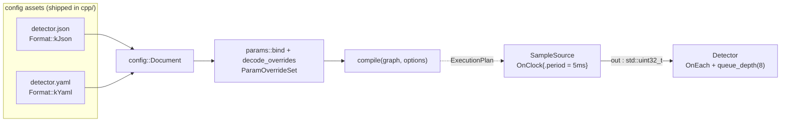

# essential/config_file — from a JSON/YAML file to a compiled plan

> **Essential module.** This example uses the SDK's optional configuration and
> parameter-tooling libraries — `holoscan::config_io`, `holoscan::params`, and
> `holoscan::params_io` — which ship enabled by default
> (`HOLOSCAN_BUILD_CONFIG_IO` / `HOLOSCAN_BUILD_PARAMS` /
> `HOLOSCAN_BUILD_PARAMS_IO` = `ON`) but are separate link targets layered on
> top of `holoscan::core`. The core runtime never depends on them: a build
> that disables these components still compiles and runs every core example.
> Installed SDK consumers request the exported `params_io` package component,
> which imports the complete `config` / `config_io` / `params` / `params_io`
> target closure. A package built with any of those optional components
> disabled intentionally omits the corresponding target; the example's
> standalone CMake check fails closed instead of silently falling back to a
> core-only build.
>
> **User guide:** [Configuring Applications](https://docs.nvidia.com/holoscan/sdk-user-guide/configuration/configuring-applications) —
> this example is the
> cited program for loading a configuration document, binding it to typed
> parameters with `params::bind()` / `params::decode_overrides()`, and
> compiling with `CompileOptions::parameter_overrides`.

A two-operator pipeline (clocked sample source → configured detector) is
compiled from a JSON *and* a YAML config file and run for six samples; the
program then proves the sparse-patch contribution model, demonstrates the
duplicate-target rejection branch, and round-trips the stopped run's parameter
state through a persisted snapshot archive.



## What you will learn

- `config_io::load(path, Format::kJson | kYaml)` — explicit-format,
  fail-closed parsing into an immutable `config::Document`, and why the JSON
  and YAML variants of the same values have the *same* semantic digest
  (`document.digest().semantic`).
- `params::bind(handle, config::Path::parse("/detector"))` — one binding, two
  deliberately separate grammars: the operator target comes from the graph
  handle; the document path is an RFC 6901 JSON Pointer (never dotted names,
  never inferred from the operator name).
- `params::decode_overrides(document, bindings)` — schema-validated,
  all-or-nothing conversion to a `ParamOverrideSet`, and its sparse-patch
  contribution model (baseline's only `ParamBindingMode`): absent members preserve
  the authored `set_params()` baseline.
- The duplicate-target rejection branch: one document object naming both
  `"threshold"` and its declared alias `"legacy_threshold"` rejects the whole
  decode with `PARAM_CONFIG_FIELD_DUPLICATE` and no partial result.
- `CompileOptions::parameter_overrides` → `compile(graph, options)` — where
  configuration enters the compile-then-freeze model.
- The persistence round trip: `session.capture_params()` →
  `snapshot.slice("detector")` → `params::save()` (strict JSON v1, atomic
  replace) → an explicit detector-only `ParamRebindTarget` →
  `params::load_overrides(path, target)`. Restore authority comes from the
  immutable target, not from names discovered in the archive: the detector
  must match its captured schema evidence, while the schema-less tick source
  remains outside the target and contributes no provenance record.

## Prerequisites

- [`tensors_in_depth`](../../tensors_in_depth/README.md) — the previous
  example in the chain (or skip straight here from the Wave 2 spine if you do
  not need GPU depth).
- [`parameter_schemas`](../../parameter_schemas/README.md) — this example
  assumes you know `HOLOSCAN_PARAM_SCHEMA`, field policies, and
  `set_params()`; the config file patches *those* declared fields.
- Guide background: typed parameters and
  [compile-and-check](../../compile_and_check/README.md) for the
  `plan.ok()` / diagnostics result model.

## Build

From this `cpp/` folder:

```bash
cmake -B build -S .
cmake --build build
```

If the SDK is not in a default location, point CMake at it:

```bash
cmake -B build -S . -Dholoscan_DIR=/path/to/holoscan/install/lib/cmake/holoscan
```

## Run

```bash
./build/config_file --config-dir .
```

`--config-dir` names the folder holding `detector.json` and `detector.yaml`.
Without the flag, the program looks next to the binary (the installed layout,
where the assets are installed beside the executable) and one level up (this
build layout); if neither contains `detector.json` it prints the paths it
tried and exits with a clear error instead of guessing further.

## Expected output

```text
config_file: loaded detector.json and detector.yaml (semantic digests match)
config_file: decoded 2 field contributions from /detector (sparse patch)
config_file: canonical+alias contribution rejected: PARAM_CONFIG_FIELD_DUPLICATE (no partial override set)
config_file: effective params: threshold=9 gain=2.5 window=8 (window preserved from the authored baseline)
config_file: snapshot archived (3 persisted fields, strict JSON v1, atomic replace)
config_file: detector-scoped overrides restored from archive (3 provenance fields: 3 archive-contributed, 0 baseline-retained; mode=sparse)
config_file: digests=match effective=(threshold=9 gain=2.5 window=8) duplicate=PARAM_CONFIG_FIELD_DUPLICATE roundtrip=(saved=3 contributed=3 retained=0) detections=3/6 termination=stopped
```

The first line proves format equivalence (one semantic tree, two syntaxes);
`effective params` proves the sparse patch (file supplies `threshold`/`gain`,
the un-named `window` keeps its authored value 8, not its type default 16);
the final line is the machine-checked summary the smoke test asserts.

## Code walkthrough

### Two grammars that never mix

`params::bind()` pairs an operator handle with `config::Path::parse("/detector")`.
The operator side is graph identity; the document side is an RFC 6901 JSON
Pointer. The API refuses to convert between them or to interpret dots as
separators — a lookup for `"detector.threshold"` would be a single odd key,
not a path. Keeping the grammars separate is what makes the file-to-graph
mapping explicit and reviewable: every `bind()` call is one visible arrow from
a document object to one operator.

### Sparse patch, not replacement

baseline supports exactly one binding mode: `ParamBindingMode::kPatch`. The decode
starts from the operator's authored baseline (`set_params()` in this program,
or the struct's default member initializers if nothing was authored) and
overlays only the fields the document explicitly names. That is why
`detector.json` can ship two keys and leave `window` alone — and why the
program can *prove* preservation by reading `ctx.params<DetectorParams>()`
inside `compute()` at run time rather than inspecting any intermediate object.

### All-or-nothing decoding

`decode_overrides()` validates every contribution against the declared schema
— names, aliases, exact types, ranges — and rejects the entire transaction on
the first inconsistency, returning a typed `ParamToolError` with a stable
token. The demonstration document supplies `"threshold"` and its alias
`"legacy_threshold"` in one object: both keys parse (they are distinct JSON
keys), but they resolve to the same schema field, so the decode fails with
`PARAM_CONFIG_FIELD_DUPLICATE` and *no* override set exists afterward. There
is never a half-applied configuration to debug.

### Configuration is part of the plan

The decoded `ParamOverrideSet` is handed to `compile()` through
`CompileOptions::parameter_overrides`, and from that point the file is out of
the picture: the runtime executes the frozen plan and never re-reads
configuration. Validation therefore happens once, on the cold path, while you
still have a stack to debug on. The override set itself is opaque but carries
inspectable provenance (`provenance().config_fields`) recording exactly which
document fields contributed.

### Persistence is a snapshot archive, not a config rewrite

After the run stops, `session.capture_params()` captures the published
parameter state, `slice("detector")` narrows it to one operator, and
`params::save()` writes a strict JSON v1 archive with an atomic
same-directory replace. The return path starts by capturing an explicit
detector-only target with
`make_param_rebind_target(graph, admission, ParamRebindTargetScope::operator_(...))`.
`load_overrides(path, target)` validates the archive's digest and schema
evidence against that immutable authority and produces a fresh
`ParamOverrideSet` — the same shape `decode_overrides()` makes — ready for a
future `compile()`. Target scope is selected by the application, never inferred
from archive contents. The schema-less `SampleSource` is therefore valid
because it is outside the detector target; the detector's three archived
fields return as `kContributed` provenance records and no unrelated baseline
field is invented. Unknown or out-of-scope archive records still fail closed.
Snapshots and application config
files stay distinct surfaces: the archive is captured evidence, never merged
back into `detector.json` behind your back.

## HSDK 4.x comparison

| HSDK 4.x | HSDK 5.x |
|---|---|
| `Application::config("app.yaml")` + implicit YAML lookup | `config_io::load(path, Format::kYaml)` → explicit `Document` |
| `from_config("detector.threshold")` dotted keys, resolved per-parameter at run setup | `params::bind(handle, "/detector")` JSON Pointer to a whole typed object, decoded once |
| Per-`Parameter<T>` defaults, unvalidated until first use | Schema-validated, all-or-nothing `ParamOverrideSet` applied at `compile()` |
| Config readable/reloadable while the app runs | Plan-frozen configuration; runtime mutation only via the typed update API |

The 4.x model resolved configuration lazily, key by key, at operator
initialization — a typo surfaced as a runtime default silently winning. The
5.x model moves the entire file-to-typed-value conversion to one validated,
inspectable cold-path step whose result is part of the plan's identity, which
is what regulated deployments need and what makes "it ran with the reviewed
config" provable.

## What's next

- [`experimental/plan_artifacts`](../../experimental/plan_artifacts/README.md)
  — the plan whose identity now includes your configuration can be serialized,
  digest-compared, and published as a deployment bundle.
- Guide deep-dive:
  configuration/configuring-applications (profiles and deployment bindings —
  the two `CompileOptions` members this example leaves at their defaults) and
  advanced/runtime-parameter-updates for mutating `.runtime_mutable()` fields
  in a running plan.

## Concepts at a glance

| API | Role |
|---|---|
| `config_io::load(path, Format::kJson\|kYaml)` | Explicit-format, fail-closed file → immutable `config::Document` |
| `config_io::parse(view, format)` | Same contract for in-memory bytes |
| `document.digest().semantic` | Format-independent identity of the semantic tree |
| `config::Path::parse("/detector")` | RFC 6901 JSON Pointer into the document |
| `params::bind(handle, path)` | One operator target ↔ one document object |
| `params::decode_overrides(doc, bindings)` | Schema-validated, all-or-nothing → `ParamOverrideSet` |
| `ParamBindingMode::kPatch` | baseline's sparse-patch contribution model |
| `PARAM_CONFIG_FIELD_DUPLICATE` | Stable token for the duplicate-target rejection |
| `CompileOptions::parameter_overrides` | Where overrides enter `compile()` |
| `session.capture_params()` / `snapshot.slice()` | Post-stop published-state capture |
| `params::save` / `params::load_overrides` | Strict JSON v1 archive round trip against an explicit immutable target |
| `ParamRebindTargetScope::operator_` | Limit restore authority and schema validation to one exact operator |
| `PARAM_REBIND_SCHEMA_UNAVAILABLE` | Restore rejection when an operator inside the selected target lacks a schema |
| `kContributed` / `kRetainedBaseline` | Restore provenance: archive-applied vs baseline-preserved fields |
