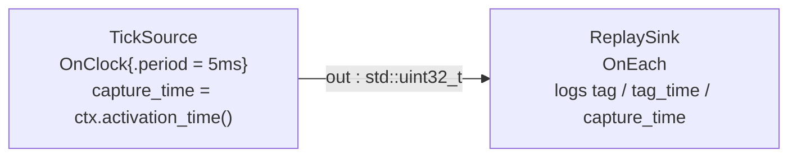

# determinism_replay — one graph, three time bases, one diff

> **Experimental example; Beta deterministic-time primitives.** Full replay
> tooling is still evolving.
> The time types, clock APIs, named-clock resolution, and per-activation
> `Tag`/`TagTime` stamping shown here ship today and are exercised end to end
> when a pipeline runs in-process; the API may still evolve in upcoming
> releases. The full capture/replay tooling built on these primitives is not
> part of this release — this example demonstrates the primitives, not a
> finished replay product.
>
> **User guide:** [Determinism and Replay](https://docs.nvidia.com/holoscan/sdk-user-guide/advanced/determinism-and-replay) —
> this example is the cited program for
> `TagTime` replay stability, `ManualClock` substitution via
> `bind_shared_clock()`, the capture-time stamping discipline, and the limits of
> today's replay guarantees.

A two-operator clock-driven pipeline runs three times in one process — once
against `RealtimeClock`, twice against a harness-stepped `ManualClock` — and
then diffs the per-activation logs: the two manual runs match field for field
(`Tag`, `TagTime`, capture time), while the realtime run's coordinates and
every wall-clock reading do not.



In prose (the diagram adds nothing more): `TickSource → ReplaySink`, scheduled
against the graph's single default clock — `RealtimeClock` in run one, a
`main()`-driven `ManualClock` in runs two and three. Each operator appends one
record per activation to an in-process log; `main()` renders and diffs the logs
after the runs, so nothing races the runtime threads.

## What you will learn

- The three kinds of "when" on every activation: `ctx.tag()` (identity —
  `{sequence, generation}`, equality and hashing only), `ctx.tag_time()`
  (logical order — `{logical_ns, microstep}`, totally ordered and
  replay-stable), and `ctx.activation_time()` (physical `TimePoint` in the
  graph's clock domain).
- `bind_shared_clock()` vs `add_clock()`: only the former retains the live
  clock instance you constructed, which is what lets `main()` call
  `advance_by()` while the graph runs.
- The lockstep replay drive: advance the `ManualClock` by exactly one period,
  wait for exactly one more activation, repeat — every clock read in the graph
  lands on the scripted 0, 5ms, 10ms… grid.
- Carrying capture time with data: `EmitOptions{.capture_time = …}` on emit,
  `in.receive()` → `Sample<T>` → `sample.metadata.capture_time()` on receive.
- What replay-stable ordering promises (per-operator `TagTime` order and
  values) and what it does not (wall-clock durations, realtime coordinates,
  raw `Tag` numbers across runs).

## Prerequisites

- [`web_tuner`](../web_tuner/README.md) (E30) — the previous learning-chain step changes
  runtime Parameter generations; this example records and replays the resulting
  deterministic execution evidence.
- [`time_and_clocks`](../../time_and_clocks/README.md) (E15) — the foundational
  `now()` vs `at_ns()`, `TimePoint` domain rules, and `ManualClock` model.

Start at [`first_pipeline`](../../first_pipeline/README.md) if `OnClock`/`OnEach`
triggers are new.

## Build

From this `cpp/` folder:

```bash
cmake -B build -S .
cmake --build build
```

If the SDK is not installed in a default location, point CMake at it:

```bash
cmake -B build -S . -Dholoscan_DIR=/path/to/holoscan/install/lib/cmake/holoscan
```

## Run

```bash
./build/determinism_replay
```

The whole program is GPU-free and finishes in well under a second: the
realtime run needs ~30ms of wall time for six 5ms ticks; the two manual runs
never wait on a wall-clock period at all.

## Expected output

```
[realtime] sink tag=gen1/seq1 tag_time=1328648ns/us1 capture=1328648ns
[realtime] sink tag=gen1/seq2 tag_time=6328648ns/us1 capture=6328648ns
[manual-a] sink tag=gen1/seq1 tag_time=0ns/us1 capture=0ns
[manual-a] sink tag=gen1/seq2 tag_time=5000000ns/us1 capture=5000000ns
[manual-b] sink tag=gen1/seq1 tag_time=0ns/us1 capture=0ns
[manual-b] sink tag=gen1/seq2 tag_time=5000000ns/us1 capture=5000000ns
determinism_replay: manual_replay_match=yes realtime_tagtime_differs=yes wall_clock_replayed=no ticks=6 termination=stopped
```

The two `[realtime]` lines vary on every invocation — their coordinates sit on
a live-clock grid whose phase is captured at run start. The four `[manual-*]`
lines are exact: `manual-b` reproduces `manual-a` field for field (in fact they
are byte-identical across separate program invocations too). `us1` is the
`TagTime` microstep: the sink's activation shares its logical nanosecond with
the tick that produced it, and the microstep deterministically orders the two
candidates at that coordinate.

## Code walkthrough

### One graph, three time bases

`run_once()` builds the identical graph every time; only the clock declaration
differs. That is the entire replay story from the operators' point of view:
`TickSource` and `ReplaySink` never learn which time base they are on. Time is
a graph-authoring decision, not an operator decision — which is why swapping
`RealtimeClock` for `ManualClock` cannot change operator code, and why the
diff at the end is a fair comparison.

### `bind_shared_clock()`: keeping a live handle

`add_clock<ManualClock>("replay")` would not work here: `add_clock()`
constructs one instance for validation, discards it, and later replays the
retained factory so the run session owns a private clock — nothing outside the
graph can advance it. `bind_shared_clock("replay", manual)` is the one
authoring verb that retains the instance you constructed, so `main()` keeps a
`shared_ptr` it may `advance_by()` while the graph runs. The runtime never
moves a `ManualClock` on its own: the run session polls `now()` and fires the
`OnClock` tick only once the clock has actually reached the scheduled
coordinate. Between advances, time in the graph is frozen — every `now()`
read, capture stamp, and trigger decision lands exactly on the scripted grid.

### Lockstep stepping, and why one period at a time

The `OnClock` phase is captured at run start, where the fresh `ManualClock`
already stands (t=0), so tick 0 fires without any advance. After that the
harness advances exactly one period and then waits for exactly one more sink
activation before touching the clock again. The discipline matters:
`OnClock`'s baseline tick policy is `kCoalesceLateTicks`, so jumping several
periods in one `advance_by()` yields one coalesced activation, not a burst.
One period per step, one activation per step — that is what makes the second
manual run land on identical `Tag` sequences and identical `TagTime`
coordinates.

### What the diff proves — and what it does not

The program asserts three things after the runs. First, the two manual logs
match on every replay field (`generation`, `sequence`, `logical_ns`,
`microstep`, capture time) for both operators — that is the determinism claim,
and it is the per-operator `TagTime` guarantee from the guide made concrete.
Second, the realtime log does not match the manual grid — replay reproduces
logical order and scripted coordinates, not live-clock readings. Third, the
host wall-clock column (`std::chrono::steady_clock`, read outside the graph's
clock on purpose) strictly advances from `manual-a` to `manual-b` even though
their replay columns are identical: physical durations are exactly the thing
replay does not promise to reproduce. Note also what is *not* compared:
nothing orders by raw `Tag` numbers across runs, and no cross-operator global
timeline is assumed.

### `SyntheticClock`: the blocking-advance alternative

`ManualClock` is the right tool when a single harness thread scripts time and
the runtime merely observes it, as here. Its sibling `SyntheticClock` inverts
the contract for code that *sleeps against the clock*: `sleep_for()` /
`sleep_until()` on a `SyntheticClock` block the calling thread until another
thread advances time past the target, releasing all sleepers in lock-step —
the shape you want when replaying a recording through components that pace
themselves by sleeping. The substitution pattern is identical:

```cpp
auto synthetic = std::make_shared<holoscan::SyntheticClock>(/*initial_timestamp_ns=*/0);
graph.set_default_clock(graph.bind_shared_clock("replay", synthetic));
// … from the driving thread: synthetic->advance_by(step);  // wakes every sleeper up to t+step
// synthetic->stop() releases any remaining sleepers with ErrorCode::kClosed.
```

On a `ManualClock`, by contrast, `sleep_for()` does not block — it moves the
clock itself forward to the wake-up point, modeling scheduler progression in
tests that own every thread.

## HSDK 4.x comparison

| HSDK 4.x | HSDK 5.x (this example) |
| --- | --- |
| `ManualClock` / `RealtimeClock` passed as a scheduler resource | Clocks are graph-scoped declarations: `add_clock<T>()` (factory-replayed) or `bind_shared_clock()` (live handle), plus `set_default_clock()` |
| Replay = swap the scheduler clock; reproducibility asserted informally | Per-activation `Tag` / `TagTime` stamped by the dispatcher; determinism is a checkable field-by-field log diff |
| No activation identity or logical coordinate on messages | `ctx.tag()`, `ctx.tag_time()`, `ctx.activation_time()` frozen per callback; capture time travels on the `Sample` |

The 4.x design left "did the replay match?" to the application. 5.x makes the
evidence first-class: `TagTime` exists precisely so two runs can be diffed
mechanically, and the clock registry separates who may *read* time (operators,
via a read-only `ClockRef`) from who may *advance* it (the harness holding the
shared instance).

## What's next

- [`custom_schema`](../../flatbuffer_schemas/custom_schema/README.md) — use an
  application-defined FlatBuffer type on typed Operator ports.
- Guide deep-dives: determinism-and-replay (the full promise/non-promise
  list) and advanced-temporal-patterns (composing `OnClock` with temporal
  selectors).

## Concepts at a glance

| API | Role |
| --- | --- |
| `ctx.tag()` | Activation identity `{sequence, generation}` — equality/hashing only, never ordering |
| `ctx.tag_time()` | Replay-stable logical coordinate `{logical_ns, microstep}` — the diff key |
| `ctx.activation_time()` | Physical dispatch `TimePoint` in the graph's clock domain |
| `graph.bind_shared_clock(name, clock)` | Bind a live clock instance the harness keeps and advances |
| `graph.add_clock<T>(name, args…)` | Declare a graph-owned clock via a replayed factory (no outside handle) |
| `manual->advance_by(delta)` | Script time from `main()`; the runtime polls `now()` and fires due ticks |
| `EmitOptions{.capture_time}` | Attach the genuine acquisition instant to an emitted sample |
| `sample.metadata.capture_time()` | Read the capture stamp that traveled with the data |
| `SyntheticClock::advance_to/by` | Blocking-advance replay: wakes threads sleeping on the clock in lock-step |
