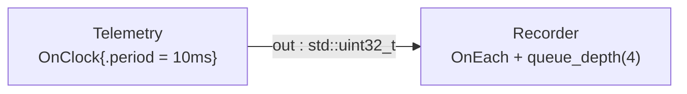

# plan_artifacts — inspect, serialize, and publish an ExecutionPlan

> **Developer preview.** The plan-tooling surface described here — record
> accessors, canonical JSON, digests, and artifact emission — is functional but
> still evolving. Accessor names, the JSON schema version, and the artifact
> bundle layout may change in upcoming releases. Pin your SDK version in CI
> jobs that depend on plan digests or bundle contents.
>
> **User guide:** [Plan Tooling](https://docs.nvidia.com/holoscan/sdk-user-guide/advanced/plan-tooling) —
> this example is the cited program for
> surveying plan record accessors, diffing plans with `PlanDigest`, and
> publishing a deployment bundle with `emit_artifacts()`.

A two-operator pipeline is compiled (never run); the program prints a table of
headline plan accessors, persists `plan.json()` to a file, proves the digest is
a stable CI baseline (identical authoring → equal, unused pin → equal, tuning
edit → different), and publishes the deployment bundle twice to prove
idempotence (`changed == false` on re-emit).



## What you will learn

- Surveying an admitted plan through read-only record accessors:
  `execution_partitions()`, `scheduler_plan()`, `clock_catalog()`,
  `temporal_triggers()`, `tensor_allocations()`, and friends — all cheap,
  immutable, and side-effect-free.
- Resolving canonical plan IDs against `plan.graph()` (the plan's frozen name
  table), never against your pre-compile authoring handles.
- `plan.json()` as canonical, schema-versioned bytes you can archive and diff.
- `plan.digest()` — a 256-bit semantic `PlanDigest`
  (`std::array<std::byte, 32>`) compared with `==` and rendered as hex — as the
  CI regression gate.
- `emit_artifacts(plan, ArtifactEmitOptions{.root, .deployment_id})` and the
  `ArtifactEmitResult{.changed, .catalog_path, .manifest_path,
  .catalog_digest}` idempotence contract.
- Pinning one generated endpoint name via
  `CompileOptions::deployment.allow_generated_endpoint_name(GeneratedEndpointNamePin{...})`
  and reading back the deep-owned pin record.

## Prerequisites

- [`essential/config_file`](../../essential/config_file/README.md) (E26) — the
  previous learning-chain step binds admitted configuration before compile;
  this example serializes and compares the resulting plan identity.
- [`compile_and_check`](../../compile_and_check/README.md) (E16) — the foundational
  `plan.ok()`, diagnostics, and digest workflow used here.
- No GPU is required, and the plan is never executed: every operation here is
  a cold operation on the immutable `ExecutionPlan`.

## Build

From this `cpp/` folder, `CMakeLists.txt` is the standalone `cmake -S .`
entry point and forwards that mode to `CMakeLists.min.txt`:

```bash
cmake -B build -S .
cmake --build build
```

If your SDK lives elsewhere, point `-Dholoscan_DIR=` at the directory
containing `holoscan-config.cmake`. Inside the SDK source tree the example
builds as part of the normal examples build via `CMakeLists.txt`.

## Run

```bash
./build/plan_artifacts
```

Or through CTest:

```bash
ctest --test-dir build -R EXAMPLE_CPP_PLAN_ARTIFACTS_TEST
```

## Expected output

```text
[pin] final_name=telemetry.samples algorithm=holoscan.auto_endpoint_name version=1
[plan] ok: yes (diagnostics: 0)
[table] execution_partitions().size()     | 1
[table]   partition 1                     | lane=0 members=recorder,telemetry
[table] scheduler_plan()                  | ready_policy=holoscan.ready.deterministic_serial v1 lanes=1 max_concurrent=1 workers=1
[table] clock_catalog()                   | plan_generation=5299862849567575108 clocks=1 default=app-clock
[table] temporal_triggers().size()        | 2 (kEach, kClock)
[table] tensor_allocations().size()       | 0 (no tensor_allocation outputs here)
[table] json().size()                     | 20738 bytes
[json] plan.json written: plan_artifacts_plan.json (20738 bytes)
[digest] first  compile: 629a0e52797f5f46af9f633ae9c65cf6d5090ffa725df5966de75bfadf6251c1
[digest] second compile: 629a0e52797f5f46af9f633ae9c65cf6d5090ffa725df5966de75bfadf6251c1
[digest] identical authoring digests equal: yes
[digest] unused pin changes digest: no
[digest] edited compile: 5fa9ae6f8ef13426355f5545f4287dfc6cad9d729c3dd57e057bcc7897c0adf9
[digest] edited graph digest differs: yes
[artifacts] first emit:  changed=yes catalog=endpoint-catalog.json manifest=artifact-manifest.json
[artifacts] catalog_digest=sha256:f21a7e651855bf1d3439b6abe9b957b81e626d11d1fc7610424bc83062b4a83e
[artifacts] second emit: changed=no digest identical: yes
plan_artifacts example complete: accessors, digest, and idempotent artifacts verified
```

Identity values — the digest hex strings, `plan_generation`, the JSON byte
count, and the `sha256:` catalog digest — are deterministic for a given SDK
build but change across SDK releases; the yes/no verdicts and the final
marker line are the stable part.
Partition members print as `recorder,telemetry` because plan records use
canonical (alphabetical) vertex order, not authoring order.

## Code walkthrough

### Why the plan is the tooling surface

`compile()` returns an immutable, deep-owning snapshot of every decision the
compiler made. Every accessor in the table — `execution_partitions()`,
`scheduler_plan()`, `clock_catalog()`, `temporal_triggers()`,
`tensor_allocations()` — returns plan-owned records or views: nothing is
computed on demand, nothing can mutate the plan, and the records stay valid
after the source `Graph` is edited or destroyed. That is what makes
inspection tooling (CI checks, dashboards, budget audits) safe to build with
zero runtime involvement. The one discipline is ID resolution: records speak
canonical dense IDs, so `member_names()` joins partition members against
`plan.graph().vertices()` — the plan's own frozen name table — never against
the authoring handles used to compose.

### Why a digest instead of diffing JSON

`plan.json()` is canonical and deterministic, so archiving and textual
diffing work — but a CI gate only needs to know *whether the compiler made
the same decisions*. `plan.digest()` answers exactly that with one 256-bit
semantic digest compared via `==`; the hex string printed here is the byte
array rendered for humans. The three comparisons are the whole CI story: an
independently authored identical graph digests equal (the baseline is
meaningful), and a small tuning edit — 10ms/depth-4 to 5ms/depth-8 — moves
the digest (the gate actually trips). The digest is a change detector, not a
cryptographic authenticity claim.

### Why the unused pin does not move the digest

The pin is *deployment authority*: it tells the compiler which exact
generated endpoint identity (`final_name` + `algorithm` + `version`, matched
exactly, no wildcards) may be exposed to external clients. This graph exports
no external topic, so the pin goes unused — and the program proves the
compile with the pin and the compile without it produce identical digests
*and* identical JSON. Plan identity covers plan semantics only; admission
authority that never bound to anything leaves no trace. When a graph does
lean on generated names, the exactness makes the pin a refactor tripwire: a
structural rename stops matching and fails in CI instead of in production.

### Why `emit_artifacts` is safe to call unconditionally

Publication is explicit, atomic, and idempotent. Changed content is written
through verified temporary siblings and the manifest is committed *last* as
the sole completeness marker, so a reader that sees
`artifact-manifest.json` sees a complete bundle. Re-emitting an identical
bundle rewrites nothing and reports `changed == false` with the same
`sha256:` catalog digest — which is why the program can call it twice into
the same root and a redeploy pipeline can call it on every deploy. I/O
failures come back as typed `Error` values in the `expected`, never as
exceptions.

## What's next

- [`examples/experimental/restart_control`](../restart_control/README.md) — lifecycle
  records from the same plan drive a running application's restart control.
- Guide deep-dive: advanced/plan-tooling (full accessor map, bundle layout,
  containment rules) and advanced/standalone-channel-clients (consuming the
  published endpoint catalog).

## Concepts at a glance

| API | Role in this example |
|---|---|
| `plan.execution_partitions()` | accepted disjoint partition cover; members resolved via `plan.graph()` |
| `plan.scheduler_plan()` | deterministic-serial scheduler evidence (`ready_policy`, lanes, workers) |
| `plan.clock_catalog()` | plan-local clock catalog view (`plan_generation`, dense `clocks`) |
| `plan.temporal_triggers()` | one pointer-free record per admitted trigger (`kClock`, `kEach`) |
| `plan.tensor_allocations()` | admitted Tensor pool plans — empty here, by design |
| `plan.json()` | canonical schema-versioned bytes, persisted to a file |
| `plan.digest()` / `PlanDigest` | 256-bit semantic baseline, compared with `==`, printed as hex |
| `GeneratedEndpointNamePin` | exact `{final_name, algorithm, version}` deployment admission |
| `DeploymentBinding::allow_generated_endpoint_name` | attach the pin to `CompileOptions::deployment` |
| `emit_artifacts` / `ArtifactEmitOptions` | explicit publication under `{.root, .deployment_id}` |
| `ArtifactEmitResult` | `.changed`, `.catalog_path`, `.manifest_path`, `.catalog_digest` evidence |
