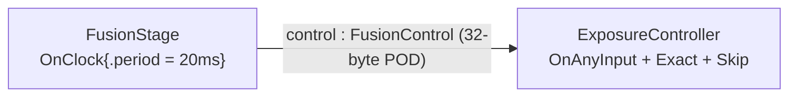

# pod_payloads — experimental raw structs as port payloads

> **Experimental, expert-level API.** Prefer an application-owned
> [FlatBuffers schema](../../flatbuffer_schemas/custom_schema/README.md) for
> ordinary structured messages. This raw POD path is intended for specialized
> applications that deliberately avoid schema compilation and generated code.
> Its constraints and API may change between early-access releases.
>
> **User guide:** [Experimental Raw POD Payloads](https://docs.nvidia.com/holoscan/sdk-user-guide/advanced/experimental-pod-payloads) —
> this example is the cited
> program for the `FusionControl` POD walkthrough (also serves
> payload-type-rules).

A clock-driven fusion stage emits a custom 32-byte `FusionControl` struct
every 20 ms through an ordinary typed port; an exposure controller receives
it, prints the decoded fields for six samples, and the program cooperatively
stops with a single summary line.



## What you will learn

- The two trait specializations that admit a plain-old-data struct as a port
  payload: `ChannelTypeIdentity<T>` (dotted name + nonzero version) and
  `ChannelPodLayout<T>` (`pod_fields(pod_field("m", &T::m, offsetof(T, m)),
  ...)`).
- Why the declared fields must **tile the struct exactly** — zero implicit
  padding — and how to guarantee that by ordering members by decreasing
  alignment (8 → 4 → 2 → 1).
- The two rejection points for a bad layout: the focused compile-time
  `assert_complete_channel_pod_contract` diagnostic when typed authoring
  materializes the port identity, and the defensive `GRAPH_POD_LAYOUT_INVALID`
  diagnostic for an untrusted pointer-free record.
- The no-`bool` rule and its `std::uint8_t` replacement, plus fixed
  `std::array` members (including an explicit `reserved` tail array).
- Version-bump discipline: the same name + version must always mean the same
  bytes, and your application must coordinate producer and consumer rollout.
- That `Output<FusionControl>` / `Input<FusionControl>`, `emit()`,
  `receive()`, and `add_flow()` are byte-for-byte the scalar workflow — the
  runtime derives the canonical little-endian codec from the traits.

## Before choosing this path

- Start with [`flatbuffer_schemas/custom_schema`](../../flatbuffer_schemas/custom_schema/README.md).
  Generated schemas provide identity, serialization, reflection, nested and
  variable-length fields, and a machine-readable schema source without
  hand-authored byte-layout traits.
- Use raw POD only when avoiding the FlatBuffers compiler and generated code is
  itself a requirement, the payload is a small fixed-layout scalar aggregate,
  and you can coordinate every producer and consumer.
- No GPU is required: the payload is a 32-byte host struct.

## Build

From this `cpp/` folder (standalone consumer build, using
`CMakeLists.min.txt` as the project file):

```bash
cmake -B build -S . -Dholoscan_DIR=/opt/nvidia/holoscan/lib/cmake/holoscan
cmake --build build
```

If your SDK lives elsewhere, point `-Dholoscan_DIR=` at the directory
containing `holoscan-config.cmake`. Inside the SDK source tree the example
builds as part of the normal examples build via `CMakeLists.txt`.

## Run

```bash
./build/pod_payloads
```

Or through CTest:

```bash
ctest --test-dir build -R EXAMPLE_CPP_POD_PAYLOADS_TEST
```

## Expected output

```text
FusionControl frame=1 t_ns=20000000 exposure_delta=-2 confidence=0.90 roi=961x540 locked=1
FusionControl frame=2 t_ns=40000000 exposure_delta=-1 confidence=0.90 roi=962x540 locked=0
FusionControl frame=3 t_ns=60000000 exposure_delta=0 confidence=0.90 roi=963x540 locked=1
FusionControl frame=4 t_ns=80000000 exposure_delta=1 confidence=0.90 roi=964x540 locked=0
FusionControl frame=5 t_ns=100000000 exposure_delta=2 confidence=0.90 roi=965x540 locked=1
FusionControl frame=6 t_ns=120000000 exposure_delta=3 confidence=0.90 roi=966x540 locked=0
pod_payloads: decoded 6 FusionControl samples (last frame=6, size=32 bytes, zero padding) termination=stopped
```

Each `FusionControl` line is printed by `ExposureController` while the graph
runs — every field of the received struct, already decoded. The final line is
printed by `main()` only after `session.wait()` returns and the termination
state is verified; the smoke test anchors on that line alone. The timestamps
are the nominal 20 ms capture cadence stamped by the producer, so the output
is deterministic.

## Code walkthrough

### Why a struct must declare identity and layout at all

The runtime never guesses what your bytes mean: there is no RTTI fallback, no
compiler-name fallback, and no "same size, close enough" matching. A POD
payload carries an explicit versioned identity
(`"com.example.FusionControl"`, version 2) and an exact field layout, and a
producer and consumer interoperate only when name, version, object
size/alignment, and the complete field layout are *identical* — even across
processes. That moves silent type confusion, one of the nastiest pipeline
bugs, into either a compile error (layout mistakes) or a typed, fail-closed
`kIncompatible` rejection (identity mismatches) that never reaches
`compute()`.

### Why the fields must tile the struct exactly — and how ordering delivers that

`ChannelPodLayout` requires each `pod_field` to start exactly where the
previous one ended and the last to end at `sizeof(T)`. Implicit compiler
padding therefore makes a struct *undescribable*: there is no pad-field
mechanism, by design — a padding byte is a byte whose value the wire contract
cannot pin. `FusionControl` earns zero padding by ordering members by
decreasing alignment: `std::uint64_t` (8) → `std::uint32_t`/`std::int32_t`/
`float` (4) → `std::array<std::uint16_t, 2>` (2) → `std::uint8_t` bytes (1).
The source keeps a commented-out `PaddedControl` counter-example that puts a
1-byte member before a 4-byte member: the compiler inserts three padding
bytes, `complete_channel_pod_contract` evaluates false, and the
`assert_complete_channel_pod_contract` assertion fails when
`OperatorSpec::output` materializes the identity for `Output<PaddedControl>`.
An untrusted pointer-free layout record that does not pass through typed
authoring is still rejected when the graph composes the connection, with the
`GRAPH_POD_LAYOUT_INVALID` diagnostic
(`ErrorCode::kInvalidArgument`). Layout bugs die at build time — that is the
*good* failure mode.

### Why there is no `bool` — and what replaces it

POD fields are fixed-width scalars only (`std::uint8_t` … `std::uint64_t`,
signed variants, `float`, `double`) or fixed-length arrays of them. `bool`,
`enum`, pointers, nested structs, and `std::string` are not admitted as
fields, because their object representations are not pinned by the wire
contract (`bool` remains fine as a standalone scalar port payload).
`FusionControl` shows the two idioms: `exposure_locked` is a `std::uint8_t`
carrying 0/1 in place of a `bool`, and the fixed `std::array` members carry
the ROI pair and the explicit `reserved` tail. That tail is the second half
of the padding rule: `alignof(FusionControl)` is 8, so `sizeof` must be a
multiple of 8 — naming the seven trailing bytes keeps them part of the
contract instead of invisible tail padding.

### Why the version is 2, not 1

The guide's inline walkthrough ships `com.example.FusionControl` version 1
with three fields; this example extends the payload (timestamp, ROI, lock
flag), so the version bumps to 2. The rule is absolute: same name + same
version must always mean the same bytes. Producer and consumer must match the
version exactly — there is no negotiation and no best-effort decode — so a
layout edit without a version bump is a wire-protocol bug, not a style issue.

### Why the pipeline code does not change

`FusionStage` declares `Output<FusionControl>`, states `OnClock{.period =
20ms}`, and emits a braced struct; `ExposureController` declares
`Input<FusionControl>` and spells out the ordinary input-ready transaction:
`OnAnyInput{}` proposes an activation, `Exact{}` selects one sample, and
`Skip{}` suppresses compute if that selection cannot be formed. The same
trigger would be synthesized if this inputful contract omitted an explicit
trigger; writing it here makes all three roles visible. `receive()` then hands
back a `Sample<FusionControl>` whose `.data` is the struct. `add_flow`,
`compile`, `run_async`, and the cooperative-stop idiom are unchanged from
`first_pipeline`. You never write encode/decode code: the runtime derives a
canonical little-endian codec from the layout for process boundaries, and
in-process connections carry the typed struct inline with no serialization at
all.

## HSDK 4.x comparison

| Concern | HSDK 4.x | HSDK 5.x `pod_payloads` |
|---|---|---|
| Sending a custom struct in-process | `op_output.emit(value, "out")` accepted any copyable C++ type with no declaration | the type must satisfy the POD contract (or be a schema/tensor payload); ports are typed members `Output<FusionControl>` |
| Cross-process transport | separate codec registration for distributed apps; unregistered types failed at runtime | the same two trait specializations serve in-process and interprocess; the codec is derived, never hand-registered |
| Type mismatch across a boundary | discovered at runtime, sometimes as garbled data or transport errors | fail-closed typed `kIncompatible` rejection before `compute()`; layout errors are compile errors |
| Layout/versioning | implicit — whatever the C++ ABI produced | explicit identity (name + version) and byte-exact field tiling, checked at compile and composition time |

4.x made the easy case silent and the hard case (crossing a process boundary)
a separate, runtime-discovered chore. 5.x charges a small, explicit,
compile-checked declaration once, and in exchange the same struct works
everywhere with the whole type-confusion bug class moved to build time.

## What's next

- [`examples/schema_payloads`](../../schema_payloads/README.md) — zero-declaration SDK
  schema types (`schema::StringT`, `schema::TimeT`, `schema::ImuT`) when a
  flat struct is not enough.
- Guide deep-dive: [Experimental Raw POD Payloads](https://docs.nvidia.com/holoscan/sdk-user-guide/advanced/experimental-pod-payloads)
  and [Payload Type Rules](https://docs.nvidia.com/holoscan/sdk-user-guide/data-and-payloads/payload-type-rules).

## Concepts at a glance

| API | Role in this example |
|---|---|
| `ChannelTypeIdentity<FusionControl>` | dotted wire name + nonzero version (bumped to 2 for the extended layout) |
| `ChannelPodLayout<FusionControl>` | ordered `pod_fields`/`pod_field` tiling all 32 bytes exactly |
| `pod_field("m", &T::m, offsetof(T, m))` | one field descriptor: name, member pointer, real byte offset |
| `assert_complete_channel_pod_contract` | focused compile-time diagnostics for invalid identity or layout during typed authoring |
| `GRAPH_POD_LAYOUT_INVALID` | composition-time rejection of an invalid layout record |
| `std::uint8_t` flag / `std::array` members | `bool` replacement and fixed-array fields (incl. explicit `reserved` tail) |
| `Output<FusionControl>` / `Input<FusionControl>` | POD rides the ordinary typed ports; `emit`/`receive` unchanged |
| `OnClock{.period = 20ms}` | time-driven producer activation |
| `OnAnyInput{}` + `Exact{}` + `Skip{}` | explicit input-ready activation, one-sample selection, and no-sample suppression |
| `run_async` / `request_stop` / `wait` / `termination()` | cooperative run lifecycle from `first_pipeline` |
