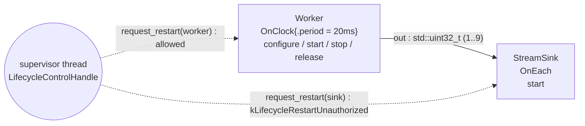

# restart_control — bounded lifecycle restarts, from inside and outside the run

> **Experimental example; Beta capability.**
> Lifecycle restart executes end to end today and the API may still evolve in
> upcoming releases. Works today: deny-by-default grants, nonblocking requests
> from `compute()` and a `LifecycleControlHandle`, the full teardown/forward
> re-entry matrix, closures, widening, fencing, rollback with old-epoch
> restoration, and `lifecycle_mutable` parameter-origin restarts. Compatible
> requests accepted while a transaction is queued may share it — including
> requests for different operators; each request keeps its own receipt. Not
> yet in EA1: restart requests from inside a lifecycle callback, a graph-wide
> atomic restart, quiescing of interprocess neighbors, automatic retry of
> failed stages, and clock- or tag-timed restarts. Enabling
> `CompileOptions::lifecycle_transactions` on a plan containing a `real_time`
> or `regulated` region fails compilation; no restart request is admitted into
> a run. The
> `examples/experimental/` directory is an EA1 example-catalog location, not
> the API's stability stage.
>
> **User guide:** [Restart Control](https://docs.nvidia.com/holoscan/sdk-user-guide/advanced/restart-control) —
> this example is the cited program
> for deny-by-default restart authority, `ctx.request_restart()` from
> `compute()`, and the external `LifecycleControlHandle` minted from a
> `RunSession`.

A clock-driven `Worker` streams three samples per lifecycle epoch into a
`StreamSink` and then wedges; the first wedge is cured by a self-restart
requested from its own `compute()`, the second by an external restart driven
from a supervisor thread — and one deliberately unauthorized attempt against
the sink is rejected as `kLifecycleRestartUnauthorized` while the sink itself
keeps running through all three epochs.



The dashed edges are control, not data flow: the plan admits external restart
authority only for the worker, so the same handle call that restarts the
worker is rejected against the sink. The same facts appear in prose below.

## What you will learn

- Deny-by-default restart authority at graph scope:
  `graph.lifecycle().allow_self_restart(worker).allow_external_restart(worker)`
  — and the compile-time opt-in
  `CompileOptions::lifecycle_transactions = LifecycleTransactionOptions{...}`
  with its nine explicit capacity bounds.
- Requesting a self-restart from `compute()` with `ctx.request_restart()`
  (default `LifecycleRestartOptions{.from_stage = kConfigure}`), and why the
  returned `LifecycleRestartReceipt` is an identity, not a waiter.
- Reading `ctx.transition_phase()` in lifecycle callbacks so the
  `kPreRestartTeardown` and `kRestartForward` passes of each restart are
  visible next to `kStartupForward` and `kShutdownTeardown`.
- Minting a restriction-only `LifecycleControlHandle` with
  `session.lifecycle_control(LifecycleAccessPolicy{.allowed_targets,
  .allowed_from_stages})`, then `request_restart` / `inspect` / `await`.
- The typed unauthorized rejection: an un-granted target fails with
  `kLifecycleRestartUnauthorized` and changes no state.
- Closure scope in practice: the sink's single `kStart` event proves both
  restarts stayed inside the worker's lifecycle-dependency closure.

## Prerequisites

- [`examples/experimental/plan_artifacts`](../plan_artifacts/README.md) — the previous
  stop in the advanced example sequence; this example reads the accepted plan's
  `lifecycle_restart_targets()` records the same way that example walks plan
  accessors.
- [`examples/lifecycle_callbacks`](../../lifecycle_callbacks/README.md) — the eight
  stages, sparse `spec.lifecycle().stage(...)` registration, and the two
  steady transition phases this example extends with the restart phases.
- No GPU is required: payloads are bare `std::uint32_t` on host memory.

## Build

From this `cpp/` folder, `CMakeLists.txt` is the standalone `cmake -S .`
entry point and forwards that mode to `CMakeLists.min.txt`:

```bash
cmake -B build -S . -Dholoscan_DIR=/opt/nvidia/holoscan/lib/cmake/holoscan
cmake --build build
```

Inside the SDK source tree the example builds with the regular examples
target; `CMakeLists.txt` is the in-tree file.

## Run

```bash
./build/restart_control
```

The program is self-checking: it verifies the sink's nine in-order samples,
the worker's twelve-event stage arc, both `published` transaction states, and
the unauthorized rejection before printing the final summary line, and exits
nonzero on any mismatch. It stops itself via `request_stop()`; total runtime
is well under the 30 s test timeout.

## Expected output

```text
restart_control: plan accepted; restart authority: worker=self+external, sink=none
restart_control: worker wedged after 3 samples; self restart accepted (receipt_id=1, requested_stage=configure)
restart_control: self restart transaction state=published (inspected via control handle)
restart_control: external restart (receipt_id=2) await -> state=published, effective_stage=configure
restart_control: unauthorized target rejected: kLifecycleRestartUnauthorized
worker observed arc (12 events):
  configure @startup-forward
  start @startup-forward
  stop @pre-restart-teardown
  release @pre-restart-teardown
  configure @restart-forward
  start @restart-forward
  stop @pre-restart-teardown
  release @pre-restart-teardown
  configure @restart-forward
  start @restart-forward
  stop @shutdown-teardown
  release @shutdown-teardown
sink observed arc (1 event):
  start @startup-forward
restart_control: restarts published (1 self, 1 external); unauthorized target rejected (kLifecycleRestartUnauthorized); sink received 9 samples across 3 epochs termination=stopped
```

Receipt ids are run-scoped acceptance identities; `1` and `2` are what a
clean run mints for the first and second accepted requests. The program first
prints the raw observed callback arcs for diagnostics, then compares them with
all twelve expected worker events and the sink's one startup event before
printing the final success marker. Each restart is a teardown pass
(`stop`/`release` at `pre-restart-teardown`) followed by a forward pass
(`configure`/`start` at `restart-forward`).

## Code walkthrough

### Authority is composition data, not a runtime toggle

Nothing in a Holoscan application may restart an operator unless the graph
said so at authoring time. The example grants the worker exactly two of the
three narrow grants (`allow_self_restart`, `allow_external_restart`) and the
sink none, then opts the plan into restart transactions with
`CompileOptions::lifecycle_transactions`. Every bound in
`LifecycleTransactionOptions` is explicit because restart bookkeeping —
pending requests, receipts, fences, audit and rollback journals — is
fixed-size at run time; nothing about recovery allocates on demand. Without
the opt-in every restart path fails closed with
`kLifecycleTransactionsDisabled`, and the plan itself records the outcome:
`main()` picks its two targets out of `plan.lifecycle_restart_targets()` by
their admitted authority flags rather than by name.

### The wedge, and why the request is nonblocking

The worker spends a three-sample budget per lifecycle epoch and then wedges —
activations keep firing, nothing is emitted. Inside `compute()` the cure is
one call: `ctx.request_restart()`. Acceptance only queues a bounded
transaction and installs an activation fence; the restart executes after the
current callback retires, never mid-`compute()`. That is why the return value
is a small trivially copyable `LifecycleRestartReceipt` — an identity you can
hand to observation code — and why the worker un-wedges in its `kStart`
callback, which re-derives the per-epoch budget: state a restart must reset
belongs in stage callbacks, state that must survive restarts (the wedge
latch, the emitted-value counter) lives outside them.

### Phases make the restart visible

Every stage callback records `ctx.transition_phase()`. A `kConfigure`-rewind
restart tears down through `stop`/`release` in `kPreRestartTeardown`, then
re-runs `configure`/`start` in `kRestartForward` — the same checkpoints that
ran at `kStartupForward` on day one and at `kShutdownTeardown` after the
stop request. The sink records exactly one `kStart` event: a restart executes
over the target's *lifecycle-dependency closure*, and a data-flow consumer is
not part of it — the sink's queue simply sees the worker's output resume.

### External control is a capability that can only shrink

The supervisor thread binds plan identities to the live run with
`session.operator_ref(...)` (identity only — no authority), then mints a
handle whose `LifecycleAccessPolicy` names one target and one stage. The
policy can narrow but never broaden what the plan admitted, so a subsystem
holding the handle cannot escalate. `await()` is the single blocking handle
operation and its timeout never cancels the transaction; `inspect()` shows
that the handle can also observe the worker's *self*-restart receipt, because
receipts are run-scoped identities rather than private waiters. The
unauthorized attempt against the sink comes back as the typed error
`kLifecycleRestartUnauthorized` with no state change — same fail-closed shape
as every other rejection in the runtime.

## HSDK 4.x comparison

| Concern | HSDK 4.x | HSDK 5.x |
|---|---|---|
| Recover one wedged operator | No public mechanism — stop the whole `Application::run()` and start over | Bounded per-target lifecycle restart transaction |
| Who may trigger recovery | n/a | Graph-scope grants: self / external / requester→target |
| Observing recovery | n/a | `LifecycleRestartReceipt` + `inspect()`/`await()` terminal states |

4.x had no per-operator restart, so recovering a wedged driver meant tearing
down the entire pipeline. 5.x deliberately scopes recovery to a
compiler-frozen closure with deny-by-default authority: restart is a
permissioned data-plane-preserving transaction, not a stop-the-world event.

## What's next

- [`examples/experimental/runtime_params`](../runtime_params/README.md) — the next stop
  in the advanced example sequence: changing an operator's typed parameters in a
  running session through the same capability-style control surface.
- Guide deep dive: advanced/restart-control — closure widening rules, the
  activation fence, and rollback dispositions.

## Concepts at a glance

| API | Role |
|---|---|
| `graph.lifecycle().allow_self_restart(op)` | Grant: operator may restart itself from `compute()` |
| `graph.lifecycle().allow_external_restart(op)` | Grant: run control outside the graph may restart it |
| `CompileOptions::lifecycle_transactions` | Compile-time opt-in with nine explicit capacity bounds |
| `plan.lifecycle_restart_targets()` | Per-operator admitted-authority records in the accepted plan |
| `ctx.request_restart(options)` | Nonblocking self-restart request from `compute()` |
| `LifecycleRestartReceipt` | Run-scoped identity of one accepted request |
| `ctx.transition_phase()` | Which pass owns a lifecycle callback (startup/teardown/restart) |
| `session.operator_ref(plan_ref)` | Bind plan identity to the live run — identity, not authority |
| `session.lifecycle_control(policy)` | Mint a restriction-only `LifecycleControlHandle` |
| `handle.request_restart / inspect / await` | Submit, observe, and block-until-terminal on receipts |
| `kLifecycleRestartUnauthorized` | Typed fail-closed rejection of an un-granted target |
