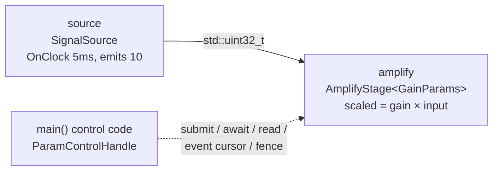

# runtime_params — changing a typed parameter while the graph runs

> **Experimental example; Beta capability.**
> Runtime parameter updates work today with hard bounds, and the API may still
> evolve in upcoming releases: values are **scalars only** (bool, fixed-width
> integers, enums, `float`, `double`, and integral-nanosecond durations — no
> strings, containers, or Tensors); a `runtime_mutable()` field publishes at
> the target operator's **next compute boundary** (never mid-callback and
> never at an arbitrary clock time), while a `lifecycle_mutable(stage)` field
> publishes through a **lifecycle restart transaction**; and runtime mutation
> is admitted only under the **Standard** and **Research** profiles. Atomic
> batches are limited to a single operator — there is no graph-wide atomic
> update. The `examples/experimental/` directory is an EA1 example-catalog
> location, not the API's stability stage.
>
> **User guide:** [Runtime Parameter Updates](https://docs.nvidia.com/holoscan/sdk-user-guide/advanced/runtime-parameter-updates) —
> this example is the
> cited program for the full programmatic update cycle: opt-in chain, control
> handle, submit/await/read, event cursor, and the ingress fence.

A two-operator pipeline — a 5 ms clock-driven source emitting a constant
reading into a gain stage with a `.runtime_mutable()` `gain` field — keeps
running while a control thread (here, `main()`) doubles the gain through a
`ParamControlHandle`, proves the new generation was pinned by a real
`compute()`, exercises one optimistic-concurrency rejection, drains the
value-free event stream, and finally fences the run against any further
update.



The control edge is dashed because no data flows through it: updates travel
as **immutable parameter generations** published at the target operator's
next compute boundary, never as in-place mutation of a running callback's
values.

## What you will learn

- The two-link opt-in chain: `field<&GainParams::gain>("gain").runtime_mutable()`
  in `HOLOSCAN_PARAM_SCHEMA` **and**
  `CompileOptions::parameters.runtime_updates = ParamRuntimeUpdatePolicy::kEnabledIfAdmitted`.
- How to address a field: `plan.parameter_fields()` →
  `ParameterFieldPlanRecord{.owner, .field}` → `session.operator_ref(owner)` →
  `ParamAddress`.
- Minting a restriction-only `ParamControlHandle` with
  `session.parameter_control(ParamAccessPolicy{...})`.
- Why `submit()` returning `committed` is a *reservation*, and how
  `await(update_sequence, timeout)` resolves through `kPublished` to
  `kObserved` once a callback pins the new generation.
- Coherent read-back with `read(address, ParamReadView::kPublished)` and
  change-tracking with `open_event_cursor()` / `drain()`.
- Optimistic concurrency (`expected_generation` →
  `kExpectedGenerationMismatch`) and the irreversible
  `session.close_parameter_update_ingress()` fence (`kClosed` afterwards).

## Prerequisites

- [`examples/experimental/restart_control`](../restart_control/README.md) — the
  previous stop in the advanced example sequence; the same capability-style pattern
  (mint a policy-scoped handle from the running session) drives restarts
  there and parameter updates here.
- [`examples/parameter_schemas`](../../parameter_schemas/README.md) — the schema
  builder this example's `.runtime_mutable()` marker comes from, including
  the namespace-scope `HOLOSCAN_PARAM_SCHEMA` rule.
- No GPU is required; the payload is a bare `std::uint32_t` on host memory.

## Build

From this `cpp/` folder, `CMakeLists.txt` is the standalone `cmake -S .`
entry point and forwards that mode to `CMakeLists.min.txt`:

```bash
cmake -B build -S . -Dholoscan_DIR=/opt/nvidia/holoscan/lib/cmake/holoscan
cmake --build build
```

If your SDK lives elsewhere, point `-Dholoscan_DIR=` at the directory
containing `holoscan-config.cmake`. Inside the SDK source tree the example
builds as part of the normal examples build via `CMakeLists.txt`.

## Run

```bash
./build/runtime_params
```

The run is fully self-driving and finishes in well under ten seconds.

## Expected output

```text
plan accepted: field 'gain' is runtime-mutable
generation 0 pinned: gain=1 scaled=10
update committed: target_generation=1 update_sequence=1
generation 1 pinned: gain=2 scaled=20
await resolved: state=observed
read kPublished: gain=2 generation=1
stale patch rejected: status=expected-generation-mismatch (no sequence assigned)
event cursor: drained=3 for_our_update=3 gaps=0
ingress fenced: terminal_update_sequence=1
post-fence submit rejected: status=closed
runtime_params: gain 1->2 generation=1 state=observed mismatch=rejected events=seen fence=closed termination=stopped
```

`update_sequence` (and therefore `terminal_update_sequence`) is the
first accepted sequence of the run; the exact `drained=`/`for_our_update=`
counts depend on how many transition records the update produced and may
vary. Every other line is exact: the same constant input scales by 1 under
generation 0 and by 2 under generation 1, and the final marker line only
prints after the session stopped cleanly.

## Code walkthrough

### Why parameters are immutable generations

`AmplifyStage::compute()` reads `ctx.params<GainParams>()` — a reference
pinned for exactly this callback — alongside `ctx.params_generation()`. An
update never mutates that aggregate: it reserves a *new* immutable
generation that publishes at a scheduler-safe boundary, so a value can never
change (or tear) underneath a running `compute()`. The observable
consequence, printed by this example, is that "gain=2" always arrives
together with "generation 1" in a *later* callback, never mid-callback.

### Why acceptance is a reservation, not liveness

`submit()` returns synchronously with `committed=true` the moment the
runtime reserves a candidate generation and its audit evidence — the value
is **not** live yet. The example makes this ordering visible: it first waits
for the pipeline itself to report a generation-1 activation, then calls
`await()`, which treats `kPublished` as terminal while a bounded retry
absorbs the instant between "callback entered" and "retained lineage
advanced to `kObserved`". Control code that needs the value live must await;
checking `committed` alone is not enough.

### Why the address comes from the plan, not from strings at submit time

`ParamAddress` needs the plan-bound owner (`ParameterFieldPlanRecord.owner`)
re-stamped with the live run's identity via `session.operator_ref()`. That
run-stamping is what lets the runtime reject a stale controller — an address
built against a previous run fails typed (`kStaleOperatorRef`) instead of
silently steering the wrong instance. The plan is the address book;
canonical names are resolved once, before the run, not on the hot path.

### Why the policy is restriction-only and rejections are values

`ParamAccessPolicy` can only narrow what the plan and session already
admitted — never widen it — so handing a component a handle is handing it a
bounded capability, not ambient authority. Every failure in the flow is a
typed value on a result struct: the stale optimistic patch comes back
`committed=false` with `kExpectedGenerationMismatch` and **no** accepted
sequence, atomically leaving both published and latest-accepted views
untouched. Nothing throws, and nothing partially applies.

### Why the fence is irreversible

`close_parameter_update_ingress()` exists for the "validated configuration
entering a measurement window" moment: after the fence, no path — owning
handle or compute-originated — can slip another change in, and a later
`submit()` reports `kClosed`. Updates accepted *before* the fence still
publish, and the returned `terminal_update_sequence` tells control code
exactly what to `await`.

## HSDK 4.x comparison

| Concern | HSDK 4.x | HSDK 5.0 |
|---|---|---|
| Change a value mid-run | No supported surface; typical practice was a hand-rolled `std::atomic` member or a side channel next to `Parameter<T>` | First-class `ParamControlHandle` `submit`/`await`/`read` over immutable generations |
| Read coherence | Ad hoc sharing could tear across fields mid-`compute()` | Each callback pins one coherent generation; batches are same-operator atomic |
| Observability | None (invisible to the framework) | Typed statuses, `update_sequence` lineage, bounded value-free event cursor |

The 4.x gap was not the lack of a setter — it was that any homegrown setter
bypassed the scheduler, so authors traded torn reads against locks on the
hot path. 5.0 moves the update onto the scheduler's own compute boundary,
which is why acceptance and liveness are deliberately separate states.

## What's next

- [`examples/experimental/web_tuner`](../web_tuner/README.md) — the next stop in the
  advanced example sequence: a loopback browser front-end over this exact
  generations engine, for fields additionally marked `.external_tuning()`.
- Guide deep dive: advanced/runtime-parameter-updates — compute-originated
  submissions (`ctx.param_control().try_submit_from_compute()`), snapshot
  capture, and the full rejection taxonomy.

## Concepts at a glance

| API | Role |
|---|---|
| `field<&T::gain>("gain").runtime_mutable()` | opt-in link 1: field marker in the schema |
| `options.parameters.runtime_updates = kEnabledIfAdmitted` | opt-in link 2: compile-time policy (Standard/Research profiles) |
| `plan.parameter_fields()` | address book: owner + stable field identity per declared field |
| `session.operator_ref(record.owner)` | re-stamps a plan-bound owner with the live run's identity |
| `session.parameter_control(policy)` | mints a restriction-only `ParamControlHandle` |
| `handle.submit(ParamPatch{...})` | typed synchronous reservation (`ParamBatchUpdateResult`) |
| `ParamPatch::expected_generation` | optimistic precondition → `kExpectedGenerationMismatch` on a stale view |
| `handle.await(seq, timeout)` | blocks to a terminal state; `kPublished` terminal, `kObserved` after a callback pins it |
| `handle.read(address, ParamReadView::kPublished)` | coherent no-wait read-back with generation lineage |
| `handle.open_event_cursor()` / `cursor.drain(span)` | independent, bounded, value-free transition stream (`kGap` on retention loss) |
| `session.close_parameter_update_ingress()` | irreversible run-wide fence; later submits report `kClosed` |
| `ctx.params<GainParams>()` / `ctx.params_generation()` | the pinned per-callback snapshot the whole model protects |
