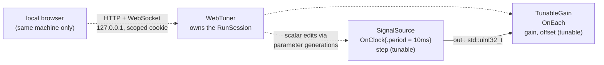

# web_tuner — live parameter tuning from a local browser

> **Experimental — build-flag-gated.** This example builds only when the SDK
> is configured with `-DHOLOSCAN_BUILD_EXPERIMENTAL_PARAMS_WEB_TUNER=ON`
> (the default, which itself requires `-DHOLOSCAN_BUILD_PARAMS=ON`). If a
> consumer configures the tuner flag `OFF`, this example degrades gracefully:
> it is excluded with a configure-time
> `message(STATUS ...)` notice, never a build error. The API lives in
> `holoscan/experimental/params/web_tuner.hpp` under
> `holoscan::experimental::params` and may change in any release.
>
> **Underlying capability: Beta, with hard bounds.** The runtime parameter
> updates this tuner drives work today: values are **scalars only** (bool,
> fixed-width integers, enums, `float`, `double`, and integral-nanosecond
> durations — no strings, containers, or Tensors); a `runtime_mutable()`
> field publishes at the target operator's **next compute boundary** (never
> mid-callback and never at an arbitrary clock time); and runtime mutation is
> admitted only under the **Standard** and **Research** profiles. Atomic
> batches are limited to a single operator — there is no graph-wide atomic
> update. The API may evolve in upcoming releases. The tuner facade itself
> remains Experimental as described above.
>
> **User guide:** [Runtime Parameter Updates](https://docs.nvidia.com/holoscan/sdk-user-guide/advanced/runtime-parameter-updates) —
> this
> example is the cited program for the experimental loopback web tuner (also
> serves configuring-applications as its live-tuning pointer).

A two-operator pipeline — a clock-driven counter with a tunable `step`
feeding a gain stage with tunable `gain` and `offset` — runs under
`WebTuner::start(plan, options)`, prints the loopback endpoint origin and
bootstrap URL with usage instructions, collects about one second of tuned
samples, then stops cooperatively and prints the terminal
`WebTunerResult` (`accepted_edits()`, `published_edits()`,
`terminalized_through()`, `stopped_snapshot()`).



## What you will learn

- The two-marker opt-in that puts a field in the tuner's browser catalog:
  `.runtime_mutable()` (live generation swaps) **plus** `.external_tuning()`
  (exposure to the external tuning surface) on each `field<>` declaration.
- The plan-side admission the tuner requires: `Profile::kStandard` (or
  Research) and `CompileOptions::parameters.runtime_updates =
  ParamRuntimeUpdatePolicy::kEnabledIfAdmitted`.
- The advanced facade `holoscan::experimental::params::WebTuner::start(plan,
  options)` — a move-only owner that runs the session itself (`main()` never
  calls `run_async`) — versus the blocking convenience
  `run_with_tuner(plan, options)`.
- What `WebTunerEndpoint` does and does not contain: a public `TunerScopeId`,
  the loopback `origin`, and the per-run `bootstrap_path` — routing identity
  only; the credential arrives via the bootstrap cookie exchange.
- `WebTunerOptions` bounds (`port = 0` for ephemeral, one logical client,
  connection/request/edit capacities) and the `WebTunerEndpointAnnouncement`
  policy — which announces only through the blocking `run_with_tuner()`
  facade; the advanced facade exposes `endpoint()` instead of logging.
- Reading the immutable terminal `WebTunerResult`: `accepted_edits()`,
  `published_edits()` (effective-in-published-state proof),
  `terminalized_through()`, and the coherent `stopped_snapshot()`.

## Prerequisites

- [`examples/experimental/runtime_params`](../runtime_params/README.md) — the
  programmatic `ParamControlHandle` path (`submit`/`await`/`read`); the tuner
  is a browser front-end over the same generations engine.
- No GPU is required; payloads are bare `std::uint32_t` on host memory.
- An SDK build with the tuner enabled (see the flag banner above).

## Build

From this `cpp/` folder, `CMakeLists.txt` is the standalone `cmake -S .`
entry point and forwards that mode to `CMakeLists.min.txt`:

```bash
cmake -B build -S .
cmake --build build
```

If your SDK lives elsewhere, point `-Dholoscan_DIR=` at the directory
containing `holoscan-config.cmake`. Inside the SDK source tree the example
builds as part of the normal examples build via `CMakeLists.txt`. In both
forms the example is guarded by
`if(TARGET holoscan::experimental_params_web_tuner)` — the same gate shape
the SDK's own `tests/params/CMakeLists.txt` uses in-tree — and configuring
against an SDK built without the flag prints a `STATUS` exclusion notice
instead of failing.

## Run

```bash
./build/web_tuner
```

While the ~1s window is open you can visit the printed bootstrap URL from a
browser **on the same machine** and edit `step`, `gain`, or `offset` live.
For interactive exploration, raise `kSampleTarget` in the source so the
window stays open longer.

Or through CTest (unattended; expects zero edits):

```bash
ctest --test-dir build -R EXAMPLE_CPP_WEB_TUNER_TEST
```

## Expected output

```text
web_tuner: endpoint origin http://127.0.0.1:41733
web_tuner: bootstrap URL   http://127.0.0.1:41733/__holoscan/tuner/v1/9f2ce1a04b7d43219f2ce1a04b7d4321/
web_tuner: open the bootstrap URL in a browser on this machine (the
web_tuner: tuner binds loopback only) to receive the scoped session
web_tuner: cookie, then edit 'step', 'gain', and 'offset' live; this
web_tuner: bounded demo stops on its own after ~1s of samples.
web_tuner: samples=100 last_tuned=100 gain=1 offset=0
web_tuner: terminalized_through=0
web_tuner: stopped accepted_edits=0 published_edits=0 catalog_schemas=2 samples=ok
```

The port and the 32-hex scope segment differ on every run (ephemeral port,
fresh OS-entropy scope id), and `samples=`/`last_tuned=` vary with timing.
No SDK log record appears: `WebTunerEndpointAnnouncement` drives only the
blocking `run_with_tuner()` facade's single INFO record (`Experimental
Parameter tuner listening at <origin><bootstrap_path>`); the advanced facade
never announces — it exposes `endpoint()`, and this example prints the
origin itself. The final line is printed only after `wait()` returns the
terminal result; the smoke test anchors on it with the unattended values
(no browser connected, so zero edits).

## Code walkthrough

### Why the pipeline itself is tuner-agnostic

`SignalSource` and `TunableGain` contain no tuner code at all. Tunability is
declared where the data lives — `field<&GainParams::gain>("gain")
.runtime_mutable().external_tuning()` in the schema — not where the tooling
lives. That is the point of the two-marker design: `.runtime_mutable()` is a
statement about the operator's update semantics (safe to swap between
activations), while `.external_tuning()` is a statement about exposure
policy (allowed to be driven from outside the process). An operator authored
with honest markers picks up the tuner, the programmatic control handle, and
any future tuning surface without a source change.

### Why `WebTuner::start` owns the RunSession

The tuner cannot bolt onto an already-running session: edits must be
admitted against the same immutable plan the session executes, and shutdown
must drain in-flight edits before the run result is captured. So
`WebTuner::start(plan, options)` performs the complete option/package/plan
checks, binds exactly one loopback family, and *then* starts the run it
owns. `main()` keeps only the tuner handle: `request_stop()` is the same
cooperative, idempotent signal a session exposes, and `wait()` joins all
owned work and returns one cached immutable result — every completed call
returns the same value. The blocking `run_with_tuner()` is the same machine
minus the handle, which is why this bounded demo (which must stop *itself*)
uses the advanced facade; the blocking form waits for an external stop.

### Why the endpoint is safe to print

`WebTunerEndpoint` carries the origin and the per-run bootstrap path built
from a `TunerScopeId` — 16 OS-entropy bytes rendered as 32 lowercase hex
characters. These are deliberately *routing* identity, not authorization:
the actual credential is minted during the bootstrap GET as a scoped,
HttpOnly, SameSite=Strict cookie valid only under that path, for one logical
client (`max_clients` supports only 1 in baseline). Combined with the
loopback-only bind (`kIpv4` → exactly 127.0.0.1, no fallback), printing the
URL — as this example does, and as `run_with_tuner()`'s `kLogOrigin` INFO
record does for the blocking facade — leaks nothing a local attacker could
replay from another origin.

### Why the terminal result distinguishes accepted from published

`accepted_edits()` counts edits Core admitted; `published_edits()` counts
those *proven effective in published state* — an accepted-no-change edit
contributes only after a semantic-equality proof against the published
view. The gap teaches the same reservation-versus-publication lesson as the
programmatic API's `submit` → `await(kObserved)` pair: acceptance is a
promise about the future, publication is an observed fact. The example
asserts the invariant `published_edits() <= accepted_edits()` in-process,
and reads `stopped_snapshot()` — a coherent capture taken after the closed
ingress frontier `terminalized_through()` — to verify both example schemas
were visible to the tuning surface (`catalog_schemas=2`).

## HSDK 4.x comparison

There is no 4.x counterpart: HSDK 4.x had no built-in live-tuning surface —
changing a parameter meant editing YAML and restarting the application, or
hand-rolling an ad-hoc control channel into an operator. The 5.x design
could add a web tuner as a *pure tool* precisely because parameters are
schema-declared, generation-versioned data the runtime already knows how to
update safely; the tuner adds transport and UI, not semantics.

## What's next

- [`examples/experimental/determinism_replay`](../determinism_replay/README.md) —
  reproducing a run exactly under `ManualClock` after you have tuned it.
- Guide deep-dive: advanced/runtime-parameter-updates (generations model,
  control handles, and the tuner section).

## Concepts at a glance

| API | Role in this example |
|---|---|
| `.runtime_mutable().external_tuning()` | two-marker opt-in that places a field in the tuner catalog |
| `Profile::kStandard` + `parameters.runtime_updates = kEnabledIfAdmitted` | plan-side admission the tuner checks at start |
| `WebTuner::start(plan, options)` | advanced facade; owns the RunSession and all helper work |
| `run_with_tuner(plan, options)` | blocking convenience; returns only after an external stop |
| `WebTunerOptions` | bounded tuner configuration (`port=0` → ephemeral, capacities, announcement) |
| `WebTunerEndpoint` (`origin`, `bootstrap_path`, `scope_id`) | public, token-free routing identity printed for the user |
| `WebTunerEndpointAnnouncement::kLogOrigin` | blocking-facade (`run_with_tuner()`) policy: one bounded INFO record announcing the non-secret origin |
| `tuner.request_stop()` / `tuner.wait()` | cooperative stop; join and cached immutable terminal result |
| `WebTunerResult::accepted_edits()` / `published_edits()` | admitted edits vs. edits proven effective in published state |
| `WebTunerResult::terminalized_through()` / `stopped_snapshot()` | closed ingress frontier and the coherent stopped capture |
