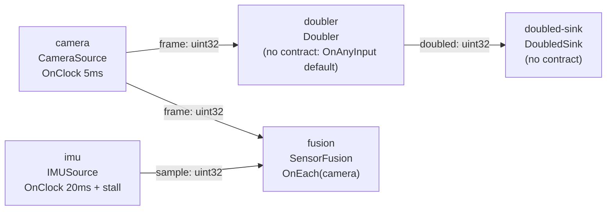

# First Operator: contract-less and contracted operators side by side

> **User guide:** [Your First Operator](https://docs.nvidia.com/holoscan/sdk-user-guide/getting-started/first-operator) —
> this example is the cited
> program for the contract-less `OnAnyInput{}` default and for the page's
> first explicit temporal contract (`OnEach` + `LatestWithin` +
> `ReuseLast`).

One fast camera source (5 ms) and one stall-prone IMU source (20 ms) feed a
contract-less `Doubler` chain and a contracted `SensorFusion` operator; the
program prints interleaved `doubled: N` and `fused: cam=N imu=M
(fresh|reused)` lines, then a deterministic post-shutdown summary of labeled
fresh/reused/missing counts.



## What you will learn

- When omitting `contract()` is enough: the runtime applies the
  `OnAnyInput{}` default to any operator with at least one connected input,
  and a compile-time error rejects an empty contract on a zero-input
  operator.
- Authoring your first explicit contract:
  `result.trigger(holoscan::OnEach{camera})
  .input(imu, holoscan::LatestWithin{.max_age = 5ms})
  .on_missing(imu, holoscan::ReuseLast{.max_age = 20ms})`.
- The two scalar receive variants: `in.receive()` returns a full
  `holoscan::Sample<T>` (payload plus `SampleMetadata`), while
  `in.receive_data()` returns the payload value only.
- Checked, `[[nodiscard]]` publication: `out.emit(...)` returns
  `holoscan::expected<void, holoscan::Error>`, which `compute()` returns
  directly instead of ignoring.
- Observing selection outcomes with `in.selection().state`
  (`InputState::kSelected` vs `kReused`) and `in.is_missing()`, so
  `ReuseLast` re-serving a stale sample is visible in the output.

## Prerequisites

- [`first_pipeline`](../first_pipeline/README.md) (E01) — the complete minimal pipeline.
  This example keeps that build/compile/run shape and opens the Operator and
  contract details that E01 intentionally hides.

## Build

From this `cpp/` folder, using an installed SDK (add
`-Dholoscan_DIR=<install>/lib/cmake/holoscan` if the SDK is not in one of
the default search paths baked into `CMakeLists.min.txt`):

```bash
cmake -B build -S .
cmake --build build
```

In the SDK source tree this folder builds as part of the examples
aggregate; the standalone `CMakeLists.min.txt` is the copy-paste starting
point for your own project.

## Run

```bash
./build/first_operator
```

The program needs no GPU, no configuration file, and no command-line
arguments; it stops itself after observing 48 fusion activations (bounded
by a 10 s safety timeout).

## Expected output

Per-activation lines are printed live from operator threads, so their
interleaving (and the exact fresh/reused split) varies run to run; the
final two summary lines are printed from `main()` after shutdown and always
appear, in order, with counts of this shape:

```text
doubled: 2
fused: cam=1 imu=none (missing)     <- before the first IMU sample arrives
doubled: 4
fused: cam=4 imu=20 (fresh)         <- IMU sample no older than 5 ms
doubled: 10
fused: cam=6 imu=20 (reused)        <- ReuseLast re-serves it up to 20 ms
...
fused: cam=22 imu=40 (missing)      <- IMU stalled > 20 ms: nothing to reuse
...
imu selection over 48 fused activations: fresh=13 reused=30 missing=5
first_operator complete: doubled=48 fused_fresh=13 fused_reused=30 fused_missing=5
```

## Code walkthrough

### Why the Doubler has no `contract()`

A contract answers one question: *when should this operator run, and with
which inputs?* For a stateless per-sample transform the answer is "once per
arriving sample" — exactly what the `OnAnyInput{}` default already says. So
`Doubler` (and `DoubledSink`) simply omit the override; the base class
returns an empty `Contract` and compilation substitutes the default. The
rule of thumb the guide gives: reach for an explicit contract only when
*time* enters the question — multiple rates, freshness bounds, alignment,
or missing-data policy. The zero-input edge case is guarded structurally: a
source cannot rely on the default (nothing would ever trigger it), so an
empty contract there is rejected at compile time, which is why both sources
here declare `OnClock` triggers.

### Why SensorFusion needs all three contract pieces

The fusion runs at camera rate (`OnEach{camera}`), but the IMU
is four times slower and sometimes silent. Declaring
`OnEach{camera}` already pins the exact readiness-causing camera sample; the
driver is not redundantly selected again. `LatestWithin{.max_age = 5ms}`
states the *quality* requirement (an IMU
sample counts as fresh only within 5 ms, measured in event time against
sample capture timestamps), and `ReuseLast{.max_age = 20ms}` states the
*degradation* policy (re-serve the last admitted sample for up to another
period). Encoding both in the contract means the runtime — not
hand-written buffering code in `compute()` — enforces the temporal
semantics, and the decision is inspectable in the compiled plan rather
than buried in operator state.

### Why `receive()` and `receive_data()` both exist

`Doubler` calls `receive()` because it *forwards* the sample: mutating
`sample->data` and emitting the same `Sample<T>` preserves the camera's
capture timestamp, which downstream age-based selectors depend on
(re-stamping on every hop would silently reset every freshness clock).
`SensorFusion` and `DoubledSink` call `receive_data()` because they only
consume the value; the payload-only variant also acquires no sample read
claim, so it is the cheaper default when metadata is not needed.

| Variant | Returns | Use when |
|---|---|---|
| `receive()` | `expected<Sample<T>, Error>` — payload + `SampleMetadata` | forwarding samples, reading capture time/sequence/flags |
| `receive_data()` | `expected<T, Error>` — payload only | plain consumption; no metadata, no read claim held |
| `selected_batch()` | `expected<SelectedBatchView<T>, Error>` | batch selectors (`DrainAll`, `BracketedWindow`) — see `temporal_contracts/*` |

### Why the freshness labels come from `selection()`, not from data

`compute()` never guesses whether a value is stale: the runtime froze that
decision before the callback ran, and `imu.selection().state` reports it —
`kSelected` (fresh), `kReused` (`ReuseLast` fired), or a missing state that
`imu.is_missing()` folds into one branch check. Branching on the selection
state rather than on payload heuristics is the intended pattern: it keeps
degraded-mode behavior explicit, testable, and aligned with what the
contract promised.

### Why the summary is printed from `main()` after `wait()`

Operators execute on runtime threads, so per-activation `std::cout` lines
can interleave arbitrarily between operators. The example therefore
collects counts in a small mutex/condition-variable observation struct,
waits for a bounded number of fusion activations, calls
`session.request_stop()` then `session.wait()`, and only then prints the
summary lines — the only lines a test (including this example's own CTest
entry) should anchor on.

## HSDK 4.x comparison

| Concern | HSDK 4.x | HSDK 5.x (this example) |
|---|---|---|
| Ports | `spec.input<T>("name")` looked up by string in `compute()` | typed members `holoscan::Input<T> in;` bound once in `setup()` |
| Scheduling | conditions attached at `make_operator()` (`PeriodicCondition`, `MessageAvailableCondition`) | declarative `contract()` on the operator (`OnClock`, `OnEach`, or the `OnAnyInput{}` default) |
| Freshness / missing data | hand-written caching and age checks inside `compute()` | `LatestWithin` / `ReuseLast` declared in the contract; `selection()` reports the outcome |
| Receive | `op_input.receive<T>("name")` returning `expected` of the payload | `in.receive()` (sample + metadata) or `in.receive_data()` (payload) |
| Errors | exceptions and unchecked emit | `[[nodiscard]] expected<void, Error>` from `compute()` and `emit()` |
| Run loop | `app->run()` until sources stop | explicit `compile()` → `run_async()` → `request_stop()` → `wait()` |

Design rationale: 4.x scattered an operator's execution policy across
graph-side condition arguments and in-operator buffering code; 5.x moves
the whole *when-and-with-what* question into one inspectable, compilable
declaration on the operator itself, and makes every fallible step return a
value you must check.

## What's next

- [`examples/tensors_101`](../tensors_101/README.md) — the same graph discipline with
  real tensor payloads and the loan/commit/emit lifecycle.
- [`examples/temporal_contracts/*`](../temporal_contracts) — the full
  trigger/selector/missing-policy vocabulary, one runnable pattern per
  folder (start with `on_any_input`, then `on_each`).
- User guide deep-dive: core-concepts/temporal-contracts.

## Concepts at a glance

| API | Role in this example |
|---|---|
| `holoscan::Operator<>` | CRTP-free base; parameterless variant of `Operator<Params>` |
| `spec.input(port, "name").queue_depth(N)` / `spec.output(port, "name")` | binds typed member ports in `setup()` |
| omitted `contract()` | `OnAnyInput{}` default: activate per accepted sample (Doubler, DoubledSink) |
| `OnEach{camera}` | camera arrivals drive SensorFusion activations |
| implicit exact driver pinning | `OnEach{camera}` consumes exactly its readiness-causing camera sample; do not add a separate `.input(camera, Exact{})` clause |
| `LatestWithin{.max_age = 5ms}` | admit the newest IMU sample at most 5 ms old |
| `ReuseLast{.max_age = 20ms}` | re-serve the last admitted IMU sample for up to 20 ms |
| `receive()` / `receive_data()` | sample-plus-metadata vs payload-only reads |
| `selection().state` / `is_missing()` | frozen per-activation outcome: fresh, reused, or missing |
| `emit(value, EmitOptions{.capture_time})` | checked publication with an explicit event-time stamp |
| `compile()` / `run_async()` / `request_stop()` / `wait()` | explicit plan-then-run lifecycle with bounded shutdown |
