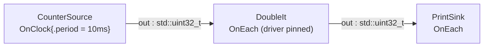

# first_pipeline — the complete minimal pipeline

> **User guide:** [Your First Pipeline](https://docs.nvidia.com/holoscan/sdk-user-guide/getting-started/first-pipeline) —
> this example is the cited
> program for the complete minimal `CounterSource → DoubleIt → PrintSink`
> pipeline (also serves core-concepts and composing-a-graph).

A clock-driven counter feeds a doubling transform and a printing sink; after
ten doubled ticks the program cooperatively stops the run and prints a single
summary line.



## What you will learn

- The three declarations every operator makes: `setup(OperatorSpec&)`,
  `[[nodiscard]] Contract contract() const`, and
  `[[nodiscard]] expected<void, Error> compute(ExecutionContext&)`.
- Time-driven vs data-driven activation: `OnClock{.period}` for a source with
  no inputs, and `OnEach` for operators that react to samples. `OnEach`
  implicitly pins its driving sample, so the driver must not be reselected.
- Typed member ports (`holoscan::Output<std::uint32_t> out;`,
  `holoscan::Input<std::uint32_t> in;`) bound by name in `setup()`, and
  per-edge queue sizing with `ConnectionOptions{.queue_depth}`.
- The two-step clock opt-in:
  `graph.set_default_clock(graph.add_clock<RealtimeClock>("clock"))`.
- The three-phase failure model in one `main()`: compose → `compile(graph)`
  with the `plan.ok()` gate → `run_async(plan)`.
- The cooperative stop idiom: observation struct → `session.request_stop()` →
  `session.wait()` → `session.termination()` check — there is no
  `CountCondition` and no automatic stop on source exhaustion.
- Error propagation with `expected<void, Error>`, `HOLOSCAN_TRY`, and
  `make_unexpected`.

## Prerequisites

- A working SDK install verified with
  [`examples/hello_world`](../hello_world/README.md) — this example assumes you can
  already build and run a Holoscan binary.
- No GPU is required: the payload is a bare `std::uint32_t` on host memory.

## Python run

The Python variant defines all three Operators as Python classes and uses the
same public Graph, compile, and session APIs. It deliberately needs no example
operator provider or private registry import:

```bash
PYTHONPATH=<build>/python/lib python3.12 python/first_pipeline.py
```

From an SDK install that includes Python bindings and example sources, the
`python/` directory is also an independent CMake project.

## C++ build

From this `cpp/` folder (standalone consumer build, using
`CMakeLists.min.txt` as the project file):

```bash
cmake -B build -S .
cmake --build build
```

If your SDK lives elsewhere, point `-Dholoscan_DIR=` at the directory
containing `holoscan-config.cmake`. Inside the SDK source tree the example
builds as part of the normal examples build via `CMakeLists.txt`.

## C++ run

```bash
./build/first_pipeline
```

Or through CTest:

```bash
ctest --test-dir build -R EXAMPLE_CPP_FIRST_PIPELINE_TEST
```

## Expected output

```text
tick 2
tick 4
tick 6
tick 8
tick 10
tick 12
tick 14
tick 16
tick 18
tick 20
first_pipeline: received 10 doubled ticks (last=20) termination=stopped
```

The ten `tick N` lines are printed by `PrintSink` while the graph runs (each
counter value 1…10, doubled). The final line is printed by `main()` only
after `session.wait()` returns and the termination state is verified — the
smoke test anchors on that line alone. Note: the user-guide listing uses a
100ms tick period; the shipped example uses 10ms so the test completes
quickly. The values printed are identical.

## Code walkthrough

### Why every operator makes exactly three declarations

`setup()` declares *structure* (ports and queue depths), `contract()`
declares *when compute may run*, and `compute()` declares *what happens when
it runs*. Keeping these separate is what lets the compiler check the whole
graph before anything executes: structure and timing are data the planner can
reason about, not side effects buried in code. `contract()` is `const`
because it is a pure description read at compile time — if it could mutate
the operator, the plan could disagree with the operator's runtime state and
the compile-time guarantees would be worthless.

### Why `compute()` is temporally oblivious

`CounterSource::compute()` contains no timer, no sleep, and no schedule;
`DoubleIt::compute()` never asks "is data ready?". All of that lives in the
contract (`OnClock{.period = kTickPeriod}` and `OnEach`). By the
time `compute()` is called, its activation condition already holds, so the
body is plain sequential logic that is trivial to test and reuse under a
different schedule. `OnEach` pins exactly one driving sample for the
activation — one tick in, one doubled tick out, with no hidden batching.

### Why there is no `CountCondition`

In HSDK 4.x the graph stopped itself when a condition (like a tick count)
expired inside an operator. In 5.x termination is owned by the application:
the source simply stops emitting after `kTickLimit`, `main()` observes ten
results through `PipelineObservation` (a mutex + condition_variable +
counter), and then calls `session.request_stop()` followed by
`session.wait()`. This keeps shutdown policy out of reusable operators — the
same `CounterSource` can run forever in another app — and makes the stop
deterministic and testable (`termination() == RunTermination::kStopped`).

### Why the failure model has three phases

`main()` is a straight line through the three places a pipeline can fail:
composition errors surface when the graph is built, admission errors surface
at `compile(graph)` behind the `plan.ok()` gate (print `plan.json()` for the
diagnostics), and runtime errors surface through `session.diagnostics()`
after the run. Each phase has its own observable artifact, so a failure is
attributable without log spelunking.

### Why errors travel as `expected`, not exceptions

`compute()` returns `expected<void, Error>`. `DoubleIt` shows the concise
form — `HOLOSCAN_TRY(const std::uint32_t value, in.receive_data());` unwraps
the value or returns the error — while `PrintSink` writes the same pattern
out longhand with `make_unexpected(std::move(value).error())`. Both keep the
hot path allocation-free and make every fallible call visible at the call
site; `[[nodiscard]]` ensures a dropped result is a compile-time complaint.

## HSDK 4.x comparison (`ping_simple`)

| Concern | HSDK 4.x `ping_simple` | HSDK 5.x `first_pipeline` |
|---|---|---|
| Ports | string-keyed, declared as `spec.input<int>("in")`, accessed via `op_input.receive<int>("in")` | typed members `holoscan::Input<std::uint32_t> in;` bound in `setup()`; access is `in.receive_data()` |
| Stopping | `CountCondition(10)` attached to the source stops the app | source exhausts, `main()` observes and calls `session.request_stop()` |
| Scheduling | implicit — the scheduler fires operators when messages arrive | declared — `OnClock{.period}` and `OnEach` in `contract()` |
| Composition and run | `Application::compose()` + blocking `app->run()` | explicit `Graph` → `compile()` → `plan.ok()` → `run_async()` phases |
| Errors | exceptions / logged GXF codes | `expected<void, Error>` + `HOLOSCAN_TRY`, diagnostics on the session |

The 4.x design hid scheduling and termination inside conditions attached to
operators, which made behavior hard to predict from the code. 5.x moves both
into declarative, compile-checkable surfaces (contracts and the session API)
so the same operator is reusable under any schedule and every run terminates
the way `main()` says it will.

## What's next

- [`examples/first_operator`](../first_operator/README.md) — contract-less and
  contracted operators side by side, plus `receive()` vs `receive_data()`.
- Guide deep-dive: core-concepts (three-phase model) and
  temporal-contracts (the full trigger/selector vocabulary).

## Concepts at a glance

| API | Role in this example |
|---|---|
| `holoscan::Operator<>` | base class; `<>` means no parameter aggregate |
| `spec.output(out, "out")` / `spec.input(in, "in").queue_depth(4U)` | bind typed member ports; size the destination queue |
| `OnClock{.period = kTickPeriod}` | time-driven activation for the source |
| `OnEach{in}` | one activation per accepted driver sample; the trigger pins it exactly without a redundant selector |
| `ConnectionOptions{.queue_depth = 4U}` | per-edge queue depth at `add_flow` |
| `graph.add_clock<RealtimeClock>` + `set_default_clock` | two-step clock opt-in |
| `compile(graph)` / `plan.ok()` / `plan.json()` | admission gate with diagnostics |
| `run_async` / `request_stop` / `wait` / `termination()` | cooperative run lifecycle |
| `HOLOSCAN_TRY` / `make_unexpected` | `expected`-based error propagation |
