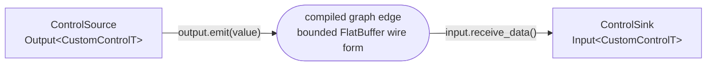

# custom_schema — use your own FlatBuffer type on Operator ports

**User guide:** [Custom FlatBuffer Schemas](https://docs.nvidia.com/holoscan/sdk-user-guide/data-and-payloads/custom-flatbuffer-schemas)

This example starts with the application-owned `custom_control.fbs`, generates the owning
`app::CustomControlT` type and its Holoscan package traits, and uses that type directly on
`Output<app::CustomControlT>` and `Input<app::CustomControlT>`. Application authors compose normal
Operators and a Graph; they do not create Channel publishers or subscribers.



## What you will learn

- How `holoscan_add_flatbuffer_schema()` generates FlatBuffers headers and Holoscan package traits.
- How to declare `Output<app::CustomControlT>` and `Input<app::CustomControlT>` members.
- How to emit and receive the generated owning type without handling serialized bytes.
- How to connect the typed ports with `Graph::add_flow()` and execute the compiled graph with
  `run_async()`.

## Build

From the `cpp/` directory, using an installed SDK:

```bash
cmake -B build -S . -Dholoscan_DIR=/opt/nvidia/holoscan/lib/cmake/holoscan
cmake --build build --parallel 4
```

The key CMake declaration is:

```cmake
holoscan_add_flatbuffer_schema(
  TARGET custom_schema_flatbuffers_generated
  SCHEMAS custom_control.fbs
  INCLUDE_DIRS "${CMAKE_CURRENT_SOURCE_DIR}"
  OUTPUT_DIR "${CUSTOM_SCHEMA_GENERATED_DIR}"
  BFBS_EMBED
  TRAITS_HEADER custom_control_schema_traits.hpp
  TRAITS_SCHEMA custom_control.fbs
  TRAITS_ROOT_TYPE app::CustomControl
  TRAITS_NATIVE_TYPE app::CustomControlT
  TRAITS_BINARY_SCHEMA_TYPE app::CustomControlBinarySchema
  TRAITS_PACKAGE_NAMESPACE app::package
  TRAITS_CANONICAL_NAME app.CustomControl
  TRAITS_SCHEMA_VERSION 1
  TRAITS_MAX_SERIALIZED_SIZE 512
)
```

The schema determines the generated C++ shape. The CMake declaration supplies application policy
that the `.fbs` file cannot safely infer: canonical identity, semantic version, and the maximum
serialized size accepted by the Runtime.

## Application path

The source declares and emits the generated owning type:

```cpp
inline constexpr std::size_t kControlCount = 5U;
inline constexpr auto kTickPeriod = std::chrono::milliseconds{10};

class ControlSource final : public holoscan::Operator<> {
 public:
  void setup(holoscan::OperatorSpec& spec) override {
    spec.output(output, "output").max_emits_per_compute(1U);
  }

  holoscan::Contract contract() const override {
    holoscan::Contract result;
    result.trigger(holoscan::OnClock{.period = kTickPeriod});
    return result;
  }

  holoscan::expected<void, holoscan::Error> compute(
      holoscan::ExecutionContext&) override {
    if (emitted_ >= kControlCount) {
      return {};
    }

    ++emitted_;
    app::CustomControlT control;
    control.sequence = emitted_;
    control.gain = 0.25F * static_cast<float>(emitted_);
    control.label = "ctrl-" + std::to_string(emitted_);
    return output.emit(std::move(control));
  }

  holoscan::Output<app::CustomControlT> output;

 private:
  std::uint64_t emitted_{};
};
```

The sink receives the same owning type:

```cpp
class ControlSink final : public holoscan::Operator<> {
 public:
  void setup(holoscan::OperatorSpec& spec) override {
    spec.input(input, "input").queue_depth(4U);
  }

  holoscan::Contract contract() const override {
    holoscan::Contract result;
    result.trigger(holoscan::OnEach{input});
    return result;
  }

  holoscan::expected<void, holoscan::Error> compute(
      holoscan::ExecutionContext&) override {
    auto control = input.receive_data();
    if (!control) {
      return holoscan::make_unexpected(std::move(control).error());
    }
    std::cout << control->label << '\n';
    return {};
  }

  holoscan::Input<app::CustomControlT> input;
};
```

Graph composition is identical to an SDK-owned payload type:

```cpp
holoscan::Graph graph{"custom-schema"};
const auto source = graph.op<ControlSource>("control-source");
const auto sink = graph.op<ControlSink>("control-sink");
graph.add_flow(source->output, sink->input);

const holoscan::ExecutionPlan plan = holoscan::compile(graph);
holoscan::RunSession session = holoscan::run_async(plan);
```

The Runtime serializes the owning value into its bounded FlatBuffer form at emit time, verifies
the received bytes, and reconstructs `CustomControlT` before the sink's `compute()` runs.

## Completion and testing

The small `ControlObservation` helper follows the SDK examples' normal finite-run pattern:
`main()` waits for the sink to receive five controls, requests cooperative stop, and joins the
session. The public CTest compiles and runs this application.

## Run

```bash
./build/custom_schema
```

Expected output ends with:

```text
custom_schema: received 5 controls
```

## Limits

- The generated ordinary-schema path is for self-contained FlatBuffers object graphs. Native types
  containing a Core Tensor require the separately versioned descriptor-backed schema extension.
- Compatibility is exact-match. A semantic schema change requires a version update and coordinated
  producer/consumer deployment.
- `TRAITS_MAX_SERIALIZED_SIZE` is a hard bound. Oversized values fail at emit instead of allocating
  unbounded transport storage.
- Generation is build-time and compile-time; no runtime registration or schema lookup is added.
