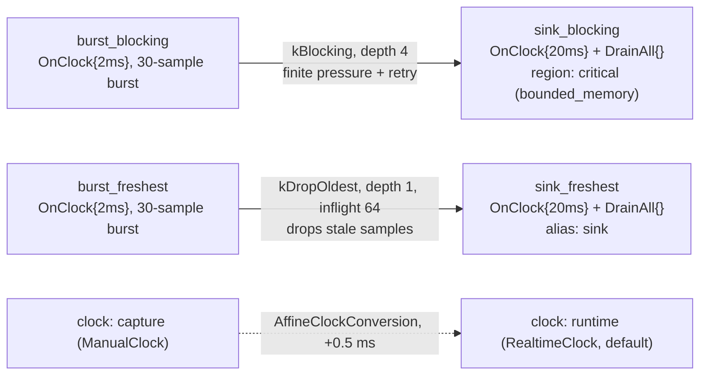

# Graph composition: configurators, regions, clocks, and `GraphView`

> **User guide:** [Graph Composition](https://docs.nvidia.com/holoscan/sdk-user-guide/composing-applications/graph-composition) —
> this example is
> the cited program for port/edge configurators (`configure` /
> `try_configure`), `QueuePolicy` selection, regions, graph-scope clocks with
> `add_clock_conversion`, and `GraphView` inspection.

Two byte-for-byte identical 2 ms producers each emit one bounded 30-sample
burst into two byte-for-byte identical sinks, each directly clocked at 20 ms;
the only difference between the paths is policy authored at graph scope —
bounded `kBlocking` with exact-value retry on one edge, `kDropOldest` + depth 1
on the other — and the program prints the full `GraphView`
authoring snapshot before compiling, then per-path produced/received/dropped
counts that make the two policies' behavior observable.



## What you will learn

+ How to override port policy after wiring with
  `graph.configure(handle->input).queue_depth(1).diagnostic_alias("sink")`,
  and edge policy with the flow-handle configurator
  `.queue_policy(QueuePolicy::kDropOldest).max_inflight_samples(64)`.
+ Why `try_configure(...)` returns `expected<Configurator, Error>` — probing
  a foreign port is a value-shaped rejection, not an exception — and why it
  is the *only* non-throwing authoring verb.
+ What `QueuePolicy::kBlocking` (lossless with finite `kBackpressured`
  results that the producer may retry) and
  depth-one `QueuePolicy::kDropOldest` (lossy, freshest-wins) each trade away, observed as
  a gap-free full burst on one path and heavy drops on the other.
+ How a fixed-rate consumer directly combines `OnClock{20ms}` with a
  `DrainAll{}` data input, without manufacturing a metronome edge.
+ How to group operators with
  `region("critical").add(op).constrain(RegionConstraint::bounded_memory())`.
+ How to declare a second clock and relate the two domains with
  `add_clock_conversion(from, to, AffineClockConversion{.offset_ns})`.
+ How `view()` freezes an immutable `GraphView` and how to walk
  `vertices()` / `ports()` / `edges()` / `regions()` / `partitions()` /
  `clocks()` / `clock_conversions()`, plus `identity()` and `generation()`.

## Prerequisites

You should have read [`lifecycle_callbacks`](../lifecycle_callbacks/README.md)
(E20), which completes the operator-side story. This example moves up one
level: everything here is authored on the `Graph`, and the operator classes
are deliberately boring so the graph-scope policy is the whole lesson. If
you have not built a multi-operator graph yet, start at
[`first_pipeline`](../first_pipeline/README.md) (E01).

## Build

From this `cpp/` folder:

```bash
cmake -B build -S .
cmake --build build
```

The `-Dholoscan_DIR=` hint is only needed when the SDK is installed outside
the default search prefixes listed in `CMakeLists.min.txt`.

## Run

```bash
./build/graph_composition
```

Or through CTest:

```bash
ctest --test-dir build -R EXAMPLE_CPP_GRAPH_COMPOSITION_TEST
```

## Expected output

```text
[view] generation=18 identity.version=18 identity.hash=0ec10ff1..
[view] vertex id=1 kind=operator name=burst_blocking
[view] vertex id=2 kind=operator name=burst_freshest
[view] vertex id=3 kind=operator name=sink_blocking
[view] vertex id=4 kind=operator name=sink_freshest
[view] port burst_blocking.output dir=out setup.depth=- override.depth=- alias=-
[view] port burst_freshest.output dir=out setup.depth=- override.depth=- alias=-
[view] port sink_blocking.input dir=in setup.depth=4 override.depth=- alias=-
[view] port sink_freshest.input dir=in setup.depth=4 override.depth=1 alias=sink
[view] edge burst_blocking.output -> sink_blocking.input policy=kBlocking depth=4 override.policy=- override.inflight=-
[view] edge burst_freshest.output -> sink_freshest.input policy=kBlocking depth=- override.policy=kDropOldest override.inflight=64
[view] region name=critical members=[sink_blocking] constraints=[bounded_memory]
[view] clock name=runtime default=yes
[view] clock name=capture default=no
[view] conversion capture -> runtime scale=1/1 offset_ns=500000
[graph_composition] try_configure foreign-port rejected=yes code=kNotFound (value, not exception)
[graph_composition] blocking produced=30 received=30 dropped=0 gaps=0 backpressured=18
[graph_composition] freshest produced=30 received=4 dropped=26
[graph_composition] result blocking_dropped=0 freshest_dropped=26
graph composition complete
```

Snapshot identifiers (generation, version, hash, record ids and ordering)
vary from run to run, and the depth-one `kDropOldest` path's received/dropped split moves
with scheduling (received is roughly one sample per 20 ms tick overlapping
the ~60 ms burst). The stable claims — which the CTest regex asserts — are
on the `result` line: the `kBlocking` path delivers the entire burst
(`blocking_dropped=0`, `gaps=0` shows the received values are in order with no
holes, and `backpressured` is nonzero), while the freshest-only path visibly drops
(`freshest_dropped` ≥ 1). Both producers emit all 30 samples; what differs is
how many survive the queue policy.

## Code walkthrough

### Policy lives on the graph, not in the operators

`BurstSource` and `SlowSink` are each instantiated twice, and neither class
mentions queue policy anywhere. That is the core design point of this page
of the guide: *structural* wiring (`add_flow`) and *policy*
(configurators, `ConnectionOptions`) are graph-scope authoring, so the same
operator library can be composed into a lossless pipeline or a
freshest-wins pipeline without touching operator code. In HSDK 4.x the
equivalent knobs lived inside each operator's `setup()` (`IOSpec` queue
sizes and policies), which made retuning a deployment an operator-code
change.

### A fixed-rate consumer can select data directly

Each sink declares `OnClock{20ms}` and selects its data input with
`DrainAll{}` in the same contract. The runtime freezes one scheduled tick and
one selector transaction for that activation, so there is no synthetic tick
port or metronome operator to wire. `DrainAll` then makes each clock tick
consume the complete batch that survived its queue policy.

### `kBlocking` vs depth-one `kDropOldest`: two honest answers to overload

Both paths overproduce by design (a 30-sample burst at 2 ms against a 20 ms
consumer cadence). Something must give, and the queue policy is where you
say *what*. `kBlocking` — the default — preserves every accepted sample: a
full bounded queue returns `kBackpressured`, and the source retains and
retries the same sequence value until accepted, producing a complete
gap-free burst. `kDropOldest` at depth one retains the newest unread sample
and lets the producer free-run: freshness is protected, and
staleness is shed as the dropped count. Neither is "better"; the example
makes the trade observable so you can pick deliberately. Note the default is
the lossless one — dropping data is always an explicit, greppable authoring
decision.

The lossless retry loop is intentionally bounded work: one failed publication
returns to the runtime and retries on the next producer activation. It neither
spins nor blocks the execution lane, so the clock-driven sink can drain space
and cooperative stop remains responsive.

### Two configurator layers, one honest snapshot

The freshest-only edge is authored *plain* and then reshaped:
`configure(sink_freshest->input).queue_depth(1).diagnostic_alias("sink")` on
the port, and `.queue_policy(kDropOldest).max_inflight_samples(64)` through the
flow configurator. Look at the `[view]` lines: the snapshot does **not**
collapse these into one effective value — `setup.depth=4` sits next to
`override.depth=1`, and the edge shows `policy=kBlocking` (from `add_flow`)
next to `override.policy=kDropOldest`. `GraphView` deliberately preserves both
authoring layers so the compiler resolves precedence from recorded intent
rather than the view reconstructing it — and so *you* can see exactly who
asked for what when debugging a composed graph. Configurators themselves
are short-lived: apply them where you obtain them, never stash one.

### Why `try_configure` exists (and `try_add_flow` does not)

Authoring errors throw — a duplicate name or a cycle is a programming bug,
best detected loudly at the call site. Configuration is the one authoring
surface that data-driven composition code routinely *probes*, so it alone
has a non-throwing twin. The example probes a port belonging to a different
`Graph`: `foreign.try_configure(sink_freshest->input)` comes back as a falsy
`expected` carrying an `Error` (`kNotFound` in this build: the port is not
in *that* graph's namespace) — no exception, no side effect — and the same
fluent verbs work on the success value (`.value().queue_policy(...)`).

### Two clock domains, declared cold

The graph declares its default `RealtimeClock` plus a deterministic
`ManualClock` capture domain, then relates them with a *directed* affine
conversion (`source*scale + offset_ns`, here identity rate and +0.5 ms).
Conversions are authored on the graph — not computed ad hoc at runtime — so
the compiler can freeze a consistent conversion registry into the plan,
reject conflicting pairs and cycles at composition time, and give every
consumer the same exact-rational mapping. The `GraphView` table shows the
declaration with its canonical reduced ratio.

## HSDK 4.x comparison

| HSDK 5.x (this example) | Closest HSDK 4.x idiom |
|---|---|
| `graph.configure(h->input).queue_depth(1)` | `IOSpec` capacity set inside the operator's `setup()` |
| flow `.queue_policy(QueuePolicy::kDropOldest)` | receiver `IOSpec::QueuePolicy::kPop` (drop-oldest), per operator |
| `ConnectionOptions{.queue_policy, .queue_depth}` at `add_flow` | `Fragment::add_flow` had no policy arguments |
| `region("critical").constrain(...)` | no counterpart (closest: GXF entity groups / scheduler-wide settings) |
| second clock + `add_clock_conversion` | single scheduler `Clock` resource |
| `graph.view()` walk | no authoring snapshot; inspect GXF YAML or runtime state |

In 4.x, queue capacity and overflow policy were properties of the receiving
operator's `IOSpec`, invisible and unchangeable at application-composition
scope, and there was no first-class way to read back what a composed
application actually declared. 5.x moves policy to the graph, layers it
(setup defaults vs graph overrides vs per-edge options), and makes the whole
authored state inspectable as one immutable `GraphView` snapshot — which is
also what the compiler consumes.

## What's next

Continue with [`reusable_graphs`](../reusable_graphs/README.md) (E22), which
packages a subgraph behind exported interface ports and embeds it twice —
the other half of this guide page. For the full record-by-record `GraphView`
reference and the authoring error model, see the
composing-applications/graph-composition guide page.

## Concepts at a glance

| API | Role in this example |
|---|---|
| `ConnectionOptions{.queue_policy, .queue_depth}` | initial edge policy at `add_flow` time |
| `graph.configure(h->input).queue_depth(1).diagnostic_alias("sink")` | throwing port-policy override after wiring |
| `graph.try_configure(flow)` / `.queue_policy(kDropOldest).max_inflight_samples(64)` | non-throwing configurator probe + fluent edge override |
| `QueuePolicy::kBlocking` | lossless queue; full capacity returns finite `kBackpressured`, allowing exact-value retry |
| `QueuePolicy::kDropOldest` | newest-N queue; depth one is freshest-only, while larger depths retain an in-order backlog |
| `OnClock{.period}` + `.input(port, DrainAll{})` | direct fixed-rate batch selection from a data input |
| `region(name).add(op).constrain(RegionConstraint::bounded_memory())` | named group + backend-neutral constraint |
| `add_clock<ManualClock>(...)` / `add_clock_conversion(a, b, AffineClockConversion{.offset_ns})` | second clock domain + directed affine mapping |
| `graph.view()` | freeze an immutable, deep-owning authoring snapshot |
| `view.vertices()/ports()/edges()/regions()/partitions()/clocks()/clock_conversions()` | record spans over every authored fact |
| `view.identity()` / `view.generation()` | instance + frozen version + content hash of the snapshot |
