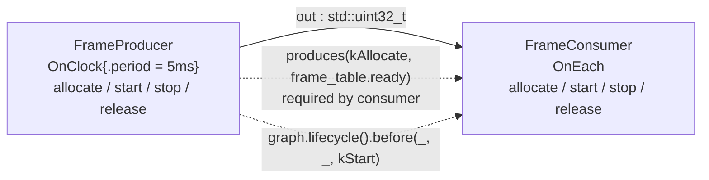

# lifecycle_callbacks — sparse stage checkpoints and cross-operator ordering

> **User guide:** [Lifecycle Callbacks](https://docs.nvidia.com/holoscan/sdk-user-guide/building-operators/lifecycle-callbacks) —
> this example is
> the cited program for sparse lifecycle stage registration, `LifecycleStatus`
> dispositions, and cross-operator lifecycle ordering.

A clock-driven `FrameProducer` streams values from a table it reserves at the
`kAllocate` checkpoint into a `FrameConsumer`; both operators register sparse
lifecycle callbacks, their checkpoints are ordered across operators two
different ways, and after a cooperative stop `main()` prints and verifies the
full sequence-stamped stage arc.



The dashed edges are *lifecycle* orderings, not data flow: within the
`kAllocate` stage the consumer waits for the producer's fact, and within the
`kStart` stage the graph-scope edge releases the consumer only after the
producer's checkpoint completes. The same facts appear in prose below.

## What you will learn

- Sparse stage registration in `setup()`:
  `spec.lifecycle().stage(LifecycleStage::kAllocate, &Op::allocate)` for a
  required checkpoint and `.optional(kRelease, ...)` where absence is
  permitted — unregistered stages cost nothing. Advanced `kStart` and
  `kStop` callbacks may also be optional; the runtime preserves that exact
  declaration through cold reconstruction and records a skipped logical
  checkpoint when an optional binding is absent.
- The callback shape: `LifecycleStatus (Op::*)(LifecycleContext&) noexcept`,
  and all four `LifecycleStatus` dispositions (`kOk`, `kSkipped`,
  `kRetryableFailure`, `kFatalFailure`).
- Fact-based same-stage ordering:
  `.produces(kAllocate, key)` / `.requires_dependency(kAllocate, key)` with a
  namespace-scope `LifecycleDependencyKey`.
- Graph-scope same-stage ordering:
  `graph.lifecycle().before(producer, consumer, LifecycleStage::kStart)`.
- Reading `LifecycleContext::transition_phase()` to distinguish
  `kStartupForward` from `kShutdownTeardown`.
- A noexcept-safe observation pattern: an atomic sequence counter into a
  fixed array, printed by `main()` only after `session.wait()`.

## Prerequisites

- [`examples/parameter_schemas`](../parameter_schemas/README.md) — the previous stop in
  the building-operators chain; this example assumes you can already declare
  operators, contracts, and parameters.
- No GPU is required: payloads are bare `std::uint32_t` on host memory, and
  the "resource" being allocated is an in-memory table.

## Build

From this `cpp/` folder (standalone consumer build, using
`CMakeLists.min.txt` as the project file):

```bash
cmake -B build -S . -Dholoscan_DIR=/opt/nvidia/holoscan/lib/cmake/holoscan
cmake --build build
```

If your SDK lives elsewhere, point `-Dholoscan_DIR=` at the directory
containing `holoscan-config.cmake`. Inside the SDK source tree the example
builds as part of the normal examples build via `CMakeLists.txt`.

## Run

```bash
./build/lifecycle_callbacks
```

Or through CTest:

```bash
ctest --test-dir build -R EXAMPLE_CPP_LIFECYCLE_CALLBACKS_TEST
```

## Expected output

```text
lifecycle[0] producer allocate phase=startup-forward -> ok
lifecycle[1] consumer allocate phase=startup-forward -> ok
lifecycle[2] producer start phase=startup-forward -> ok
lifecycle[3] consumer start phase=startup-forward -> ok
lifecycle[4] consumer stop phase=shutdown-teardown -> ok
lifecycle[5] producer stop phase=shutdown-teardown -> skipped
lifecycle[6] consumer release phase=shutdown-teardown -> ok
lifecycle[7] producer release phase=shutdown-teardown -> ok
lifecycle_callbacks: stage arc verified (8 events; producer precedes consumer at allocate and start) termination=stopped
```

Nothing prints while the graph runs — every line is emitted by `main()` after
`session.wait()` returns, in recorded sequence order. Lines 0–3 are
deterministic: the fact-based dependency fixes producer-before-consumer at
`allocate`, and the graph-scope edge fixes it again at `start`. Lines 4–7 are
also deterministic for this compiled plan, but for two different reasons:
independent `stop` peers unwind in reverse successful-start order, while
independent `release` peers follow their stable compiled order. Both place the
consumer before the producer here, as the displayed trace shows. The program's
broader assertion checks each teardown stage's membership and grouping rather
than duplicating those scheduler-ordering rules. The smoke test anchors on the
final summary line alone.

## Code walkthrough

### Why registration is sparse

The runtime defines eight stages (`kConfigure`, `kDiscover`, `kAllocate`,
`kWarmUp`, `kArm`, `kStart`, `kStop`, `kRelease`), but almost no operator
needs all of them, so the builder registers only the checkpoints that carry
work: `.stage()` requires a callback binding, while `.optional()` permits that
binding to be absent. An unregistered stage adds no **application callback**,
but the operator still has a logical checkpoint there: Core records it as a
successful `kSkipped` checkpoint, and it can satisfy lifecycle ordering. The
declaration therefore shows exactly where this operator performs application
work without hiding the stage model. Note that "optional" describes absence,
not failure tolerance: a present optional callback runs once per eligible
transition pass, and a failure status still fails the transition. This example
makes `kAllocate` required because compute depends on it, while `kStart`,
`kStop`, and `kRelease` are optional because omitting any of those callbacks
leaves a valid operator. Runtime replays the requiredness exactly rather than
silently promoting advanced Start/Stop callbacks to simple-path required hooks.

### Why callbacks are `noexcept` and return `LifecycleStatus`

Lifecycle transitions are executed by the runtime's lifecycle kernel, which
must make bounded, auditable decisions — an exception escaping a callback
would tear through the executor with no stage attribution. So the callback
type is `LifecycleStatus (Op::*)(LifecycleContext&) noexcept` and failure is
data, mirroring the `expected<void, Error>` philosophy of `compute()`. The
four dispositions are a closed vocabulary: `kOk` (work done), `kSkipped` (no
work — the producer's `stop` uses it because its frame table is immutable
after start), `kRetryableFailure` (cold-path cause worth retrying) and
`kFatalFailure` (abandon the run). It also forces honest observation code:
the trace in this example claims array slots with an atomic counter instead
of locking, because a `std::mutex` could throw.

### Why there are two ordering mechanisms

The fact-based form (`produces` / `requires_dependency` on the shared
`kFrameTableReady` key) encodes *operator-local* knowledge: the producer
knows it publishes a frame table at `kAllocate`, the consumer knows it needs
one — neither names the other, so the constraint survives any recomposition
that keeps the fact satisfied. The graph-scope form
(`graph.lifecycle().before(producer, consumer, kStart)`) encodes
*composition-time* knowledge: only the graph author knows that in this
topology the producer should publish readiness first. Both are same-stage
constraints; stage-to-stage order needs no declaration because every stage is
already a global barrier — all `allocate` checkpoints complete before any
`start` runs, which the trace makes visible in line order.

### Why `main()` prints only after the run stops

Callbacks record `{operator, stage, transition_phase, status}` into a fixed
array under an atomic sequence counter and print nothing; `main()` waits for
five samples, calls `session.request_stop()` then `session.wait()`, and only
then formats the arc. This keeps runtime output deterministic, keeps the
noexcept callbacks trivially cheap, and makes the ordering assertion
meaningful — `session.wait()` returning is the guarantee that the
`kShutdownTeardown` events (stop, release) have all been recorded.

## HSDK 4.x comparison

5.x keeps two authoring paths that meet in the same per-stage checkpoint
slots. The **simple path** — overriding the public virtuals `start()` and
`stop()` — ports directly from 4.x: graph authoring lowers each override as
the required `kStart`/`kStop` checkpoint. The **advanced path**, demonstrated
by this example, registers sparse callbacks against any of the eight stages.
At most one application callback may fill a stage slot: overriding `start()`
*and* registering an advanced `kStart` callback on the same operator is
rejected at graph authoring (`GRAPH_LIFECYCLE_CALLBACK_DUPLICATE`), while
mixing across stages — say advanced `kStart` plus a plain `stop()` override —
is valid. A slot filled by neither path is a successful skipped checkpoint.

| Concern | HSDK 4.x | HSDK 5.x |
|---|---|---|
| Lifecycle hooks | fixed virtual trio `initialize()` / `start()` / `stop()` overridden on `Operator` | simple path: `start()`/`stop()` overrides lowered onto `kStart`/`kStop`; advanced path (this example): sparse `spec.lifecycle().stage(...)` / `.optional(...)` against eight named stages |
| Failure reporting | exceptions thrown from hooks | advanced: `noexcept` callbacks returning bounded `LifecycleStatus`; simple: a throwing `start()`/`stop()` is caught and converted to `kFatalFailure` |
| Resource vs readiness | everything folded into `initialize()`/`start()` | distinct barriers: `kAllocate` (reserve), `kStart` (publish ready), `kStop` (quiesce), `kRelease` (return) |
| Cross-operator ordering | implicit in scheduler/startup order; not declarable | declared: fact keys (`produces`/`requires_dependency`) and graph edges (`lifecycle().before`) |

The 4.x trio conflated resource reservation with readiness publication and
gave applications no way to state that one operator's setup must precede
another's, which produced fragile init-order workarounds. 5.x splits the arc
into named global barriers and makes cross-operator order a declared,
compile-checked artifact instead of an accident of construction order. Both
paths, the one-callback-per-stage rule, and the exact hook timing are covered
in the guide's
[Lifecycle Callbacks](https://docs.nvidia.com/holoscan/sdk-user-guide/building-operators/lifecycle-callbacks)
page.

## What's next

- [`examples/graph_composition`](../graph_composition/README.md) — port/edge
  configurators, queue policies, regions, and `GraphView` inspection.
- Guide deep-dive: building-operators/lifecycle-callbacks (full stage
  semantics) and advanced/restart-control for the restart phases
  (`kPreRestartTeardown`, `kRestartForward`) this example deliberately leaves
  out.

## Concepts at a glance

| API | Role in this example |
|---|---|
| `spec.lifecycle()` | per-operator lifecycle declaration builder in `setup()` |
| `.stage(kAllocate, &Op::allocate)` | required checkpoint registration; a missing binding is invalid |
| `.optional(kStart, ...)` / `.optional(kStop, ...)` / `.optional(kRelease, ...)` | checkpoint whose binding may be absent; a present callback's failure still fails the transition |
| `LifecycleStatus` | bounded callback disposition: `kOk`, `kSkipped`, `kRetryableFailure`, `kFatalFailure` |
| `LifecycleContext::transition_phase()` | which phase invoked the callback (`kStartupForward` vs `kShutdownTeardown`) |
| `LifecycleDependencyKey` | namespace-scope stable name for a same-stage ordering fact |
| `.produces(stage, key)` / `.requires_dependency(stage, key)` | fact-based cross-operator ordering, declared operator-locally |
| `graph.lifecycle().before(a, b, stage)` | graph-scope same-stage ordering edge |
| `run_async` / `request_stop` / `wait` / `termination()` | cooperative run lifecycle bounding the stage arc |
