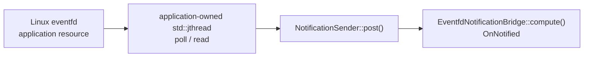

# Notification bridge

Bridge a Linux `eventfd` into a bounded `NotificationSource` without giving
the Runtime ownership of the descriptor or the application support thread.
The example is deliberately small: one notification-driven operator owns one
`eventfd`, one generation-bound `NotificationSender`, and one `std::jthread`.



## What you will learn

- Declare a counted readiness source with
  `spec.notification_source(...).capacity(1).sender_reference_capacity(1)`.
- Acquire the current source generation's `NotificationSender` only from the
  `kArm` lifecycle callback.
- Treat `kNotReady` before the global `kStart` barrier and
  `kBackpressured` while a prior activation retires as normal bounded states,
  not fatal errors.
- Open the descriptor with `EFD_SEMAPHORE` and perform exactly one read and one
  bounded post per counter unit. A saturated nonblocking write (`EAGAIN`) is a
  failed external signal, never silently accepted.
- Start one application-owned `std::jthread` at `kStart`, request cooperative
  cancellation and join it at `kStop`, and close the descriptor at `kRelease`.
  The thread is never detached.
- Make `RunSession::termination()` and `RunSession::diagnostics()` the
  authoritative terminal result. The final console line is a once-only human
  summary emitted after those structured values have been checked.

## Prerequisites

- [`../lifecycle_callbacks`](../lifecycle_callbacks/README.md) for sparse
  lifecycle registration and teardown ordering.
- [`../running_and_stopping`](../running_and_stopping/README.md) for
  `RunSession`, cooperative stop, and structured terminal diagnostics.
- Linux with `eventfd`. The source is build-safe elsewhere: unsupported
  platforms print a precise capability message and exit with code 77 so CTest
  records a skip instead of a build or runtime failure.

## Build

From this example's `cpp/` directory:

```bash
cmake -B build -S . -Dholoscan_DIR=/opt/nvidia/holoscan/lib/cmake/holoscan
cmake --build build
```

The standalone project also builds
`notification_bridge_unsupported`, which defines
`HOLOSCAN_NOTIFICATION_BRIDGE_FORCE_UNSUPPORTED`. That target executes the
non-Linux branch on Linux CI without redefining compiler platform macros.

## Run

```bash
./build/notification_bridge
```

Expected output:

```text
notification_bridge: eventfd bridged 4 notifications; lifecycle-owned worker joined; termination=stopped
```

Or run all three bounded paths:

```bash
ctest --test-dir build -R EXAMPLE_CPP_NOTIFICATION_BRIDGE
```

The forced-unsupported wrapper passes after verifying that its child process
returns exit code 77 and prints:

```text
SKIP: notification_bridge requires Linux eventfd; this platform does not provide the required waitable-descriptor capability
```

On an actually unsupported platform, the normal example row is reported as
skipped with the same message and exit code.

To exercise deterministic support-thread failure and lifecycle cleanup:

```bash
./build/notification_bridge --simulate-worker-failure
```

The example verifies one `RUNTIME_OPERATOR_CALLBACK_FAILED` diagnostic, a
`failed` terminal state, and support-thread join/release before printing:

```text
notification_bridge: worker failure propagated through RUNTIME_OPERATOR_CALLBACK_FAILED; lifecycle-owned worker joined
```

## Lifecycle and ownership walkthrough

### `kArm`: bind this source generation

`arm()` creates the descriptor and asks
`LifecycleContext::notification_sender()` for exactly one admitted sender.
Posting immediately returns `kNotReady`, which the example records and
verifies: `kArm` binds authority, but readiness is not publishable until the
global `kStart` barrier completes.

### `kStart`: start the bounded bridge

`start()` seeds a bounded four-event burst before constructing one
`std::jthread`. `EFD_SEMAPHORE` makes each successful read consume exactly one
counter unit, so the existing example test proves the burst produces four
distinct posts and activations without collapsing them into one wake. The
worker uses a 100 ms `poll()` timeout and a 1 ms stop-aware retry interval.
Those finite waits bound cancellation latency while allowing the first
`post()` to retry `kNotReady` until the Runtime publishes startup. In a real
application, a device or I/O library writes the descriptor.

### `kStop` and `kRelease`: quiesce before closing

`stop()` requests the `jthread`'s stop token, writes the descriptor to wake a
blocked `poll()`, and joins. `release()` then drops the sender tombstone and
closes the descriptor. The ordering matters: closing a descriptor while a
detached or unjoined thread can still poll it creates a stale-fd race.

## Current boundary and follow-ups

This example uses the shipped generic foreign-thread capability:
`NotificationSender`. It does **not** claim that Core already has public typed
fd/eventfd, RDMA completion-queue, CUDA-event, or arbitrary-predicate provider
adapters. Those provider surfaces, including typed support-thread placement,
are experimental follow-ups in EA1-026 and EA1-027. Until then, applications
own these bounded bridge threads and convert their readiness into
`NotificationSender::post()` explicitly.

The retry loop in this example is specific to counted notifications. Do not
copy it mechanically to another readiness family:

| Source model | Preserved state | Pressure response |
|---|---|---|
| Notification | Every accepted post is one distinct witness | `kBackpressured` accepts nothing; retry the same logical notification until accepted or terminal |
| Doorbell | The greatest accepted monotonic token | Retry a greater token only when it was rejected with `kBackpressured`; after acceptance or coalescing, advance rather than reposting the same token |
| Readable | The provider's current readable level, not event history | Re-poll and re-report the current level; do not synthesize a counted retry stream |

## Concepts at a glance

| API or resource | Role in this example |
|---|---|
| `NotificationSource` | Bounded logical readiness declared during setup |
| `LifecycleContext::notification_sender()` | Binds current-generation posting authority at `kArm` |
| `NotificationSender::post()` | Thread-safe foreign-thread wake ingress |
| `std::jthread` / `std::stop_token` | Application-owned, cooperatively canceled support worker |
| Linux `eventfd` | External waitable descriptor owned outside Runtime |
| `RunSession::termination()` / `diagnostics()` | Authoritative terminal verdict and structured evidence |
