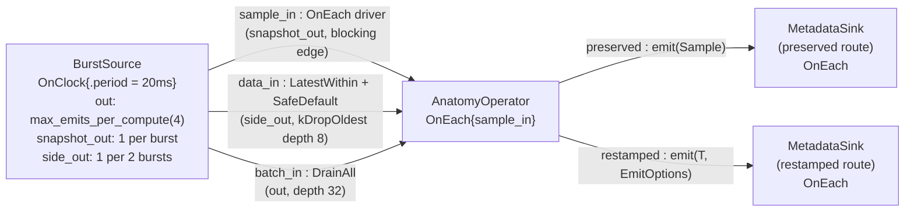

# operator_anatomy — every way an operator reads, stamps, and stops

> **User guide:** [Operator Anatomy](https://docs.nvidia.com/holoscan/sdk-user-guide/building-operators/operator-anatomy) —
> this example is the
> cited program for the full operator surface: the three read accessors
> (`receive()`, `receive_data()`, `selected_batch()`), burst emission,
> metadata forwarding vs restamping, selection introspection, and
> cooperative cancellation.

One burst source feeds three inputs of one anatomy operator from a single
`std::uint32_t` stream — a four-frame burst lane into `DrainAll`, a
once-per-burst snapshot lane that drives the operator (`OnEach`), and an
every-other-burst side lane into `LatestWithin` — each input read through a
different accessor. The operator republishes every driver snapshot twice
(metadata preserved and metadata restamped) to two verifying sinks; after
twelve samples on each sink the program stops and prints one labeled summary
line per accessor.



The same facts in prose: `BurstSource.snapshot_out` drives
`AnatomyOperator.sample_in`, `BurstSource.side_out` feeds
`AnatomyOperator.data_in`, and `BurstSource.out` (the raw burst lane) feeds
`AnatomyOperator.batch_in`; `AnatomyOperator.preserved` feeds the
preserved-route `MetadataSink` and `AnatomyOperator.restamped` feeds the
restamped-route `MetadataSink`.

> **Design note:** `OnEach{sample_in}` is intentional: each snapshot is the
> semantic driver for one anatomy activation. The burst lane is independent
> batch state, and the every-other-burst side lane deliberately exercises the
> `SafeDefault` branch. A clock-driven operator may also select inputs, but
> that would teach periodic sampling rather than this example's per-snapshot
> contract. Capture coordinates describe samples; monotonic `TagTime`
> describes dispatch order, so forwarding an older selected sample does not
> rewrite either record.

## What you will learn

- The three read accessors and what each returns: `receive()` → owning
  `Sample<T>` (payload + `SampleMetadata` + a finite read claim),
  `receive_data()` → payload only, and `selected_batch()` →
  `SelectedBatchView<T>` over a `DrainAll` selection.
- Selection introspection before any read: `in.selection()`
  (`InputState` + `SelectionReason`) and `in.is_missing()` on the
  `SafeDefault{}` branch, where no value exists to receive.
- The one legitimate home of `spec.output(out, "out").max_emits_per_compute(4U)`
  — burst emission is opt-in; the default is 1 and should be omitted.
- Metadata propagation: forwarding `emit(std::move(sample))` preserves
  capture time, source clock, `frame_id`, trace, and flags, while
  `emit(value, EmitOptions{.capture_time, .frame_id})` starts a fresh record.
- Cooperative cancellation: polling `ctx.cancellation().stop_requested()`
  inside a long compute loop.
- How one `OnEach` driver can coexist with independent scalar and batch side
  inputs; use `OnClock` with selected inputs when periodic sampling, rather
  than per-driver activation, is the intended contract.

## Prerequisites

- [`examples/running_and_stopping`](../running_and_stopping/README.md) — the run/stop
  lifecycle this example's `main()` uses without comment.
- [`examples/first_operator`](../first_operator/README.md) — first contact with
  `receive()` vs `receive_data()`; this example completes the accessor set.
- No GPU is required: the payload is a bare `std::uint32_t` on host memory.

## Build

From this `cpp/` folder (standalone consumer build, using
`CMakeLists.min.txt` as the project file):

```bash
cmake -B build -S .
cmake --build build
```

If your SDK lives elsewhere, point `-Dholoscan_DIR=` at the directory
containing `holoscan-config.cmake`. Inside the SDK source tree the example
builds as part of the normal examples build via `CMakeLists.txt`.

## Run

```bash
./build/operator_anatomy
```

Or through CTest:

```bash
ctest --test-dir build -R EXAMPLE_CPP_OPERATOR_ANATOMY_TEST
```

## Expected output

```text
operator_anatomy: accessor summary
receive()        : value=8 frame_id=8 capture_time_ns=41713466 sequence=2 valid=1
receive_data()   : value=8 matches_receive=1 (payload only: no metadata, no read claim)
selected_batch() : first_batch=4 frames [1..4] drained_total=48 empty_batches=0
selection()      : selected=6 safe_default=6 first_missing state=safe-default reason=never-seen
forward emit     : preserved=12 source frame ids kept (violations=0)
restamp emit     : restamped=12 fresh frame ids >= 1000000 (violations=0)
cancellation     : stop_requested observed during long compute = no
operator_anatomy complete: accessors verified termination=stopped
```

All lines are printed by `main()` after `session.wait()` returns; nothing
prints while the graph runs. Numeric fields (values, counts, the capture
timestamp) vary run to run with scheduling, and the cancellation line may
legitimately read `no` when no compute was in flight at the instant
`request_stop()` landed. The smoke test anchors only on the final line,
which is printed only after every invariant (metadata routes, accessor
consistency, empty diagnostics) has been checked.

## Code walkthrough

### Why three accessors instead of one

`receive()` is the complete answer — payload plus `SampleMetadata` plus a
finite read claim that lets the owning `Sample<T>` outlive the callback.
That completeness has a cost (claims are a bounded resource), so the API
also offers `receive_data()` for the common case where only the payload
matters: no metadata, no claim, nothing to hold. `selected_batch()` exists
because a `DrainAll` selection is plural by construction; it returns an
activation-scoped immutable view rather than copies, and iterating it hands
out `const Sample<T>&` in frozen selection order. Crucially, none of these
accessors pops a queue: the selection was frozen before `compute()` began,
which is why `sample_in` (the driver snapshot) and `data_in` (the side
lane's copy of the same snapshot) report the same value on the alternating
activations where the side copy is selected (`matches_receive=1`).

### Why DrainAll needs no on_missing but LatestWithin does

`DrainAll{}` cannot fail: when nothing arrived since the last activation,
the selection is a valid empty batch (`empty_batches` counts them), so the
compiler rejects a redundant missing policy. `LatestWithin{.max_age}` can
fail — before the first side snapshot there is genuinely nothing to select,
and scalar admission is consume-once, so a side lane publishing every other
burst leaves every second activation with nothing new to admit. The side
input therefore must declare a policy, and this example chooses
`SafeDefault{}`: compute still runs, `in.is_missing()` returns true, and
`in.selection()` reports the frozen state — `state=safe-default
reason=never-seen` on the first such activation, exactly what the summary's
`selection()` line shows. `Skip{}` would instead suppress the whole
activation — including the batch drain — which is the wrong shape when one
input's silence should not silence the operator. (The OnEach driver itself
declares neither a selector nor an `on_missing`: the trigger pins it.)

### Why burst emission is opt-in

`max_emits_per_compute` defaults to 1 because the compiler budgets
downstream queue capacity from it; an unbounded default would make every
edge unplannable. `BurstSource` declares
`.max_emits_per_compute(4U)` on its burst lane and emits exactly four
freshly stamped frames per tick; its snapshot and side lanes keep the
default budget of one emit per compute. This is the one place in the example
catalog where the builder call appears, because everywhere else the default
is both correct and self-documenting.

### Why forwarding and restamping are different overloads

`emit(Sample<T>)` deliberately has no `EmitOptions` parameter: the sample
already carries the semantic metadata to forward, and Runtime replaces only
its own publication fields (sequence, publish time, size). That makes
provenance-preserving pipelines the path of least resistance — the
preserved sink sees the source's `frame_id` and capture time untouched.
Capture time remains the sample's physical or semantic coordinate, while the
runtime assigns monotonic `TagTime` to each downstream activation; an older
selected sample can therefore be forwarded without pretending it was
captured when the callback ran. This example forwards its OnEach driver
because that snapshot is the artifact being transformed. When an operator
produces a genuinely new artifact it uses
`emit(value, EmitOptions{.capture_time, .frame_id})` and claims fresh
identity, stamping the activation's own frozen time; the restamped sink
verifies those frames carry the anatomy operator's
ids (>= 1000000), not the source's. Making the two intents different
overloads means you cannot half-forward metadata by accident.

### Why long computes poll cancellation

`request_stop()` is cooperative: Runtime never preempts a running
`compute()`. A callback that loops for a long time therefore checks
`ctx.cancellation().stop_requested()` — a callback-scoped monotonic latch —
once per chunk of work and returns early when it flips. The example's
bounded stand-in loop keeps the pattern honest without burning meaningful
CPU; skip the check and every shutdown waits for your worst-case loop.

## HSDK 4.x comparison

| Concern | HSDK 4.x | HSDK 5.x `operator_anatomy` |
|---|---|---|
| Reading input | `op_input.receive<T>("in")` on a string-keyed context | typed member accessors: `in.receive()`, `in.receive_data()`, `in.selected_batch()` |
| Batch consumption | loop `receive` until empty, or condition-tuned queue policies | `DrainAll{}` declared in the contract; one immutable `SelectedBatchView<T>` per activation |
| Metadata | `MetadataDictionary` merged implicitly per the operator's metadata policy | explicit: forward the `Sample<T>` to preserve, or restamp with `EmitOptions` |
| Multiple emits | `op_output.emit()` freely, backpressure discovered at runtime | `max_emits_per_compute(4U)` declared in `setup()`, budgeted by the compiler |
| Stop during compute | no cooperative signal; conditions stop scheduling between ticks | `ctx.cancellation().stop_requested()` polled inside the callback |

The 4.x surface made reads stringly-typed and metadata propagation a
per-operator policy side effect, so provenance depended on configuration
invisible at the call site. 5.x puts every choice in the code you can read:
which accessor, which emit overload, and how many emits are all explicit,
typed, and compile-checkable.

## What's next

- [`examples/parameter_schemas`](../parameter_schemas/README.md) — the parameter
  aggregate, schema policies, and validation that complete the operator's
  authoring surface.
- Guide deep-dives: building-operators/temporal-contracts (the full
  trigger/selector vocabulary behind `OnEach` + `DrainAll`) and
  data-and-payloads/payload-type-rules (what types may cross a port).

## Concepts at a glance

| API | Role in this example |
|---|---|
| `in.receive()` | owning `Sample<T>`: payload + metadata + finite read claim |
| `in.receive_data()` | payload-only copy; no metadata, no read claim |
| `in.selected_batch()` | immutable `SelectedBatchView<T>` over the `DrainAll` selection |
| `in.selection()` / `in.is_missing()` | frozen `InputState` + `SelectionReason` introspection |
| `OnEach{sample_in}` + `DrainAll{}` | driver-paced batch consumption; no `on_missing` allowed or needed |
| `LatestWithin{.max_age}` + `SafeDefault{}` | failure-capable scalar selector with a degraded compute branch |
| `spec.output(...).max_emits_per_compute(4U)` | opt-in burst emission, budgeted by the compiler |
| `out.emit(std::move(sample))` | forward with capture/frame/trace/flags preserved |
| `out.emit(value, EmitOptions{...})` | publish a new sample with fresh capture time and frame id |
| `ctx.cancellation().stop_requested()` | cooperative stop latch polled in long computes |
| `ConnectionOptions{.queue_policy = kDropOldest, .queue_depth = 8}` | bound temporal candidates without backpressuring the observational edge |
