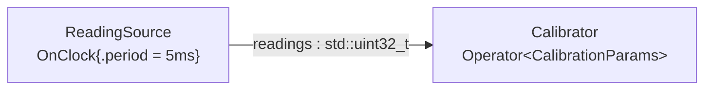

# Parameter schemas (`parameter_schemas`)

> **User guide:** [Parameter Schemas](https://docs.nvidia.com/holoscan/sdk-user-guide/building-operators/parameter-schemas) —
> this example is the
> cited program for the complete `field<>` policy taxonomy (also serves
> configuring-applications, schema side).

A two-operator pipeline — a clock-driven reading source feeding a `Calibrator`
configured by a seven-field, full-taxonomy `CalibrationParams` aggregate —
runs once with a valid graph-side override, then walks one rejected
configuration attempt per bind-time-enforced policy, labeled per policy, and
contrasts the bounded human-facing detail in a bind-time `RuntimeError` with
the typed `ParamValidationResult` used by tooling.



## What you will learn

- The complete `field<&T::m>("name")` policy chain: `.range(lo, hi)`,
  `.allowed_values({...})`, `.validator<fn>("stable.id")`,
  `.nested<FilterParams>()`, `.encoding(ParamStringEncoding::kUtf8)` +
  `.max_utf8_bytes(n)`, `.description()` / `.unit()` / `.alias()`, and the
  visibility/persistence markers `.sensitive()`, `.persisted()`,
  `.internal()`, `.external_tuning()`.
- Where each policy takes effect — bind-time validation, live updates,
  snapshot/persistence projection, or the external catalog (the table below).
- How `holoscan::validate_params(candidate)` reports a typed
  `ParamValidationResult` — `code`, `field_name`, and `validator_id` — for
  every constraint category, including constraints inside a nested schema.
- How `handle.set_params()` throws a `holoscan::RuntimeError` carrying
  `ErrorCode::kInvalidArgument` plus bounded category, field, and validator
  identity without exposing the rejected value, while `validate_params`
  remains the structured interface.
- The `holoscan::param_schema_availability<T>()` compile-time guard:
  `kDeclared` for a schema found through ADL, `kOpaqueLocal` for the silent
  wrong-namespace / missing-macro footgun.
- One `.runtime_mutable()` field whose live next-compute update behavior is
  available when the plan explicitly admits runtime updates
  ([`examples/experimental/runtime_params`](../experimental/runtime_params/README.md)).

## Prerequisites

- [`examples/typed_parameters`](../typed_parameters/README.md) (E13) — the parameter
  basics this page deepens: `HOLOSCAN_PARAM_SCHEMA` beside the struct,
  `Operator<Params>`, `ctx.params<T>()`, and `handle.set_params()`.
- [`examples/operator_anatomy`](../operator_anatomy/README.md) (E18) — the previous stop
  in the Wave-2 learning chain (operator structure this example assumes).
- No GPU is required: the payload is a bare `std::uint32_t` on host memory.

## Build

From this `cpp/` folder (standalone consumer build, using
`CMakeLists.min.txt` as the project file):

```bash
cmake -B build -S .
cmake --build build
```

If your SDK lives elsewhere, point `-Dholoscan_DIR=` at the directory
containing `holoscan-config.cmake`. Inside the SDK source tree the example
builds as part of the normal examples build via `CMakeLists.txt`.

## Run

```bash
./build/parameter_schemas
```

Or through CTest:

```bash
ctest --test-dir build -R EXAMPLE_CPP_PARAMETER_SCHEMAS_TEST
```

The program needs no GPU, takes well under a second, and always terminates:
the single bounded run stops itself after six observed samples (10-second
safety cap); every rejected attempt is validated without running a graph.

## Expected output

```text
schema: com.nvidia.holoscan.examples.CalibrationParams v1 availability=kDeclared fields=7
nested: com.nvidia.holoscan.examples.FilterParams v1 folded into field 'filter'
accepted: window=8 stride=4 label=night-mode gain=2.5 filter.cutoff_hz=120 processed=6 calibrated_last=60
rejected[range]: window=40 -> kOutOfRange field=window
rejected[allowed_values]: stride=3 -> kNotAllowed field=stride
rejected[validator]: window=5 -> kValidatorRejected field=window validator=example.even/v1
rejected[encoding]: label=<invalid-utf8-bytes> -> kInvalidEncoding field=label
rejected[max_utf8_bytes]: label=wide-angle-night-calibration -> kCardinalityExceeded field=label
rejected[nested]: filter.cutoff_hz=900 -> kOutOfRange field=cutoff_hz
bind-time: set_params(window=5) threw RuntimeError what=kInvalidArgument: PARAM_VALIDATION_FAILED category=validator_rejected field_id=<id> field_name=window validator_id=example.even/v1 (bounded detail; value omitted)
typed: validate_params(window=5) -> kValidatorRejected field=window validator=example.even/v1
parameter_schemas: accepted=1 rejected=6 typed_validation=kValidatorRejected termination=stopped
parameter_schemas example complete
```

Lines 1–2 prove both schemas were found through ADL and that the nested
schema keeps its own identity. Line 3 prints the values the `Calibrator`
actually observed via `ctx.params<CalibrationParams>()` inside `compute()`
(gain 2.5 applied to the last reading 24 gives `calibrated_last=60`). The six
`rejected[...]` lines are one per enforced policy; note the oversize-label
case reports `kCardinalityExceeded` (a byte-count bound), not an encoding
error. The `bind-time` line is bounded human-facing diagnostics; the `typed`
line is the authoritative structured `ParamValidationResult`. In the sample
output, `<id>` stands for the deterministic numeric `ParamFieldId` printed by
the executable; the angle-bracket text is not printed literally. All lines are
emitted after the run has fully stopped. CTest deliberately matches only the
final `parameter_schemas:` summary, while the executable asserts the detailed
diagnostic and typed-validation facts before printing it.

## Code walkthrough

### Why constraints live in the schema, not in compute()

Every policy in `CalibrationParams` — range, allowed set, validator, UTF-8
bound, nested range — is declared once, beside the struct, and enforced when
a value tries to *enter* the graph (`set_params`, and later the config and
tuning surfaces). `compute()` never defends against a bad parameter because a
bad parameter cannot reach a generation. That is the fail-closed inversion of
the 4.x model, where each operator hand-rolled its own checks (or didn't) and
a bad value was discovered mid-run, per call site, with no shared vocabulary
for *why* it was bad.

### Why the validator carries a stable string ID

`.validator<even_value>("example.even/v1")` pairs a process-local `noexcept`
predicate with a portable identity. The callable cannot travel — other
processes and tooling cannot run your lambda — but the ID can: an external
consumer can see *that* `example.even/v1` guards `window` and report it in a
rejection, without executing anything. That is also why the ID, not the
function name, appears in `ParamValidationResult::validator_id`: it is the
durable, cross-process handle. Version the ID string like an API (`/v1`)
because changing the predicate's meaning silently changes what deployed
tooling believes was checked.

### Why nesting keeps FilterParams a versioned unit

`.nested<FilterParams>()` folds the nested schema's ID, version, and hashes
into the parent field rather than flattening `cutoff_hz` into
`CalibrationParams`. The nested aggregate stays a reusable contract — any
other parent embedding `FilterParams` shares its constraints and identity —
and a violation inside it reports the *nested* field (`field=cutoff_hz`), not
an opaque parent-level failure. Both `static_assert`s in the builder
(exact-type match, declared nested schema) exist because a silently opaque
nested field would erase those guarantees without a diagnostic.

### Human-facing rejection detail and typed validation

`calibrator.set_params(odd_window)` throws `holoscan::RuntimeError` whose
`code()` is `ErrorCode::kInvalidArgument`. Its bounded message also names the
validation category, field identity, and validator identity, but deliberately
omits parameter values and arbitrary validator prose. That text is diagnostic,
not a parseable API. Configuration tooling calls
`holoscan::validate_params(candidate)` directly to receive the full
`ParamValidationResult` (`code`, `field_name`, `validator_id`) as a value with
no exception or message parsing. In both paths the schema is the source of
truth.

### Why these markers matter even though this example never updates a value

`gain` is marked `.runtime_mutable().persisted().external_tuning()` and
`auth_token` is `.sensitive()`. This example never submits an update, so its
aggregate stays on generation 0 for the whole run — but the markers are far
from dead code. Their engines ship today behind explicit opt-ins: a plan
compiled with the runtime-updates policy can live-tune `gain` (see the
`runtime_params` example), Core snapshot capture/projection redacts the value
of `auth_token`, and the core-bundled `params_io` library persists
already-projected snapshots through `params::save(...)`/`params::load(...)`.
The external catalog exposes `gain` as a writable tuning field only because it
is also runtime-mutable, public, and non-sensitive. One caution stands:
`.sensitive()` is redaction from saved and external surfaces, not a security
boundary — the value still lives in process memory.

## Where each marker takes effect

Reproduced from the guide page (building-operators/parameter-schemas), with
the point where each marker acts:

| Policy | Where it acts | Shown on field |
|---|---|---|
| `.range(min, max)` | **Bind time** — rejected on violation | `window`, `gain`, `scratch_mb`, nested `cutoff_hz` |
| `.allowed_values({...})` | **Bind time** — rejected on violation | `stride` |
| `.encoding(kUtf8)` / `.max_utf8_bytes(n)` | **Bind time** — invalid UTF-8 / oversize rejected | `label` |
| `.validator<fn>("id")` | **Bind time** (in-process); only the ID travels externally | `window` |
| `.nested<T>()` | **Bind time** — nested identity and constraints participate fully | `filter` |
| `.description()` / `.unit()` / `.alias()` | **Live metadata** — available to introspection and tooling | `window`, `label`, `gain`, … |
| `.runtime_mutable()` | **Live updates** — next-compute generation swaps once the plan enables `CompileOptions.parameters.runtime_updates` (Standard/Research profiles) | `gain` |
| `.external_tuning()` | **External catalog** — writable only while also runtime-mutable, public, and non-sensitive with updates admitted | `gain` |
| `.persisted()` | **Snapshots and persistence** — persistence *eligibility* (the default; `.transient()` opts out); saving is the explicit `params::save(snapshot, path)` call | `gain` |
| `.sensitive()` | **Snapshots and projections** — redacted: saved archives retain no value; still not a security boundary | `auth_token` |
| `.internal()` | **Projections** — omitted from external projections | `scratch_mb` |

## HSDK 4.x comparison (`Parameter<T>` + `spec.param`)

| Concern | HSDK 4.x | HSDK 5.x `parameter_schemas` |
|---|---|---|
| Declaration | `Parameter<float> gain_;` member plus `spec.param(gain_, "gain", "Gain", "description", 1.0f)` registration inside `setup()` | plain aggregate struct + one `HOLOSCAN_PARAM_SCHEMA` beside it; the operator just derives `Operator<CalibrationParams>` |
| Constraints | none built in — each operator hand-validated values in `initialize()`/`compute()` | declarative `.range` / `.allowed_values` / `.validator` / `.encoding` / `.nested`, enforced fail-closed at bind time |
| Metadata | headline/description strings buried in `spec.param` arguments | `.description` / `.unit` / `.alias` plus visibility, persistence, and mutability markers, all introspectable |
| Identity | per-operator string keys; renames were silent breaks | `param_schema(stable_id, version)` + derived structural/contract hashes; `.alias` gives renames a migration window |
| Failure mode | bad YAML value surfaced at run time, at first use | rejected before any run, with a typed `ParamValidationResult` naming field, code, and validator |

The 4.x design attached parameters to operators one string at a time, so
constraints, documentation, and identity had nowhere shared to live. 5.x
makes the aggregate itself the contract: one schema declaration carries
validation, metadata, and a portable versioned identity that tooling can
consume without loading your code.

## What's next

- [`examples/lifecycle_callbacks`](../lifecycle_callbacks/README.md) — the next stop in
  the learning chain: sparse stage registration and cross-operator lifecycle
  ordering.
- [`examples/experimental/runtime_params`](../experimental/runtime_params/README.md) —
  where the `.runtime_mutable()` teaser pays off: live generation updates
  through `ParamControlHandle`.
- Guide deep-dives: building-operators/parameter-schemas (this page's source)
  and advanced/runtime-parameter-updates (the generation model).

## Concepts at a glance

| API | Role in this example |
|---|---|
| `HOLOSCAN_PARAM_SCHEMA(T, param_schema(id, ver), field<>...)` | declares the schema at namespace scope beside the struct |
| `field<&T::m>("name")` fluent chain | attaches constraints, metadata, and policy markers per field |
| `.validator<even_value>("example.even/v1")` | process-local predicate + portable stable identity |
| `.nested<FilterParams>()` | folds a declared nested schema into the parent's identity |
| `.encoding(kUtf8)` + `.max_utf8_bytes(16)` | UTF-8 validity + encoded byte bound (`kCardinalityExceeded` on oversize) |
| `.sensitive()` / `.persisted()` / `.internal()` / `.external_tuning()` | visibility & persistence markers consumed by the shipped snapshot/persistence projections and the external catalog |
| `.runtime_mutable()` | opts the field into live next-compute updates once the plan enables the runtime-updates policy (see `examples/experimental/runtime_params`) |
| `holoscan::validate_params(candidate)` | typed, exception-free validation with field/code/validator detail |
| `handle.set_params(P{...})` | graph-side generation-0 override; throws `RuntimeError(kInvalidArgument)` with bounded diagnostic identity on rejection |
| `holoscan::param_schema_availability<T>()` | compile-time `kDeclared` vs `kOpaqueLocal` footgun guard |
| `ctx.params<CalibrationParams>()` | pinned `const&` read of the bound generation inside `compute()` |
