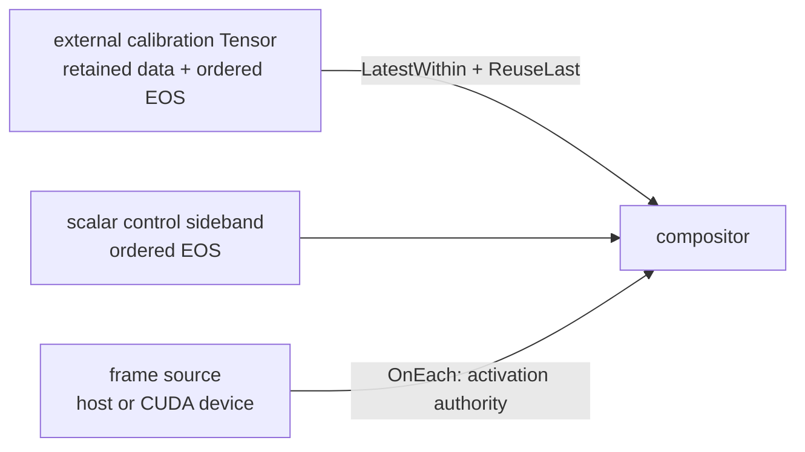

# Retained Tensor compositor

This example shows a common camera/control shape: frame arrival drives the
operator, while one externally published calibration Tensor is retained and
reused until it becomes too old. The same immutable `ExecutionPlan` runs twice
to prove that retained selection state belongs to a `RunSession`, not the plan.



The compact callback validates the selected pair instead of launching an image
kernel, keeping the temporal policy visible. Replace that body with your own
stream-ordered compositor; the graph, selection, stop, and replay pattern stays
the same.

## Build and run

From an installed SDK prefix:

```sh
cmake -S cpp -B build
cmake --build build
./build/retained_tensor_compositor
```

The default uses host frames. A CUDA device frame path is available when the
selected device is usable:

```sh
./build/retained_tensor_compositor --cuda --device 0
```

The external route is explicit and can be changed without exposing a HoloMQ
service object. The example derives its scalar control sideband by appending
`.control` to this route:

```sh
./build/retained_tensor_compositor \
  --route holomq://my-calibration-service
```

Expected output includes two fresh runs:

```text
run=1 pre_overlay_activations=0 selected=1 reused=1 tensor_eos=closed control_eos=closed reset=clean
run=2 pre_overlay_activations=0 selected=1 reused=1 tensor_eos=closed control_eos=closed reset=clean
route=holomq://retained-tensor-compositor.overlay-<unique-run-id> frame_memory=host
retained Tensor compositor complete
```

Counts can be larger on a busy system because the frame clock keeps advancing.
The stable claims are that each run starts with zero compositor activations,
then observes at least one `kSelected` and one `kReused` overlay.
The default route carries a per-process suffix so stale transport resources
from an interrupted prior run cannot collide with the example. An explicitly
authored `--route` is preserved exactly.

## What the contracts mean

- `OnEach{frame}` gives only the frame input activation authority. Calibration
  arrival and EOS update bounded input state; neither invokes `compute()`.
- `LatestWithin{2s}` admits the newly arrived calibration once.
- `ReuseLast{2s}` serves the exact same retained sample on later frame
  activations. It is explicit because `LatestWithin` alone consumes its
  selection once.
- A scalar control sideband is selected with the same finite policy and closes
  with ordered EOS. The example requires the first close to succeed and a
  repeated close to return `kClosed`.
- The catalog Tensor publisher also closes explicitly after its retained sample
  has been selected and reused. The example requires its first close to succeed
  and a repeated close to return `kClosed`; destruction, silence, and
  disconnection remain distinct from that ordered Tensor EOS operation.
- Both external routes use the default blocking queue policy, so their ordered
  closes preserve preceding samples. EOS is not a generic queue flush:
  `QueuePolicy::kDropOldest` may replace unread data according to its frozen policy.
- `request_stop()` followed by `wait()` is the cooperative shutdown boundary.
- The second `run_async(plan)` reconstructs empty selector/cache state. Its
  preroll frames cannot invoke the compositor until that run publishes a new
  overlay.

The imported overlay is host storage. CUDA mode changes the frame allocation to
`kCudaDevice` and supplies an explicit
`TensorOutputDevicePlacement{frame-source, frame, DeviceId}`; the compiler never
assumes device zero. This mixed-input shape is useful for device images plus a
small host-resident calibration table.

## Learning chain and limits

Read [`../temporal_contracts/on_each/README.md`](../temporal_contracts/on_each/README.md)
for scalar `LatestWithin`/`ReuseLast` semantics, then
[`../tensors_101/README.md`](../tensors_101/README.md) for bounded host Tensor
loans and [`../tensors_in_depth/README.md`](../tensors_in_depth/README.md) for
stream-ordered CUDA writes.

This example deliberately does not expose backend handles, implicit memory
conversion, or a public fd/RDMA/CUDA-event readiness provider. Those provider
surfaces remain experimental follow-up work; application code should use only
the stable Graph, Channel, Tensor, and `RunSession` contracts shown here.
