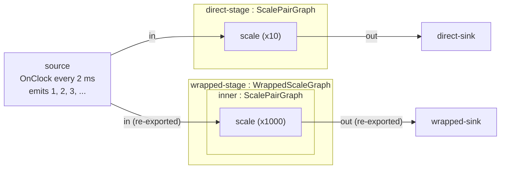

# `reusable_graphs` — typed reusable pipeline components with `embed<G>()`

> **User guide:** [Reusable Graphs](https://docs.nvidia.com/holoscan/sdk-user-guide/composing-applications/reusable-graphs) —
> this example is the
> cited program for reusable graph components (derived `Graph` subtypes with
> exported interface ports, `embed<G>()`, `GraphHandle` lifetime, and
> `GraphInstancePath`).

The program has two parts. **Part 1 (authoring):** one tick source fans out to
two independently configured `ScalePairGraph` instances. `direct-stage` is a
direct child; `wrapped-stage/inner` is embedded through an intermediate
`WrappedScaleGraph` and re-exported one nesting level. Both paths are wired
only through exported interface ports and belong to the parent-authored
`stage` region with a `bounded_memory` constraint. Each reusable scope
declares a `timeline` clock import, and its direct parent binds that import
explicitly until the chain reaches one concrete root clock.
Each branch is assigned atomically with `partition(name).add(graph_handle)`;
chaining `.add(sink)` places its external sink on the same serial owner.
`auto_partition_remaining()` leaves only the source for automatic planning.
The accepted view checks each selected instance and its two resolved Operators.
**Part 2 (runtime replay):** the same compiled cross-scope plan runs twice,
proving that fresh sessions reconstruct the imported clock chain and
constructor state consistently. A what-not-to-do stale-handle demonstration
closes the program.



The diagram is both the authored and executed topology: `source` feeds the
exported `in` port of each branch, and each exported `out` port feeds a sink
that labels values with the corresponding instance path. Both reusable
defaults resolve through explicit instance-qualified clock bindings to the
root `runtime-clock`; no clock is inherited by name or discovered by walking
ancestors.

## What you will learn

- Packaging a subgraph as a typed component: a class deriving from
  `holoscan::Graph` with public `holoscan::Input<T>`/`holoscan::Output<T>`
  interface members and a `compose()` body that binds them to internal
  operator ports with `export_input(public, internal)` /
  `export_output(public, internal)` — interface member first, inner port
  second.
- Instantiating a typed component with `graph.embed<WrappedScaleGraph>("name",
  ctor_args...)`, with constructor state reconstructed in each run session.
- Embedding the same component independently at `direct-stage` and
  `wrapped-stage/inner`, and applying one recursive parent region policy to
  the direct child and wrapper handles.
- Nesting and re-export: a reusable graph that itself embeds a reusable graph
  and re-exports the inner interface with the same `export_*` verbs — only
  ports exported at *every* level are reachable from further out.
- Instance identity: parent-relative `handle.path()` versus the
  root-qualified `GraphInstancePath` records in `graph.view().graphs()`
  (where the two-segment `wrapped-stage/inner` path lives), rendered via
  `segments()` — never by splitting a string on `/`.
- The weak-handle lifetime contract: `handle.graph_valid()` /
  `explicit operator bool()`, and why dereferencing a stale handle throws an
  error tagged `GRAPH_HANDLE_INVALID` instead of returning garbage.
- Explicit reusable-clock dependencies: `import_clock("timeline")`, using the
  import as the child default, and `bind_clock(child, child_import,
  parent_clock)` at every immediate parent boundary.
- Plan replay: two calls to `run_async(plan)` reconstruct fresh operator and
  clock state while preserving the same frozen cross-scope bindings.

## Prerequisites

- [`graph_composition`](../graph_composition/README.md) (E21) — configurators,
  regions, and `GraphView` inspection on a flat graph.
- [`first_pipeline`](../first_pipeline/README.md) — graph construction,
  `compile()`, and the run/stop idiom used here without further comment.

## Build

From this example's `cpp/` folder:

```sh
cmake -B build -S .
cmake --build build
```

If the SDK is not installed in a default location, point CMake at it:

```sh
cmake -B build -S . -DCMAKE_PREFIX_PATH=<install-prefix>
```

## Run

```sh
./build/reusable_graphs
```

The program needs no GPU, runs for well under a second, and exits nonzero if
any demonstrated property fails to hold.

## Expected output

```text
[reusable_graphs] authored instance paths: direct-stage wrapped-stage wrapped-stage/inner
[reusable_graphs] clock imports: direct and wrapped bound to runtime-clock
[reusable_graphs] region=stage graph_members=2 constraint=bounded_memory
[reusable_graphs] replay=1 termination=stopped
[reusable_graphs] replay=1 instance path=direct-stage samples=6 first=10 last=60 values: 10 20 30
[reusable_graphs] replay=1 instance path=wrapped-stage/inner samples=6 first=1000 last=6000 values: 1000 2000 3000
[reusable_graphs] replay=2 termination=stopped
[reusable_graphs] replay=2 instance path=direct-stage samples=6 first=10 last=60 values: 10 20 30
[reusable_graphs] replay=2 instance path=wrapped-stage/inner samples=6 first=1000 last=6000 values: 1000 2000 3000
[reusable_graphs] stale-handle demo: valid_in_scope=1 valid_after_scope_exit=0 path_after_scope_exit=absent deref_error=GRAPH_HANDLE_INVALID
reusable_graphs PASS: direct-stage and wrapped-stage/inner replayed twice region=stage termination=stopped
```

Sample counts past each instance's target of 6 may vary slightly run to run
with scheduling; the semantic shape does not:

- The **authored instance paths** line lists the direct child, wrapper, and
  nested two-segment `wrapped-stage/inner` record from the Part 1 `GraphView`.
- The **clock imports** line records both root-level bindings; the wrapped
  graph also binds its inner child's import to its own import.
- The **region** line proves the parent region contains the direct child and
  wrapper handles and carries the recursive `bounded_memory` constraint.
- Each **replay/instance path=** line belongs to one of two fresh sessions
  started from the same plan. Each first value equals its constructor factor
  (`x10` direct and `x1000` nested), and later values remain multiples of that
  factor, proving both independent constructor states are rebuilt in each
  fresh session.
- The **stale-handle** line is the what-not-to-do block's evidence: valid
  inside the owning scope, invalid after it, empty `path()`, and a thrown
  `GRAPH_HANDLE_INVALID` on dereference.
- The final `PASS` line is printed only after all claims are checked and is
  the line the CTest regex anchors on.

## Code walkthrough

### Why the C++ public surface *is* the interface

`ScalePairGraph` declares `Input<std::uint32_t> in{"in"}` and
`Output<std::uint32_t> out{"out"}` as public members and binds them inside
`compose()` with `export_input(in, scale->in)` / `export_output(out,
scale->out)`. There is no separate interface schema or descriptor file: you
make ports public and export them, and ordinary C++ access control decides
what a parent can see. An export is an *interface alias*, not a data edge —
no queue exists until a parent wires a flow to the exported port. Everything
you do not export fails closed: a parent that tries to reach the internal
`scale` operator's ports gets `GRAPH_PORT_NOT_FOUND` at authoring time, which
is why refactoring the body never breaks a parent as long as the exported
interface holds.

### Why `embed<>` is a constructor call, not a reference

`graph.embed<ScalePairGraph>("direct-stage", 10U)` and
`graph.embed<WrappedScaleGraph>("wrapped-stage", 1000U)` construct, compose,
and flatten two fresh children; the wrapper in turn embeds its inner
`ScalePairGraph` with the forwarded factor. A reusable graph is a function
for pipelines: each call constructs an instance with its own arguments.
Publication is transactional: if construction or `compose()` throws,
`embed` throws and the parent is left exactly as it was.

The parent can also apply policy without opening either component. Its
`stage` region contains the direct child and wrapper handles and attaches
`RegionConstraint::bounded_memory()`. Containing the wrapper recursively
covers its inner graph; the parent neither names nor flattens that private
implementation detail.

### Why re-export must be explicit at every nesting level

`WrappedScaleGraph` embeds a `ScalePairGraph` as `"inner"` and re-exports the
inner instance's already-exported ports through its own public pair —
`export_input(in, inner->in)` — using the *same* verbs used one level down
for operator ports. Visibility across levels follows one rule: only ports
exported at each level are reachable from further out. That keeps every
boundary an intentional design decision — an inner port can never leak to an
outer graph because some intermediate author forgot to hide it.

### Why instance identity is structured, not a string

`handle.path()` returns a parent-relative `GraphInstancePath`
(`"wrapped-stage"`, one segment). The nested instance's root-qualified identity
(`wrapped-stage/inner`, two segments) lives in `graph.view().graphs()` —
the `GraphView` is the source of truth once graphs nest. Names are literal
segments (a name may itself contain `/`; `"."`, `".."`, and `"_root"` are
reserved), so the example renders paths by walking `segments()` and never
splits a rendered string back apart.

### Why the stale-handle block is labeled *what not to do*

`GraphHandle` reads like a smart pointer but is weak and read-only: the
parent owns the child, and the handle never extends that lifetime. The
example deliberately retains a handle past its parent's scope and shows the
documented failure shape: `graph_valid()` flips to `false`, `path()` comes
back empty, and dereferencing throws `GRAPH_HANDLE_INVALID` rather than
returning a dangling pointer. The rule the block teaches: validate any
retained handle before dereferencing (`if (handle) ...`), and persist a
durable `GraphView` snapshot — not handles — for anything you keep, compare,
or display.

### Why clock dependencies cross scopes explicitly

A reusable graph cannot assume which concrete clock its parent will use, and
clock resolution never relies on matching names in an ancestor. Instead,
`ScalePairGraph::compose()` declares `import_clock("timeline")`, selects that
import as its default, and exposes the owned key through `clock_import()`.
After embedding, the parent binds each exact child import to its own
`runtime-clock` with `bind_clock(direct, ...)` and `bind_clock(wrapped, ...)`.

Nesting repeats the same rule at each immediate boundary.
`WrappedScaleGraph` imports its own `timeline`, binds the inner
`ScalePairGraph` import to it, and the root binds the wrapper import to the
concrete clock. The compiler freezes the complete instance-qualified chain;
RunSession reconstructs it without pointers or name search. The example then
starts two fresh sessions from the same immutable `ExecutionPlan`, and both
runs begin the scale instance at the same first value, demonstrating replay
of clocks and operator factories together.

## HSDK 4.x comparison

| Concern | HSDK 4.x | HSDK 5.x (this example) |
|---|---|---|
| Reuse unit | A whole `Fragment` (process-granular), or a hand-written helper function that adds operators to a fragment with name prefixes | A `Graph` subtype embedded in-process with `embed<G>("name", args...)`, any number of times, at any nesting depth |
| Interface boundary | Convention: documented operator/port name strings; any operator port reachable by name | The type's public `Input<T>`/`Output<T>` members, bound via `export_input`/`export_output`; unexported ports fail closed with `GRAPH_PORT_NOT_FOUND` |
| Instance identity | Manually prefixed operator names (`"left_scale"`, `"right_scale"`) | Structured `GraphInstancePath` segments, recorded in `GraphView`, rendered — never parsed — as `wrapped-stage/inner` |

In 4.x the in-process reuse story was a helper function plus naming
discipline — the "interface" was whatever names a README promised, with
nothing for the compiler to check. The 5.x design makes the component a
*type*: its signature is compile-checked at every `add_flow`, its internals
are unreachable by construction, and every instance carries a structured
identity the tooling can render and compare.

## What's next

- [`schema_payloads`](../schema_payloads/README.md) (E24) — moving beyond bare
  scalars with generated structured messages.
- Guide deep dive: composing-applications/reusable-graphs, which walks the
  interface/export model, embedding cost and transactional publication,
  handle lifetime, and `GraphInstancePath` in full.

## Concepts at a glance

| API | Role in this example |
|---|---|
| `class ScalePairGraph : public holoscan::Graph` | The reusable component type; its public port members are its interface |
| `export_input(in, scale->in)` / `export_output(out, scale->out)` | Bind interface members to internal ports (interface member first) |
| `graph.embed<G>("name", args...)` | Construct one independent named instance; returns `GraphHandle<G>` |
| `region("stage").add(handle)` | Apply parent policy recursively to an embedded graph without exposing its internals |
| `GraphHandle<G>` | Weak, read-only, typed view of an embedded instance |
| `handle.path()` | Parent-relative `GraphInstancePath` (`std::optional`) |
| `graph.view().graphs()` | Root-qualified instance records, incl. nested `wrapped-stage/inner` |
| `GraphInstancePath::segments()` | The structured identity; render from segments, never split strings |
| `handle.graph_valid()` / `operator bool()` | Validity check required before using any *retained* handle |
| `GRAPH_HANDLE_INVALID` | Error token thrown on stale-handle dereference |
| `import_clock("timeline")` / `set_default_clock(import)` | Declare one reusable scope's explicit scheduling-clock dependency |
| `bind_clock(child, child->clock_import(), parent_clock)` | Resolve an exact child import at the immediate parent boundary |
| two `run_async(plan)` sessions | Replay one immutable cross-scope plan with fresh runtime state |
