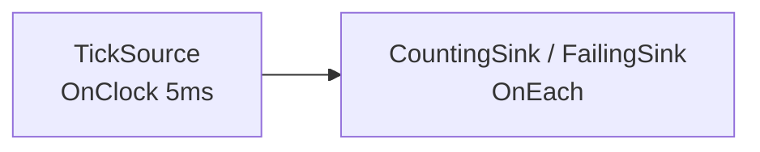

# Running and Stopping

> **User guide:** [Running and Stopping](https://docs.nvidia.com/holoscan/sdk-user-guide/getting-started/running-and-stopping) —
> this example is
> the cited program for blocking and asynchronous execution, managed shutdown
> signals, `RunSession`, cooperative stop, and the fail-closed error channel.

One tick pipeline run seven ways: an early managed-signal domain with managed
async binding, ordinary cooperative stop (`kStopped`), a deliberate compute
error (`kFailed` with diagnostics), operator-requested completion
(`kRequestedCompleted`), move-only RAII scoping, and caller-managed blocking
execution, plus default managed blocking execution.



## What you will learn

- `run_async(plan)` → `RunSession`: the asynchronous entry point every
  interactive application uses.
- `ManagedShutdownSignals::create()` plus `run_async(plan, signals)`: establish
  Linux signal ownership before participant threads and bind it before start.
- `run(plan, RunSignalPolicy::kCallerManaged)`: keep blocking execution while
  leaving SIGINT/SIGTERM to an embedding host.
- `run(plan)`: use default managed blocking execution after Linux proves a
  safe transient single-task boundary.
- `request_stop()` / `wait()`: nonblocking + idempotent stop request, then a
  joining wait — the cooperative shutdown pair.
- `ExecutionContext::request_completion()`: immediate whole-run success from
  inside `compute()`, reported as `kRequestedCompleted`.
- `session.termination()`: distinguish natural completion, requested
  completion, stop, failure, and a running session.
- `session.diagnostics()`: stable tokens describing why a run failed closed.
- The once-only terminal `ERROR` summary is for an observing human; code
  branches on `termination()` and structured `diagnostics()`, never log prose.
- `RunSession` is move-only RAII: ownership transfers with `std::move`.
  Sub-run D stops and waits through that owner; the destructor remains the
  fail-safe for a live session.

## Prerequisites

[`../compile_and_check`](../compile_and_check/README.md) — this example starts
where a successfully compiled plan ends.

## Build

The C++ and Python variants demonstrate the same session-control concepts. The
Python variant uses native Python operators; its declarative `complete_after()`
contract ends with `COMPLETED` because Python does not yet expose the C++
callback-level `ExecutionContext::request_completion()` operation.

From this folder's `cpp/` directory:

```bash
cmake -B build -S .
cmake --build build
```

## Run

```bash
./build/running_and_stopping
```

The installed Python source can be run directly:

```bash
python python/running_and_stopping.py
```

## Expected C++ output

```text
M: managed async domain -> termination=kStopped, close=ok
A: cooperative stop -> termination=kStopped, diagnostics=0
B: compute error -> termination=kFailed, first token=RUNTIME_OPERATOR_CALLBACK_FAILED
C: operator request -> termination=kRequestedCompleted, diagnostics=0
D: moved session stopped; scoped owner retained stop/join authority
E: caller-managed blocking run -> result=0
F: default managed blocking run -> result=0
running_and_stopping: all sub-runs behaved as documented
```

On non-Linux platforms the first line is instead:

```text
M: managed async domain -> kNotSupported on this platform
```

## Expected Python output

```text
A: cooperative stop -> termination=STOPPED, diagnostics=0
B: Python compute error -> diagnostic=RUNTIME_OPERATOR_CALLBACK_FAILED
C: complete_after contract -> termination=COMPLETED, diagnostics=0
D: context manager retained stop/join authority
E: caller-managed blocking run -> terminal session returned
running_and_stopping: all native Python sub-runs behaved as documented
```

## Code walkthrough

### Who decides when a pipeline ends?

You do. HSDK 5.x sources do not "finish": a clock-driven source ticks until
told otherwise, so termination is an application decision, not a framework
inference. Sub-run A shows the idiom every example in this catalog uses:
`run_async`, observe progress from `main()` (condition variable, never
polling), then `request_stop()` and `wait()`.

### Who owns SIGINT and SIGTERM?

On Linux, plain blocking `run(plan)` manages process-directed SIGINT and
SIGTERM by default. It can do so transparently only when it adopts a compatible
HSDK domain or both process-task census reads observe exactly one live task. With
no adoptable domain, successful census reads that change or do not each observe
exactly one live task report `RUNTIME_MANAGED_SIGNAL_DOMAIN_REQUIRED`; a census
read error reports `RUNTIME_MANAGED_SIGNAL_INSTALL_FAILED`. Both return nonzero
before session creation. In the originating process, an unavailable domain or
binding, or a poisoned process registry, instead reports
`RUNTIME_MANAGED_SIGNAL_OWNER_BUSY`. Let an active binding retire, close and
recreate a spent domain, reconcile an ownership conflict or choose caller-managed
execution, and restart after poisoning. Neither case silently opts out.

Sub-run E shows the explicit blocking opt-out for a host that already owns
signals:

```cpp
const int rc = holoscan::run(
    plan, holoscan::RunSignalPolicy::kCallerManaged);
```

This path performs no HSDK-managed signal ownership, census, mask, descriptor,
terminal-participant, or diagnostic work. Plain `run_async(plan)` is also caller-managed.

Sub-run M shows managed asynchronous execution. It calls
`ManagedShutdownSignals::create()` before compiling graphs or starting other
participant threads, passes the move-only one-shot domain to
`run_async(plan, signals)`, waits for both session and binding retirement, and
closes the domain on its creator thread. On non-Linux platforms the factory is
present but returns `ErrorCode::kNotSupported`.

Plain `run(plan)` may adopt an available explicit domain. That successful
reservation consumes the domain's sole binding attempt; after the run retires,
close the spent domain and create a fresh one before another managed run.

HSDK installs no signal handler and does not change `sigaction`. Its Linux
domain blocks SIGINT/SIGTERM before participant-thread creation and accepts
process-directed occurrences synchronously with `signalfd`. The first accepted
occurrence requests ordinary cooperative stop. A second accepted occurrence is
delegated under the unchanged default, ignored, or custom prior policy.
Standard signals can coalesce, and simultaneously pending mixed signals have
no promised order, so a deterministic supervisor waits for first-acceptance
evidence before sending signal two. Actual signal generation belongs in a
supervised process test, not this ordinary example.

Active-domain HSDK use after `fork()`, arbitrary existing-thread adoption, and
thread-directed delivery to another participant are currently unsupported.
The child inherits the creator's blocked SIGINT/SIGTERM mask, and `exec()`
preserves it even though the managed descriptors are close-on-exec. Before
`exec()`, reset the child mask with `sigprocmask()`, or use
`POSIX_SPAWN_SETSIGMASK` with an empty or application-chosen mask. `system()`
and `popen()` do not perform that reset for you.

Preserving a custom disposition does not preserve delivery-thread affinity. For
a persistent domain, an unblocked custom handler may run on the broker thread
both during unbound forwarding and when a bound session delegates its second
accepted signal; do not depend on main-thread TLS, affinity, or identity.
A first signal adds no forced cancellation or whole-run completion bound.

### Completion, stop, and failure are not interchangeable

Sub-run C calls `context.request_completion()` from `compute()`. The request
closes callback admission for the whole session and reports the distinct
successful outcome `kRequestedCompleted`; the blocking `run(plan)` form would
return zero. Callback claims ordered before the request may proceed and retire,
but no claim ordered afterward enters.

This is an immediate imperative success request, **not** end-of-stream: it
does not guarantee source closure, downstream drain, or delivery of already
queued samples. Use it only when the application accepts that boundary. The
`ExecutionContext&` is callback-lifetime only; never retain it or use it after
`compute()` returns.

An application `request_stop()` is the *cooperative* channel shown by sub-run
A: in-flight activations finish, teardown runs, `termination()` reports
`kStopped`, and `diagnostics()` stays empty. A synchronously accepted managed
signal also ends as `kStopped`, but retains a warning-level
`RUNTIME_MANAGED_SIGNAL_RECEIVED` diagnostic. A failing `compute()` is the
*terminal* channel: the runtime fails closed, `wait()` returns on its own,
`termination()` reports `kFailed`, and `diagnostics()` carries a stable token
you can branch on. Never use `diagnostics().empty()` to classify every stopped
run.

### Why is the failure token generic?

Sub-run B prints `RUNTIME_OPERATOR_CALLBACK_FAILED` — the runtime's generic
callback-failure token. The typed `Error` your `compute()` returned selects
the failure; the token records *that* an operator callback failed. Attribute
the *cause* from your own error code before returning it.

### Structured diagnostics versus the terminal log

After cleanup, a failed session attempts one bounded terminal `ERROR` summary
through the configured logger. That line helps a human notice the failure when
running an installed example, but its prose, formatting, field order, and sink
are deliberately not API. The code above waits for terminal state and then
reads `session.diagnostics()`: stable diagnostic identifiers, source identity,
and typed errors are the machine-readable authority even if a logger is
disabled or its sink fails.

### Move-only RAII

`RunSession` cannot be copied — there is exactly one owner of stop/join
authority. Sub-run D transfers that authority with `std::move`, then stops and
waits through the moved-to owner. If a live session instead leaves scope, its
destructor supplies the same stop-and-join fail-safe. The fatal rule: never
call `wait()` (or destroy the session) from code that runs *inside* the run —
that deadlocks by construction.

### About `run(plan)` and successful completion

The blocking `run(plan)` family returns zero for natural `kCompleted` and
explicit `kRequestedCompleted`. A compiler-accepted zero-vertex `Graph`
produces a valid zero-work plan and completes naturally as a no-op. That is
distinct from a
default-constructed or compile-rejected empty `ExecutionPlan` wrapper:
passing such a wrapper to `run()` or `run_async()` throws `CompileError`.
Ordinary nonempty graphs with recurring sources do not infer natural
completion from a temporarily empty input queue: they run until a cooperative
stop or failure because HSDK 5 has no bounded-source completion witness and
downstream-drain protocol. Sub-run E demonstrates caller-managed blocking with
an explicit requested-completion witness. Sub-run F reuses the same plan
through default managed blocking after all earlier session threads and the
explicit domain have retired; the other execution examples use async sessions.

## HSDK 4.x comparison

| Concept | HSDK 4.x | HSDK 5.x |
|---|---|---|
| Ending a run | `CountCondition` / scheduler stops when conditions expire | Application requests whole-run completion or stop explicitly |
| Failure reporting | Exceptions / GXF error codes in logs | `termination() == kFailed` + `diagnostics()` tokens |
| Session object | `Application::run()` blocks; no session handle | Move-only `RunSession` with RAII join |

4.x pushed the decision into per-operator conditions. HSDK 5 currently has no
operator-local deactivation or deadlock-as-success rule: whole-run completion
or stop is explicit. A count/EOS/drain protocol is a separate capability and
is not implied by `request_completion()`.

## What's next

- [`../operator_anatomy`](../operator_anatomy/README.md) — everything an
  operator can do inside `compute()`.
- The user guide's *Lifecycle Restart Control* page (Advanced) covers
  restarting parts of a running graph without ending the session.

## Concepts at a glance

| HSDK 5.x API | Role in this example |
|---|---|
| `run_async(plan)` | Start the run, return the owning session |
| `ManagedShutdownSignals::create()` | Establish the early Linux signal domain; return `kNotSupported` elsewhere |
| `run_async(plan, signals)` | Atomically bind one managed async session before start |
| `ManagedShutdownSignals::close()` | Restore the creator's exact prior mask after binding retirement |
| `run(plan, RunSignalPolicy::kCallerManaged)` | Block while leaving process signals to the caller |
| `run(plan)` | Block with default managed SIGINT/SIGTERM admission on Linux |
| `RunSession::request_stop()` | Nonblocking, idempotent stop request |
| `RunSession::wait()` | Join; returns when the run has ended |
| `RunSession::termination()` | Natural/requested success, stop, failure, or running verdict |
| `RunSession::diagnostics()` | Stable failure tokens |
| `RunSession::is_running()` | Liveness probe |
