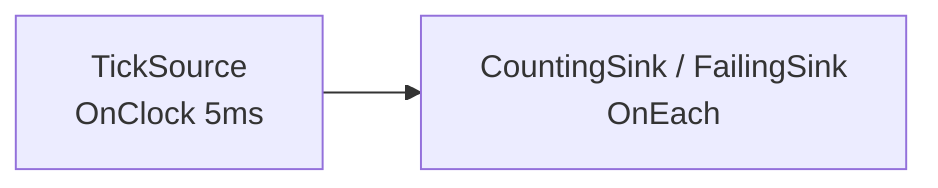

# Running and Stopping

> **User guide:** [Running and Stopping](https://docs.nvidia.com/holoscan/sdk-user-guide/getting-started/running-and-stopping) —
> this example is
> the cited program for `run_async()`, `RunSession`, cooperative stop, and the
> fail-closed error channel.

One tick pipeline run three ways: cooperative stop (`kStopped`), a deliberate
compute error (`kFailed` with diagnostics), and move-only RAII scoping.



## What you will learn

- `run_async(plan)` → `RunSession`: the asynchronous entry point every
  interactive application uses.
- `request_stop()` / `wait()`: nonblocking + idempotent stop request, then a
  joining wait — the cooperative shutdown pair.
- `session.termination()`: `kStopped` vs `kFailed` vs `kRunning` — and what
  each means for your exit code.
- `session.diagnostics()`: stable tokens describing why a run failed closed.
- The once-only terminal `ERROR` summary is for an observing human; code
  branches on `termination()` and structured `diagnostics()`, never log prose.
- `RunSession` is move-only RAII: ownership transfers with `std::move`.
  Sub-run C stops and waits through that owner; the destructor remains the
  fail-safe for a live session.

## Prerequisites

[`../compile_and_check`](../compile_and_check/README.md) — this example starts
where a successfully compiled plan ends.

## Build

From this folder's `cpp/` directory:

```bash
cmake -B build -S . -Dholoscan_DIR=/opt/nvidia/holoscan/lib/cmake/holoscan
cmake --build build
```

## Run

```bash
./build/running_and_stopping
```

## Expected output

```text
A: cooperative stop -> termination=kStopped, diagnostics=0
B: compute error -> termination=kFailed, first token=RUNTIME_OPERATOR_CALLBACK_FAILED
C: moved session stopped; scoped owner retained stop/join authority
running_and_stopping: all sub-runs behaved as documented
```

## Code walkthrough

### Who decides when a pipeline ends?

You do. HSDK 5.x sources do not "finish": a clock-driven source ticks until
told otherwise, so termination is an application decision, not a framework
inference. Sub-run A shows the idiom every example in this catalog uses:
`run_async`, observe progress from `main()` (condition variable, never
polling), then `request_stop()` and `wait()`.

### The two stop channels are not interchangeable

`request_stop()` is the *cooperative* channel: in-flight activations finish,
teardown runs, `termination()` reports `kStopped`, and `diagnostics()` stays
empty. A failing `compute()` is the *terminal* channel: the runtime fails
closed, `wait()` returns on its own, `termination()` reports `kFailed`, and
`diagnostics()` carries a stable token you can branch on. Never treat the two
as equivalent in production code — one is your decision, the other is an
incident.

### Why is the failure token generic?

Sub-run B prints `RUNTIME_OPERATOR_CALLBACK_FAILED` — the runtime's generic
callback-failure token. The typed `Error` your `compute()` returned selects
the failure; the token records *that* an operator callback failed. Attribute
the *cause* from your own error code before returning it.

### Structured diagnostics versus the terminal log

After cleanup, a failed session attempts one bounded terminal `ERROR` summary
through the configured logger. That line helps a human notice the failure when
running an installed example, but its prose, formatting, field order, and sink
are deliberately not API. The code above waits for terminal state and then
reads `session.diagnostics()`: stable diagnostic identifiers, source identity,
and typed errors are the machine-readable authority even if a logger is
disabled or its sink fails.

### Move-only RAII

`RunSession` cannot be copied — there is exactly one owner of stop/join
authority. Sub-run C transfers that authority with `std::move`, then stops and
waits through the moved-to owner. If a live session instead leaves scope, its
destructor supplies the same stop-and-join fail-safe. The fatal rule: never
call `wait()` (or destroy the session) from code that runs *inside* the run —
that deadlocks by construction.

### About `run(plan)` and `kCompleted`

The blocking `run(plan)` form returns an `int` and reserves `0` for
`RunTermination::kCompleted`. A compiler-accepted zero-vertex `Graph` produces
a valid zero-work plan and completes as a no-op. That is distinct from a
default-constructed or compile-rejected empty `ExecutionPlan` wrapper:
passing such a wrapper to `run()` or `run_async()` throws `CompileError`.
Ordinary nonempty graphs with recurring sources do not infer completion from
a temporarily empty input queue: they run until a cooperative stop or failure
because EA1 has no bounded-source completion witness and downstream-drain
protocol. This example therefore demonstrates the asynchronous form
throughout.

## HSDK 4.x comparison

| Concept | HSDK 4.x | HSDK 5.x |
|---|---|---|
| Ending a run | `CountCondition` / scheduler stops when conditions expire | Application observes and calls `request_stop()` |
| Failure reporting | Exceptions / GXF error codes in logs | `termination() == kFailed` + `diagnostics()` tokens |
| Session object | `Application::run()` blocks; no session handle | Move-only `RunSession` with RAII join |

4.x pushed the stop decision into per-operator conditions, which made "when
does the app end" an emergent property of the graph. 5.x makes it an explicit
application-level decision with one owner.

## What's next

- [`../operator_anatomy`](../operator_anatomy/README.md) — everything an
  operator can do inside `compute()`.
- The user guide's *Lifecycle Restart Control* page (Advanced) covers
  restarting parts of a running graph without ending the session.

## Concepts at a glance

| HSDK 5.x API | Role in this example |
|---|---|
| `run_async(plan)` | Start the run, return the owning session |
| `RunSession::request_stop()` | Nonblocking, idempotent stop request |
| `RunSession::wait()` | Join; returns when the run has ended |
| `RunSession::termination()` | `kStopped` / `kFailed` verdict |
| `RunSession::diagnostics()` | Stable failure tokens |
| `RunSession::is_running()` | Liveness probe |
