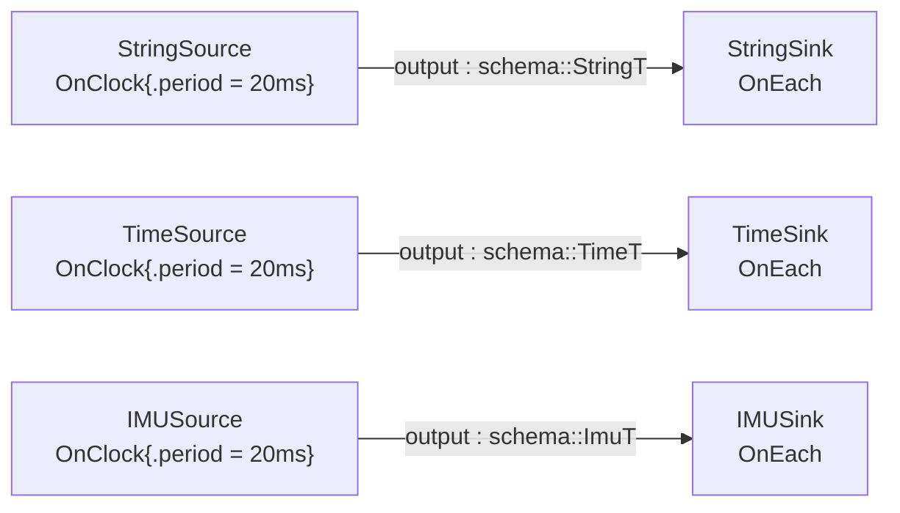

# schema_payloads — SDK schema types as zero-declaration payloads

> **User guide:** [Schema Payloads](https://docs.nvidia.com/holoscan/sdk-user-guide/data-and-payloads/schema-payloads) —
> this example is the
> cited program for using the SDK's generated schema types
> (`schema::StringT`, `schema::TimeT`, `schema::ImuT`) directly as port
> types, and for the bounded-size rejection every generated-schema emit is
> subject to (also serves data-and-payloads/payload-type-rules).

Three clock-driven sources emit SDK schema values down three parallel lanes
to three sinks; one mid-stream oversize `StringT` emit is rejected with
`kResourceExhausted`, and the program prints the round-tripped values, the
labeled rejection, and a single summary line after a cooperative stop.



## What you will learn

- SDK schema types are admitted port types with **zero declarations**:
  `holoscan::Output<holoscan::schema::StringT> output;` — no wrapper
  struct, no `ChannelTypeIdentity`/`ChannelPodLayout`, no codec
  registration.
- The owning generated types are plain C++ value types you fill directly:
  `value.data = "…"` (`StringT`), `value.time_ns`/`value.acqtime_ns`
  (`TimeT`), and nested `std::shared_ptr<schema::HeaderT>` +
  `schema::Quaternionf`/`schema::Vector3f` members (`ImuT`).
- Caller `SampleMetadata` (`trace_id`, `frame_id`,
  `SampleFlags::kDegraded`) rides with the value and round-trips to the
  consumer unchanged.
- Every generated-schema payload has a package-declared serialized bound,
  `holoscan::generated_schema_max_serialized_size_v<T>` (512 bytes for
  `StringT`); an emit that cannot fit is rejected **synchronously at the
  emit call** with `ErrorCode::kResourceExhausted`.
- The schema's stable identity is a compile-time constant:
  `holoscan::schema_identity<schema::StringT>()` yields
  `holoscan.schema.String v1`.
- Consumers of `StringT` and `TimeT` link **`holoscan::schema`** (which brings
  in `holoscan::core`); `holoscan::core` alone does not expose the generated
  schema headers.
- This example also carries `schema::ImuT`, and the `Image` and `Imu` schemas
  belong to **`holoscan::sensor_io`** rather than to Core. That is a separate
  package component, `holoscan-sensor-io`, so an SDK install that omitted it will
  fail to configure this example.

## Prerequisites

- No GPU is required: all values are host-side owning types.

## Build

From this `cpp/` folder (standalone consumer build, using
`CMakeLists.min.txt` as the project file):

```bash
cmake -B build -S .
cmake --build build
```

If your SDK lives elsewhere, point `-Dholoscan_DIR=` at the directory
containing `holoscan-config.cmake`. Note the target links both
`holoscan::schema` and `holoscan::sensor_io` in addition to
`holoscan::core` — the schema target exports the generated FlatBuffers headers
and the schema runtime library, while `holoscan::sensor_io` is what supplies
`schema::ImuT`.
Inside the SDK source tree the example builds as part of the normal
examples build via `CMakeLists.txt`.

## Run

```bash
./build/schema_payloads
```

Or through CTest:

```bash
ctest --test-dir build -R EXAMPLE_CPP_SCHEMA_PAYLOADS_TEST
```

## Expected output

```text
imu #1: frame="imu_link" w=1 az=-9.81
string #1: "schema greeting #1" (frame=1, degraded=no)
time #1: time_ns-acqtime_ns=1000000
imu #2: frame="imu_link" w=1 az=-9.81
string #2: "schema greeting #2" (frame=2, degraded=no)
time #2: time_ns-acqtime_ns=1000000
imu #3: frame="imu_link" w=1 az=-9.81
time #3: time_ns-acqtime_ns=1000000
imu #4: frame="imu_link" w=1 az=-9.81
string #3: "schema greeting #3" (frame=3, degraded=no)
time #4: time_ns-acqtime_ns=1000000
string #4: "schema greeting #4" (frame=4, degraded=no)
string #5: "schema greeting #5" (frame=5, degraded=yes)
schema_payloads: StringT identity=holoscan.schema.String v1 bound=512 bytes
schema_payloads: oversize emit rejected: kResourceExhausted: serialized schema exceeds bounded storage
schema_payloads: strings=5 times=4 imus=4 degraded=1 oversize=kResourceExhausted termination=stopped
```

The per-sample lines are printed by the three sinks while the graph runs;
their interleaving across the three lanes varies run to run, but each
lane's own lines are ordered and the counts are exact (the sources are
bounded). The gap in the string lane after greeting #2 is the activation
the source spends on the oversize attempt. The
final three lines are printed by `main()` only after `session.wait()`
returns; the smoke test anchors on the last line alone.

## Code walkthrough

### Why schema payloads need zero declarations

For SDK schema types the message contract already exists: the generated package carries the
identity (`holoscan.schema.String v1`), a schema digest, an embedded
binary schema, a verifier, and a codec. `Output<schema::StringT>` therefore
compiles with no user-side registration at all — the type *is* the
contract. Application-owned FlatBuffers schemas generate the same evidence
from your `.fbs` source and are the recommended structured-message path.

### Why the serialized bound exists — and why the rejection is synchronous

A generated-schema payload travels as serialized bytes, and the channel
pre-allocates its wire storage from the package-declared bound
(`generated_schema_max_serialized_size_v<schema::StringT>` = 512 bytes) so
the steady-state path never allocates. A `StringT` holding 1024 characters
cannot fit, and the runtime refuses to discover that asynchronously: the
encode happens inside `output.emit(...)`, so the failure comes back as the
emit result — `kResourceExhausted: serialized schema exceeds bounded
storage` — on the very call that caused it. The operator here treats the
rejection as data (records it and moves on), which is exactly the pattern
for producers that may occasionally construct an over-bound value: the
error is attributable, local, and does not poison the run.

### Why the consumer receives values, not bytes

Each sink's `input.receive()` yields a fully materialized owning value
(`sample->data.data`, `sample->data.header->frame_id`, …) plus the caller's
`SampleMetadata`. Decode happened before `compute()` ran, against the
package's verifier, so a consumer can never observe a malformed or
truncated schema value — malformed bytes are a channel-level `kCodecError`,
never a half-parsed object in application code. The metadata round-trip
(trace and frame IDs matching, exactly one `kDegraded` sample) is asserted
by `main()`, demonstrating that identity and degradation flags are carried
by the runtime, not re-derived downstream.

### Why the nested `ImuT` lane matters

`StringT` is flat; `ImuT` exercises the full generated object shape: a
nested table (`header` as `std::shared_ptr<schema::HeaderT>`, itself
holding a `shared_ptr<schema::TimeT>` stamp) and fixed FlatBuffers structs
(`Quaternionf`, `Vector3f` with constructor + accessor style, e.g.
`orientation.w()`). All of it rides the same bounded encode/decode
pipeline — nesting changes what you write into the value, not how it moves.
The IMU schema's bound is also 512 bytes, so deep values are still finite
by construction.

## HSDK 4.x comparison (emitting non-tensor data)

| Concern | HSDK 4.x | HSDK 5.x `schema_payloads` |
|---|---|---|
| Emitting a string/struct | `op_output.emit(value, "out")` type-erases into a GXF `Message`; any copyable type appears to work in-process | only admitted payload families compile; schema types are admitted by their generated package |
| Wire contract | implicit — distributed apps needed a registered codec, and mismatches surfaced at runtime on the far side | explicit — identity, digest, verifier, codec, and serialized bound ship with the type |
| Size limits | none declared; a huge value grew buffers or failed deep in lower transport layers | package-declared bound, enforced at `emit` with `kResourceExhausted` |
| Failure locality | serialization errors logged by the framework, often on the consumer side | the producer's own `emit` call returns the error as `expected<void, Error>` |

The 4.x model let anything through locally and discovered contract
problems at the worst possible time — across a transport, on another
machine. 5.x makes the payload contract part of the type system, so "will
this value move?" is answered at compile time and "does it fit?" is
answered at the emit call.

## What's next

- [`flatbuffer_schemas/custom_schema`](../flatbuffer_schemas/custom_schema/README.md) —
  define an application-owned schema when the SDK's built-in shapes do not fit.
- [`examples/tensors_in_depth`](../tensors_in_depth/README.md) — device-side payloads
  with pooled allocation and stream-ordered publication (Wave 3,
  CUDA-gated).
- Guide deep-dive: data-and-payloads/schema-payloads (package evidence and
  identity model) and data-and-payloads/payload-type-rules (which payload
  family to choose when).

## Concepts at a glance

| API | Role in this example |
|---|---|
| `Output<schema::StringT>` / `Input<schema::StringT>` | SDK schema type as a port type — zero declarations |
| `schema::StringT` / `schema::TimeT` / `schema::ImuT` | owning generated value types filled field-by-field |
| `schema::HeaderT`, `Quaternionf`, `Vector3f` | nested table (via `shared_ptr`) and fixed structs inside `ImuT` |
| `generated_schema_max_serialized_size_v<T>` | package-declared serialized bound (512 bytes for `StringT`) |
| `ErrorCode::kResourceExhausted` | synchronous emit rejection when a value exceeds the bound |
| `schema_identity<schema::StringT>()` | compile-time stable identity (`holoscan.schema.String v1`) |
| `SampleMetadata{.trace_id, .frame_id, .flags}` | caller metadata that round-trips with the value |
| `metadata.degraded()` | consumer-side check of the `kDegraded` flag |
| `holoscan::schema` (CMake target) | link target exporting generated headers + schema runtime |
| `holoscan::sensor_io` (CMake target) | link target owning the `Image` and `Imu` schemas |
