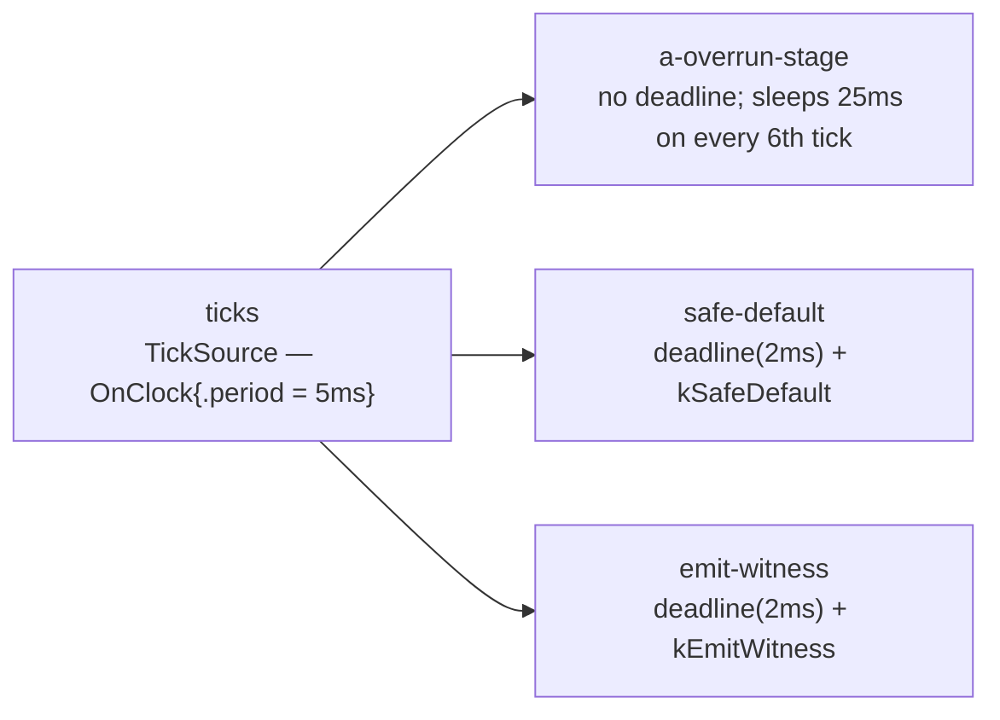

# Deadlines and violation policies (`contract_deadlines`)

> **User guide:** [Temporal Contracts](https://docs.nvidia.com/holoscan/sdk-user-guide/building-operators/temporal-contracts) —
> this example is the cited program
> for `deadline()` / `on_violation()`: the latest-start deadline budget and all three
> `OnViolation` policies (`kSafeDefault`, `kEmitWitness`, `kFailRun`).

A 5 ms tick source fans out to an overrun stage plus two deadline consumers that share
one contract shape — `deadline(2ms)` with different violation policies. The overrun
stage (no deadline of its own) sleeps 25 ms on every 6th tick; because it is dispatched
first on the shared serial worker lane, both consumers' already-eligible activations
for that tick start ~25 ms late, and the post-run summary labels each activation
on-time vs LATE. A `--fail-run` flag swaps the consumers for a single `kFailRun`
consumer whose first late candidate fails the whole run with a diagnostics dump.



With `--fail-run`, the consumers are replaced by one `fail-run` operator that authors
`deadline(2ms).on_violation(OnViolation::kFailRun)`; the same overrun stage delays its
6th activation past the budget and the run fails closed.

## What you will learn

- How to author a deadline in a temporal contract with
  `Contract::deadline(2ms)` chained with
  `Contract::on_violation(holoscan::OnViolation::...)` — the two must be authored
  together; a deadline without a policy (or vice versa) is rejected.
- What the deadline means: a **latest-permitted-compute-start budget** measured from
  the activation's frozen eligibility time — not a bound on how long `compute()` runs
  and not an ingress-sample age limit. Once eligibility is frozen, waiting behind other
  work on the execution lane counts toward the budget; an operator's own later backlog
  instead freezes when that operator becomes ready again. The boundary is inclusive:
  starting exactly at the budget is still nominal.
- How a late `kSafeDefault` / `kEmitWitness` activation enters `compute()` exactly once
  with a frozen `holoscan::ActivationStatus`, read via `ctx.activation()`
  (`.reason == ActivationReason::kDeadlineExceeded`, `.policy` = the compiled action),
  and how the operator branches to its own degraded path.
- What `OnViolation::kFailRun` does: the late candidate never enters `compute()`, the
  session ends with `RunTermination::kFailed`, and `session.diagnostics()` retains the
  deadline-specific evidence: warning `DEADLINE_MISS` records the observed strict miss,
  and error `RUNTIME_DEADLINE_FAIL_RUN` records the fatal policy decision.
- The standard bounded-run idiom: `compile()` → `run_async()` → observation object →
  `request_stop()` → `wait()` → print results from `main()` only after shutdown.

## Prerequisites

- Previous step in the contract family:
  [`temporal_contracts/missing_data`](../missing_data/README.md) (E10) — missing-data
  policies decide what happens when *data* is not there in time; deadlines decide what
  happens when *compute* does not start in time.
- A built or installed HSDK 5 SDK providing the `holoscan::core` CMake target.
- No GPU is required; the run is bounded (well under a second per variant).

## Build

From this `cpp/` folder, as part of the SDK examples tree the example builds with the
parent `examples/` project. As a standalone consumer, copy `CMakeLists.min.txt` over
`CMakeLists.txt` (or configure with `-C`), then:

```bash
cmake -B build -S . -Dholoscan_DIR=/opt/nvidia/holoscan/lib/cmake/holoscan
cmake --build build
```

The `-Dholoscan_DIR=` hint is only needed when the SDK is not in one of the default
`find_package` search prefixes listed in `CMakeLists.min.txt`.

## Run

```bash
./build/contract_deadlines              # kSafeDefault + kEmitWitness, exits 0
./build/contract_deadlines --fail-run   # kFailRun demo, exits nonzero by design
```

## Expected output

Default run (the following is one representative 12-activation run). Stop is
cooperative, so a real run may report 13 or more activations, and heavy host
scheduling can add LATE labels after values 6 and 12:

```text
[deadlines] config: source_period=5ms deadline=2ms overrun_stall=25ms stall_every=6
[deadlines] safe_default: activations=12 late=2 policy=kSafeDefault
[deadlines] safe_default timeline: 1:on-time 2:on-time 3:on-time 4:on-time 5:on-time 6:LATE 7:on-time 8:on-time 9:on-time 10:on-time 11:on-time 12:LATE
[deadlines] safe_default: first_late value=6 reason=kDeadlineExceeded policy=kSafeDefault action=degraded-return
[deadlines] emit_witness: activations=12 late=2 policy=kEmitWitness
[deadlines] emit_witness timeline: 1:on-time 2:on-time 3:on-time 4:on-time 5:on-time 6:LATE 7:on-time 8:on-time 9:on-time 10:on-time 11:on-time 12:LATE
[deadlines] emit_witness: witness value=6 reason=kDeadlineExceeded policy=kEmitWitness
contract deadlines complete
```

`--fail-run` run (exit code 3):

```text
[deadlines] fail-run: deadline=2ms on_violation=kFailRun overrun_stall=25ms
[deadlines] fail-run: on_time_activations=5 late_compute_callbacks=0
[deadlines] fail-run: termination=kFailed
[deadlines] fail-run diagnostic[0]: token=DEADLINE_MISS severity=warning
[deadlines] fail-run diagnostic[1]: token=RUNTIME_DEADLINE_FAIL_RUN severity=error
contract deadlines fail-run complete
```

Annotations: on tick 6 the overrun stage — dispatched first for each tick — sleeps
25 ms inside `compute()`. Both consumers' activations for tick 6 were already frozen
eligible when the stall began, so their compute starts miss the 2 ms latest-start
budget and enter their policy paths; the degraded path returns immediately. This graph
uses cross-operator interference because it is a deterministic witness. Any backlog
whose original source decision was already frozen can likewise consume the budget.
In the fail-run variant `late_compute_callbacks=0` is the proof that `kFailRun` never
invokes `compute()` for a late candidate: activations 1–5 are nominal and the delayed
6th candidate fails the run instead of entering user code.

## Code walkthrough

### Why the deadline is a latest-*start* budget

`Contract::deadline(budget)` declares the latest permitted *compute start* relative to
the activation's frozen eligibility time. The Runtime checks the gate at dispatch, on
the graph's admitted clock, before user code runs — which is why the enforcement point
is deterministic and why an operator cannot "absorb" lateness by finishing quickly.

Two subtleties matter when manufacturing violations honestly:

- **The activation already running cannot retroactively become late.** Its compute
  started on time; `deadline()` is not a compute-duration budget.
- **Waiting after the original source decision is frozen can make a start late.** Here
  the overrun stage is dispatched
  first (its `a-` name sorts first under serial alphabetic dispatch) and sleeps 25 ms
  while both consumers' activations for the same tick are already frozen eligible;
  when the shared worker lane frees, those starts are ~25 ms past a 2 ms budget. This
  demonstrates a slow neighbor, but the same rule applies to a same-operator backlog
  whose source decision was frozen before the earlier activation completed.

### Why deadline and policy are authored together

`deadline(2ms)` without `.on_violation(...)` is invalid (and vice versa). The design
forces the author to answer "and then what?" at authoring time, from a closed set of
three dispositions, instead of leaving lateness a silent log line or an unbounded
callback hook. The policy is compiled into the plan; at runtime it is visible read-only
as `ctx.activation().policy`.

### Why the degraded path is operator-authored

Under `kSafeDefault` the Runtime does not fabricate output or skip the operator — it
invokes `compute()` exactly once with `ActivationStatus{.reason = kDeadlineExceeded,
.policy = kSafeDefault}`. Only the operator knows what a safe fallback is for its
domain (hold last command, emit neutral output, return immediately). Here the degraded
branch consumes the sample, records the status for the post-run summary, and returns
immediately instead of doing nominal-path work.

### Why `kEmitWitness` exists separately from `kSafeDefault`

The invocation shape is identical; the difference is intent and evidence. `kEmitWitness`
records deadline evidence runtime-side and signals that the operator may emit a witness
of the violation. The consumer here reads `ctx.activation()` and reports the violation
reason (`kDeadlineExceeded`) — the "witness" line in the output — instead of silently
degrading. Use it when downstream systems must be able to *see* that a deadline slipped.

### Why `kFailRun` never calls `compute()` and how the evidence surfaces

`kFailRun` is the terminal policy: a late candidate is consumed without invoking user
code and the run fails closed — `session.wait()` returns with
`RunTermination::kFailed` and `session.diagnostics()` carries exactly one bounded
warning `DEADLINE_MISS` record for the violating candidate plus one error
`RUNTIME_DEADLINE_FAIL_RUN` record for the terminal policy decision. Nonfatal
policies retain only the warning miss record, while a checked deadline-evaluation
failure has the distinct
`RUNTIME_DEADLINE_EVALUATION_FAILED` token. Because failure is asynchronous, `main()` polls
`session.is_running()` with a 10 s cap instead of blocking unconditionally, then
prints the termination and the diagnostics dump. All
result printing in both variants happens in `main()` after `wait()` — operator-side
`std::cout` from concurrent `compute()` calls is not line-atomic.

## HSDK 4.x comparison

HSDK 4.x had no first-class deadline concept; this is new vocabulary rather than a
renamed API. The closest 4.x practice was hand-rolled:

| Concern | HSDK 4.x | HSDK 5 |
|---|---|---|
| Detecting a late start | Manual `std::chrono` stamps inside `compute()` | `deadline(budget)` in the contract, checked by the Runtime at dispatch |
| Reacting to lateness | Ad-hoc `if` + logging, semantics per author | Closed `OnViolation` set: `kSafeDefault` / `kEmitWitness` / `kFailRun` |
| Terminal misbehavior | Process keeps running unless the author aborts | `kFailRun`: run fails closed with `RunTermination::kFailed` + diagnostics |
| Evidence | Log grep | `ctx.activation()` in-band; `session.diagnostics()` post-run |

The rationale: timing obligations are part of an operator's *contract* with the graph,
so they are declared next to triggers and selectors where the compiler and Runtime can
enforce them uniformly, rather than re-implemented differently inside every operator.

## What's next

- Next in the contract family: [`temporal_contracts/on_predicate`](../on_predicate/README.md)
  (E12) — data-dependent activation gating (preview tier).
- Guide deep-dive: building-operators/temporal-contracts, deadline and violation-policy
  section (see the guide's Performance section for measurement topics).

## The contract family

This example is E11 in the family chain:
[E04 on_any_input](../on_any_input/README.md) → [E05 on_each](../on_each/README.md) →
[E06 on_clock](../on_clock/README.md) → [E07 on_aligned](../on_aligned/README.md) →
[E08 on_window](../on_window/README.md) → [E09 selectors](../selectors/README.md) →
[E10 missing_data](../missing_data/README.md) → **E11 deadlines** →
[E12 on_predicate](../on_predicate/README.md).

Contract vocabulary matrix — this example demonstrates the **bolded** cells:

| Vocabulary group | Options |
|---|---|
| Trigger | OnAnyInput, **OnEach**, OnClock, OnAligned, OnWindow, OnPredicate |
| Selector | **Exact** (implicit on the trigger port), LatestWithin, DrainAll, BracketedWindow |
| Missing-data policy | Skip, SafeDefault, ReuseLast |
| Deadline | **deadline(budget) + on_violation(kSafeDefault / kEmitWitness / kFailRun)** |

**When to choose this pattern:** add a deadline whenever an operator's output loses
value (or becomes unsafe) if compute starts late — control loops, actuation, safety
interlocks. Pick `kSafeDefault` when a domain fallback exists, `kEmitWitness` when
downstream must observe the slip, and `kFailRun` when running late is worse than not
running at all.

## Concepts at a glance

| API | Role |
|---|---|
| `Contract::deadline(std::chrono::nanoseconds)` | Declares the positive latest-permitted-compute-start budget from frozen eligibility time |
| `Contract::on_violation(OnViolation)` | Declares the sole action for a late final invocation gate; mandatory partner of `deadline()` |
| `holoscan::OnViolation` | Closed policy set: `kSafeDefault`, `kEmitWitness`, `kFailRun` |
| `ExecutionContext::activation()` | Returns the frozen `ActivationStatus` for this callback; side-effect free |
| `holoscan::ActivationStatus` | `.reason` (`kNominal` / `kDeadlineExceeded` / `kInvariantViolated`) + `.policy` (compiled action) |
| `RunSession::termination()` | `kStopped` after cooperative stop; `kFailed` after a `kFailRun` violation |
| `RunSession::diagnostics()` | Bounded post-run evidence; `kFailRun` carries warning `DEADLINE_MISS` plus error `RUNTIME_DEADLINE_FAIL_RUN` |
| `holoscan::OnClock{.period}` | Clock-driven source trigger paced by the graph's default `RealtimeClock` |
