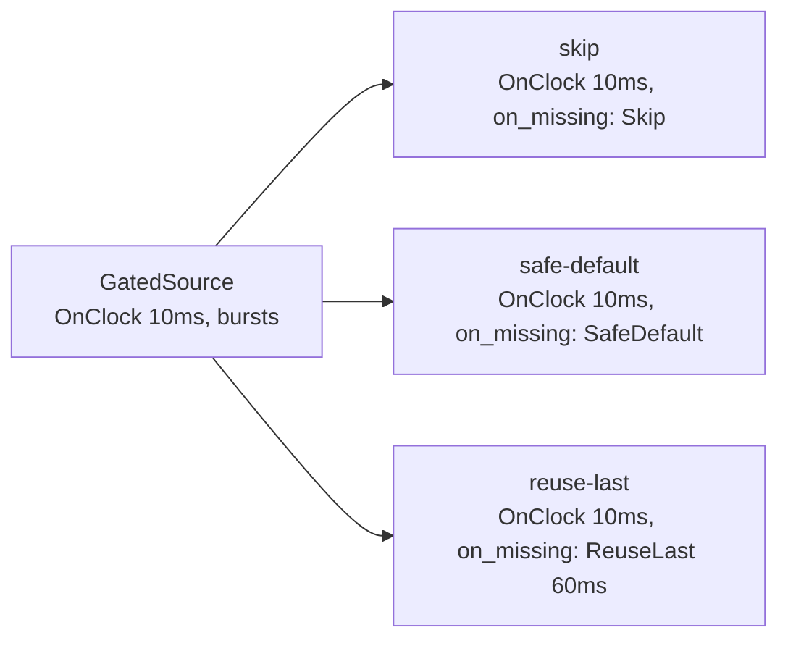

# Missing-Data Policies: `Skip` vs `SafeDefault` vs `ReuseLast`

> **User guide:** [Temporal Contracts](https://docs.nvidia.com/holoscan/sdk-user-guide/building-operators/temporal-contracts) —
> this example is
> the cited program for the three missing-data policies compared side by side.

A gated source (bursts of four samples, then four silent ticks) fans out to
three consumers that each declare a 10 ms `OnClock` trigger. The consumers
are identical except for
their `on_missing` policy; the per-policy counters printed after the run make
the differences observable.

> **Runtime shape:** `OnClock` with selected inputs is preserved across compile,
> run, restart, and replay. This example uses that direct public shape.



## What you will learn

- `Skip{}`: suppresses the whole activation — `compute()` never runs for a
  missing input, so nothing is fabricated and nothing stale is re-served.
- `SafeDefault{}`: activates `compute()` once on the operator-authored
  degraded branch; there is no fabricated sample — you branch on
  `data.selection().state == InputState::kSafeDefault`.
- `ReuseLast{.max_age}`: re-serves the last admitted sample (state
  `kReused`) until it exceeds the inclusive retention age, then reports
  absence.
- `data.selection().state` / `InputState`: the frozen per-activation input
  state every policy-aware `compute()` should branch on.
- Why `LatestWithin` on a data input outside the driving trigger's guarantee
  *requires* a missing-data policy: a clock candidate can always fire with an empty
  window, so the contract must say what happens.
- Why trigger cadence and per-input selection remain independent axes in a
  direct `OnClock` consumer contract.

## Prerequisites

[`../selectors`](../selectors/README.md) — how `Exact`, `LatestWithin`, and
`DrainAll` choose which samples participate; this example holds the selector
fixed and varies only the missing-data policy.

## Build

From this folder's `cpp/` directory:

```bash
cmake -B build -S .
cmake --build build
```

## Run

```bash
./build/contract_missing_data
```

## Expected output

```text
skip: activations=13 fresh=13 reused=0 safe_default=0 absent=0
safe_default: activations=26 fresh=13 reused=0 safe_default=13 absent=0
reuse_last: activations=25 fresh=13 reused=12 safe_default=0 absent=0
missing_data: policy comparison complete (skip/safe_default/reuse_last)
```

Exact counts vary with scheduling, but the shape is stable: the `skip`
consumer records *fewer activations* (missing-data ticks never invoke it) and
never a reused or defaulted state; the `safe_default` consumer activates on
every tick and takes the degraded branch whenever no fresh sample is
admitted; the `reuse_last` consumer also activates on every tick and
re-serves the last burst sample instead. Each admitted arrival satisfies at
most one activation, so `fresh` tracks the emitted burst samples (about half
the ticks) — a tick without a *new* arrival counts as missing even if the
last sample is still younger than `max_age`.

## Code walkthrough

### One consumer, three policies

`PolicyConsumer<MissingPolicyT>` is a single template whose `contract()`
differs only in `.on_missing(data, policy_)`. `OnClock{10ms}` supplies the
shared cadence; the sampled data input is declared independently. Everything the runtime
needs to know about gaps is declared *in the contract*; `compute()` merely
inspects the outcome. This is the HSDK 5.x replacement for 4.x-style runtime
condition callbacks: routing policy lives in a declarative, compile-checked
contract rather than mutable callback state.

### Branching on `selection().state`

Under `SafeDefault{}` the runtime does not fabricate a zero-filled sample —
`receive()` would fail. The authored pattern (same as the camera/IMU hero
app) is a `switch` on `data.selection().state`: `kSelected` and `kReused` may
`receive()`; `kSafeDefault` takes the degraded branch with no sample at all.

### Why `Skip` changes the activation count

`Skip{}` is the only policy that suppresses the activation itself. The other
two consumers activate on every clock candidate regardless of data; the `skip`
consumer's smaller `activations` counter is the observable proof. The example
asserts both that every Skip activation carries a fresh sample and that the
Skip lane activates fewer times than the SafeDefault lane before printing its
CTest success marker.

### Choosing a policy

| Policy | Choose when | Cost |
|---|---|---|
| `Skip{}` | Work is meaningless without the input | Activation gaps |
| `SafeDefault{}` | You have an authored degraded behavior (hold outputs, emit witness) | You must write the branch |
| `ReuseLast{.max_age}` | Stale-but-bounded data beats none (sensor fusion) | Explicit staleness bound to justify |

## HSDK 4.x comparison

| Concept | HSDK 4.x | HSDK 5.x |
|---|---|---|
| Missing input handling | Operator-side null checks after `receive()` | Declared `on_missing` policy; runtime enforces it before `compute()` |
| Reusing stale data | Hand-rolled caching members | `ReuseLast{.max_age}` with a mandatory bound |
| Skipping work | `ConditionType::kMessageAvailable` gating | `Skip{}` — activation suppressed by contract |

The 4.x approach mixed policy into `compute()` bodies where every operator
reinvented it; 5.x names the policy once in the contract so the compiler can
validate the combination and the plan records it.

## What's next

- [`../max_start_delay`](../max_start_delay/README.md) adds time budgets and violation
  policies on top of selection.
- The user guide's *Temporal Contracts* chapter covers combining policies
  with every trigger family.
- Family: [E04 on_any_input](../on_any_input/README.md) →
  [E05 on_each](../on_each/README.md) →
  [E06 on_clock](../on_clock/README.md) →
  [E07 on_aligned](../on_aligned/README.md) →
  [E08 on_window](../on_window/README.md) →
  [E09 selectors](../selectors/README.md) → **E10 missing_data** →
  [E11 max_start_delay](../max_start_delay/README.md) →
  [E12 on_predicate](../on_predicate/README.md).

## Contract vocabulary matrix

This example demonstrates the **bolded** cells.

| Dimension | Vocabulary |
|---|---|
| Trigger | `OnAnyInput` · `OnEach` · **`OnClock`** · `OnAligned` · `OnWindow` · `OnPredicate` (preview) |
| Selector | `Exact` · **`LatestWithin`** · `DrainAll` · `BracketedWindow` |
| Missing-data policy | **`Skip`** · **`SafeDefault`** · **`ReuseLast`** |

**When to choose this pattern:** a trigger can become ready without every
selected input, and the application must declare whether absence should
suppress work, enter an authored degraded branch, or reuse a bounded-age
observation.

## Concepts at a glance

| HSDK 5.x API | Role in this example |
|---|---|
| `on_missing(port, policy)` | Declares the per-input gap behavior |
| `Skip{}` / `SafeDefault{}` / `ReuseLast{}` | The three policies under comparison |
| `data.selection().state` | Frozen `InputState` the compute branch inspects |
| `LatestWithin{.max_age}` | The staleness window that makes gaps observable |
| `OnClock{.period}` | Drives each consumer directly at a fixed cadence |
