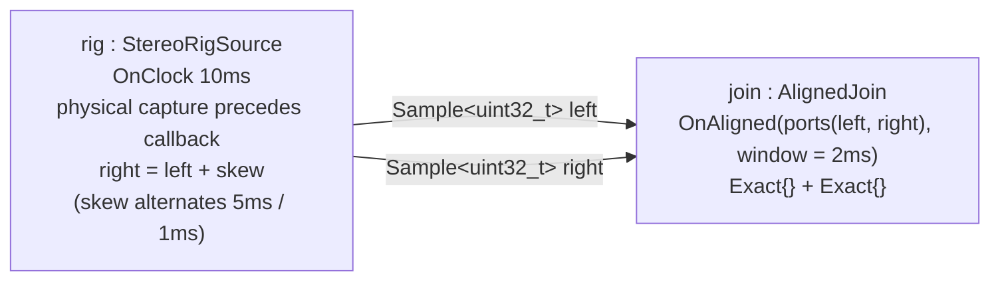

# OnAligned: windowed alignment of two streams

> **User guide:** [Temporal Contracts](https://docs.nvidia.com/holoscan/sdk-user-guide/building-operators/temporal-contracts) —
> this example is the
> cited program for the `OnAligned` trigger (windowed multi-stream alignment).

One clock-driven dual-lane capture rig — think of a stereo camera driver that
stamps both eyes from one shutter before its callback runs — emits a left/right sample pair per tick
into one joining operator whose contract fires only when the two FIFO-head
capture times fall within a 2 ms window; the program prints every fired pair
plus the fired vs skipped counts, so you can see exactly which pairs aligned
and which were retired.



The same topology in prose: `rig` emits one pair per activation on two output
lanes; `join` consumes one sample from each lane, but only as a
capture-time-aligned pair.

## What you will learn

- How to declare a closed multi-input alignment trigger with
  `OnAligned{.ports = holoscan::ports(left, right), .window = 2ms}`.
- Why **every** `OnAligned` member port must use the `Exact{}` selector — the
  all-`Exact` rule — and what one-to-one head consumption buys you.
- How alignment compares the **capture timestamps** you stamp via
  `holoscan::SampleMetadata{.capture_timestamp_ns, .source_clock_id}`, never
  wall-clock arrival order, which is what makes this example deterministic.
- Why capture time and `TagTime` are separate: the shutter coordinates may
  predate the publishing callback, while monotonic `TagTime` records Runtime
  observation and dispatch order without rewriting physical provenance.
- What happens on a miss: the runtime deterministically retires the
  minimum-time head(s) and re-evaluates — a miss is nominal control flow, not
  an error, and this program makes the retired samples countable.
- The bounded-run idiom: `compile()` → `run_async()` → observation struct →
  `request_stop()` → `wait()`, with all reporting done from `main()`.

## Prerequisites

You should be comfortable with clock-driven activation from the previous
example in the contract family,
[`temporal_contracts/on_clock`](../on_clock/README.md) (E06), and with the
typed-port operator shape from
[`temporal_contracts/on_any_input`](../on_any_input/README.md) (E04).

Contract family: [on_any_input](../on_any_input/README.md) →
[on_each](../on_each/README.md) → [on_clock](../on_clock/README.md) →
**on_aligned (this example)** → [on_window](../on_window/README.md) →
[selectors](../selectors/README.md) → [missing_data](../missing_data/README.md)
→ [deadlines](../deadlines/README.md) →
[on_predicate](../on_predicate/README.md).

## Build

From this `cpp/` folder, inside the SDK build tree the example builds with the
other examples. Standalone, against an installed SDK, use the minimal project
file (copy `CMakeLists.min.txt` over `CMakeLists.txt` first, or point CMake at
a copy):

```sh
cmake -B build -S .
cmake --build build
```

If the SDK is installed somewhere CMake does not search by default, pass a
hint: `cmake -B build -S . -DCMAKE_PREFIX_PATH=<install-prefix>`.

## Run

```sh
./build/contract_on_aligned
```

The program needs no GPU, no arguments, and finishes in well under a second
(8 left/right pairs at a 10 ms period, then a cooperative stop).

## Expected output

```text
[on_aligned] fired left#2 (t=+10ms) right#2 (t=+11ms) spread=1ms
[on_aligned] fired left#4 (t=+30ms) right#4 (t=+31ms) spread=1ms
[on_aligned] fired left#6 (t=+50ms) right#6 (t=+51ms) spread=1ms
[on_aligned] fired left#8 (t=+70ms) right#8 (t=+71ms) spread=1ms
[on_aligned] emitted_left=8 emitted_right=8
[on_aligned] fired=4 skipped_left=4 skipped_right=4
on_aligned example complete
```

The fired/skipped pattern, the pair identities, and every `spread` value are
deterministic. Odd-numbered pairs carry a 5 ms inter-lane skew (outside the
2 ms window) and are retired without firing; even-numbered pairs carry a 1 ms
skew (inside the window) and fire. `t=+Nms` is the capture time relative to
the rig's first activation — on the nominal 10 ms grid shown above; only under
extreme host load can tick coalescing shift those offsets to later grid
points, and even then the pattern and spreads are unchanged. The `fired=4
skipped_left=4 skipped_right=4` line is the CTest assertion.

## Code walkthrough

### Why the window lives in the contract, not in compute()

`AlignedJoin::compute()` contains no timestamp comparison at all — it just
receives one sample per port. The pairing policy is declared once in
`contract()`:

```cpp
result
    .trigger(holoscan::OnAligned{.ports = holoscan::ports(left, right), .window = 2ms})
    .input(left, holoscan::Exact{})
    .input(right, holoscan::Exact{});
```

Because the policy is data, the compiler can validate it, the plan records it
(a deterministic `aligned-oldest-head/v1` policy record), and `compute()` is
only ever activated with a complete, already-aligned tuple. Hand-rolled
alignment inside `compute()` would be invisible to the plan and impossible to
reason about deterministically.

### Why both inputs must be Exact

`OnAligned` consumes matched FIFO heads exactly once per firing — a strict
one-to-one join. A rate-adapting selector such as `LatestWithin` or `DrainAll`
would decouple consumption from the head comparison and destroy that
one-to-one meaning, so the contract requires `Exact{}` on every member port
(the all-`Exact` rule). If you need rate adaptation between unequal streams,
that is the [`on_each`](../on_each/README.md) pattern; if you need a batch
around an anchor, that is [`on_window`](../on_window/README.md).

### Why one rig stamps both lanes from one shutter

Alignment compares the **capture time carried in each sample's metadata**, not
when the sample happened to arrive. The rig starts from one physical shutter
coordinate, labels it with `context.clock().at_ns()`, and
adds the authored right-lane skew (alternating 5 ms / 1 ms). The shutter is
modeled 6 ms before the driver callback, so both capture coordinates honestly
predate publication. Because both stamps derive from one shutter, the
inter-lane skew is exact on every run, which is precisely how a real stereo
driver stamps both eyes from one shutter, and why the demo's fired/skipped
pattern never flakes.

The one-rig shape models one physical capture authority rather than a scheduler
workaround. `OnAligned` compares the immutable capture coordinates, including
an older sample that becomes visible after newer dispatch work. Runtime keeps
its scheduling history monotonic in a separate `TagTime` record, advancing a
microstep when necessary; it does not replace the shutter timestamp with the
callback's activation time. Independent sensors can use their own admitted
clock domains and frozen conversions, but a stereo device naturally produces
both coordinates from one shutter and therefore needs no conversion.

### Why misses are counted, not reported as errors

When the two heads are farther apart than the window, the runtime retires
every head at the minimum capture time and re-evaluates. A miss is nominal
streaming behavior — sensors drift, packets drop — so nothing in `compute()`
fails and `session.diagnostics()` stays empty. The example makes the misses
*visible* arithmetically: the rig counts what each lane emitted, the join
records what fired, and `skipped = emitted - fired` per lane.

### Why all printing happens in main() after wait()

Operators run concurrently, and interleaved `std::cout` from `compute()` is
not line-atomic. Results are collected in `AlignedObservation` (mutex +
condition variable + counters) and printed from `main()` only after
`request_stop()` and `wait()` have joined every operator thread, so the
output — and the CTest regular expression anchored to it — is stable.

## HSDK 4.x comparison

| Task | HSDK 4.x | HSDK 5 |
|---|---|---|
| Fire when every input has data | Implicit AND of per-port `MessageAvailableCondition`s (positional pairing — whichever messages sit at the queue fronts) | `OnAligned{.ports, .window}` — pairing is by capture time, declared in the contract |
| Timestamp-based pairing | Hand-written buffering and timestamp comparison inside `compute()` | Runtime `aligned-oldest-head` algorithm; `compute()` sees only complete tuples |
| Misaligned data | Application-specific drop/keep logic, easy to get nondeterministic | Deterministic minimum-head retirement, observable and replayable |

In 4.x the scheduler could tell you *that* both queues were non-empty, but
never *whether the two front messages belonged together*; every team rebuilt
timestamp joins by hand. HSDK 5 moves the pairing rule into the declared
contract so it is compile-checked, plan-visible, and identical on every run.

## What's next

Continue the contract family with
[`temporal_contracts/on_window`](../on_window/README.md) (E08), which replaces
the strict pair with an anchor plus a bracketed batch of neighbors. For the
full alignment semantics — closure proofs, miss witnesses, retirement order —
see the temporal-contracts guide page (building-operators/temporal-contracts)
and its advanced follow-on (advanced/advanced-temporal-patterns). Performance
characteristics of the triggers are covered by the guide's Performance
section.

## Concepts at a glance

| API | Role in this example |
|---|---|
| `holoscan::OnAligned{.ports, .window}` | Fires `compute()` only when all member FIFO heads fall within the capture-time window |
| `holoscan::ports(left, right)` | Builds the closed, ordered member-port list for the trigger |
| `context.activation_time()` | The driver callback's scheduled coordinate; deliberately later than the simulated shutter |
| `context.clock().at_ns(raw_capture_ns)` | Labels each raw shutter timestamp with the graph clock without reading it |
| `holoscan::Exact{}` | Mandatory selector on every `OnAligned` member: consume the matched head exactly once |
| `holoscan::SampleMetadata{.capture_timestamp_ns, .source_clock_id}` | The capture time alignment compares; stamped per lane by the rig |
| `holoscan::Sample<std::uint32_t>` | Payload + metadata unit emitted by the rig and received by the join |
| `in.receive()` | Takes the selected sample inside an activation; returns `expected<Sample<T>, Error>` |
| `run_async()` / `request_stop()` / `wait()` | Bounded, cooperative run: observe 4 fired pairs, then stop |

### Pattern selection

| Choose `OnAligned` when… | Reach for something else when… |
|---|---|
| You need genuinely simultaneous samples (stereo cameras, synchronized sensors) and a stale pair is worse than no pair | Streams have very different rates (→ `OnEach` + `LatestWithin`, E05), you need a batch around an anchor (→ `OnWindow`, E08), or output must tick at a fixed rate (→ `OnClock`, E06) |
