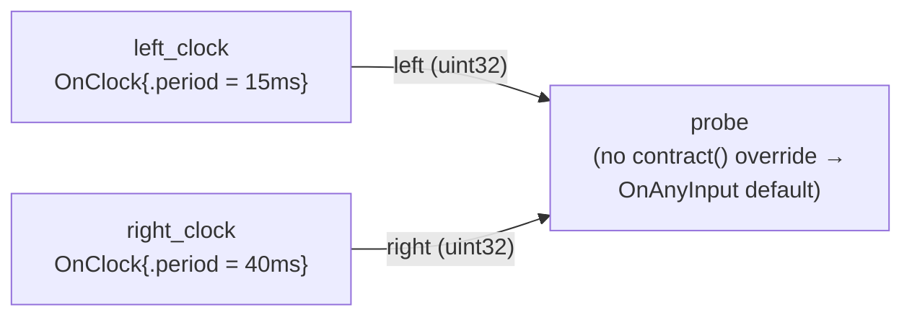

# `on_any_input` — the default trigger, made observable

> **User guide:** [Temporal Contracts](https://docs.nvidia.com/holoscan/sdk-user-guide/building-operators/temporal-contracts) —
> this example is the
> cited program for the `OnAnyInput{}` default trigger and per-activation port
> attribution.

Two clock-driven sources with different periods feed one consumer that
declares **no `contract()` override**, and the program prints one line per
activation naming which input port caused it.



Topology in prose: `left_clock` (15 ms period) and `right_clock` (40 ms
period) each connect to one input of `probe`; `probe` omits `contract()`, so
compilation synthesizes the `OnAnyInput{}` default and activates `compute()`
once per accepted sample on either port.

## What you will learn

- What the omitted-`contract()` default means: an empty `Contract` requests
  the synthesized `OnAnyInput{}` trigger for any operator with connected
  inputs, so each accepted sample on any port activates `compute()` once.
- How to attribute an activation to a port with the frozen introspection
  accessors `Input<T>::selection()` (returns `InputSelection{state, reason}`)
  and `Input<T>::is_missing()`.
- Why the port that did *not* fire reports
  `InputState::kNotSelected` / `SelectionReason::kNotSelectedForActivation`,
  and why calling `receive()` on it returns `ErrorCode::kInputNotSelected`
  instead of blocking or fabricating data.
- Why a **zero-input** operator cannot rely on the default: graph compilation
  rejects an empty contract on a source with a `TEMPORAL_CONTRACT_INVALID`
  diagnostic (`NO_TRIGGER: a zero-input or partially authored contract needs
  one trigger`), which is why `PeriodicSource` authors `OnClock{.period}`.
- The cooperative stop idiom: `run_async` → observation object →
  `request_stop()` → `wait()` → `termination() == RunTermination::kStopped`.

## Prerequisites

You have built and run [`tensors_101`](../../tensors_101/README.md) (E03) —
or at least [`first_operator`](../../first_operator/README.md) (E02), which
introduces the three operator declarations (`setup`, `contract`, `compute`)
that this family drills into pattern by pattern.

## Build

From this `cpp/` folder:

```bash
cmake -B build -S .
cmake --build build
```

If the SDK is not installed in a default location, point CMake at it:

```bash
cmake -B build -S . -DCMAKE_PREFIX_PATH=<install-prefix>
```

(The in-tree `CMakeLists.txt` builds as part of the SDK examples tree; the
standalone `CMakeLists.min.txt` shown above consumes an installed SDK.)

## Run

```bash
./build/contract_on_any_input
```

The program needs no GPU and no arguments; it stops itself after both ports
have been observed (bounded by a 10-second cap) and exits nonzero on any
failure.

## Expected output

```text
[on_any_input] activation 1: port=left value=1
[on_any_input] activation 2: port=left value=2
[on_any_input] activation 3: port=right value=100
[on_any_input] activation 4: port=left value=3
[on_any_input] activation 5: port=left value=4
[on_any_input] activation 6: port=right value=200
[on_any_input] observed: left_activations=5 right_activations=2 anomalies=0
[on_any_input] every activation was attributed to exactly one input port
on_any_input example complete
```

Annotations: the first six lines replay recorded activations — `left` values
count 1, 2, 3, … (15 ms period) and `right` values count 100, 200, … (40 ms
period), so `left` lines outnumber `right` lines roughly 8:3. The exact
interleaving and the two counts vary run to run with wall-clock scheduling;
the last two lines are deterministic and only print when every recorded
activation had exactly one selected port.

## Code walkthrough

### Why "no contract()" is itself a contract

`OperatorBase::contract()` returns an empty `Contract` by default, and an
empty contract is not "no temporal semantics" — it *requests the synthesized
default*. For an operator with connected inputs, compilation materializes
`OnAnyInput{}` (the plan records it as core-synthesized), giving the simplest
useful behavior: react to whatever arrives, whenever it arrives. `AnyInputProbe`
therefore contains only `setup()` and `compute()` — the absence of the third
declaration is the lesson.

### Why the empty default is rejected on a zero-input operator

`OnAnyInput` means "trigger when any connected input accepts a sample", so on
an operator with zero inputs there is nothing that could ever trigger it.
Rather than compile a graph that silently never runs, `holoscan::compile()`
fails the plan: `plan.ok()` is `false` and `plan.json()` carries a
`TEMPORAL_CONTRACT_INVALID` diagnostic with the message `NO_TRIGGER: a
zero-input or partially authored contract needs one trigger`. That is why
every source in this family — here `PeriodicSource` — must author an explicit
trigger such as `OnClock{.period = 15ms}`. The rejection happens at graph
compile time (the `plan.ok()` gate in `main()`), before any thread starts, so
the mistake can never reach a running system.

### Why port attribution uses selection state, not "which queue has data"

Under `OnAnyInput`, each activation is caused by exactly one accepted sample.
The runtime freezes that decision before `compute()` runs: the causing port
reports `selection().state == InputState::kSelected`, while the other live
port reports `InputState::kNotSelected` with
`SelectionReason::kNotSelectedForActivation` (and `is_missing()` returns
`true` for it). `compute()` reads this frozen evidence instead of probing
queues, so attribution is race-free by construction — data sitting in the
other port's queue stays queued for its *own* future activation and is never
consumed here. Calling `receive()` on the not-selected port would return the
typed error `ErrorCode::kInputNotSelected`, not block.

### Why results are printed from main(), after the run stops

Operator callbacks run on runtime threads, and interleaved `std::cout` writes
from concurrent operators are not line-atomic. The example records each
activation into `AnyInputObservation` (mutex + condition variable, as in every
example in this family) and `main()` prints the replay and the summary only
after `request_stop()`/`wait()` have completed. The test regex anchors on
those post-stop lines, so the check is deterministic even though scheduling
is not.

## HSDK 4.x comparison

| Concern | HSDK 4.x | HSDK 5.0 |
|---|---|---|
| Default readiness of a multi-input operator | One `MessageAvailableCondition` per input port, AND-combined: `compute()` waits until **all** input ports hold a message | Synthesized `OnAnyInput{}`: `compute()` runs once per accepted sample on **any** port |
| Which port fired? | Not surfaced; `receive()` each port and inspect what came back | Frozen `selection()` / `is_missing()` state per port, plus typed `kInputNotSelected` on the port that did not fire |
| Zero-input operator with no scheduling terms | Runs freely (scheduler polls it) | Rejected at graph compile: `NO_TRIGGER` / `TEMPORAL_CONTRACT_INVALID` |

Rationale: 4.x's implicit AND default silently stalled pipelines whose inputs
arrived at different rates — the fast stream waited on the slow one. 5.0
inverts the default to the weakest useful trigger (any arrival), makes the
firing cause explicit per-port evidence, and refuses to compile an operator
that could never fire, so rate mismatches become a visible design decision
(`OnEach`, `OnAligned`, …) instead of a silent stall.

## What's next

Next in the contract family: [`on_each`](../on_each/README.md) (E05) pins the
trigger to *one* anchor port and samples the other with
`LatestWithin{.max_age}` — the first step from "react to anything" toward
authored temporal policy. Family chain: **E04 on_any_input** →
[E05 on_each](../on_each/README.md) → [E06 on_clock](../on_clock/README.md) →
[E07 on_aligned](../on_aligned/README.md) →
[E08 on_window](../on_window/README.md) →
[E09 selectors](../selectors/README.md) →
[E10 missing_data](../missing_data/README.md) →
[E11 deadlines](../deadlines/README.md) →
[E12 on_predicate](../on_predicate/README.md). Deep dive: the
temporal-contracts guide page (building-operators/temporal-contracts).

## Contract vocabulary (this example demonstrates the bolded cell)

| Dimension | Values |
|---|---|
| Trigger | **`OnAnyInput{}` (synthesized default)**, `OnEach{port}`, `OnClock{.period}`, `OnAligned{.ports, .window}`, `OnWindow{.anchor, .max_wait}`, `OnPredicate{...}` (preview) |
| Selector | `Exact{}`, `LatestWithin{.max_age}`, `DrainAll{}`, `BracketedWindow{...}` |
| Missing-data policy | `Skip{}`, `SafeDefault{}`, `ReuseLast{.max_age}` |

**When to choose this pattern:** the operator should react to every sample
from every producer, port identity matters more than cross-port alignment,
and no rate control is needed — e.g. event loggers, multiplexers, monitors.
The moment one port must *drive* and others must be *sampled*, move to
`OnEach` (E05).

## Concepts at a glance

| API | Role in this example |
|---|---|
| *(omitted)* `contract()` override | Requests the synthesized `OnAnyInput{}` default on an inputful operator |
| `holoscan::OnAnyInput{}` | Trigger: activate once per accepted sample on any connected input |
| `Input<T>::selection()` | Frozen `InputSelection{state, reason}` for this activation |
| `Input<T>::is_missing()` | `true` when selection produced no usable value (`kAbsent` / `kSafeDefault` / `kNotSelected`) |
| `InputState::kSelected` / `kNotSelected` | The causing port vs. a live port excluded from this activation |
| `SelectionReason::kNotSelectedForActivation` | Exact reason paired with `kNotSelected` |
| `Input<T>::receive()` | Copy the selected `Sample<T>`; typed `kInputNotSelected` error on the other port |
| `OnClock{.period}` | Explicit trigger every zero-input source must author |
| `compile()` / `plan.ok()` / `plan.json()` | Graph-compile gate that rejects the empty contract on a zero-input operator |
| `run_async` / `request_stop` / `wait` / `termination()` | Bounded cooperative run and clean-stop check |
