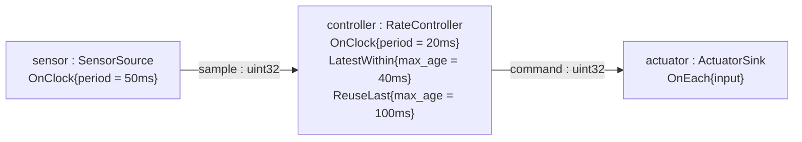

# Fixed-rate activation with `OnClock` (`temporal_contracts/on_clock`)

> **User guide:** [Temporal Contracts](https://docs.nvidia.com/holoscan/sdk-user-guide/building-operators/temporal-contracts) —
> this example is the
> cited program for the `OnClock` fixed-rate trigger, combined with
> `LatestWithin` sampling and a `ReuseLast` fallback.

A 50 ms sensor source and a 20 ms clock-triggered controller run at independent
rates; the controller directly samples the
latest sensor reading at each tick, emitting one command per activation to a
sink. After a bounded run the program prints per-activation input states and
an activation-vs-production tally proving that the controller activated
**more often than the sensor produced** — a cadence only the clock can
explain.



## Runtime shape

The controller uses the direct public contract: `OnClock{20ms}` plus a
selected data input. Runtime reconstructs this shape identically at compile,
run, restart, and replay boundaries. The sensor is deliberately slower than
the controller because that makes fresh-versus-reused selection visible; it
is a teaching choice, not a requirement that clock-triggered inputs be slow.

## What you will learn

- How `OnClock{.period = 20ms}` directly drives a mid-graph consumer whose
  activation timing is decoupled from data-input arrival.
- How `Contract::input(port, LatestWithin{.max_age = 40ms})` samples the
  newest sufficiently fresh reading at each tick (one consuming admission per
  activation) instead of processing every arrival.
- How `Contract::on_missing(port, ReuseLast{.max_age = 100ms})` re-serves the
  last admitted reading on ticks between arrivals, visible per activation as
  `InputState::kSelected` (fresh) vs `InputState::kReused` via
  `Input<T>::selection()`.
- That a truly absent input (nothing fresh, nothing reusable — here only
  before the first reading) suppresses the whole activation: `compute()` is
  never called with a missing value, so the loop never fabricates a command.
- Why a derived mid-graph emission is stamped with a *fresh* clock read
  (`context.clock().now()`) rather than the frozen activation time.
- The standard bounded run idiom: `compile()` → `run_async()` → observation
  wait → `request_stop()` → `wait()` → summary printed only after shutdown.

## Prerequisites

- [`temporal_contracts/on_each`](../on_each/README.md) (E05) — contrast its
  input-driven anchor with the clock-driven activation used here.
- A Holoscan SDK 5.x install. No GPU is required.

## Build

From this `cpp/` folder:

```bash
cmake -B build -S .
cmake --build build
```

If the SDK is not in a default location, point CMake at it:

```bash
cmake -B build -S . -DCMAKE_PREFIX_PATH=<install-prefix>
```

## Run

```bash
./build/contract_on_clock
```

The program stops itself after eight commands (bounded by a 10 s cap) and
exits nonzero if the run does not stop cleanly or the semantic claim fails.

## Expected output

```text
[on_clock] activation=1 input=fresh sensor_value=1
[on_clock] activation=2 input=reused sensor_value=1
[on_clock] activation=3 input=fresh sensor_value=2
[on_clock] activation=4 input=reused sensor_value=2
[on_clock] activation=5 input=reused sensor_value=2
[on_clock] activation=6 input=fresh sensor_value=3
[on_clock] activation=7 input=reused sensor_value=3
[on_clock] activation=8 input=fresh sensor_value=4
[on_clock] sensor_period_ms=50 control_period_ms=20
[on_clock] samples_produced=4 activations=8 commands=8
[on_clock] fresh=4 reused=4
on_clock example complete: fixed-rate activation verified
```

Annotations: exact counts vary run to run with scheduling — what is invariant
is the *shape*. Each `sensor_value` appears once as `fresh` (its consuming
admission) and then repeats as `reused` on the ticks before the next reading
arrives; a 50 ms producer under a 20 ms consumer yields roughly a
fresh-reused-reused cycle. `activations` is strictly greater than
`samples_produced` — the proof that the cadence came from the clock — and the
final marker line prints only after the program verifies that inequality, so
the CTest regular expression anchors on it.

## Code walkthrough

### Why the cadence is a clock — and where the clock lives

The fixed rate belongs directly to `RateController`, whose contract declares
`trigger(OnClock{.period = kControlPeriod})` together with the sensor selector.
Every 20 ms on the graph default clock Runtime evaluates that contract. In
HSDK 5 the trigger decides *when* `compute()` runs and the per-input
selectors decide *what* it reads — two independent axes. Contrast with E05,
where the anchor is a data stream and the activation rate is whatever rate
that data arrives at.

### Why the input uses `LatestWithin` + `ReuseLast`

`input(sensor, LatestWithin{.max_age = 40ms})` says "give me the newest
reading not older than 40 ms" — sampling, not queue draining. Admission is
consuming and happens at most once per activation. On the ticks between
50 ms readings nothing fresh is queued, and
`on_missing(sensor, ReuseLast{.max_age = 100ms})` re-serves the last admitted
reading (state `kReused`) while it is at most 100 ms old. Only when neither
policy can serve a value — before the very first reading here — is the input
truly absent, and then the runtime *suppresses the whole activation*:
`compute()` never observes a missing sensor and never has to fabricate a
command. (`SafeDefault` is the policy that would instead run `compute()` in a
degraded branch.)

### Why the sensor is slower than the loop

The 50 ms sensor is slower than the 20 ms controller so `ReuseLast` is
observable between fresh admissions. `LatestWithin` and `ReuseLast` are the
baseline pattern for sampling a slower or unrelated-rate scalar stream at the
anchor cadence. A side stream that is faster than the consumer cadence must
instead use `DrainAll` so every surviving sample is retired as a batch; a
replacement queue policy does not make a fast scalar
`LatestWithin`/`ReuseLast` lane safe. Sustained use of that unsupported scalar
shape can terminate the run with `RUNTIME_TAG_CAPACITY_EXHAUSTED`.

### Why the command has a new capture timestamp

`LatestWithin` and `ReuseLast` measure *age in event time*, against the
capture timestamp the producer wrote into
`SampleMetadata{.capture_timestamp_ns, .source_clock_id}`; the sensor stamps
its samples from `context.activation_time()`. If the controller were forwarding
that same observation, it would emit the original `Sample<T>` and preserve its
capture coordinate. This output is instead a newly issued actuation command,
so a fresh `context.clock().now()` is its physically meaningful event time.
Runtime orders valid late visibility with separate internal `TagTime`; capture
time is never rewritten merely to make ordering convenient.

### Why the proof prints from `main()` after shutdown

Operator `compute()` bodies never print; they append to a small observation
struct under a mutex. `main()` waits for eight commands, requests a stop,
joins the session, and only then prints — so stdout is deterministic in
order, and the semantic check (`activations > samples_produced`, at least one
fresh admission) gates the final marker line that CTest matches.

## HSDK 4.x comparison

| Concern | HSDK 4.x | HSDK 5.x (this example) |
|---|---|---|
| Fixed-rate activation | `PeriodicCondition(20ms)` attached to the operator | `OnClock{.period = 20ms}` directly on the consumer contract |
| "Run even if no new input" | Fight between `PeriodicCondition` and the default `MessageAvailableCondition`; often solved by `ConditionType::kNone` plus manual `receive()` null checks | Trigger and selection are independent: the tick fires, `LatestWithin`/`ReuseLast` decide what the activation sees |
| Detect stale/absent input | Hand-rolled timestamp bookkeeping in `compute()` | `sensor.selection().state` (`kSelected` / `kReused`) frozen per activation; truly absent input suppresses the activation |
| Rate mismatch handling | Receiver queue-policy/capacity tuning on the connector | Queue survival policy plus declared freshness (`max_age`), reuse bounds, and selector semantics |

Rationale: 4.x expressed "when to run" through a bag of scheduler conditions
whose AND-combination was implicit and easy to get wrong; 5.x makes the
temporal policy a declarative, compile-checked `Contract` value that travels
with the operator.

## What's next

- [`temporal_contracts/on_aligned`](../on_aligned/README.md) (E07) — when two
  inputs must be *jointly* fresh, align FIFO heads inside a window instead of
  sampling each independently.
- Guide deep-dive: building-operators/temporal-contracts, "Fixed-rate
  control loops" — and the Performance section for measurement guidance.
- Family: [E04 on_any_input](../on_any_input/README.md) →
  [E05 on_each](../on_each/README.md) → **E06 on_clock** →
  [E07 on_aligned](../on_aligned/README.md) →
  [E08 on_window](../on_window/README.md) →
  [E09 selectors](../selectors/README.md) →
  [E10 missing_data](../missing_data/README.md) →
  [E11 deadlines](../deadlines/README.md) →
  [E12 on_predicate](../on_predicate/README.md).

## Contract vocabulary (family matrix)

This example demonstrates the **bolded** cells.

| Axis | Values |
|---|---|
| Trigger | `OnAnyInput` (E04), `OnEach` (E05), **`OnClock` (E06, driving this consumer directly)**, `OnAligned` (E07), `OnWindow` (E08), `OnPredicate` (E12, preview) |
| Selector | `Exact`, **`LatestWithin`**, `DrainAll` (E09), `BracketedWindow` (E08) |
| Missing-data policy | `Skip`, `SafeDefault`, **`ReuseLast`** (all three side by side in E10) |

**When to choose this pattern:** the operator must act on a fixed cadence
(control loops, rate-limited publishers, watchdog-style monitors) while its
inputs arrive at unrelated rates.

## Concepts at a glance

| API | Role in this example |
|---|---|
| `OnClock{.period}` | Evaluates the controller contract every 20 ms (and drives the sensor every 50 ms) from the graph default clock |
| `LatestWithin{.max_age}` | Admits the newest sensor reading at most 40 ms old, once per activation |
| `ReuseLast{.max_age}` | Re-serves the last admitted reading (state `kReused`) on ticks between arrivals, up to 100 ms |
| `Input<T>::selection()` | Frozen per-activation input state (`kSelected` / `kReused`) |
| `SampleMetadata.capture_timestamp_ns` | The event-time coordinate `max_age` bounds are measured against |
| `ClockRef::now()` (via `context.clock()`) | Fresh issue-time stamp for the derived mid-graph command |
| `run_async` / `request_stop` / `wait` | Bounded deterministic run without a stop condition in the graph |
