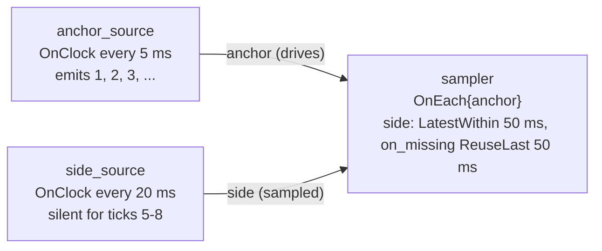

# `on_each` — anchor-driven sampling with `OnEach` + `LatestWithin` + `ReuseLast`

> **User guide:** [Temporal Contracts](https://docs.nvidia.com/holoscan/sdk-user-guide/building-operators/temporal-contracts) —
> this example is the
> cited program for the anchor-driven sampling pattern (`OnEach` trigger with a
> `LatestWithin` side input and `ReuseLast` on missing data).

A 5 ms anchor stream drives a consumer that samples a slower 20 ms side stream
at the anchor rate; the side source deliberately goes silent for ~80 ms, so the
program prints counts proving that fresh side samples were admitted once,
re-served between arrivals, and that activations were suppressed once the
retained value aged past its bound — without `compute()` ever running with a
missing side.



## What you will learn

- Declaring which input *causes* activation with
  `c.trigger(holoscan::OnEach{anchor})` — one activation per accepted anchor
  sample, independent of the side stream's rate.
- Admitting the freshest side value with
  `.input(side, holoscan::LatestWithin{.max_age = 50ms})` — the newest causal
  queued side sample, no older than 50 ms. **Admission is consuming**: each
  side sample is served to exactly one activation; `LatestWithin` alone does
  not re-serve it to later activations.
- Sampling the slower stream at the anchor's rate with
  `.on_missing(side, holoscan::ReuseLast{.max_age = 50ms})` — on activations
  with no queued side sample, the runtime re-serves the last admitted sample
  (frozen selection state `InputState::kReused`) while it is no older than
  50 ms in event time.
- What happens when *neither* policy can serve a value (before the first side
  sample, or once the retained sample ages out during a stall): the side is
  absent and the whole activation is suppressed — `compute()` is never invoked
  with a missing side, so `side.receive()` always succeeds and
  `side.is_missing()` is always `false` inside `compute()`.
- Verifying the suppression from outside the operator: sequential anchor
  values make suppressed activations visible as gaps in the recorded sequence.
- The standard bounded-run idiom: `compile()` → `plan.ok()` → `run_async()` →
  observation object with a 10 s capped wait → `request_stop()` → `wait()` →
  `session.termination()` / `session.diagnostics()` checks.

## Prerequisites

- [`on_any_input`](../on_any_input/README.md) (E04) — the default trigger this
  pattern replaces, and why "any arrival" is often not what a control loop
  wants.
- [`first_pipeline`](../../first_pipeline/README.md) — graph construction,
  `compile()`, and the run/stop idiom used here without further comment.

## Build

From this example's `cpp/` folder:

```sh
cmake -B build -S .
cmake --build build
```

If the SDK is not installed in a default location, point CMake at it:

```sh
cmake -B build -S . -Dholoscan_DIR=/opt/nvidia/holoscan/lib/cmake/holoscan
```

## Run

```sh
./build/contract_on_each
```

The program needs no GPU, runs for well under a second, and exits nonzero if
any demonstrated property fails to hold.

## Expected output

```text
[on_each] activations=25 anchor_gaps=11 fresh_side_admissions=5 reused_side_activations=20 side_missing_in_compute=0 post_resume_activations=3
on_each contract demo PASS: anchor-rate sampling with reuse, stale side suppressed
```

Counts vary slightly run to run with scheduling; the semantic shape does not:

- `activations` is much larger than `fresh_side_admissions` — the 5 ms anchor
  drives, each 20 ms side sample is admitted by `LatestWithin` exactly once
  (`kSelected`), and `ReuseLast` re-serves it to the following anchor
  activations (`kReused`). Every activation is one or the other:
  `activations == fresh_side_admissions + reused_side_activations`.
- `anchor_gaps > 0` — anchors that arrived before the first side sample, or
  while the retained side value was older than 50 ms, were suppressed, so
  their sequence numbers never reached `compute()`.
- `side_missing_in_compute=0` — always exactly zero: a truly absent side
  suppresses the activation before `compute()` runs.
- The final `PASS` line is printed only after those claims are checked, and is
  the line the CTest regex anchors on.

## Code walkthrough

### Why the anchor, not the scheduler, sets the rate

With the default `OnAnyInput{}` (E04), *either* port's arrival activates the
operator, so the effective rate is the sum of both streams. Control-loop-style
operators usually want one designated input to dictate cadence.
`c.trigger(holoscan::OnEach{anchor})` states that intent declaratively: one
activation per accepted anchor sample, and the side port can never cause an
activation on its own. The rate policy lives in the contract, where the
compiler can see it, not in defensive `compute()` logic.

### Why `LatestWithin` alone is not enough — admission consumes

`LatestWithin{.max_age = 50ms}` selects the newest causal queued side sample
no older than 50 ms, evaluated in event time against the activation's frozen
reference time. Crucially, a committed admission **consumes** that sample: it
is served to exactly one activation. With a 5 ms anchor and a 20 ms side,
three out of four anchor activations find the side queue empty — and an empty
selection is *missing*, regardless of how recent the last admitted value was.
Pairing `LatestWithin` with `on_missing(side, Skip{})` therefore does **not**
sample the side at the anchor rate; it downsamples the consumer to the side
arrival rate (one activation per fresh side sample, every other anchor
suppressed). Re-serving history is a separate, explicitly bounded decision.

### Why `ReuseLast` is the sampling half of the pattern

`.on_missing(side, ReuseLast{.max_age = 50ms})` supplies that decision: when
no queued sample is admissible, the runtime re-serves the last admitted side
sample, marked `InputState::kReused` in the frozen selection, while its event
time age stays within 50 ms. That is what turns "admit each side sample once"
into "sample the side stream at the anchor rate". In hand-rolled designs this
is the cached member variable plus wall-clock age arithmetic that every
consumer re-implements — here retention, re-serving, and the age bound are
contract-declared and runtime-owned. The 50 ms bound is chosen against the
side's 20 ms period: normal jitter never trips it, only a genuine stall does.

### Why an aged-out side still suppresses the activation

`ReuseLast` is not a license to run on arbitrarily stale data: once the
retained sample's age exceeds `max_age`, the side input is absent and the
activation candidate is suppressed entirely — the same no-fire outcome that
`Skip{}` produces on absence. `compute()` therefore never branches on an empty
optional: every declared input is present (fresh or reused) whenever the body
runs, which is why this example's `compute()` simply calls `receive()` on both
ports and treats failure as a hard error. The example records
`side.is_missing()` on every activation and asserts the count of `true`
observations is zero, and distinguishes fresh from reused activations via
`side.selection().state`. When the operator should instead run a degraded
path on missing data, use `SafeDefault{}` — compared side by side in
[`missing_data`](../missing_data/README.md) (E10).

### Why the side source stalls on purpose

Without a stall, the suppression half of the lesson would be invisible. The
side source emits on ticks 1–4, is silent for ticks 5–8 (an ~80 ms gap,
comfortably past the 50 ms reuse bound), then resumes. Because clock ticks can
only be late, never early, the gap can only widen under load — the
suppression phase is guaranteed, keeping the CTest assertion deterministic.
The run stops only after three post-resume activations and at least one
reused activation are observed, so all phases are always covered.

### Why results are printed after `wait()`

Operator `compute()` runs on runtime threads, and interleaved `std::cout`
writes are not line-atomic. The example therefore records everything in an
observation object (mutex + condition variable) and prints the summary from
`main()` only after `session.wait()` has joined all runtime work. The CTest
regex anchors exclusively on those post-stop lines.

## HSDK 4.x comparison

| Concern | HSDK 4.x | HSDK 5.x (this example) |
|---|---|---|
| When does `compute()` run | `MessageAvailableCondition` per port; the scheduler ANDs all port conditions, so any "drive from one port" behavior needs condition tuning per receiver | `c.trigger(OnEach{anchor})` — the driving port is named once, in the contract |
| Sampling a slower stream | Manual: pop everything from the receiver, keep the newest message in a member, do age math by hand in `compute()` | `.input(side, LatestWithin{.max_age = 50ms})` admits the newest causal sample once; `.on_missing(side, ReuseLast{.max_age = 50ms})` re-serves it, with the event-time age check runtime-owned |
| Missing/stale data | `compute()` runs anyway; every operator hand-writes an early-return guard | An absent side (nothing fresh, nothing reusable) suppresses the activation; `compute()` never sees the missing case |

In 4.x the *when* of execution was assembled from per-receiver conditions and
in-operator guard code, so the actual temporal behavior was scattered and hard
to review. The 5.x contract puts trigger, freshness, and missing-data policy
in one declarative place that the compiler validates and the plan records.

## What's next

- [`on_clock`](../on_clock/README.md) (E06) — a mid-graph operator that runs at
  a fixed rate regardless of input arrival, the other half of the control-loop
  story.
- Guide deep dive: building-operators/temporal-contracts, which walks this
  trigger/selector/policy combination among its five worked patterns.

## The contract vocabulary (family map)

| Role | Vocabulary (bold = demonstrated here) |
|---|---|
| Trigger | `OnAnyInput`, **`OnEach`**, `OnClock`, `OnAligned`, `OnWindow`, `OnPredicate` |
| Selector | `Exact`, **`LatestWithin`**, `DrainAll`, `BracketedWindow` |
| Missing-data policy | `Skip`, `SafeDefault`, **`ReuseLast`** |

| When to choose this pattern | One input dictates the processing rate and a slower auxiliary stream should be sampled at that rate; briefly reusing the last auxiliary value is acceptable within an explicit age bound, but the work is meaningless without any fresh-enough value, so aged-out data should suppress the activation rather than fabricate input. |
|---|---|

Family: [E04 `on_any_input`](../on_any_input/README.md) → **E05 `on_each`** →
[E06 `on_clock`](../on_clock/README.md) → [E07 `on_aligned`](../on_aligned/README.md)
→ [E08 `on_window`](../on_window/README.md) → [E09 `selectors`](../selectors/README.md)
→ [E10 `missing_data`](../missing_data/README.md) → [E11 `deadlines`](../deadlines/README.md)
→ [E12 `on_predicate`](../on_predicate/README.md).

## Concepts at a glance

| API | Role in this example |
|---|---|
| `OnEach{anchor}` | Trigger: one activation per accepted anchor sample |
| `LatestWithin{.max_age = 50ms}` | Selector: newest causal side sample, admitted to exactly one activation |
| `ReuseLast{.max_age = 50ms}` | Missing-data policy: re-serve the last admitted sample (`kReused`) while fresh; absent (suppressed) once aged out |
| `OnClock{.period}` | Drives both sources at 5 ms / 20 ms without upstream inputs |
| `Input<T>::receive()` | Copies the frozen selected sample inside `compute()` |
| `Input<T>::selection()` / `is_missing()` | Introspects the frozen selection (`kSelected` vs `kReused`; never missing here) |
| `run_async` / `request_stop` / `wait` | Bounded, deterministic run without a GPU |
| `session.termination()` / `session.diagnostics()` | Post-run health checks gating the summary |
