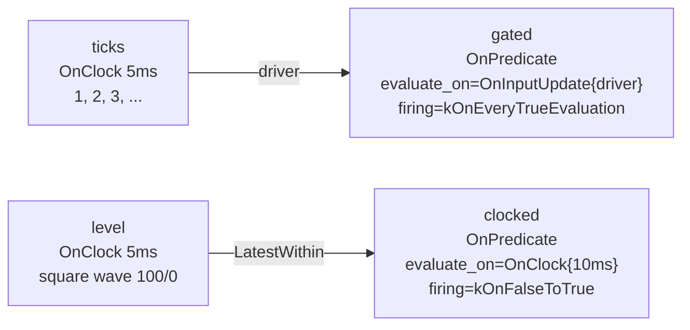

# OnPredicate: data-dependent activation (preview)

> **Beta temporal policies.** The patterns on this page — `OnPredicate`,
> `BracketedWindow`, and the multi-rate composition recipes — are the most
> recently promoted parts of the temporal contract API. They are functional
> today, but field names, admission rules, and diagnostics may evolve in
> upcoming releases. Prefer the basic trigger/selector vocabulary wherever it
> expresses your intent; reach for this tier only when it does not.
>
> **User guide:** [Advanced Temporal Patterns](https://docs.nvidia.com/holoscan/sdk-user-guide/advanced/advanced-temporal-patterns) —
> this example is the
> cited program for predicate-driven activation with `OnPredicate`. The
> trigger itself ships in baseline; its temporal policy remains Beta even when reached through Stable
> graph/compile entry points.

Two clock-driven sources feed two predicate consumers. The first evaluates
on every accepted driver sample and fires on every `true` result. The second
evaluates on its own 10 ms clock, samples a typed input with `LatestWithin`,
and fires on each false-to-true edge. The program prints each consumer's
evaluation count next to its activation count so evaluation-source and firing
semantics are independently visible.



In prose (never only in the diagram): `ticks` (an increasing counter at 5 ms)
feeds the input-driven `gated` consumer.
`level` (a 100/0 square wave at 5 ms) feeds the clock-driven `clocked` consumer,
which samples the latest recent level every 10 ms. Neither consumer's
`compute()` runs unless its predicate says so; cooperative stop bounds the run.

## What you will learn

- How to build a predicate binding with `holoscan::predicate(identity,
  predicate_inputs(...), evaluator)` and why the evaluator receives frozen
  `holoscan::PredicateInputView<T>` views instead of touching queues.
- How `holoscan::OnPredicate{.evaluate_on, .predicate, .firing}` composes an
  evaluation source with a firing rule
  (`PredicateFiring::kOnEveryTrueEvaluation` vs
  `PredicateFiring::kOnFalseToTrue`).
- Why the driver's sample arrives as the implicit first
  `PredicateInputView<T>` argument for input-driven evaluation, while a
  clock-driven predicate has no implicit driver and lists every typed view
  explicitly with `predicate_inputs(...)`.
- How selectors and missing-data policies (`Exact{}`,
  `LatestWithin{.max_age}`, `on_missing(..., Skip{})`) still govern what a
  predicate sees — the predicate only reads what the contract selected.
- How to make gating observable: samples that evaluate `false` never activate
  `compute()`, so evaluation counts exceed activation counts.
- Why a successful `false` evaluation retires its candidate without invoking
  `compute()`, so ordinary bounded queues continue making progress.

## Prerequisites

This is the last member of the temporal-contract family. Read
[`max_start_delay`](../max_start_delay/README.md) (E11) first — and ideally the whole chain from
[`on_any_input`](../on_any_input/README.md) (E04) — so the trigger/selector/policy
vocabulary below is familiar. Start at
[Temporal contracts](https://docs.nvidia.com/holoscan/sdk-user-guide/building-operators/temporal-contracts)
if you have not seen a `contract()` override before.

## Build

From this `cpp/` folder:

```bash
cmake -B build -S .
cmake --build build
```

If CMake cannot find the SDK, point it at your install:

```bash
cmake -B build -S . -DCMAKE_PREFIX_PATH=<install-prefix>
```

## Run

```bash
./build/contract_on_predicate
```

The program runs for a fraction of a second, stops itself once the gating
effect is unambiguous, and exits `0`. No GPU is required.

## Expected output

Counts vary slightly from run to run (the sources are real-time clocked); the
inequalities they demonstrate do not:

```text
[on_predicate] plan temporal trigger records=4
[on_predicate] gate consumer (evaluate_on=OnInputUpdate{driver}, firing=kOnEveryTrueEvaluation)
[on_predicate]   evaluations=48 true_evaluations=16 activations=16 misfires=0
[on_predicate] clocked consumer (evaluate_on=OnClock{10ms}, firing=kOnFalseToTrue)
[on_predicate]   evaluations=24 true_evaluations=12 activations=4 low_activations=0
on_predicate verdict: gating=ok clocked_gating=ok
on_predicate example complete
```

Reading the numbers: the gate consumer was *evaluated* once per accepted
driver tick but *activated* only on ticks divisible by three;
`misfires=0` confirms no false evaluation reached `compute()`. The clocked
consumer activates only when the sampled level crosses from low to high;
its additional true evaluations and rejected low-level evaluations prove both
edge firing and that its 10 ms clock — not input arrival — drives the decision
cadence.

The stop request may race with one final gate evaluation. Predicate truth is
recorded before callback admission, so that evaluation can be `true` while the
session-wide stop boundary retires its candidate without entering `compute()`.
The stable final invariant is therefore
`activations <= true_evaluations <= activations + 1`: all but at most the one
true evaluation whose callback candidate loses the race with the stop boundary
are matched by activations, and no callback is admitted after that boundary.

## Code walkthrough

### Why the predicate is a separate, deep-owned binding

`holoscan::predicate("tick-divisible-edge", lambda)`
does not register a callback — it copies the callable into a cold descriptor
with a stable identity string. The contract owns its own deep copy, so no
authoring address ever enters the compiled plan or the run session, and the
identity (optionally a versioned `PredicateKey`) becomes attributable replay
evidence. That is why the binding is built inside `contract()` and moved into
the trigger rather than stored on the operator.

### Why there are exactly two evaluation sources

`evaluate_on` answers *when the question is asked*. `OnInputUpdate{driver}`
asks once per accepted driver sample — the natural shape for "act on matching
data" — and pins that sample as the implicit first `PredicateInputView`
argument. `OnClock{.period}` asks on a schedule with no implicit driver — the
natural shape for "sample the current condition periodically." A
clock-evaluated predicate may still select typed inputs: the clocked consumer
declares `predicate_inputs(level)`, applies `LatestWithin` and `Skip` through
the ordinary contract input clauses, and receives that explicit view after
the evaluation context. This makes evaluation cadence independent from input
arrival while preserving one selector-governed snapshot per evaluation.

### Why firing is a separate axis from truth

The evaluator only reports `true`/`false`; `firing` decides which `true`
becomes an activation. `kOnEveryTrueEvaluation` gives the input-driven gate
level-triggered semantics: every divisible-by-three sample activates.
`kOnFalseToTrue` gives the clocked consumer edge-triggered semantics — the
*runtime* remembers the previous result, so a sustained high level activates
once rather than on every scheduled evaluation. Keeping firing memory in the
runtime keeps each evaluator a pure, nonthrowing function of its frozen views.

### Why the evaluator sees views, not ports

The predicate runs on the scheduler's hot decision path, before any
activation exists. `PredicateInputView<T>` is a borrowed, immutable snapshot
of whatever the contract's ordinary `.input(...)` selector chose
(`Exact{}` for the pinned driver and `LatestWithin` for the clocked
consumer's level input). The evaluator can therefore be cheap and safe
by construction — no receiving, no consuming, no blocking. Heavy conditions
belong at the top of `compute()`, not in a predicate.

### Why a false evaluation does not wedge the driver

Predicate evaluation and callback firing are separate transactions. Once an
input-driven evaluation succeeds, the runtime retires the evaluated driver
candidate even when the result is `false`; it simply does not create a
`compute()` activation. That rule lets the increasing tick source run through
an ordinary bounded queue without accumulating every rejected value. The
clock-driven consumer uses a bounded `kDropOldest` observation edge because it
needs recent level candidates at each scheduled evaluation without
backpressuring every intermediate publication.

### Why counting happens in an observation object

Evaluators and `compute()` run on runtime threads, where interleaved
`std::cout` is not line-atomic. Both consumers record counters into a
mutex-guarded observation struct; `main()` waits (bounded at 10 s) until the
inequalities are unambiguous, calls `session.request_stop()`, then
`session.wait()`, and only afterwards prints the summary — so the lines the
test asserts on are written by exactly one thread.

## HSDK 4.x comparison

| Concern | HSDK 4.x | HSDK 5.0 |
|---|---|---|
| Data-dependent activation | `BooleanCondition` toggled imperatively from operator code, or a custom `Condition` subclass | `OnPredicate` trigger with a typed evaluator declared in `contract()` |
| When the condition is checked | Scheduler polls condition state; no declared evaluation source | Explicit `evaluate_on`: `OnInputUpdate{driver}`, or `OnClock{.period}` with optional selector-governed typed inputs |
| Edge vs level semantics | Hand-rolled in operator/condition state | Declarative `PredicateFiring::kOnFalseToTrue` / `kOnEveryTrueEvaluation` |
| What the condition can read | Whatever the object captured; unconstrained | Frozen `PredicateInputView<T>` per declared input, selector-governed |

Rationale: a 4.x `BooleanCondition` was mutable shared state — the decision
logic lived outside the graph description, could not be inspected in a
compiled plan, and mixed "what is true" with "when to fire". The 5.0 trigger
makes all three parts (evaluation source, predicate, firing rule) declarative
plan records, so the same gating logic is inspectable, replayable, and
admissible under constrained deployment profiles.

## What's next

- You have completed the contract family (E04–E12). Continue to
  [`typed_parameters`](../../typed_parameters/README.md) (E13) for schema-backed
  operator parameters.
- Guide deep-dive:
  [Advanced temporal patterns](https://docs.nvidia.com/holoscan/sdk-user-guide/advanced/advanced-temporal-patterns)
  for `BracketedWindow` and the multi-rate composition recipes, and
  [Determinism and replay](https://docs.nvidia.com/holoscan/sdk-user-guide/advanced/determinism-and-replay)
  for how predicate identity becomes replay evidence.

## The contract vocabulary

This example demonstrates the **bolded** cells; the rest of the family covers
the others.

| Triggers | Selectors | Missing-data policies |
|---|---|---|
| `OnAnyInput` ([E04](../on_any_input/README.md)) | **`Exact`** | **`Skip`** |
| `OnEach` ([E05](../on_each/README.md)) | **`LatestWithin`** | `SafeDefault` ([E10](../missing_data/README.md)) |
| `OnClock` ([E06](../on_clock/README.md)) | `DrainAll` ([E09](../selectors/README.md)) | `ReuseLast` ([E10](../missing_data/README.md)) |
| `OnAligned` ([E07](../on_aligned/README.md)) | `BracketedWindow` ([E08](../on_window/README.md)) | |
| `OnWindow` ([E08](../on_window/README.md)) | | |
| **`OnPredicate`** (this example) | | |

**When to choose this pattern:** reach for `OnPredicate` only when activation
depends on the *content* of inputs — a threshold crossing, a state-machine
edge, a match between streams — and no basic trigger expresses it. If a
period, an arrival, or an alignment already describes when to run, use that
instead; and if the condition needs real work to decide, activate
unconditionally and early-exit in `compute()`.

## Concepts at a glance

| API | Role in this example |
|---|---|
| `holoscan::predicate(name, predicate_inputs(...), lambda)` | Builds the deep-owned, identity-carrying evaluator binding |
| `holoscan::predicate_inputs(port...)` | Declares additional typed inputs the evaluator may read |
| `holoscan::PredicateInputView<T>` | Frozen, immutable per-input sample view during evaluation |
| `holoscan::PredicateEvaluationContext` | Frozen evaluation evidence (reference time, selections) |
| `holoscan::OnPredicate{.evaluate_on, .predicate, .firing}` | The trigger: evaluation source + predicate + firing rule |
| `holoscan::OnInputUpdate{driver}` | Evaluate once per accepted driver sample (driver view pinned first) |
| `holoscan::OnClock{.period}` | Evaluate on a periodic schedule; typed inputs, when declared, are explicit rather than implicit driver views |
| `holoscan::PredicateFiring::kOnEveryTrueEvaluation` | Level-triggered firing: every `true` activates |
| `holoscan::PredicateFiring::kOnFalseToTrue` | Edge-triggered firing: runtime-remembered rising edge activates |
| `LatestWithin{.max_age}` / `Exact{}` / `Skip{}` | Ordinary selectors/policies still govern what the predicate sees |
