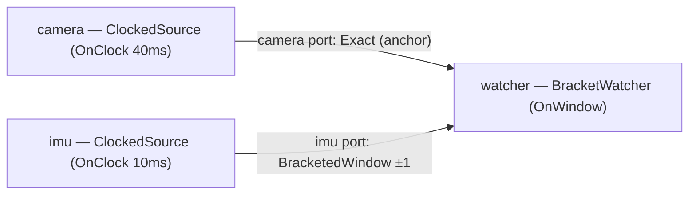

# `on_window`: bracketed sensor windows around an anchor

> **User guide:** [Temporal Contracts](https://docs.nvidia.com/holoscan/sdk-user-guide/building-operators/temporal-contracts) —
> this example is the
> cited program for the `OnWindow` trigger with a `BracketedWindow` secondary
> input and a `SafeDefault{}` missing-data policy. It is also cited from
> advanced/advanced-temporal-patterns as the anchored-window building block.

A 40 ms "camera" source anchors a window over a 10 ms "IMU" source, and the
consumer prints exactly which IMU samples the runtime selected around each
camera frame — one labeled `[on_window] anchor=N bracket=[...]` line per
window.

## What you will learn

- How `OnWindow{.anchor, .max_wait, .max_pending_windows}` opens one bounded
  pending interval per accepted anchor sample instead of firing immediately.
- How `BracketedWindow{.lookbehind, .lookahead, .max_samples}` selects the
  strict predecessors, the inclusive middle, and the strict successors of an
  anchor by *event time* (capture timestamps), not by arrival order.
- How to read the whole selection at once with `imu.selected_batch()`
  (`SelectedBatchView<T>`, range-for over `Sample<T>`).
- How `on_missing(imu, SafeDefault{})` routes an incomplete bracket into your
  degraded path — observable via `imu.selection().state` and
  `selection().reason` — without fabricating data.
- Why samples feeding an event-time selector must carry a genuine
  `capture_timestamp_ns` in a comparable clock domain
  (`EmitOptions`/`SampleMetadata`).

## Prerequisites

- [`on_aligned`](../on_aligned/README.md) (E07) — aligning two `Exact`
  streams within a tolerance window; `on_window` generalizes from "two heads
  align" to "a whole history bracket around one anchor".
- Comfort with the contract vocabulary from
  [`on_any_input`](../on_any_input/README.md) (E04).

## Build

From this `cpp/` folder, inside the SDK build tree the example builds with the
in-tree `CMakeLists.txt`. As a standalone consumer against an installed SDK,
configure with the min project file:

```bash
cmake -B build -S .
cmake --build build
```

(`CMakeLists.min.txt` is the standalone variant: copy it over
`CMakeLists.txt`, or point `-Dholoscan_DIR=` at your install if holoscan is
not in a default search path.)

## Run

```bash
./build/contract_on_window
```

No GPU is required; the program observes six windows (well under a second)
and exits 0.

## Expected output

```text
[on_window] anchor=1 bracket=safe-default reason=insufficient-history
[on_window] anchor=2 bracket=[4,5,6,7,8,9] samples=6
[on_window] anchor=3 bracket=[8,9,10,11,12,13] samples=6
[on_window] anchor=4 bracket=[12,13,14,15,16,17] samples=6
[on_window] anchor=5 bracket=[16,17,18,19,20,21] samples=6
[on_window] anchor=6 bracket=[20,21,22,23,24,25] samples=6
[on_window] windows=6 bracketed=5 safe_default=1
[on_window] verified: a bracket straddles its anchor with earlier and later imu samples
on_window bracket demo complete
```

Annotations: bracket membership and sample counts vary slightly from run to
run with real-clock scheduling — the invariant the program asserts (and the
`verified:` line reports) is that a selected bracket contains IMU samples both
*earlier* and *later* than its anchor's capture time. The first window
commonly reports `safe-default` while IMU history is still priming; the
`safe_default` count in the summary line may be 0 or 1. The final two lines
are deterministic.

## Topology



The same facts in prose: two clock-driven sources at deliberately different
periods (camera 40 ms, IMU 10 ms) feed one consumer. The camera port is the
`OnWindow` anchor with `Exact{}` selection; the IMU port uses
`BracketedWindow{.lookbehind = 1U, .lookahead = 1U, .max_samples = 8U}` with
`SafeDefault{}` as its missing-data policy.

## Code walkthrough

### Why the trigger waits instead of firing

`OnEach{camera}` would activate the instant a frame arrives — but the frame's
*successor* IMU sample has not been produced yet. `OnWindow{.anchor = camera,
.max_wait = 20ms, .max_pending_windows = 2U}` deliberately holds each anchor
in a pending window so the runtime can wait (bounded by `max_wait`) for the
`lookahead` samples that complete the bracket. `max_pending_windows` bounds
memory: it is the number of anchors that may be awaiting completion at once,
so a stalled IMU stream cannot queue unbounded pending state.

### Why bracket selection is event-time, not arrival-order

`BracketedWindow` answers "which IMU readings surround *this exact frame in
time*", which only makes sense over capture timestamps. That is why
`ClockedSource` emits `Sample<std::uint32_t>` with
`SampleMetadata{.capture_timestamp_ns, .source_clock_id}` taken from
`context.activation_time()`: both sources stamp in the same (default
`RealtimeClock`) domain, making their timestamps comparable. Omit the capture
time and event-time selection cannot admit the sample
(`SelectionReason::kCaptureTimeAbsent`).

### Why the consumer reads a batch, not a value

The bracket is a *set*, so the IMU port is read with
`imu.selected_batch()` returning a `SelectedBatchView<std::uint32_t>` — an
immutable, activation-scoped, range-for-able view of `Sample<T>`. The view
borrows; it expires when the activation ends, which is why the example copies
what it needs into its own record instead of retaining the view. The anchor
port stays scalar (`camera.receive()`) because `Exact{}` selects exactly one
sample.

### Why `SafeDefault{}` instead of `Skip{}`

A perception consumer usually still wants the frame even when the inertial
bracket could not be completed (startup, IMU dropout, window timeout).
`on_missing(imu, SafeDefault{})` runs `compute()` anyway with the IMU input in
a degraded state — `imu.selection().state == InputState::kSafeDefault` — and
`selection().reason` explains *why* (`kInsufficientHistory`,
`kWindowTimeout`, ...). Nothing is fabricated: the operator authors its own
degraded behavior. `Skip{}` (see [`on_each`](../on_each/README.md))
would instead suppress the activation entirely, dropping the frame.

### Why results are printed from `main()` after shutdown

Operator `compute()` calls run concurrently, and interleaved `std::cout`
writes are not line-atomic. The consumer therefore records each window into a
mutex-guarded observation object; `main()` waits for six windows (10 s cap),
calls `session.request_stop()`, `session.wait()`, checks
`session.termination()` and `session.diagnostics()`, and only then prints —
so every line, and the CTest marker, is stable.

## HSDK 4.x comparison

| Concern | HSDK 4.x | HSDK 5 (this example) |
|---|---|---|
| Fire when a frame plus surrounding IMU exists | `MessageAvailableCondition` per port + hand-rolled buffering/timeout logic inside `compute()` | `OnWindow{.anchor, .max_wait, .max_pending_windows}` declared in `contract()` |
| Collect IMU samples around a frame | Application-owned deque + manual timestamp comparison | `BracketedWindow{.lookbehind, .lookahead, .max_samples}` + `selected_batch()` |
| Handle an incomplete bracket | Implicit — whatever the hand-written buffer code does | `on_missing(imu, SafeDefault{})` + `selection().reason` |

In 4.x the *scheduling* condition ("a message is available") and the
*temporal* question ("which samples belong to this frame") were separate, and
the temporal half lived as imperative buffer bookkeeping inside every
operator. HSDK 5 moves the whole temporal statement into the declarative
contract, so the compiler can size queues, bound memory, and report selection
outcomes uniformly.

## What's next

- [`selectors`](../selectors/README.md) (E09) — the same stream read
  through `Exact{}` vs `LatestWithin{}` vs `DrainAll{}` side by side.
- Guide deep-dives: building-operators/temporal-contracts (the full
  trigger/selector/policy walk) and advanced/advanced-temporal-patterns
  (anchored windows composed with predicates and maximum start delays).
- Family: [E04 on_any_input](../on_any_input/README.md) →
  [E05 on_each](../on_each/README.md) →
  [E06 on_clock](../on_clock/README.md) →
  [E07 on_aligned](../on_aligned/README.md) → **E08 on_window** →
  [E09 selectors](../selectors/README.md) →
  [E10 missing_data](../missing_data/README.md) →
  [E11 max_start_delay](../max_start_delay/README.md) →
  [E12 on_predicate](../on_predicate/README.md).

## Contract vocabulary matrix

This example demonstrates the **bolded** cells.

| Dimension | Vocabulary |
|---|---|
| Trigger | `OnAnyInput` · `OnEach` · `OnClock` · `OnAligned` · **`OnWindow`** · `OnPredicate` (preview) |
| Selector | **`Exact`** (anchor) · `LatestWithin` · `DrainAll` · **`BracketedWindow`** (secondary) |
| Missing-data policy | `Skip` · **`SafeDefault`** · `ReuseLast` |

**When to choose this pattern:** one input is the semantic "event" (frame,
detection, trigger pulse) and another is a high-rate context stream whose
samples *surrounding* that event — before and after — are what the
computation needs.

## Concepts at a glance

| API | Role in this example |
|---|---|
| `OnWindow{.anchor, .max_wait, .max_pending_windows}` | Opens one bounded pending window per camera frame |
| `Exact{}` | Selects the anchor frame itself |
| `BracketedWindow{.lookbehind, .lookahead, .max_samples}` | Event-time bracket of IMU samples around the anchor |
| `on_missing(imu, SafeDefault{})` | Degraded activation instead of a dropped frame |
| `imu.selected_batch()` / `SelectedBatchView<T>` | Range-for read of the whole bracket |
| `imu.selection()` (`InputState`, `SelectionReason`) | Tells the degraded path what happened and why |
| `Sample<T>` + `SampleMetadata.capture_timestamp_ns` | Comparable event-time coordinates for selection |
| `run_async` / `request_stop` / `wait` / `termination()` | Bounded, deterministic shutdown for the demo |
