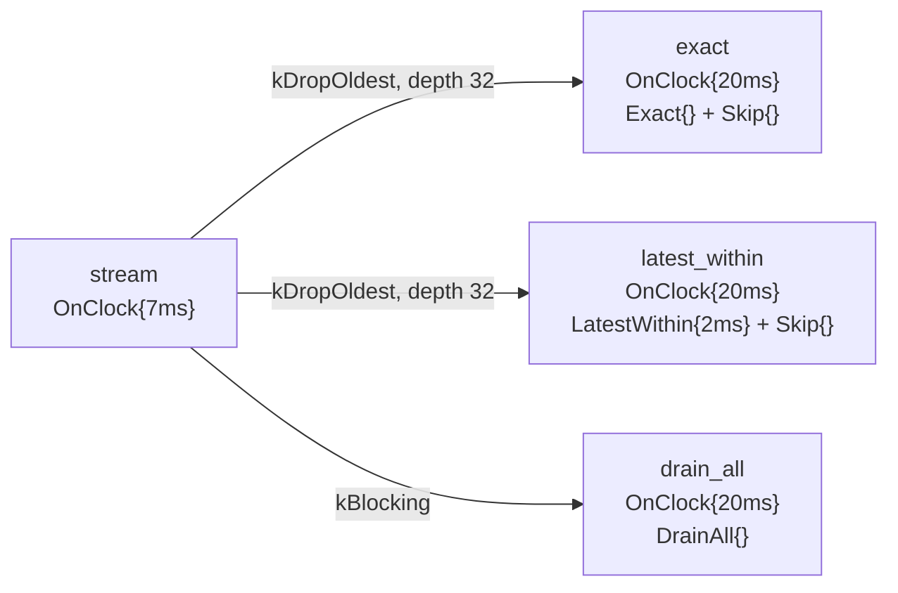

# Temporal contract selectors: `Exact` vs `LatestWithin` vs `DrainAll`

> **User guide:** [Temporal Contracts](https://docs.nvidia.com/holoscan/sdk-user-guide/building-operators/temporal-contracts) —
> this example is the
> cited program for data-input selectors (`Exact{}`, `LatestWithin{}`,
> `DrainAll{}`).

Three consumers each declare the same `OnClock{20ms}` cadence and differ in
their data-input selector. One `OnClock{7ms}` stream fans the same sequence and
capture coordinates to all three consumers. `Exact{}` requires coordinate
equality, `LatestWithin{.max_age = 2ms}` selects at most one sufficiently fresh
sample, and `DrainAll{}` batches every queued survivor. After a bounded run the
program validates and prints the three consumption patterns side by side.



## Runtime shape

The direct clock-with-input shape is preserved across compile, run, restart,
and replay. Queue replacement and temporal selection remain separate:
Bounded `kDropOldest` limits candidates for the observational scalar lanes, while
`DrainAll` deliberately preserves and batches every survivor on its lane.

## What you will learn

- How the same cadence produces three different consumption patterns when
  only the data-input contract changes: `Exact{}`, `LatestWithin{.max_age}`,
  and `DrainAll{}` declared via `Contract::input(port, selector)`.
- Why a failure-capable selector (`Exact`, `LatestWithin`) on an input
  outside the trigger's guarantee **must** declare `on_missing(port, ...)` —
  the compiler rejects the contract otherwise — while `DrainAll` needs no
  missing policy at all.
- Why `DrainAll` is the deliberate choice when every survivor of a stream
  faster than the consumer cadence must be processed as a batch.
- Why each edge's queue policy must match the selector: bounded `kDropOldest` for
  sampled inputs that a `Skip`-suppressed consumer rarely drains (a
  `kBlocking` queue would repeatedly return finite `kBackpressured` and force
  the shared source to retain and retry that exact value), `kBlocking` for the
  `DrainAll` edge that must preserve every sample.
- How to read a batch selection with `in.selected_batch()` and iterate the
  returned `SelectedBatchView<T>` with a range-`for` loop.
- Why `Exact{}` on the shared stream almost never fires: it selects the sample
  whose event time equals the frozen scheduled-clock reference *exactly*, and
  the deliberately incommensurate 7 ms and 20 ms periods rarely coincide.
- How executable relational checks prove that `Exact` and `LatestWithin` stay
  scalar, `LatestWithin` both selects and skips candidates, and `DrainAll`
  produces a multi-sample batch without relying on timing-sensitive counts.
- The `compile()` → `run_async()` → observation wait → `request_stop()` →
  `wait()` shutdown idiom with results printed only after the session
  retires.

## Prerequisites

You should have read [`on_clock`](../on_clock/README.md) (E06), which introduces
the direct `OnClock`-with-input contract this example uses, and
[`on_window`](../on_window/README.md) (E08), which introduces anchored batch
selection with `BracketedWindow`. This example isolates the selector axis so
each selector's behavior is observable without an anchor in play.

## Build

From this `cpp/` folder:

```bash
cmake -B build -S . -Dholoscan_DIR=/opt/nvidia/holoscan/lib/cmake/holoscan
cmake --build build
```

The `-Dholoscan_DIR=` hint is only needed when the SDK is installed outside
the default search prefixes listed in `CMakeLists.min.txt`.

## Run

```bash
./build/contract_selectors
```

Or through CTest:

```bash
ctest --test-dir build -R EXAMPLE_CPP_CONTRACT_SELECTORS_TEST
```

## Expected output

```text
[selectors] cadence=OnClock{20ms} stream=7ms max_age=2ms
[selectors] exact activations=0 samples=0 max_batch=0
[selectors] latest_within activations=2 samples=2 max_batch=1
[selectors] drain_all activations=8 samples=22 max_batch=3
[selectors] assertions=pass
contract selectors complete
```

Counts vary slightly from run to run (the program stops after the
`drain_all` consumer has activated 8 times, about 160 ms). The stable claims
are relational rather than exact counts: `Exact` is scalar and may activate
only when a 7 ms source coordinate happens to equal a 20 ms consumer
coordinate; `LatestWithin` selects at least one fresh sample, skips at least
one stale clock candidate, and always selects one sample; and `DrainAll`
activates on every tick with at least one multi-sample batch. The executable
checks those claims in-process before printing `assertions=pass`, which is the
stable CTest pass expression.

## Code walkthrough

### One cadence, three contracts

The three consumer classes share the same setup and `OnClock{20ms}` trigger;
their `.input(data, ...)` selector and corresponding scalar-or-batch read are
the only semantic differences. That is deliberate: in HSDK 5.x the
*consumption pattern* is a declarative property of the operator, not
imperative queue-selection logic buried in `compute()`. Because the selector
is visible to `compile()`, the plan can size queues and caches for each edge
and reject inconsistent combinations before anything runs.

### Why `Exact{}` on the shared stream almost never fires

`Exact{}` selects the sample at the exact frozen event-time reference — here
the consumer's scheduled clock coordinate. When the trigger itself anchors on
a concrete sample (`OnEach` pins its driver, `OnAligned` members, the
`OnWindow` anchor), that reference is a real sample timestamp and `Exact` is
the natural choice. Here the shared source advances every 7 ms while the
consumer advances every 20 ms, so equality is rare and `Skip{}` suppresses
nearly every candidate. The takeaway: `Exact` expresses "the sample at this
exact activation coordinate", not "whatever is newest."

### Why `LatestWithin` activates once per sample, not once per tick

`LatestWithin{.max_age = 2ms}` is a bounded-staleness contract: "give me
the newest causal sample, but never one older than 2 ms." The bound is
required to be positive — unbounded sampling would silently hide a stalled
producer. Because the selector can fail, and the tick gives no guarantee
about the stream input, the contract must say what happens then;
compilation rejects a failure-capable selector outside the trigger's
guarantee that lacks `on_missing`. Here `Skip{}` drops those clock candidates.

The 7 ms producer period and 2 ms age bound deliberately make some 20 ms
clock candidates fresh and others stale. `latest_within` therefore activates
fewer times than `drain_all`, and each admitted activation carries exactly one
sample. Scalar admission consumes each arrival at most once; an already
admitted sample is **not** re-served on later ticks by `LatestWithin` itself.
If the consumer must also act on the ticks in between, that is the job of
`on_missing(data, ReuseLast{.max_age})`, which re-serves the last admitted
sample with `InputState::kReused` — exactly the pattern the
[`on_clock`](../on_clock/README.md) controller demonstrates and the
[`missing_data`](../missing_data/README.md) example isolates.

### Why `DrainAll` is fieldless and needs no `on_missing`

`DrainAll{}` consumes every FIFO survivor since the previous activation as
one batch. It carries no authored limit because compilation derives the
finite bound from queue geometry (`queue_depth(32)` here) — an authored cap
would change its consume-all meaning. It also cannot "fail": an empty batch
is a valid selection, so no missing policy is declared and the consumer
activates on every tick regardless. The `compute()` body iterates
`data.selected_batch()` and counts the batch, which is where the
`max_batch=3`-style evidence comes from. `DrainAll` is chosen for the same
7 ms stream because this consumer promises to preserve every FIFO survivor as
a batch. Scalar-selector queues are also bounded by their edge depths, but
those selectors deliberately sample rather than preserve every arrival.

### Why the queue policies differ per edge

The scalar edges use `QueuePolicy::kDropOldest` at depth 32: the `exact`
consumer drains its queue almost never and `latest_within` at most once per
activation, so under the default `kBlocking` policy those queues would fill
and repeatedly return finite `kBackpressured` to the shared stream source,
forcing exact-value retry and delaying every consumer downstream of it.
Bounded `kDropOldest` prevents an observational edge from backpressuring the shared source.
The batch edge keeps `kBlocking` because `DrainAll`'s contract is to see
*every* sample, and it holds that contract by emptying the queue on each
clock activation.

### Why the statistics print only after `wait()`

Operator callbacks run concurrently, and interleaved `std::cout` writes are
not line-atomic. Each consumer therefore only records into a mutex-guarded
observation object; `main()` waits for a bounded number of `drain_all`
activations (10 s cap), stops the session, and prints the summary only after
`session.wait()` proves every callback has retired. It then checks the scalar,
skip, and batch relationships in-process. The CTest regex anchors to the
post-check `assertions=pass` line rather than to nondeterministic counts.

## Selector vocabulary (this example demonstrates the bolded cells)

| Axis | Values |
|---|---|
| Trigger | OnAnyInput, OnEach, **OnClock**, OnAligned, OnWindow, OnPredicate *(preview)* |
| Selector | **Exact**, **LatestWithin**, **DrainAll**, BracketedWindow |
| Missing-data | **Skip**, SafeDefault, ReuseLast |

**When to choose this pattern:** reach for `LatestWithin` when a fixed-rate
consumer needs at most one fresh survivor per activation (add `ReuseLast` when
every tick must act); reach for
`DrainAll` when a consumer must process *every* sample of a stream faster
than its cadence (logging, integration, batching); keep `Exact` for triggers
that anchor on a concrete sample.

## HSDK 4.x comparison

| HSDK 5.x (this example) | Closest HSDK 4.x idiom |
|---|---|
| `trigger(OnClock{20ms})` on a consumer with inputs | `PeriodicCondition(20ms)` on the operator |
| `.input(data, LatestWithin{.max_age = 2ms})` | bounded drop-oldest receiver queue + `receive()` of the selected sample |
| `.input(data, DrainAll{})` | hand-written `while (auto m = op_input.receive(...))` drain loop |
| `.on_missing(data, Skip{})` | `MessageAvailableCondition` gating execution |

In 4.x the consumption pattern lived in imperative `compute()` code and
scheduler conditions that the framework could not see as one coherent
statement, so staleness bounds and drain semantics were conventions, not
contracts. 5.x lifts the selection onto the input declaration, which lets the
compiler validate it, size queues for it, and report it in plan diagnostics.

## What's next

Continue with [`missing_data`](../missing_data/README.md) (E10), which holds the
selector fixed and varies the missing-data policy (`Skip` vs `SafeDefault` vs
`ReuseLast`). For the full selector semantics, see the Selectors section of
the building-operators/temporal-contracts guide page.

## Concepts at a glance

| API | Role in this example |
|---|---|
| `Contract::trigger(OnClock{20ms})` | fixed cadence declared directly on each consumer |
| `Contract::input(port, Exact{})` | select the sample at the exact frozen reference time |
| `Contract::input(port, LatestWithin{.max_age})` | select the newest causal sample within a staleness bound, once per arrival |
| `Contract::input(port, DrainAll{})` | select every FIFO survivor since the last activation as a batch |
| `Contract::on_missing(port, Skip{})` | suppress the activation candidate when selection fails |
| `ConnectionOptions{.queue_policy = kDropOldest, .queue_depth = 32}` | retain a bounded temporal candidate set without backpressuring the shared source |
| `in.receive()` | copy the selected scalar sample |
| `in.selected_batch()` / `SelectedBatchView<T>` | borrow and iterate the batch selection |
| `run_async` / `request_stop` / `wait` | bounded, deterministic session shutdown |
