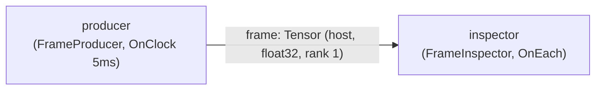

# tensors_101 — the minimal tensor round trip

> **User guide:** [Tensors 101](https://docs.nvidia.com/holoscan/sdk-user-guide/getting-started/tensors-101) —
> this example is the cited
> program for the host-pool tensor loan lifecycle.

A two-operator pipeline — a host-pool tensor producer feeding a read-only
inspector sink — that prints one verified line per frame, a read-only
reception check, and, with `--exhaust`, the immediate `kResourceExhausted`
drop-and-continue behavior of an exhausted pool.



## What you will learn

- Declaring a direct tensor output with
  `.produces_tensor(TensorPortLayout{.memory_kind, .dtype, .rank})` and
  opting into a bounded plan-owned pool with
  `.tensor_allocation(TensorAllocationBounds{.max_rank, .max_byte_span})`.
- The bounded loan lifecycle:
  `allocate_tensor(TensorLoanRequest{.shape, .dtype})` → either fused
  `write_host_and_commit(fill)` **or** explicit
  `write_host()` → fill → `std::move(*writer).commit()` →
  `emit(std::move(*loan), EmitOptions{.capture_time})`. The fused form
  commits on success; do not commit it a second time.
- Why an exhausted pool answers immediately with
  `ErrorCode::kResourceExhausted` instead of blocking, and how an operator
  drops and continues.
- Why received tensors are read-only (`mutable_data()` →
  `kPermissionDenied`) and why host access is explicit
  (`synchronize_for_host()` before reading `data_as<float>()`).
- Declaring the matching consumer expectation with
  `.expects_tensor(TensorPortLayout{...})`.

## Prerequisites

You have built and understood
[`first_operator`](../first_operator/README.md) (E02): typed
`Input<T>`/`Output<T>` port members, `contract()`, and checked
`[[nodiscard]]` emit results. This example swaps the scalar payload for
`holoscan::Tensor`. Everything runs in host memory — no GPU or CUDA driver
is required.

## Build

From this `cpp/` folder:

```sh
cmake -B build -S .
cmake --build build
```

If the SDK is installed somewhere non-default, point CMake at it:

```sh
cmake -B build -S . -Dholoscan_DIR=/opt/nvidia/holoscan/lib/cmake/holoscan
```

(`CMakeLists.min.txt` is the standalone-consumer variant of the build; the
in-tree `CMakeLists.txt` is used when building inside the SDK examples tree.)

## Run

```sh
./build/tensors_101            # normal round trip
./build/tensors_101 --exhaust  # undersized-pool demonstration
```

Both runs terminate on their own within a few seconds; a nonzero exit code
means a verification step failed.

## Expected output

Normal run — one line per received frame, alternating writer forms, printed
after the session has stopped:

```text
frame 1 ok (fused writer)
frame 2 ok (explicit writer)
frame 3 ok (fused writer)
frame 4 ok (explicit writer)
frame 5 ok (fused writer)
frame 6 ok (explicit writer)
read-only check: mutable_data() -> kPermissionDenied
tensors_101: round trip complete (frames=6, bytes_per_frame=64)
```

`--exhaust` run — the first dropped frame number depends on the compiled
pool capacity, so `N` below varies; the codes and the final line do not:

```text
frame N dropped: kResourceExhausted
frame N+1 dropped: kResourceExhausted
frame N+2 dropped: kResourceExhausted
tensors_101: exhaust demo complete (drops=3, code=kResourceExhausted)
```

## Code walkthrough

### Why the pool is declared at setup, not created at runtime

`produces_tensor` states the logical facts a consumer may rely on (host
memory, `float32`, rank 1); `tensor_allocation` bounds the pool
(`max_rank = 1`, `max_byte_span = 64`). Recording bounds does not itself
create a pool — the compiler admits and materializes physical placement when
`compile(graph)` builds the plan. That is why exhaustion is a *capacity*
property of the compiled plan, never a hidden heap fallback: the hot path can
never allocate more than what was declared cold.

### The bounded loan lifecycle

`allocate_tensor` **borrows** — it hands you sole unpublished authority over
one pool slot, not an owning tensor. Writing happens through a
`TensorOutputWriteGuard`, and **commit records readiness, never publishes**:
after `commit()` the data is ready, but nothing has been sent. Publication
stays a separate, explicit `emit(std::move(*loan), EmitOptions{...})`. The
separation exists so a half-written buffer can never leak downstream — an
abandoned loan or guard is simply retired, and the type system (move-only
loan, rvalue-qualified `commit()`) makes each step consumable exactly once.

### Fused vs explicit writer

Odd frames use the fused `write_host_and_commit(fill)`: one callback fills the
whole buffer and the commit is implied on success — use it for whole-buffer
fills. Even frames use the explicit `write_host()` → fill through the guard →
`std::move(*writer).commit()` — use it when the fill is staged or conditional
and you need to hold write access across several statements. Both forms
produce identical published tensors; the inspector cannot tell them apart.

### Exhaustion is immediate, not blocking

With `--exhaust`, the producer keeps its committed loans alive instead of
publishing them, modeling a backlog of in-flight frames. Each live loan pins
one pool slot, so `allocate_tensor` eventually returns
`kResourceExhausted` — *immediately*. There is no blocking loan variant and no
retry-inside-the-runtime: the operator sees the refusal on the same
activation and chooses its own policy. Here it drops the frame and continues,
which is the right default for live sources where the freshest data is
always about to arrive anyway.

### The consumer is read-only, and host access is explicit

The inspector's `mutable_data()` probe fails with `kPermissionDenied`:
published tensors are immutable so any number of consumers can share the
same zero-copy buffer safely. Reading requires an explicit
`synchronize_for_host()` first — for this host-pool tensor it is essentially
free, but for device tensors it blocks the host thread until the producing
stream finishes. That is why synchronization never belongs on a steady-state
hot path: keep device data on the device, and synchronize only at
inspection/debug boundaries like this sink.

## HSDK 4.x comparison

| Concern | HSDK 4.x | HSDK 5.x (this example) |
|---|---|---|
| Buffer provisioning | `UnboundedAllocator` / `BlockMemoryPool` resource attached to the operator | `.tensor_allocation(TensorAllocationBounds{...})` on the output declaration; plan-owned pool |
| Producing a tensor | Build a `TensorMap`, `op_output.emit(tensor_map)` | `allocate_tensor` → write guard → `commit()` → explicit `emit(loan)` |
| Exhaustion behavior | Allocator-dependent; unbounded growth or failure at allocate | Immediate `kResourceExhausted`, operator-chosen drop-and-continue |
| Consumer mutability | Received tensors mutable by convention | Read-only enforced: `mutable_data()` → `kPermissionDenied` |

The 5.x design moves allocation from a runtime resource decision to a
compile-time declaration so capacity, memory kind, and rank are admitted
before the first activation — misconfiguration fails at `compile(graph)`,
not minutes into a run.

## What's next

- [`temporal_contracts/on_any_input`](../temporal_contracts/on_any_input/README.md)
  (E04) starts the contract family: making activation semantics observable.
- `tensors_in_depth` (E25) covers the device-pool story: CUDA streams,
  `write(producer_stream)`, and `copy_to_host_async`.
- Guide deep-dive: the tensors chapter's loan-lifecycle and memory-kind
  sections; performance guidance lives in the guide's Performance section.

## Concepts at a glance

| API | Role |
|---|---|
| `Output<Tensor>` + `produces_tensor(TensorPortLayout)` | Declare logical tensor facts on a producer port |
| `tensor_allocation(TensorAllocationBounds)` | Opt into a bounded plan-owned pool |
| `allocate_tensor(TensorLoanRequest)` | Borrow one pool slot (never blocks) |
| `TensorOutputLoan::write_host_and_commit(fill)` | Fused fill + readiness commit |
| `write_host()` / `TensorOutputWriteGuard::commit()` | Explicit staged fill + readiness commit |
| `emit(std::move(*loan), EmitOptions{.capture_time})` | Explicit publication, separate from commit |
| `ErrorCode::kResourceExhausted` | Immediate refusal when the pool has no free slot |
| `Input<Tensor>` + `expects_tensor(TensorPortLayout)` | Declare consumer-side tensor expectations |
| `Tensor::mutable_data()` → `kPermissionDenied` | Read-only reception guarantee |
| `Tensor::synchronize_for_host()` | Explicit host-visibility barrier before reading |
