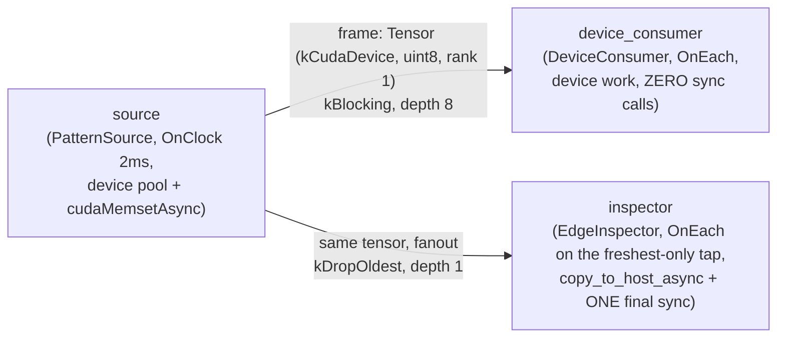

# tensors_in_depth — device pools, stream ordering, and the edge of the hot path

> **User guide:** [Tensors in Depth](https://docs.nvidia.com/holoscan/sdk-user-guide/data-and-payloads/tensors-in-depth) —
> this example is the
> cited program for the device tensor stream model: readiness and release
> streams, pre-ordered receive, and pool exhaustion.
>
> **Beta** (from the user-guide page): the tensor stream/pool model, declared
> memory-kind awareness, and bounded staging ship today, and the API may still
> evolve in upcoming releases. Exact baseline limits: every tensor obligation of
> one operator must resolve to a single device, the runtime never inserts
> cross-device copies, managed memory (`MemoryKind::kCudaManaged`) does not
> cross process boundaries, and unpooled pass-through emits skip memory-kind
> validation at receive. GPU-resident execution and automatic host↔device
> converter insertion remain deferred to a later release.

A three-operator fanout — a CUDA device-pool producer feeding a
no-synchronization device consumer and a `copy_to_host_async` inspection tap —
that prints a stream-identity check, a pre-ordered-receive count, three
verified host-staged frames, and two `kResourceExhausted` drops, then a
completion marker. Requires a CUDA device; on CPU-only machines it prints a
skip marker and exits with CTest's conventional skip code, 77.



## What you will learn

- Declaring a CUDA device pool with one `TensorOutputSpec` containing a
  CUDA-device `TensorRepresentation`, finite `tensor_bounds(...)`, and
  `TensorOutputStorage::kRuntimePool`, and
  binding it to a device at compile time with
  `CompileOptions::deployment.bind_tensor_output_device(
  TensorOutputDevicePlacement{.operator_path, .output_port, .device})` — the
  compiler never silently infers device zero.
- The device write phase: `loan->write(context.cuda_stream())` →
  `cudaMemsetAsync` on that same stream → `std::move(*writer).commit()`,
  which records the readiness event and never synchronizes or publishes.
- Why a received device tensor arrives **pre-ordered** on
  `ExecutionContext::cuda_stream()` and the consumer enqueues device work with
  **zero synchronization calls**.
- Fanout release-stream behavior: one readiness event per producer, one
  deallocation (release) stream per consumer; the inspection tap registers its
  private stream via `set_deallocation_stream()` so the pool slot cannot be
  recycled under its pending copy.
- Where the only sanctioned blocking lives: `copy_to_host_async` staging on a
  private stream with **one final `cudaStreamSynchronize` at the edge sink**,
  never per frame.
- Pool exhaustion on a device pool: `allocate_tensor` answers immediately with
  `ErrorCode::kResourceExhausted` — drop and continue, no blocking variant.

## Prerequisites

- [`schema_payloads`](../schema_payloads/README.md) (E24) — the previous
  learning-chain step completes portable structured payloads; this step moves
  into device-resident Tensor ownership.
- [`tensors_101`](../tensors_101/README.md) (E03) — the foundational four-step
  loan lifecycle (`allocate_tensor` **borrows** → write guard → `commit()` →
  explicit `emit`), read-only reception, and host-pool exhaustion.

This example moves that lifecycle onto a CUDA device pool. Building requires
the CUDA Toolkit (`CUDA::cudart`); running the full path requires a CUDA device,
but the binary degrades to a clean skip without one.

## Build

From this `cpp/` folder:

```bash
cmake -B build -S .
cmake --build build
```

If the SDK is installed somewhere non-default, point CMake at it:

```bash
cmake -B build -S . -DCMAKE_PREFIX_PATH=<install-prefix>
```

(`CMakeLists.min.txt` is the standalone-consumer variant of the build; the
in-tree `CMakeLists.txt` is used when building inside the SDK examples tree.
The sources use only the CUDA runtime API from C++, so no `.cu` file and no
CUDA language enablement is needed — just `CUDA::cudart`.)

## Run

```bash
./build/tensors_in_depth
```

The run terminates on its own within a few seconds. Exit code 77 means that no
CUDA device was available and CTest reports the row as **Skipped**; any other
nonzero exit code means a verification step failed.

## Expected output

With a CUDA device (frame counts, staged byte values, and dropped frame
numbers vary with scheduling; the *checks* — shared stream identity, uniform
strictly-increasing staged bytes, `kResourceExhausted` codes — do not):

```text
shared runtime stream: producer == device consumer (one per process group + device)
device consumer: 6 frames received pre-ordered, 0 synchronization calls
inspector: staged bytes 1 2 3 (uniform, increasing) via copy_to_host_async + one final sync
inspector: private release stream registered with the pool
frame 8 dropped: kResourceExhausted
frame 9 dropped: kResourceExhausted
tensors_in_depth: device tour complete (frames=6, inspected=3, drops=2)
```

Without a CUDA device (CTest reports this row as **Skipped**, not Passed):

```text
tensors_in_depth: skipped: no CUDA device
```

## Code walkthrough

### Why the device is bound at compile time, not discovered at runtime

A CUDA-backed pool needs a device identity before the plan can materialize
backing memory and its CUDA event inventory, and the compiler refuses to
guess: without `bind_tensor_output_device` the compile rejects (the guide's
Current limitations include "the compiler never silently infers device
zero"). Binding is deployment placement, not allocation authorship — the
operator's `setup()` stays device-agnostic, and the same graph can be pointed
at another GPU by changing one `CompileOptions` line in `main()`.

### Why the producer's memset needs no fence

`loan->write(context.cuda_stream())` opens a *stream-ordered* write phase;
the runtime requires the write stream to be the operator's runtime-assigned
compute stream. `cudaMemsetAsync` enqueues onto it, and
`std::move(*writer).commit()` records a timing-disabled readiness event on
the same stream — nothing else. No flush, no sync, no publish. The runtime
owns stream ordering: you write, commit, and emit; the framework records
producer readiness and inserts the consumer-side wait.

### Why the device consumer contains zero synchronization calls

Before its `compute()` runs, the runtime has already enqueued a
`cudaStreamWaitEvent` on the consumer's compute stream against the producer's
readiness event. The received tensor is therefore *pre-ordered*: the
consumer's stream-ordered scratch allocation, device-to-device copy, and
stream-ordered free (the stand-in for your kernel launch) simply queue behind
the producer's writes. The guide's rule is reproduced here in behavior:
**never call `cudaStreamSynchronize` on the hot path** — a blocking sync in
`compute()` serializes the pipeline and buys no additional correctness. The
example also verifies the stream model itself: producer and device consumer
record the same `cuda_stream()` handle, because 5.x materializes one
non-blocking stream per (process group, device) pair.

### Why the inspection tap is depth-one drop-oldest, on its own stream, with one final sync

Host inspection is real work that must not backpressure the device path, so
its fanout edge uses `QueuePolicy::kDropOldest` with depth 1 and the inspector
triggers `OnEach` on that edge: the queue keeps only the newest frame, so a
slow tap sees fresh data and never stalls the producer. `OnEach` is a
semantic choice here — every retained arrival may start inspection. A
periodic tap can instead use `OnClock` with a selected input when sampling on
a fixed cadence is the desired contract. Each sampled frame is
staged with `copy_to_host_async` on a private non-blocking stream, and the
tensor's `set_deallocation_stream(private_stream)` registers that stream for
release tracking — fanout release behavior made visible: the slot returns to
the pool only after *every* consumer's release work, including this pending
copy, completes. On the normal path, `cudaStreamSynchronize` runs once, after
the last staged copy, at the edge. Host inspection stays off the steady-state
path.

Release-stream registration borrows the stream. `InspectionResources` in
`main()` owns the private stream and staging buffers until after session
cleanup has released Tensor handles and enqueued deferred deallocation.
Destroying the stream in the operator destructor would be too early. If the
run ends before the final inspection synchronization, the resource owner
synchronizes during cleanup before releasing the buffers and stream.

### Retry transient capacity refusals without blocking

The blocking device edge preserves accepted samples; `emit()` still refuses
immediately with `kBackpressured` when its queue is full. During streaming,
the producer retries the same logical frame on a later clock tick after
`kBackpressured` or an allocation's `kResourceExhausted`. A Tensor loan is
consumed by every terminal emit attempt, so each retry allocates and writes a
fresh loan using the current activation's stream. The frame sequence advances
only after successful publication. Other errors, including partial or uncertain
publication, remain fatal.

### Why exhaustion drops instead of waiting

After the streaming lesson completes, the producer deliberately pins pool
slots by holding borrowed loans, and the next `allocate_tensor` answers
immediately with `kResourceExhausted` — same contract as the host pool in
`tensors_101`, now on device memory. There is no blocking-loan variant by
design: a blocked producer hides backpressure that should surface as an
explicit, typed error the operator can branch on. The producer records the
drop and continues.

This example does not exercise foreign DLPack imports
(`make_tensor_from_dlpack`, `set_readiness_stream`, permanently read-only
reception); see the guide page's "Foreign tensors imported through DLPack"
section for those rules.

## HSDK 4.x comparison

| Concern | HSDK 4.x | HSDK 5.x (this example) |
|---|---|---|
| Stream assignment | One unique internal stream per operator; `receive_cuda_stream(port)` | One shared stream per process group + device; `ExecutionContext::cuda_stream()` |
| Producer/consumer ordering | Event record + stream wait on every hop, visible to the author | Runtime records readiness at `commit()` and inserts the consumer wait; received tensors arrive pre-ordered |
| Device selection | Allocator/operator parameter at runtime | `bind_tensor_output_device` at compile; never inferred |
| Release tracking | Buffer not stream-aware; one release path | One release stream per fanout consumer, registered via `set_deallocation_stream`, bounded caps |
| Host access | Ad-hoc `cudaMemcpy` wherever needed | Explicit `copy_to_host_async` / `synchronize_for_host` — the entire blocking surface |

Fewer streams means fewer cross-stream fences: in 4.x a chain of three
operators paid an event record and wait at every hop just to bridge three
private streams; in 5.x those operators usually share one stream, and the
author never manages ordering by hand.

## What's next

- [`essential/config_file`](../essential/config_file/README.md) (E26)
  continues Wave 3: binding JSON/YAML configuration files to typed operator
  parameters at compile time.
- Guide deep-dive: the tensors-in-depth page's "When the fences disappear"
  (proven linear chains), "Crossing process boundaries" (generation fence),
  and "Foreign tensors imported through DLPack" sections; performance
  guidance lives in the guide's Performance section.

## Concepts at a glance

| API | Role |
|---|---|
| `TensorRepresentation{.memory_kind = MemoryKind::kCudaDevice, ...}` | Declare device-memory tensor facts on a port |
| `bind_tensor_output_device(TensorOutputDevicePlacement{...})` | Explicit compile-time CUDA device binding for a pooled output |
| `loan->write(context.cuda_stream())` | Open a stream-ordered device write phase (runtime stream only) |
| `std::move(*writer).commit()` | Record the readiness event — never syncs, never publishes |
| `emit(std::move(*loan), EmitOptions{.capture_time})` | Explicit publication, separate from commit |
| `ExecutionContext::cuda_stream()` | The shared runtime compute stream (one per process group + device) |
| `has_readiness_stream_contract()` | Whether a received tensor can be stream-ordered at all |
| `copy_to_host_async(dst, bytes, stream)` | Enqueue readiness-fenced D2H staging on a caller-owned stream |
| `set_deallocation_stream(stream)` | Register a consumer release stream gating pool-slot recycle |
| `QueuePolicy::kDropOldest` at depth 1 | Observational fanout edge that keeps only the freshest unread sample |
| `ErrorCode::kResourceExhausted` | Immediate, non-blocking pool-exhaustion refusal |
