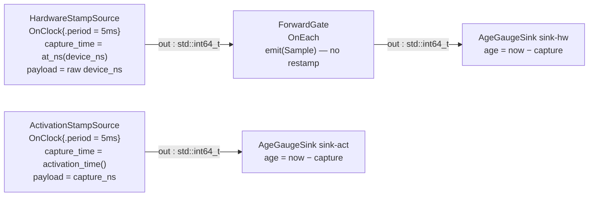

# time_and_clocks — capture time, clock domains, and a test clock

> **User guide:** [Time and Clocks](https://docs.nvidia.com/holoscan/sdk-user-guide/getting-started/time-and-clocks) —
> this example is the cited program for
> `now()` vs `at_ns()`, `TimePoint` domain rules, physical capture time versus
> logical `TagTime`, the forward-don't-restamp discipline, and ManualClock determinism
> (also serves testing and determinism-and-replay).

Two clock-driven sources publish frames with honest capture metadata. The
camera-shaped source labels its raw device exposure timestamp with
`clock.at_ns()` and uses that physical coordinate as `capture_time`; the
comparison source has no hardware timestamp and uses its activation coordinate.
A forwarding operator proves the physical stamp survives an intermediate hop,
and two sinks measure capture age with `now()` and drop the one frame that sat
in a simulated device queue beyond a 500 ms freshness budget. `--manual`
reruns the identical graph under a `ManualClock` advanced from `main()`.



In prose (the diagram adds nothing more): the hardware-stamp chain is
`HardwareStampSource → ForwardGate → sink-hw`; the activation-stamp chain is
`ActivationStampSource → sink-act`. All four operators schedule against the
graph's single default clock — `RealtimeClock` normally, `ManualClock` with
`--manual`.

## What you will learn

- **Capture time and dispatch order are different records.** A device-provided
  exposure timestamp may legitimately predate the callback that publishes it.
  `EmitOptions{.capture_time}` preserves that physical coordinate, while
  monotonic `ctx.tag_time()` orders when Runtime observes and dispatches the
  sample, including a late-visible older capture.
- **Measuring vs labeling**: `clock.now()` *measures* and is fallible
  (`expected<TimePoint, Error>` — a clock generation can be stale or
  unreadable); `clock.at_ns(device_ns)` *labels* an integer you already have
  and is infallible.
- `TimePoint` domain rules: a timestamp is `{timestamp_ns, clock_id}`, and
  differences are computed only after checking both points share a
  `clock_id`.
- The three time records on every sample path: physical capture metadata
  (`EmitOptions{.capture_time}`), the raw device timestamp retained as data,
  and logical dispatch order (`ctx.tag()` / `ctx.tag_time()`).
- Forward-don't-restamp: re-emitting the received `Sample` (the overload with
  no `EmitOptions` parameter) preserves capture time and source clock;
  Runtime replaces only publication-side metadata.
- Swapping `RealtimeClock` for `ManualClock` without touching one line of
  operator code, and why `graph.bind_shared_clock()` (not `add_clock()`) is
  the verb that lets `main()` keep a live handle to `advance_by()`.
- Freshness as application policy: the sink computes capture age
  (`clock.now() - capture_time`) and drops the one frame over its 500 ms budget;
  it separately verifies that relabeling the raw payload reproduces the capture
  coordinate exactly.

## Prerequisites

- [`examples/errors_as_values`](../errors_as_values/README.md) — this example leans on
  `expected`, `HOLOSCAN_TRY`, and `make_unexpected` without re-explaining
  them.
- [`examples/first_pipeline`](../first_pipeline/README.md) — the `OnClock`/`OnEach`
  contract shapes and the observe-then-`request_stop()` idiom.
- No GPU is required: payloads are bare `std::int64_t` device timestamps on
  host memory; the frame identity rides in `EmitOptions{.frame_id}`.

## Build

From this `cpp/` folder (standalone consumer build, using
`CMakeLists.min.txt` as the project file):

```bash
cmake -B build -S . -Dholoscan_DIR=/opt/nvidia/holoscan/lib/cmake/holoscan
cmake --build build
```

If your SDK lives elsewhere, point `-Dholoscan_DIR=` at the directory
containing `holoscan-config.cmake`. Inside the SDK source tree the example
builds as part of the normal examples build via `CMakeLists.txt`.

## Run

```bash
./build/time_and_clocks            # RealtimeClock
./build/time_and_clocks --manual   # identical graph under ManualClock
```

Or through CTest:

```bash
ctest --test-dir build -R EXAMPLE_CPP_TIME_AND_CLOCKS
```

## Expected output

```text
sink-act: frame=0 tag=g1:s1 device_delta_us=0 capture_age_us=201 capture_ns=7636576
forward: frame=0 tag=g1:s1 tag_time=7636907ns/m1 capture_ns=7136907 (forwarded unchanged)
sink-hw: frame=0 tag=g1:s1 device_delta_us=0 capture_age_us=835 capture_ns=7136907
sink-act: frame=1 tag=g1:s2 device_delta_us=0 capture_age_us=103 capture_ns=12636576
forward: frame=1 tag=g1:s2 tag_time=12636907ns/m1 capture_ns=12136907 (forwarded unchanged)
sink-hw: frame=1 tag=g1:s2 device_delta_us=0 capture_age_us=691 capture_ns=12136907
sink-hw: DROP frame=3 capture_age_ms=5000 (over the 500 ms freshness budget)
time_and_clocks[realtime]: hw accepted=11 dropped=1 act accepted=12 forward_preserved=yes termination=stopped
```

Timestamp, `capture_age_us`, and `tag_time` values vary run to run (they are
real clock readings) and lines from the two chains may interleave in either
order; `device_delta_us=0`, the counts, the single `DROP` of frame 3, and the
final summary line do not vary. The smoke tests anchor only on the summary
line, which `main()` prints after `session.wait()` returns. With `--manual`
the summary reads `time_and_clocks[manual]: …` with identical counts; the
activation-stamped chain has zero capture age, while ordinary hardware frames
retain the authored 500 us exposure age and the stale frame retains its 5 s
queue delay. The final `manual: virtual clock ended at …` line comes from the
live clock handle, and no wall-clock frame period is waited on. The `tag_time`
printed beside a hardware sample may be later than its preserved capture time:
the former is monotonic dispatch order, the latter is physical provenance.

## Code walkthrough

### Why `now()` can fail but `at_ns()` cannot

`ClockRef::now()` *reads a live clock*: the owning registry generation can be
gone (`kStaleEndpoint`), reads may not be admitted (`kNotSupported`), so it
returns `expected<TimePoint, Error>` and the sink unwraps it with
`HOLOSCAN_TRY`. `ClockRef::at_ns()` reads nothing — it attaches the clock's
domain identity to an integer you already possess (a device-provided hardware
timestamp), so it is `noexcept` and always succeeds. The API split teaches the
semantic split: measuring is an act with failure modes; labeling is
bookkeeping. `AgeGaugeSink` does both, in the right order: it *labels* the
device integer it received as data, then *measures* the live clock — and only
subtracts after the domain check.

### Why the device timestamp is the capture stamp

`HardwareStampSource` receives a raw device integer, labels it with the
activation clock's domain using `context.clock().at_ns(device_ns)`, and passes
that `TimePoint` to `EmitOptions`. That is the honest physical capture time,
even though exposure happened 500 us before the callback and one deliberately
stale frame was captured 5 s earlier. Runtime preserves the source coordinate
as sample metadata and uses a separate monotonic `TagTime` record to order late
visibility and downstream activation. No timestamp rewrite is needed to make
the scheduler monotonic.

The raw integer also rides as payload so the sink can demonstrate the inverse
operation: labeling it again with `at_ns()` reproduces the metadata coordinate
exactly (`device_delta_us=0`). `ActivationStampSource` shows the fallback when
no device timestamp exists: the only truthful coordinate available is
`ctx.activation_time()`.

### Why the forwarder re-emits the `Sample`, not the value

`ForwardGate` calls `out.emit(std::move(*sample))`. That overload
deliberately has no `EmitOptions` parameter: the sample *is* the metadata to
forward. Runtime replaces publication sequence/time on the new hop, but
capture time, source clock, frame id, and flags ride through as forwarding
evidence. Had the forwarder unpacked the value and re-emitted it with fresh
options, every downstream consumer would silently measure "age since the
forwarder ran" instead of "age since the pixels existed". The sink proves the
discipline held: it compares each received stamp against what the source
recorded and reports `forward_preserved=yes` only on an exact match.

### Why the sink checks `clock_id` before subtracting

A `TimePoint` is a coordinate *in a named domain*, and domains are not
implicitly comparable — there is deliberately no `operator-` on `TimePoint`.
The sink verifies `capture.clock_id == now.clock_id` before computing capture
age, and `device.clock_id == capture.clock_id` before checking that payload and
metadata identify the same instant. Across domains, the correct tool is an
admitted `add_clock_conversion` (see the time-and-clocks guide page), never raw
integer arithmetic. Staleness itself (drop any frame whose capture age
exceeds 500 ms) is application policy, so it lives in application code: the
runtime's job was delivering the sample with honest metadata; deciding that
5-second-old pixels are useless is the sink's job. Note the split the numbers
teach: `device_delta_us` is data validation and is zero in every run;
`capture_age_us` is a live measurement and varies. Under `ManualClock`, it is
exactly the authored exposure latency because the clock does not move between
capture publication and sink measurement.

### Why `--manual` swaps one line, and why `bind_shared_clock`

The `--manual` branch changes exactly one declaration:
`graph.bind_shared_clock("wall", manual)` instead of
`graph.add_clock<RealtimeClock>("wall")`. Every operator, contract, and edge
is untouched — time-driven behavior was declared in contracts, so replacing
the time source re-schedules the same program. `add_clock()` would not work
for this: it validates and *discards* your instance, replaying a factory
later, so the object `main()` holds would not be the clock the graph uses.
`bind_shared_clock()` is documented as the one verb that retains the live
instance, which is what lets `main()` call `advance_by()` at all.

A bound `ManualClock` does not advance itself inside a running session: left
alone, the graph fires exactly one tick per source at the start coordinate
and then idles forever. `main()` is therefore the time authority, and the
example drives it in *lock-step*: advance one frame period, then wait until
the scheduler digests that tick (one frame recorded on each chain) before
feeding the next. With the admitted `kCoalesceLateTicks` policy, jumping
several periods coalesces to the greatest due tick rather than queuing every
skipped coordinate. Lock-step is used here so one authored period produces
one observable frame, making the teaching evidence deterministic. Driven this
way the run has grid-aligned
capture coordinates, `device_delta_us=0`, exact authored hardware capture
ages, and no wall-clock frame period ever waited on — exactly what an
operator unit test wants. The pre-run `advance_by(1s)` epoch shift and the
post-run `timestamp()` read prove the handle in `main()` is the same live
clock the graph scheduled against.

## HSDK 4.x comparison

| Concern | HSDK 4.x | HSDK 5.x `time_and_clocks` |
|---|---|---|
| Clock ownership | a `Clock` resource handed to the scheduler (`GreedyScheduler(Arg("clock", …))`) | a named graph declaration: `graph.add_clock<…>` / `bind_shared_clock` + `set_default_clock` |
| Timestamps | raw `int64_t` acq/pub times on the message, domain implicit | `TimePoint{timestamp_ns, clock_id}`; domain checked before comparison |
| Capture stamping | `op_output.emit(value, "port", acq_time)` int64, domain implicit | `EmitOptions{.capture_time}` carries a domain-tagged physical coordinate; `TagTime` separately orders dispatch |
| Test time | `ManualClock` existed but swapping it meant reconfiguring the scheduler | one authoring line swaps the default clock; operator code untouched |
| Ordering evidence | none first-class (timestamps doubled as order) | `Tag` / `TagTime` are separate logical-order records, printed here per hop |

The 4.x model attached time to the scheduler and trusted raw integers to mean
the same thing everywhere; 5.x makes the clock a named graph citizen and
makes every timestamp carry its domain, so "which clock said this?" is
answerable in code instead of in a post-mortem.

## What's next

- [`examples/compile_and_check`](../compile_and_check/README.md) — the plan diagnostics
  and digest workflow that catches graph mistakes before any clock ticks.
- Guide deep-dive: time-and-clocks (clock conversions, `SyntheticClock`, and
  the clock-capability model) and determinism-and-replay.

## Concepts at a glance

| API | Role in this example |
|---|---|
| `ctx.clock()` → `ClockRef` | borrow the activation's default-clock reference |
| `clock.now()` → `expected<TimePoint, Error>` | fallible measurement (sink ages samples) |
| `clock.at_ns(device_ns)` → `TimePoint` | infallible domain labeling (source forms physical capture metadata; sink verifies the raw payload) |
| `ctx.activation_time()` | this activation's coordinate; the fallback capture time when no physical timestamp exists |
| `EmitOptions{.capture_time, .frame_id}` | physical/semantic capture stamping + frame identity |
| `emit(Sample<T>)` (no options) | forward-don't-restamp; metadata rides through |
| `sample.metadata.capture_time()` | `{capture_timestamp_ns, source_clock_id}` as one `TimePoint` |
| `ctx.tag()` / `ctx.tag_time()` | per-activation logical identity/order, printed for correlation |
| `graph.bind_shared_clock(name, ptr)` | clock declaration that retains the live instance |
| `ManualClock::advance_by()` / `timestamp()` | main() as lock-step time authority in the `--manual` variant |
