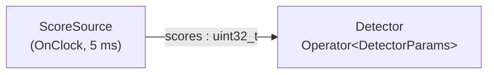

# Typed parameters (`typed_parameters`)

> **User guide:** [Typed Parameters](https://docs.nvidia.com/holoscan/sdk-user-guide/getting-started/typed-parameters) —
> this example is the cited
> program for typed operator parameters (`HOLOSCAN_PARAM_SCHEMA`,
> `handle.set_params()`, `ctx.params<T>()`).

A two-operator pipeline — a clock-driven score source feeding a `Detector`
that is configured by a 3-field `DetectorParams` aggregate — runs three times:
once with the struct's authoring defaults, once with a graph-side
`set_params()` override, and once demonstrating the bind-time rejection of an
out-of-range value, then prints one deterministic summary of all three.



## What you will learn

- How to declare a parameter aggregate as a plain struct with default member
  initializers, and attach its schema with `HOLOSCAN_PARAM_SCHEMA(Type,
  holoscan::param_schema("com.nvidia.holoscan.examples.DetectorParams", 1),
  holoscan::field<&Type::member>("name")...)` **at namespace scope, next to
  the struct**.
- How to constrain fields with `.description()`, `.range(lo, hi)`, and
  `.allowed_values({...})`, and why validation then fails closed at bind time.
- How an operator binds its aggregate via `class Detector : public
  holoscan::Operator<DetectorParams>` and reads it exactly once per activation
  with `ctx.params<DetectorParams>()` (a pinned `const&`, O(1)).
- How generation-0 values are overridden graph-side with
  `handle.set_params(DetectorParams{...})`, and how an invalid aggregate is
  rejected with a caught `holoscan::RuntimeError` before anything runs.
- How `holoscan::param_schema_availability<T>()` statically guards against the
  wrong-namespace footgun that silently degrades a type to an opaque aggregate.

## Prerequisites

- [`temporal_contracts/on_predicate`](../temporal_contracts/on_predicate/README.md) (E12):
  the previous learning-chain step completes the contract family. This
  example's `Detector` reuses its typed `receive()` idiom while shifting focus
  from activation policy to schema-backed parameters.
- A working build of [`first_pipeline`](../first_pipeline/README.md) confirms your
  toolchain and `holoscan_DIR` are set up.

## Build

From this `cpp/` folder:

```bash
cmake -B build -S .
cmake --build build
```

If the SDK is not in a default location, pass the package hint:

```bash
cmake -B build -S . -Dholoscan_DIR=/opt/nvidia/holoscan/lib/cmake/holoscan
```

## Run

```bash
./build/typed_parameters
```

The program needs no GPU, takes well under a second, and always terminates:
each run stops itself after eight observed samples (10-second safety cap).

## Expected output

```text
schema: com.nvidia.holoscan.examples.DetectorParams v1 availability=kDeclared fields=3
threshold=0.5 (default) stride=2 label=person evaluated=4 accepted=3
threshold=0.8 (configured) stride=4 label=vehicle evaluated=2 accepted=1
rejected: kInvalidArgument: PARAM_VALIDATION_FAILED category=out_of_range field_id=<id> field_name=threshold (typed validation: field=threshold code=kOutOfRange)
summary: default_threshold=0.5 configured_threshold=0.8 configured_accepted=1/2 runtime_error=kInvalidArgument typed_validation=kOutOfRange field=threshold
typed_parameters example complete
```

Line 1 proves the schema was found through ADL. Lines 2–3 print the values the
`Detector` actually observed via `ctx.params<DetectorParams>()` inside
`compute()` — not the values main() intended to set. Line 4 contrasts the
bounded bind-time diagnostic with the authoritative typed validation. Its
`<id>` text stands for the deterministic numeric `ParamFieldId` printed by the
executable; the angle-bracket text is not printed literally. All lines are
printed by `main()` after each run has fully stopped. CTest intentionally
matches only the final `summary:` line; the executable asserts the detailed
diagnostic and typed-validation facts before printing it.

## Code walkthrough

### The schema lives beside the struct — and must

`HOLOSCAN_PARAM_SCHEMA` expands to ADL free functions
(`holoscan_param_schema`, `holoscan_param_validate`) keyed on the exact
aggregate type. ADL only finds them in the struct's own namespace. The
counter-example:

```cpp
namespace app { struct DetectorParams { ... }; }
namespace other {
HOLOSCAN_PARAM_SCHEMA(app::DetectorParams, ...);  // compiles!
}
```

This compiles cleanly — and silently degrades `app::DetectorParams` to an
*opaque aggregate*: no range checks, no field metadata, no portable schema
identity. Because the failure mode is silence, the example pins the intent
with a compile-time guard right after the macro:

```cpp
static_assert(holoscan::param_schema_availability<DetectorParams>() ==
              holoscan::ParamSchemaAvailability::kDeclared);
```

### One pinned read at the top of compute()

`ctx.params<DetectorParams>()` returns a `const&` to the parameter generation
pinned for this activation. Reading it once at the top and using the local
reference thereafter guarantees every decision in the activation sees one
coherent aggregate — there is no window where `threshold` comes from one
generation and `stride` from another. Re-reading per field would invite
exactly that torn-read bug once runtime parameter updates enter the picture.

### Overrides replace the whole aggregate, graph-side

`detector.set_params(DetectorParams{.threshold = 0.8F, .stride = 4U, ...})`
is an authoring-time (generation-0) operation on the `OperatorHandle`, not a
message to a running operator. The runtime reconstructs the operator from its
factory with the new aggregate, which is why overrides are whole-struct
replacement rather than per-field pokes: the operator can never observe a
half-updated struct, and `setup()` re-runs against the new values.

### Validation fails closed, before anything runs

`.range(0.0F, 1.0F)` and `.allowed_values({1U, 2U, 4U})` are enforced when the
candidate aggregate is bound: `set_params()` throws `holoscan::RuntimeError`
(code `kInvalidArgument`) and the graph is left untouched — the prior
generation-0 values stay in force. The thrown message carries bounded,
deterministic category and field identity without rendering the rejected
value. For machine-readable handling the example also calls
`holoscan::validate_params()` directly, which returns a
`ParamValidationResult` naming the failing field (`threshold`) and cause
(`kOutOfRange`). Catching the mistake at bind time,
on the authoring thread, is the point: a typo in a config never becomes a
mid-run surprise.

## HSDK 4.x comparison

| Concern | HSDK 4.x | HSDK 5.x (this example) |
|---|---|---|
| Declaration | `Parameter<float> threshold_;` member + `spec.param(threshold_, "threshold", ...)` in `setup()` | Plain aggregate `DetectorParams` + `HOLOSCAN_PARAM_SCHEMA` at namespace scope |
| Defaults | Scattered across `spec.param(...)` default arguments and YAML | Default member initializers in one struct |
| Constraints | Hand-written checks in `initialize()`/`compute()` | Declarative `.range()` / `.allowed_values()`, enforced at bind time |
| Configuration | `from_config("detector")` + YAML lookup by string key | Typed `handle.set_params(DetectorParams{...})` on the graph handle |
| Read in compute | `threshold_.get()` per parameter | One `ctx.params<DetectorParams>()` pinned read |

The 4.x model attached parameters to the operator one string-keyed
`Parameter<T>` at a time, so defaults, constraints, and wiring were spread
over three places and validated (if at all) by hand at run time. The 5.x
aggregate moves the whole contract into one value type the compiler can see,
which is what makes bind-time rejection and coherent per-activation reads
possible.

## What's next

- [`errors_as_values`](../errors_as_values/README.md) (E14): the
  `expected<T, Error>` machinery behind the `RuntimeError` bridge you just
  caught.
- Guide deep-dive: getting-started/typed-parameters, and the config chapter
  for loading these same aggregates from JSON/YAML documents
  (`holoscan::config_io` + `holoscan::params::bind`, essential module).

## Concepts at a glance

| API | Role |
|---|---|
| `HOLOSCAN_PARAM_SCHEMA(Type, header, fields...)` | Declares the static schema beside the struct (ADL) |
| `holoscan::param_schema(id, version)` | Leading clause: stable reverse-DNS identity + nonzero version |
| `holoscan::field<&T::m>("m")` | One field declaration; `.description()/.range()/.allowed_values()` attach metadata and constraints |
| `holoscan::Operator<DetectorParams>` | Binds the aggregate as the operator's `Params` type |
| `ctx.params<DetectorParams>()` | Pinned per-activation `const&` read inside `compute()` |
| `handle.set_params(Params{...})` | Graph-side generation-0 override; throws `RuntimeError` on invalid values |
| `holoscan::validate_params(value)` | Direct cold-path validation returning field-level `ParamValidationResult` |
| `holoscan::param_schema_availability<T>()` | `consteval` guard: `kDeclared` vs silent `kOpaqueLocal` |
