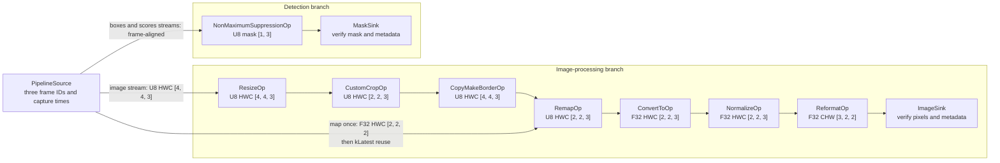

# Holoscan Vision sample pipeline

This example composes every Holoscan Vision operator into one compiled CUDA
graph. A single source emits image, remap, bounding-box, and score tensors with
aligned capture times and frame IDs across three deterministic frames. The
static remap map is published with the first frame and reused by `RemapOp`'s
`kLatest` map input for the remaining frames. The graph processes the streams
through independent image and detection branches, then verifies every image,
mask, capture time, clock domain, and frame ID on the host.

The complete implementation is in
[`cpp/vision_pipeline.cpp`](cpp/vision_pipeline.cpp).



## What it demonstrates

- Chaining `ResizeOp`, `CustomCropOp`, `CopyMakeBorderOp`, `RemapOp`,
  `ConvertToOp`, `NormalizeOp`, and `ReformatOp` without staging intermediate
  tensors on the host.
- Streaming three frame-aligned image, bounding-box, and score samples through
  the graph, while publishing the static remap map only once for `kLatest`
  reuse at `RemapOp`.
- Reusing one causal map across the image stream at `RemapOp`, while joining
  each frame's boxes and scores at `NonMaximumSuppressionOp` by matching
  capture time and frame ID.
- Declaring finite runtime tensor pools and binding every tensor-producing
  output to CUDA device 0 during compilation.
- Converting interleaved U8 image data to normalized planar F32 data while a
  parallel detection branch produces an NMS mask.
- Copying only the final tensors to the host to verify every frame's image
  values, detection mask, capture timestamp, source clock domain, and frame ID.

## Build and test

From the repository root:

```bash
./public/run build --config \
  "-DHOLOSCAN_BUILD_VISION=ON -DHOLOSCAN_BUILD_EXAMPLES=ON -DHOLOSCAN_BUILD_TESTS=ON"
./public/run test --name '^VISION_PIPELINE_EXAMPLE$' --verbose
```

On success, the example prints:

```text
vision_pipeline: image and detection branches passed
```

The test requires a usable CUDA device. If none is available, the executable
prints `vision_pipeline skipped: no usable CUDA device`, returns code 77, and
CTest reports the test as skipped.
