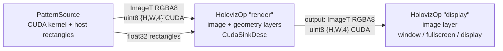

# Render to a CUDA tensor, then display it (`cuda_sink_example`)

Two `HolovizOp` instances in one graph. The first one does not present at all: it composites a
kernel-generated RGBA image with a rectangle overlay and publishes the finished frame as a
`schema::ImageT` with a CUDA data tensor through `CudaSinkDesc`. The second one takes that ImageT
as an ordinary image layer and puts
it on screen, in a window, fullscreen, or directly on a display (`--display`), exactly like
`gray_scale_example`. The rendered image stays on the CUDA device end to end; the only host tensor
in the graph is the small rectangle-overlay sample the source emits beside each frame.



- `PatternSource` (`cpp/pattern_source.*`) ticks at `--fps` and emits two samples per frame from
  runtime-owned tensor pools: a `schema::ImageT` (encoding `RGBA8`) whose `{height, width, 4}`
  `uint8` data tensor is written by a CUDA kernel (a rotating colour field with a bright orbiting
  disc), and a `{12}` `float32` host tensor with
  three rectangles in HolovizOp's `kRectangleList` wire format (`x0, y0, x1, y1` per rectangle,
  normalized to the frame, origin top-left): a box tracking the disc, a frame border, and a
  sweeping bar.
- `HolovizOp "render"` declares an image layer (`kR8G8B8A8Unorm`, the trigger) and a geometry
  layer (`kRectangleList`, three primitives, 3 px lines) and a `CudaSinkDesc` of the same size.
  Every activation renders into an exported render target and copies the result into a pooled
  CUDA tensor, which leaves on the operator's `output()` port as a `schema::ImageT` (encoding
  `RGBA8`, the sink's format; `width`/`height` the sink's extent) with the activation time as its
  capture time. When the consumer holds every pooled tensor the activation is skipped, like a
  backpressured swapchain.
- `HolovizOp "display"` declares one `kR8G8B8A8Unorm` image layer bound to that output. The wire
  encoding matches the layer's format, so the frame is admitted; the tensor is CUDA-resident, so the operator hands its device pointer straight to the renderer (no staging
  copy) and presents through the sink `--fullscreen` / `--display` select.

Every edge is a depth-1 drop-oldest mailbox, so a stalled window costs at most one stale frame and
never backpressures the source. Each `HolovizOp` runs in its own partition. Both CUDA tensor pools
(`source/frame` and `render/output`) are placed on the CUDA device of the first HoloViz adapter
backed by one, because that is the device the `render` operator's CUDA sink renders on (it has no
surface to pick an adapter from); `--device` may name that device explicitly and is rejected
otherwise.

## Build and run

The example is built with the visualization module when `HOLOSCAN_BUILD_EXAMPLES` is on (in the
SDK build that also requires `HOLOSCAN_BUILD_VISUALIZATION`). From the repository root, inside the
build container:

```sh
./public/run launch . --run-cmd "cmake --build build-x86_64 --target cuda_sink_example -j"
./public/run launch . --run-cmd "./build-x86_64/modules/visualization/examples/operators/cuda_sink_example/cpp/cuda_sink_example --seconds 20"
# Direct scanout to a display no compositor owns (DRM name from holoviz_direct_display --list)
./public/run launch . --run-cmd "./build-x86_64/modules/visualization/examples/operators/cuda_sink_example/cpp/cuda_sink_example --display DP-3 --seconds 20"
```

Options (identical to `gray_scale_example`):

- `--seconds N` stop after N seconds (default 0: run until Ctrl-C). N must be a nonnegative
  integer; anything else (`abc`, `5junk`, `-1`, out-of-range) is rejected before the graph starts.
- `--device D` CUDA device ordinal for the tensor pools; same syntax validation as `N`. Defaults to
  the render operator's device (above) and must equal it when given — a mismatch is rejected
  before the graph is compiled instead of failing at the first activation.
- `--fps N` source frame rate in Hz (default 60, accepted range 1..1000); both HolovizOps render
  one frame per arriving sample, so this is also the display rate.
- `--fullscreen [MONITOR]` present in an undecorated fullscreen window on the named monitor
  (window-system name, e.g. `DP-2`; default: the primary monitor). ESC closes it, and the sink
  pins plain FIFO presentation. With a MONITOR the example exports
  `__GL_SYNC_DISPLAY_DEVICE=MONITOR` before the graph runs unless it is already set. See
  "Fullscreen windows and G-Sync/VRR" in the [module README](../../../README.md). Mutually
  exclusive with `--display`.
- `--display [NAME]` present directly to a display no compositor owns
  (`ExclusiveDisplaySinkDesc`: no window system in the path, lowest latency). `NAME` is a
  case-sensitive substring of the DRM connector name (`DP-2`, `HDMI-A-1`); omit it to take the
  first free display. Linux only, and no display server may own the GPU: stop the display manager
  (`sudo systemctl stop gdm`) and run from a TTY. The process needs `/dev/dri` access
  (`video`/`render` groups; `./run launch` adds both). See "Exclusive display
  (direct-to-display, DRM)" in the [module README](../../../README.md) and the
  [direct_display README](../../core/direct_display/README.md).
- `--hz HZ` video-mode refresh rate to request with `--fullscreen` or `--display`; same
  validation as `N`. A fullscreen window keeps the monitor's current mode when it is omitted;
  exclusive display selects the display's largest resolution and its fastest refresh.

The rendering run needs a display and therefore has no CTest entry; the
`EXAMPLE_CUDA_SINK_ARGS.*` CTest entries only check that malformed arguments are rejected. The
CUDA sink itself is covered headless by `holoviz_test_cuda_present_backend` (backend) and
`holoviz_test_holoviz_op_cuda_sink` (operator, including a two-HolovizOp chain like this one).
Expected final output line:

```text
cuda_sink_example complete
```

Standalone build against an installed SDK:

```sh
cmake -S cpp -B build && cmake --build build
```
