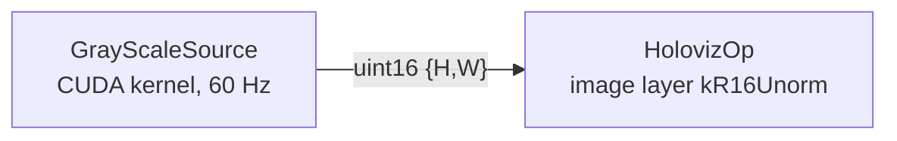

# 16-bit grayscale image (`gray_scale_example`)

Shows HolovizOp consuming a single-channel 16-bit image natively: a CUDA kernel writes a
`uint16` `{height, width}` tensor and the image layer, declared as `kR16Unorm`, uploads it as an
`R16_UNORM` texture and replicates the channel to gray. The source, the transport and the upload
keep the 16-bit samples; nothing in the graph converts them to 8-bit RGBA before sampling. The
window itself presents through the default `kB8G8R8A8Unorm` swapchain, so the final displayed
color is quantized to 8 bits per channel. This example demonstrates native 16-bit input, not
high-bit-depth output.



- `GrayScaleSource` (`cpp/gray_scale_source.*`) renders a diagonal ramp spanning the full
  0..65535 range plus a sweeping white bar into a runtime-owned tensor pool. Adjacent pixels differ
  by far less than one 8-bit step. The example preserves those 16-bit values through upload and
  sampling; the BGRA8 window target quantizes the final displayed color, so the on-screen ramp
  checks that the samples are interpreted and normalized as 16-bit, not that 16 bits are displayed.
  The automated evidence for that interpretation is the R16 backend readback test (its `0x00FF`
  column) and the HolovizOp admission test (`holoviz_test_holoviz_op_image_admission`).
- `HolovizOp` declares one image layer with `ImageFormat::kR16Unorm`. The operator checks each
  sample's dtype and channel count against the declared format and drops mismatching frames with
  an error log instead of rendering them garbled.

Accepted tensors for a `kR16Unorm` layer: `uint16 {H, W}`, `uint16 {H, W, 1}`, or a packed byte
view `uint8 {H, W, 2}`. Row pitch comes from `Tensor::strides()[0]` (bytes). Values map linearly,
0 to black and 65535 to white; window/level scaling is not applied.

## Build and run

The example is built with the visualization module when `HOLOSCAN_BUILD_EXAMPLES` is on (in the
SDK build that also requires `HOLOSCAN_BUILD_VISUALIZATION`). From the repository root, inside the
build container:

```sh
./public/run launch . --run-cmd "cmake --build build-x86_64 --target gray_scale_example -j"
./public/run launch . --run-cmd "./build-x86_64/modules/visualization/examples/operators/gray_scale_example/cpp/gray_scale_example --seconds 20"
```

Options:

- `--seconds N` stop after N seconds (default 0: run until Ctrl-C). N must be a nonnegative
  integer; anything else (`abc`, `5junk`, `-1`, out-of-range) is rejected before the graph starts.
- `--device D` CUDA device ordinal for the tensor pool (default 0); same validation as `N`.
- `--fps N` source and display rate in Hz (default 60, accepted range 1..1000). For a visible
  G-Sync/VRR effect pick a rate inside the panel's variable-refresh range and below its maximum,
  e.g. `--fps 90` on a 60..144 Hz panel (G-Sync still engages at the 60 Hz floor, but the panel
  has nothing to follow).
- `--fullscreen [MONITOR]` present in an undecorated fullscreen window on the named monitor
  (window-system name, e.g. `DP-2`; default: the primary monitor). ESC closes it, and the sink
  pins plain FIFO presentation (the default auto mode picks FIFO_LATEST_READY, which the NVIDIA
  overlay labels "VSYNC OFF"). With a MONITOR the example exports
  `__GL_SYNC_DISPLAY_DEVICE=MONITOR` before the graph runs unless it is already set, so the
  NVIDIA X11 driver paces presents on that monitor rather than the primary output. See
  "Fullscreen windows and G-Sync/VRR" in the
  [module README](../../../README.md) for the conditions under which the window runs at variable
  refresh.
- `--hz HZ` video-mode refresh rate to request with `--fullscreen` (default: keep the current);
  same validation as `N`.

The rendering run needs a display and therefore has no CTest entry; the
`EXAMPLE_GRAY_SCALE_ARGS.*` CTest entries only check that malformed arguments are rejected.
Expected final output line:

```text
gray_scale_example complete
```

Standalone build against an installed SDK:

```sh
cmake -S cpp -B build && cmake --build build
```
