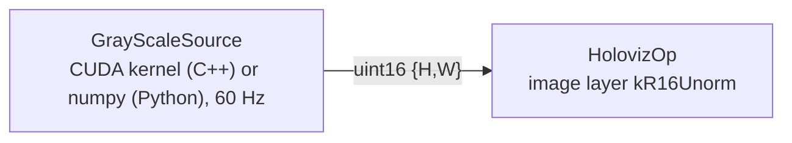

# 16-bit grayscale image (`gray_scale_example`)

Shows HolovizOp consuming a single-channel 16-bit image natively: a CUDA kernel (C++) or numpy on
the host (Python) writes a `uint16` `{height, width}` tensor and the image layer, declared as
`kR16Unorm` (`r16_unorm` in Python), uploads it as an
`R16_UNORM` texture and replicates the channel to gray. The source, the transport and the upload
keep the 16-bit samples; nothing in the graph converts them to 8-bit RGBA before sampling. The
window itself presents through the default `kB8G8R8A8Unorm` swapchain, so the final displayed
color is quantized to 8 bits per channel. This example demonstrates native 16-bit input, not
high-bit-depth output.



- `GrayScaleSource` (`cpp/gray_scale_source.*`) renders a diagonal ramp spanning the full
  0..65535 range plus a sweeping white bar into a runtime-owned tensor pool. Adjacent pixels differ
  by far less than one 8-bit step. The example preserves those 16-bit values through upload and
  sampling; the BGRA8 window target quantizes the final displayed color, so the on-screen ramp
  checks that the samples are interpreted and normalized as 16-bit, not that 16 bits are displayed.
  The automated evidence for that interpretation is the R16 backend readback test (its `0x00FF`
  column) and the HolovizOp admission test (`holoviz_test_holoviz_op_image_admission`).
- `HolovizOp` declares one image layer with `ImageFormat::kR16Unorm`. The operator checks each
  sample's dtype and channel count against the declared format and drops mismatching frames with
  an error log instead of rendering them garbled.
- `python/gray_scale_example.py` is the Python port: the same ramp and bar are rendered with numpy
  into a host `uint16 {H, W}` tensor and emitted as a MONO16 `holoscan.schema.Image`, which
  HolovizOp uploads (host rows are packed before upload). The operator is authored through the
  typed declarations of `holoscan_visualization.operators` (`ImageLayer`, `ImageFormat`,
  `WindowSink`, `ExclusiveDisplaySink`, `PresentMode`, `LayerTrigger`), so the example doubles
  as the runnable reference for that API.

Accepted tensors for a `kR16Unorm` layer: `uint16 {H, W}`, `uint16 {H, W, 1}`, or a packed byte
view `uint8 {H, W, 2}`. Row pitch comes from `Tensor::strides()[0]` (bytes). Values map linearly,
0 to black and 65535 to white; window/level scaling is not applied.

## Build and run

### C++

The example is built with the visualization module when `HOLOSCAN_BUILD_EXAMPLES` is on (in the
SDK build that also requires `HOLOSCAN_BUILD_VISUALIZATION`). From the repository root, inside the
build container:

```sh
./public/run launch . --run-cmd "cmake --build build-x86_64 --target gray_scale_example -j"
./public/run launch . --run-cmd "./build-x86_64/modules/visualization/examples/operators/gray_scale_example/cpp/gray_scale_example --seconds 20"
# Direct scanout to a display no compositor owns (DRM name from holoviz_direct_display --list)
./public/run launch . --run-cmd "./build-x86_64/modules/visualization/examples/operators/gray_scale_example/cpp/gray_scale_example --display DP-3 --seconds 20"
```

### Python

The Python port needs the SDK build with `HOLOSCAN_BUILD_PYTHON=ON`, which places the `holoscan`
and `holoscan_visualization` packages under `build-x86_64/python/lib`. It takes the same options as
the C++ binary except `--device`: its frames live in a host tensor pool, so there is no CUDA pool to
place. Exit codes match the C++ binary: a completed `--seconds` run exits 0, while Ctrl-C (or
SIGTERM) stops the graph cooperatively and exits nonzero.

Run from the SDK root without a positional directory: `./run launch` then uses the default
architecture build directory (`build-x86_64` on x86) as the working directory and puts its
`python/lib` on `PYTHONPATH`, so the script imports the freshly built packages rather than an
installed wheel. The script path is relative to that build directory. Check the import first:

```sh
./run launch --run-cmd "python3 ../modules/visualization/examples/operators/gray_scale_example/python/gray_scale_example.py --help"
./run launch --run-cmd "python3 ../modules/visualization/examples/operators/gray_scale_example/python/gray_scale_example.py --seconds 20"
./run launch --run-cmd "python3 ../modules/visualization/examples/operators/gray_scale_example/python/gray_scale_example.py --display DP-3 --seconds 20"
```

Outside `./run launch`, set `PYTHONPATH=<build>/python/lib` (or the installed Python package
directory) yourself. In the installed tree the script lives at
`<libdir>/holoscan/examples/holoviz/operators/gray_scale_example/python/gray_scale_example.py`.

### Options

- `--seconds N` render N × `--fps` frames, then complete: the source declares
  `complete_after(ComputeCalls{N * fps})` (`complete_after(N * fps)` in Python), HolovizOp
  drains, and the process exits 0. The default 0 runs until Ctrl-C, which stops the graph
  cooperatively with a nonzero exit code. N must be a nonnegative integer; anything else (`abc`,
  `5junk`, `-1`, out-of-range) is rejected before the graph starts.
- `--device D` (C++ only) CUDA device ordinal for the tensor pool (default 0); same validation as
  `N`. On a multi-GPU host this must be the GPU driving the selected window or display: HolovizOp
  creates its device from the presentable adapter, and a mismatched activation stream fails the
  first `compute()` with a cross-device `kIncompatible` error.
- `--fps N` source frame rate in Hz (default 60, accepted range 1..1000); HolovizOp presents each
  frame as it arrives, so this is also the display rate. For a visible
  G-Sync/VRR effect pick a rate inside the panel's variable-refresh range and below its maximum,
  e.g. `--fps 90` on a 60..144 Hz panel (G-Sync still engages at the 60 Hz floor, but the panel
  has nothing to follow).
- `--fullscreen [MONITOR]` present in an undecorated fullscreen window on the named monitor
  (window-system name, e.g. `DP-2`; default: the primary monitor). ESC closes it, and the sink
  pins plain FIFO presentation (the default auto mode picks FIFO_LATEST_READY, which the NVIDIA
  overlay labels "VSYNC OFF"). With a MONITOR the example exports
  `__GL_SYNC_DISPLAY_DEVICE=MONITOR` before the graph runs unless it is already set, so the
  NVIDIA X11 driver paces presents on that monitor rather than the primary output. See
  "Fullscreen windows and G-Sync/VRR" in the
  [module README](../../../README.md) for the conditions under which the window runs at variable
  refresh. Mutually exclusive with `--display`.
- `--display [NAME]` present directly to a display no compositor owns
  (`ExclusiveDisplaySinkDesc`: no window system in the path, lowest latency). `NAME` is a
  case-sensitive substring of the DRM connector name (`DP-2`, `HDMI-A-1`); omit it to take the
  first free display. DRM names differ from the X11/RandR monitor names `--fullscreen` uses;
  `holoviz_direct_display --list` prints them with each display's ownership. Linux only, and
  no display server may own the GPU: stop the display manager (`sudo systemctl stop gdm`) and run
  from a TTY. The process needs `/dev/dri` access (`video`/`render` groups; `./run launch` adds
  both). See "Exclusive display (direct-to-display, DRM)" in the
  [module README](../../../README.md) and the
  [direct_display README](../../core/direct_display/README.md).
- `--hz HZ` video-mode refresh rate to request with `--fullscreen` or `--display`; same
  validation as `N`. The two modes default differently when it is omitted: a fullscreen window
  keeps the monitor's current mode, while exclusive display selects the display's largest
  resolution and its fastest refresh at that resolution (a modeset may occur even without
  `--hz`).

The rendering run needs a display and therefore has no CTest entry; the
`EXAMPLE_GRAY_SCALE_ARGS.*` (C++) and `EXAMPLE_GRAY_SCALE_PYTHON_ARGS.*` (Python) CTest entries
only check that malformed arguments are rejected with the same diagnostics. Expected final output
line of either variant:

```text
gray_scale_example complete
```

Standalone build of the C++ variant against an installed SDK:

```sh
cmake -S cpp -B build && cmake --build build
```
