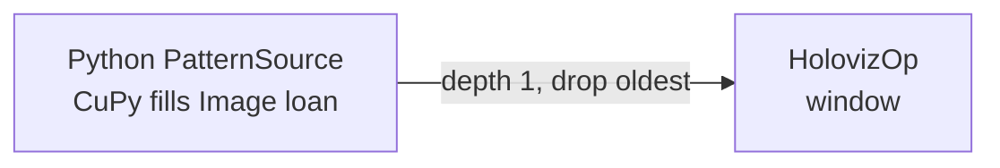

# CuPy Image pattern

This native Python example fills a canonical `holoscan.schema.Image` pool loan
with an animated CuPy RGBA8 pattern and publishes it to `HolovizOp`.



`PatternSource` declares bounded CUDA runtime-pool storage for `Image.data`.
It constructs Image metadata, requests a contiguous `uint8[height,width,4]`
Tensor loan, and fills a scoped CuPy view of that loan. `UnownedMemory` retains
the writable Tensor as its owner; CuPy neither owns nor frees the provider buffer.
The example checks shape, byte extent, dtype, contiguity and logical device
before borrowing the pointer. The view stays inside the write guard.

One `context.stream()` handle covers coordinate generation, pixel writes and
loan commit. Guard exit records readiness and publishes the provider-backed
Image. The example needs no full-frame foreign allocation, explicit image copy
or source-retention queue; intermediate CuPy operations may still allocate.
This is not a general zero-copy or performance guarantee. Direct write-phase
DLPack export is separate SDK work; this example uses the validated scoped view.

An `OnClock` contract paces updates. If all pool buffers are held, the source
skips that allocation attempt and retries the same frame on the next tick.
The display edge drops older queued frames when rendering falls behind.
`--seconds` is the session wait duration. A successful CLI run establishes that
the session survived that interval and stopped without final diagnostics;
it does not measure post-emission duration or prove displayed pixels.
The non-installed lifecycle driver and CUDA tests establish those separate
production and image-value properties.

## Run from an SDK build

From the SDK source root, with the built Python modules on `PYTHONPATH`:

```sh
python3 modules/visualization/examples/operators/holoviz_cupy_pattern/python/holoviz_cupy_pattern.py \
  --seconds 5 --fps 30 --width 640 --height 480
```

Use Python 3.12+, the SDK Core/Sensor I/O/Visualization Python packages, CuPy for
the installed CUDA toolkit, a working CUDA/Vulkan device, and an accessible
window display. The example requires **one visible CUDA device** because the
Python Holoviz constructor has no adapter-ordinal option. Expose one physical
GPU consistently to CUDA and Vulkan, for example by selecting its UUID in the
SDK container launcher. Merely changing the CuPy current device does not select
the Holoviz adapter. Multi-GPU renderer selection is outside this example.

Options are checked before loading CuPy or constructing a graph. Durations and
rate must be finite and positive; rate is at most 1000 Hz, and each image
dimension is between 1 and 8192. The test driver separately accepts a finite,
positive `--startup-timeout` (30 seconds by default).

Exit 77 identifies an absent CuPy dependency, no CUDA device, or diagnostics
proving only that no window-system route is configured. Allocation, admission, renderer, device mismatch,
compile, and lifecycle failures fail the run. Invalid arguments exit 2.
Generic GLFW/window errors and mixed diagnostics fail. After requesting stop, the
tutorial waits up to ten seconds and flushes a timeout diagnostic before cleanup
if the session remains active. A stuck native callback or cleanup can still block
exit, so automation keeps an outer process timeout. Unsupported multiple-visible-GPU use exits 1
with a concise diagnostic.

## Run installed sources

Install the Core runtime and Python packages, Sensor I/O runtime and Python
schemas, Visualization runtime and Python provider, their native dependencies,
and `holoscan-visualization-examples` into one prefix. Then, outside the source
and build trees (Linux layout):

```sh
export PYTHONPATH="$prefix/lib/python3.12/site-packages"
export LD_LIBRARY_PATH="$prefix/lib${LD_LIBRARY_PATH:+:$LD_LIBRARY_PATH}"
python3 "$prefix/lib/holoscan/examples/holoviz/operators/holoviz_cupy_pattern/python/holoviz_cupy_pattern.py" \
  --seconds 5
```

The installed script is self-contained; test modules are not installed.

## Test coverage

From the configured build directory:

```sh
ctest -R '^(EXAMPLE_HOLOVIZ_CUPY_PATTERN[.]|python-visualization[.]cupy_pattern_)' --output-on-failure
```

| Check | What it establishes |
|---|---|
| `python-visualization.cupy_pattern_cpu` | Arguments, strict driver deadlines, final-result precedence, borrowed-loan validation, pool-pressure recovery, device policy, and pytest exit mapping without CuPy |
| `python-visualization.cupy_pattern_cuda` | Identified received-frame RGB against NumPy, metadata/device, delayed-write readiness, pool reuse with retained Images; separately, rendered-value/distinctness checks |
| `python-visualization.cupy_pattern_lifecycle` | The real graph with an observed emission, strict startup deadline, post-emission duration and clean stop |
| `EXAMPLE_HOLOVIZ_CUPY_PATTERN.window` | The shipped CLI running directly with a real window and authoritative final status |

The lossless receive test identifies frames by their publication sequence and
compares all RGB channels to an independent NumPy float64 sinusoid reference.
It permits a one-code-value rounding difference from GPU float32 arithmetic.
Rendered frames have separate semantic/distinctness checks because rendering
and drop-oldest queues need not preserve the received frame indices or exact pixels.
An injected GPU delay leaves writes pending at commit; another CUDA stream reads
them through the Tensor readiness protocol. First-frame descriptors remain held
while later publications demonstrate actual pool-address reuse, then their
contents are checked again within the live session. A separate saturation test
waits for every planned source pool slot to be captured before probing exhaustion,
then releases one Image and requires a new publication and capture for recovery.
CUDA rendering and its output-device binding are configured only in the test module;
the shipped example configures a window.

Tests live under the Visualization module's `python/tests` and are not installed.
CPU tests always remain registered when Python examples/tests are enabled, even
without CuPy. GPU selection exits 77 only when every selected test skipped;
failures, teardown errors, collection errors and empty selections remain failures.
Runner GPU assignment must expose the same single physical GPU to CUDA and Vulkan;
the CTests do not overwrite it with an arbitrary `CUDA_VISIBLE_DEVICES=0`.

The SDK requires `cupy-cuda13x>=14.0.0` and adapts callback streams with
`cupy.cuda.Stream.from_external`. CuPy 14 makes NumPy 2 the effective minimum
for CuPy environments. Qualification covers both the minimum and current CuPy
versions and runs the example from an isolated installed SDK prefix.
