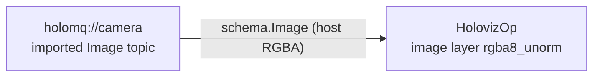

# Image topic display in Python (`holoviz_image_topic`)

Shows the Visualization Python bindings driving a real graph: an imported
`holoscan.schema.Image` topic feeds one HolovizOp image layer in a window, and the whole
application — composition, compilation and the run session — is written in Python. Nothing here
is a C++ operator authored from Python; the graph uses the registered `HolovizOp` row directly.

## What it covers, and what it does not

This is **lifecycle coverage**. A passing run says the graph compiled, the session ran for the
requested duration without terminating, and it stopped cleanly — the whole Python binding path
end to end. A failed start would have ended the session and recorded diagnostics instead, which
is what makes a clean run meaningful.

It proves **nothing about rendering**. Nothing publishes to `holomq://camera` here, so no frame
ever reaches the layer; the example neither inspects presented pixels nor exercises window-event
handling. A clean start and stop says the plumbing is sound, not that anything was drawn
correctly. Attach a peer publishing `schema.Image` frames to see actual output.



- The topic is imported with `hs.payload.resolve("holoscan.schema.Image")`, resolved lazily rather
  than at module import because the registry row arrives with `libholoscan_sensor_io`, and a
  per-field
  contract, `tensor_fields={"data": ...}`, because `Image` is a descriptor-tensor schema: the
  frame's pixel data is one named field rather than the whole payload.
- The frame contract declares host memory. HolovizOp leaves its image ports unconstrained for
  residency, so a host- or device-resident producer is accepted without forcing a copy.
- The trigger is left at its default, which is what a display application wants: activation
  follows frame arrival on layer 0. Nothing here depends on that choice — with no publisher the
  operator starts and stops cleanly under either trigger.
- The layer edge is a depth-1 drop-oldest mailbox, so a stalled display would drop frames instead
  of backpressuring a publisher. That is the shape a real graph wants; with nothing publishing,
  the example does not exercise it.

## Running it

```sh
python3 holoviz_image_topic.py --seconds 5
```

A peer publishing `schema.Image` frames to `holomq://camera` supplies the picture. Without one the
operator still starts and stops cleanly, which is what makes it usable as a lifecycle smoke test —
and also why it cannot vouch for anything being drawn.

The window needs a display. When none is reachable the example prints `no display available;
skipping` and exits 77, which CTest reports as a skipped test rather than a failure.
