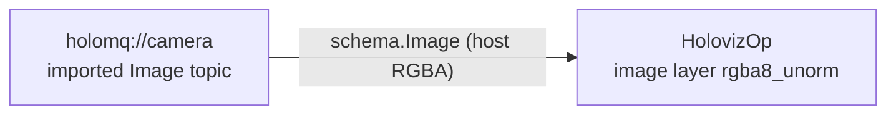

# Image topic display in Python (`holoviz_image_topic`)

Shows the Visualization Python bindings driving a real graph: an imported
`holoscan.schema.Image` topic feeds one HolovizOp image layer in a window. Composition,
compilation and the run session are written in Python, using the registered `HolovizOp` row.
`build_graph()` takes no arguments and contains only the application graph.

## What it covers

A passing run says the graph compiled, the session wait lasted for the requested interval,
and the session stopped without diagnostics. A session wait observes termination; it does
not confirm that all START callbacks completed before the interval. An early terminal result,
final failure, or shutdown timeout fails the smoke.

Nothing publishes to `holomq://camera`, so no frame reaches the layer. This example does not
validate rendering or window-event handling. Attach a peer publishing `schema.Image` frames
to see actual output.



- The topic uses `hs.payload.resolve("holoscan.schema.Image")`, resolved lazily because the
  registry row arrives with `libholoscan_sensor_io`. Its `tensor_fields={"data": ...}` contract
  bounds the pixel-data field of the descriptor-tensor schema.
- The frame contract declares host memory. HolovizOp accepts host- or device-resident inputs.
- The default trigger follows frame arrival on layer 0. With no publisher, no image activation
  occurs.
- The depth-1 drop-oldest mailbox describes how a stalled display would drop frames instead
  of backpressuring a publisher. This idle example does not exercise that policy.

## Running it

From this example's `python/` directory in the source or installed example tree:

```sh
python3 holoviz_image_topic.py --seconds 5
```

`--seconds` defaults to 2 and must be finite and positive. After waiting on the session, the
example requests cooperative stop and waits up to 10 seconds. Native callbacks and session
context-manager cleanup cannot be forcibly interrupted by a Python timeout, so automated
callers need an outer process watchdog. The direct CTest has a 120-second timeout.
CTest serializes the direct tutorial and strict driver because they import the same camera service.

The script exits 77 only when every diagnostic identifies the visualizer's START callback and
retains `NOT_FOUND` with the renderer's explicit `[holoviz] No window system route` cause.
Generic window creation or GLFW initialization failures, inconsistent error codes,
CUDA/renderer failures and mixed diagnostics fail.
A skipped installed run does not qualify successful installed execution.

## Test-owned startup qualification

The non-installed [lifecycle driver](../../../python/tests/holoviz_image_topic_lifecycle.py)
imports this same `build_graph()` and adds a fresh Python observer using the existing default
clock. Its first compute follows the global START barrier. The driver accepts that observation
within its budget, then requires the full requested interval and a clean final `STOPPED` result.
It adds no clock or lifecycle dependency to the tutorial graph. This also provides no rendering
or window-event evidence.

From the SDK source root:

```sh
python3 modules/visualization/python/tests/holoviz_image_topic_lifecycle.py \
  --seconds 1 --startup-timeout 30
```

Both driver durations must be finite and positive. The 30-second default is a startup
**observation budget**, not a performance target. Polling waits are at most 50 ms. The driver
reads the event before sampling the monotonic clock and accepts only an observation at or
before the deadline. An event signaled earlier but first observed after the deadline times out.
Terminal results and final diagnostics override the event. Timeout messages are flushed before
cooperative cleanup, which still needs an outer watchdog.

The execution routes have separate responsibilities:

| Route | Evidence |
|---|---|
| `EXAMPLE_HOLOVIZ_IMAGE_TOPIC.starts_and_stops_cleanly` | Direct shipped-script session-duration and exit-status smoke |
| `EXAMPLE_HOLOVIZ_IMAGE_TOPIC.confirmed_start_lifecycle` | Actual example graph with test-owned global START observation, then the full interval |
| `python-visualization.holoviz_image_topic` | CPU pytest: argument/decision/classifier cases, real Python/C++ START and callback watchdogs |
| Installed script from a clean prefix outside source/build | Independent tutorial execution with no test helper or test provider |

Both display CTests have a 120-second watchdog and the same narrow exit-77 policy. CPU tests
are not skipped based on hardware. Hung-callback children report callback entry before their
parent arms the hang guard; interpreter/import/compile setup has a separate 30-second budget.
The C++ lifecycle fixture belongs to the non-installed test extension.
