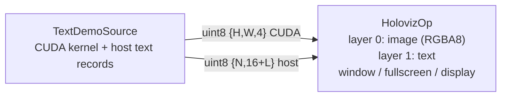

# Text labels over a video layer (`text_layer_example`)

One `HolovizOp` with two layers: a kernel-rendered RGBA image and, composited over it, a text
layer drawing a title, a frame counter, the elapsed time, a legend, and a label that follows the
bright disc orbiting the frame. The result goes to a window, an undecorated fullscreen window, or
directly to a display (`--display`), exactly like `gray_scale_example`.



- `TextDemoSource` (`cpp/text_source.*`) ticks at `--fps` and emits two samples per frame from
  runtime-owned tensor pools: a `{height, width, 4}` `uint8` RGBA image written by a CUDA kernel
  (a drifting colour field with a bright orbiting disc), and a `{6, 56}` `uint8` host tensor of
  **fixed-width text records**, HolovizOp's text wire format. Every row is one positioned run: a
  16-byte `holoscan::visualization::TextRunHeader` (`float32 x, y` with the origin top-left — any
  finite value; runs outside the frame are clipped — `float32 size_px`, `uint32 color` as
  `0xAABBGGRR`) followed by up to 40 bytes of NUL-padded UTF-8. The layer is declared with
  `TextLayerDesc::normalized_coordinates = true`, so `x, y` are fractions of the frame and the
  layout scales with the window; the default unit is framebuffer pixels. The source `memcpy`s the header and `snprintf`s the text; the sixth
  row is left blank to show that HolovizOp skips empty rows. The records are emitted **before**
  the image because the image layer is the trigger and a text layer does not hold its last
  sample: publishing the text first guarantees it is present when the frame is rendered.
- `HolovizOp` declares an image layer (`kR8G8B8A8Unorm`, the trigger) and a text layer whose
  `max_glyphs` is the largest byte count one records sample can carry (`6 * 40`), so a full
  sample is never rejected as over budget. The text is drawn with HoloViz's built-in monospace
  renderer (ASCII 32..127; any other byte renders as `?`). After Runtime admission, malformed
  record content or layout (a row shorter than the 16-byte header, unpacked rows, a non-finite
  position, a non-positive `size_px`, more bytes than `max_glyphs`) is logged and drops only
  this text layer for that activation; the video keeps presenting. A sample with the wrong dtype,
  rank, or memory residency violates the port's Runtime tensor contract instead and terminates
  the session with `kProtocolError`.

Every edge is a depth-1 drop-oldest mailbox, so a stalled window costs at most one stale frame
and never backpressures the source. The CUDA tensor pool (`source/frame`) is placed on
`--device`; the text records live in a host pool and need no placement.

## Build and run

The example is built with the visualization module when `HOLOSCAN_BUILD_EXAMPLES` is on (in the
SDK build that also requires `HOLOSCAN_BUILD_VISUALIZATION`). From the repository root, inside the
build container:

```sh
./public/run launch . --run-cmd "cmake --build build-x86_64 --target text_layer_example -j"
./public/run launch . --run-cmd "./build-x86_64/modules/visualization/examples/operators/text_layer_example/cpp/text_layer_example --seconds 20"
# Direct scanout to a display no compositor owns (DRM name from holoviz_direct_display --list)
./public/run launch . --run-cmd "./build-x86_64/modules/visualization/examples/operators/text_layer_example/cpp/text_layer_example --display DP-3 --seconds 20"
```

Options (identical to `gray_scale_example`):

- `--seconds N` render N × `--fps` frames, then complete: the source declares
  `complete_after(ComputeCalls{N * fps})`, HolovizOp drains, and the process exits 0. The
  default 0 runs until Ctrl-C, which the blocking `holoscan::run()` turns into a cooperative
  stop with a nonzero exit code. N must be a nonnegative integer; anything else (`abc`, `5junk`,
  `-1`, out-of-range) is rejected before the graph starts.
- `--device D` CUDA device ordinal for the image tensor pool (default 0); same validation as `N`.
  On a multi-GPU host this must be the GPU driving the selected window or display: HolovizOp
  creates its device from the presentable adapter, and a mismatched activation stream fails the
  first `compute()` with a cross-device `kIncompatible` error.
- `--fps N` source frame rate in Hz (default 60, accepted range 1..1000); HolovizOp renders one
  frame per arriving image, so this is also the display rate.
- `--fullscreen [MONITOR]` present in an undecorated fullscreen window on the named monitor
  (window-system name, e.g. `DP-2`; default: the primary monitor). ESC closes it, and the sink
  pins plain FIFO presentation. With a MONITOR the example exports
  `__GL_SYNC_DISPLAY_DEVICE=MONITOR` before the graph runs unless it is already set. See
  "Fullscreen windows and G-Sync/VRR" in the [module README](../../../README.md). Mutually
  exclusive with `--display`.
- `--display [NAME]` present directly to a display no compositor owns
  (`ExclusiveDisplaySinkDesc`: no window system in the path, lowest latency). `NAME` is a
  case-sensitive substring of the DRM connector name (`DP-2`, `HDMI-A-1`); omit it to take the
  first free display. Linux only, and no display server may own the GPU: stop the display manager
  (`sudo systemctl stop gdm`) and run from a TTY. The process needs `/dev/dri` access
  (`video`/`render` groups; `./run launch` adds both). See "Exclusive display
  (direct-to-display, DRM)" in the [module README](../../../README.md) and the
  [direct_display README](../../core/direct_display/README.md).
- `--hz HZ` video-mode refresh rate to request with `--fullscreen` or `--display`; same
  validation as `N`. A fullscreen window keeps the monitor's current mode when it is omitted;
  exclusive display selects the display's largest resolution and its fastest refresh.

The rendering run needs a display and therefore has no CTest entry; the
`EXAMPLE_TEXT_LAYER_ARGS.*` CTest entries only check that malformed arguments are rejected. The
text layer itself is covered headless by `holoviz_test_text_input` (record decoding) and
`holoviz_test_backend_text` (glyph rendering), and through the operator by
`holoviz_test_holoviz_op_text_admission` (needs a window system). Expected final output line:

```text
text_layer_example complete
```

Standalone build against an installed SDK:

```sh
cmake -S cpp -B build && cmake --build build
```
